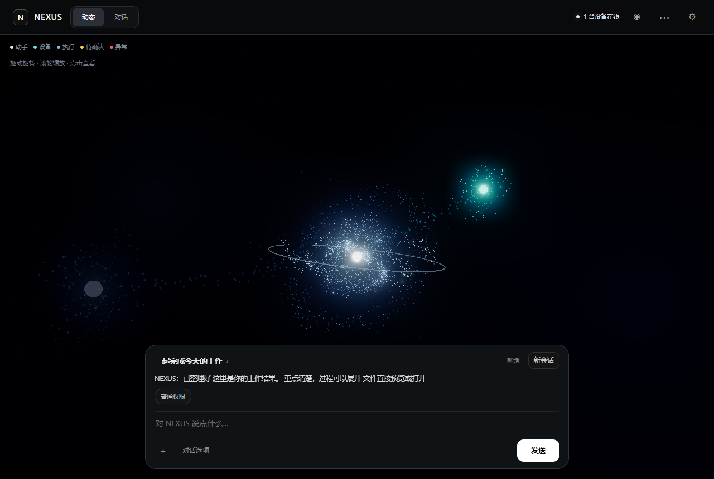
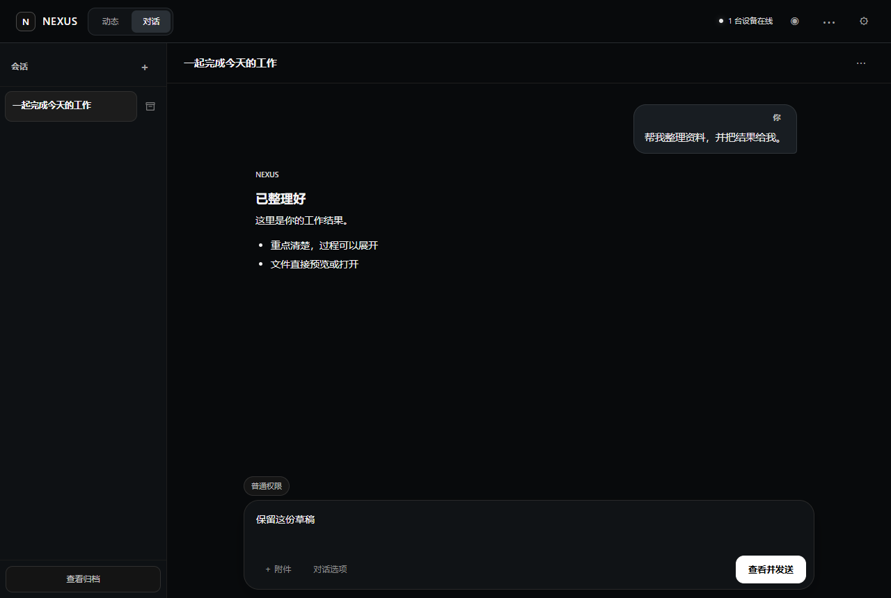

# NEXUS

**一个大脑，多个设备。**

NEXUS 是可自行部署的个人 AI 助手。通过网页、Windows 或 Android 与同一个 Core 对话，让已授权的设备查找资料、处理文件、执行工具，并保存可核对的任务结果。

[开始使用](#开始使用) · [文档](docs/README.md) · [架构](docs/ARCHITECTURE.md) · [路线图](docs/ROADMAP.md) · [参与开发](CONTRIBUTING.md)



*本地合成数据演示，不包含真实会话或设备信息。*

## 可以做什么

- **跨设备对话与执行**：根据任务选择已授权的电脑或手机，查看执行步骤、确认请求和结果。
- **项目与记忆**：围绕项目组织会话与资料，自行选择是否开启自动记忆，并可查看、纠正或撤销。
- **文件与资料**：上传附件、预览结果、搜索网页，以及在设备间传递文件。
- **工具与扩展**：管理插件、Skill 和 MCP 能力；生成插件经过独立测试后，按权限设置启用或升级。
- **持续工作**：安排定时或持续任务，在连接的设备上查看状态与提醒。
- **多种交互**：Windows 实时语音、本地手势与三维动态；游戏模式可暂停耗能功能。

项目持续开发中，各功能的本地验证、部署与设备验收分别记录在 [ROADMAP](docs/ROADMAP.md)。模型、语音和设备操作需要相应配置及授权。

## 界面

“动态”以完整画布展示助手、设备和执行状态，快速对话框悬浮于底部；“对话”提供会话列表、完整消息和文件卡片。权限与插件、手势及游戏模式集中在工具菜单，设置按设备、人格、语音和账户等分组。Android保留四个主导航入口，设备权限和连接详情按需展开。



## 开始使用

Core 与 Python Node 需要 **Python 3.12+**。从仓库根目录建立开发环境：

```powershell
python -m venv .venv
./.venv/Scripts/python.exe -m pip install -r requirements.lock
./.venv/Scripts/python.exe -m pip install --no-deps -e .
```

Linux 使用 `.venv/bin/python`。图片、原生插件和语音所需的额外依赖见 [开发说明](CONTRIBUTING.md#开发环境)。

1. 按 [首次安装](docs/s7-deployment.md#首次安装和本机演示)将示例配置复制到 `var/`，建立独立的 Core、Node 数据目录及访问根。
2. 注册用户与设备身份，分别保存凭证并授权所需工具。示例身份不能代替实际登记。
3. 在两个终端分别启动 Core 和 Node，再打开本机地址 `http://127.0.0.1:8000/` 登录。
4. 先验证设备连接与只读任务，再按 [聊天配置](docs/m3-chat.md)启用模型。模型密钥只提供给 Core。

远程访问使用受信任的 HTTPS/WSS。历史文档中的 `core.example.com` 是脱敏占位符，需要替换为自己的服务地址。

| 客户端或服务 | 构建与配置 |
| --- | --- |
| Core / Python Node | [部署与恢复](docs/s7-deployment.md)、[设备连接](docs/s3-link.md) |
| Web | 随 Core 提供，无独立前端构建步骤 |
| Windows | [Tauri 客户端与随包 Node](apps/windows/README.md) |
| Android | [原生 App、Node 与实时语音](apps/android/README.md) |

## 如何工作

| 组件 | 职责 |
| --- | --- |
| **Core** | 单活的任务、记忆、授权与执行生命周期中心 |
| **Node** | 设备上的独立执行进程，返回持久化回执和结果 |
| **客户端** | 展示状态、收集用户输入和确认，连接同一个 Core |

模型提出建议，确定性规则核对权限和执行结果。Node 能力、用户授权和本机策略共同决定可执行范围；未知结果先对账，避免重复操作。详细边界见 [架构设计](docs/ARCHITECTURE.md)。

## 参与与许可

修改和验证流程见 [CONTRIBUTING.md](CONTRIBUTING.md)，安全问题见 [SECURITY.md](SECURITY.md)。公开源码前的审阅方法见 [发布准备](docs/public-repository.md)。

NEXUS 自有代码采用 [MIT License](LICENSE)。随包库、模型及其他第三方资源保留各自许可，详见 [THIRD_PARTY_NOTICES.md](THIRD_PARTY_NOTICES.md)。
