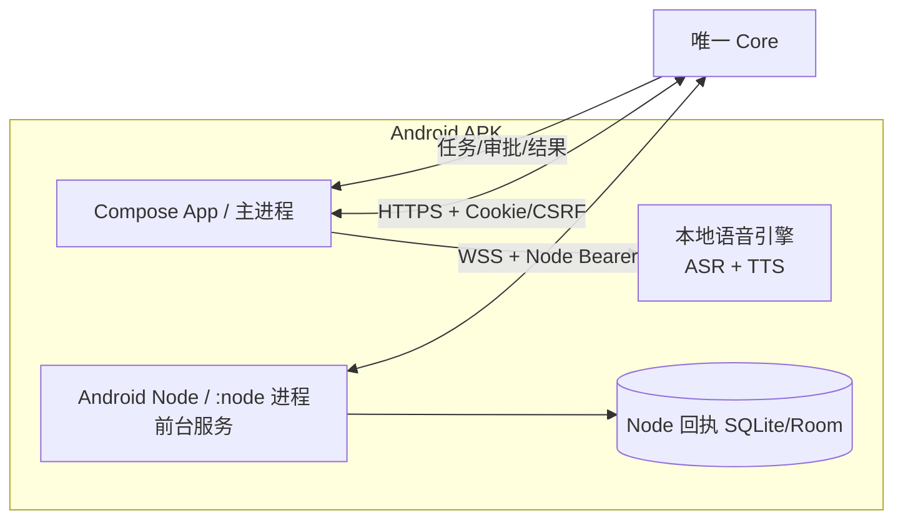

# Android App / Android Node 工程方案（草案）

日期：2026-10-22  
性质：2026-10-22 的设计输入快照。2026-10-23 用户已批准开发并选择 Core 实时语音；当前实施决定见 [ADR 0040](decisions/0040-android-app-node.md)，状态及验收只看 [P80](ROADMAP.md#p80-android)。下列模块拆分、Room、本地 ASR/TTS 和可选项不代表当前实现。  
范围：Android 客户端（M8A）、Android 设备执行端（M8B）、可选语音（M8C）中的首版交汇部分；共享 Core/contracts 变更另列[交接单](ANDROID-CORE-HANDOFF.md)，由 Codex 统一处理。

本文不再维护功能状态；实施与原草案的差异以 ADR 0040 为准。用户验收仍须单独确认。

## 1. 结论

1. **采用 Kotlin + Jetpack Compose 原生 Android 应用**，不套 WebView，不采用 Flutter/KMP，也不引入 LiveKit 房间与 Agent 运行时。
2. **一个 APK 内含两个职责面**：面向用户的 App（主进程）与 Android Node（独立的 `:node` 进程 + 前台服务）。两者共享安装包，但身份、令牌、授权和生命周期分开。
3. **用户登录与设备执行授权分离**：Owner 会话只用于聊天、任务、审批、历史；Node Bearer 令牌只用于 `/ws/v1/node`。App 登录不自动启用手机执行，Core 授权也不因 App 安装而自动扩大。
4. **首版真实手机能力只做三项**：设备状态、受限通知摘要、按住说话/语音播报。语音采用“设备本地识别 → 文本进入现有聊天 → 文本本地播报”，不把原始音频上传 Core，不建立第二套语音规划循环。
5. **核心执行语义全部复用现有 v1 协议**：Node 先落接收回执再执行、结果落盘后再确认、取消真实停止、断线先对账、未知不自动重跑。Kotlin 只重写传输与本地执行，不重写 Core 状态机。
6. **共享后端存在明确缺口**：现有 `NodeScope`、`NodeHello`、工具联合类型、授权表 CHECK、聊天目录和结果校验都只覆盖 workspace/Windows 工具。Android 能力必须先由 Codex 按[交接单](ANDROID-CORE-HANDOFF.md)扩展，Android Node 才能真正注册、获权和执行。

## 2. 现有实现核查

### 2.1 Core 认证

| 现有行为 | 代码位置 | 对 Android 的影响 |
| --- | --- | --- |
| `POST /api/v1/session` 用 Owner 令牌换取 8 小时 HttpOnly/Secure/SameSite=Strict Cookie，并返回 CSRF token | [security/http.py](../src/nexus/core/security/http.py#L69)、[security/service.py](../src/nexus/core/security/service.py#L137) | 原生客户端可以复用 Cookie+CSRF，但不能假装“同源浏览器”；必须显式配置 App Origin，并安全保存 Cookie。 |
| 登录和所有写请求检查 `Origin`；写请求另检查 `X-CSRF-Token` | [security/http.py](../src/nexus/core/security/http.py#L57)、[security/http.py](../src/nexus/core/security/http.py#L89) | Android 的 OkHttp 可设置 `Origin: https://app.nexus.local`，Core 必须把该值加入 `origins`。Origin 不是客户端身份，真正的认证仍是 Cookie。 |
| 浏览器 WS 使用 Cookie + Origin；Node WS 使用 `Authorization: Bearer` | [security/http.py](../src/nexus/core/security/http.py#L110)、[security/http.py](../src/nexus/core/security/http.py#L117) | App 的聊天状态同步可用浏览器 WS；Android Node 必须用独立 Node 令牌，不能借用 Owner Cookie。 |
| 最多 10 个有效 Owner 会话；会话过期/撤销时逐消息检查并关闭连接 | [security/service.py](../src/nexus/core/security/service.py#L146)、[security/http.py](../src/nexus/core/security/http.py#L127) | App 需要处理 401、会话过期、重新登录和“退出不误删草稿”。 |
| Owner/Node 身份只由离线 CLI 登记；没有网络自助注册 | [security/__main__.py](../src/nexus/core/security/__main__.py#L21) | 首版可由管理员导入 Node UUID/令牌；更好的体验需要一次性设备配对接口（见交接单）。 |
| 模型密钥只在 Core 环境变量；App/Node 无模型 Provider | [ARCHITECTURE.md](ARCHITECTURE.md)、[core/config.py](../src/nexus/core/config.py) | App 不保存、不转发任何模型密钥；语音识别在设备本地完成。 |

**结论**：现有 Cookie/CSRF 认证可以支撑 Android 原生客户端，最小改动是 Core 增加 App Origin；不需要为了“原生”就关闭 TLS、伪造浏览器或把 Owner 令牌交给 Node。若要“记住登录/设备配对/会话撤销”，需要交接单中的可选接口。

### 2.2 Node 协议

| 现有约束 | 代码位置 | 缺口 |
| --- | --- | --- |
| `NodeHello.tools` 最多 14 项；`roots` 只允许 `workspace`，最多 1 项 | [contracts/messages.py](../src/nexus/contracts/messages.py#L104) | Android 需要 `android:device`、`android:notifications` 两类资源，且工具数上限需留余量。 |
| `NodeScope` 的 `roots` 是 `Literal["workspace"]` | [security/types.py](../src/nexus/core/security/types.py#L32) | 无法表达手机能力资源。 |
| 有效能力计算把非 `system.info` 工具硬编码为必须有 `(tool, "workspace")` 授权 | [security/service.py](../src/nexus/core/security/service.py#L115) | Android 工具会被直接过滤掉，即使 Core 已登记。 |
| `set_grant` 对 `root_id` 做 `""`/`"workspace"` 二选一校验 | [security/service.py](../src/nexus/core/security/service.py#L186) | 管理员无法给 Android 工具授权。 |
| 数据库 `grants` 表对工具名和 `root_id` 有 CHECK 约束 | [storage/migrations/024_native_plugins.sql](../src/nexus/core/storage/migrations/024_native_plugins.sql#L4) | 新工具/新资源必须版本化迁移，旧行保留。 |
| `CommandExecute` / `CommandResult` 是封闭判别联合 | [contracts/messages.py](../src/nexus/contracts/messages.py#L229)、[contracts/messages.py](../src/nexus/contracts/messages.py#L345) | 需要新增 Android 命令和结果模型。 |
| `validate_result` 按工具名取结果模型并做工具特定断言 | [contracts/tools.py](../src/nexus/contracts/tools.py#L265) | 需要 Android 结果验证器，不能只信任 `success`。 |
| `system.info` 特殊处理无资源；其余工具默认 workspace | [security/service.py](../src/nexus/core/security/service.py#L278) | 需要统一“工具 → 资源”映射，去掉硬编码分支。 |
| 回执、取消、对账、64 次查询预算、未知保留已完整实现 | [node/runtime.py](../src/nexus/node/runtime.py)、[storage/execution.py](../src/nexus/core/storage/execution.py) | Android 端必须逐项复刻，不能简化成“收到就执行、断线就重发”。 |

**结论**：Android Node 不是“再写一个 WebSocket 客户端”那么简单；共享契约和授权范围必须先扩展。协议仍是 v1 的同步扩展，不新建 v2（v2 是 Sandbox 专用）。

### 2.3 App 与构建环境

- 仓库目前没有 `apps/android/`，没有 Android 工程、Gradle wrapper、APK 或签名配置；`apps/windows/` 是 Tauri 外壳，可参考其 Cookie/CSRF、凭据存储和 Node 配置边界，但不能直接复用。
- 本机环境：JDK 21；Android SDK 已有 platform 34/36.1、build-tools 36.1/37；未安装全局 Gradle（应由 wrapper 固定）；`adb devices` 为空，未创建 AVD。
- 因此本轮没有任何 Android 构建或真机证据。后续所有真机项必须单独记录，不能拿模拟器/截图代替。

## 3. 选型与参考项目

### 3.1 方案比较

| 方案 | 优点 | 代价/风险 | 结论 |
| --- | --- | --- | --- |
| **Kotlin + Jetpack Compose** | Android 平台能力最完整：前台服务、NotificationListenerService、AudioRecord/AudioManager、Keystore、Room、权限与生命周期都是一等公民；Compose 适合聊天/任务/审批界面 | 不能与 Windows Tauri UI 共享代码；需要维护第二套 UI | **采用** |
| WebView/Tauri 外壳复用 `/app` | 页面复用高、首版快 | WebView 内无法可靠获得 Node 前台服务、通知监听、麦克风路由；远程页面/本机桥增加攻击面；Cookie/Origin 更绕 | 不采用 |
| Flutter / Kotlin Multiplatform | 可共享部分 UI/逻辑 | 仓库没有 Flutter 基础；NotificationListener、FGS、Keystore、音频仍要写 Android 平台代码；引入第二运行时和工具链 | 不采用 |
| LiveKit Android Agent Starter 作为语音底座 | 实时语音 UI 和 WebRTC 成熟 | 需要 LiveKit Server/Token Server/Agent；会形成第二套会话与规划循环，违背 Core 唯一权威；首版不需要 WebRTC | 只参考音频焦点/权限/路由，不引入运行时 |

### 3.2 参考项目与许可证

许可证按 2026-10-22 核对仓库元数据；引用的是参考快照，不是本项目依赖。

| 项目 | 参考版本 | 许可证 | 可借鉴 | 不照搬 |
| --- | --- | --- | --- | --- |
| [Home Assistant Android](https://github.com/home-assistant/android) | `023390ba`（2026-10-21） | [Apache-2.0](https://github.com/home-assistant/android/blob/main/LICENSE.md) | Kotlin 工程组织、设备/传感器权限、通知监听、前台服务、加密存储、离线恢复思路 | 体量大、仍有 Views/Compose 迁移历史；其 Onboarding/Auth 是 Home Assistant 自己的服务器模型，不适用于 NEXUS Owner 会话 |
| [LiveKit Android Agent Starter](https://github.com/livekit-examples/agent-starter-android) | `21e510c`（2026-08-14） | [MIT](https://github.com/livekit-examples/agent-starter-android/blob/main/LICENSE) | Compose 语音界面、麦克风权限、音频会话/路由处理方式 | LiveKit 房间、Token Server、Agent 运行时；会绕开 Core 的聊天/任务权威 |
| [sherpa-onnx](https://github.com/k2-fsa/sherpa-onnx) | `51ec64f`（2026-10-22） | [Apache-2.0](https://github.com/k2-fsa/sherpa-onnx/blob/master/LICENSE) | Android AAR/JNI 的本地 ASR、VAD、TTS 示例；离线识别 | 不把示例 UI 当作产品架构；模型权重有独立许可证，必须逐个核对 |
| Kotlin / Jetpack Compose / AndroidX / Material3 | 工程初始化时锁定 | Apache-2.0 | 官方原生栈 | — |
| OkHttp / kotlinx.serialization / Room / DataStore | 工程初始化时锁定 | Apache-2.0 | HTTP/WS、严格 JSON、缓存、设置 | — |

**许可证义务**：

- Apache-2.0 组件随 APK 分发时保留 LICENSE/NOTICE，并在 App 内提供“开源许可证”页面。
- MIT 代码如被复制，保留版权与许可声明；仅参考思路不等于复制，但仍应在文档中注明来源。
- **sherpa-onnx 代码是 Apache-2.0，不代表模型也是 Apache-2.0。** 选定的中文/英文模型必须单独核对许可证、商用/再分发条款、体积和准确率；未核对通过不打包。
- 不使用 GPL/AGPL/非商业模型；不把模型密钥、训练数据或第三方私有代码放进 APK。

### 3.3 取舍说明

- **Home Assistant** 证明 Kotlin 能覆盖手机执行端的复杂生命周期，但它的应用是围绕自己的服务器和大量历史页面长出来的，直接 fork 会带来不必要的体量和旧架构。
- **LiveKit Starter** 的语音体验值得借鉴，但 LiveKit 的“客户端加入房间、Agent 在服务端规划”与 NEXUS“Core 唯一规划、App 只是入口”冲突。NEXUS 首版只需要按住说话，不需要实时全双工 WebRTC。
- **sherpa-onnx** 解决“本地、离线、可控”的识别/播报，不解决 UI、认证、任务和 Node 协议；它是语音引擎，不是第二个大脑。

## 4. 目标架构



边界：

- **Core 唯一权威**：目标、任务、审批、权限、费用、长期记忆和执行终态都在 Core。Android Node 只执行已授权的具体命令。
- **App 不等于 Node**：App 登录只代表用户；Node 在线只代表设备。二者可以同时在线，也可以一个在线一个离线。
- **同包不同进程**：Node 放在 `android:process=":node"`，由前台服务持有 WebSocket、回执库和执行槽。App UI 崩溃或界面退出不应直接杀死 Node。
- **同包不同秘密**：Owner 会话与 Node 令牌使用不同 Keystore alias、不同文件/偏好，不互相转换。
- **无第二套状态机**：App 缓存只供展示；不把本地缓存当任务状态，不自行判定成功。
- **无第二套语音循环**：ASR 只产出文本；文本进入现有聊天；TTS 只读现有最终回答。没有语音专用 Agent、语音专用任务中心或语音长期记忆。

## 5. App 工程方案

### 5.1 目录与模块

```text
apps/android/
├─ settings.gradle.kts
├─ build.gradle.kts
├─ gradle/libs.versions.toml
├─ gradle/wrapper/                 # 固定 Gradle 版本
├─ app/                            # Compose UI、导航、ViewModel
├─ core-client/                    # HTTP/WS、认证、DTO、同步
├─ node/                           # :node 进程、前台服务、回执、工具
├─ voice/                          # ASR/TTS 抽象与 sherpa-onnx 适配
├─ contracts/                      # Kotlin 严格 DTO + golden vectors
└─ designsystem/                   # 主题、通用组件
```

- 包名：`ai.nexus.android`；`applicationId` 同包名。
- `minSdk 26`，`compileSdk 36`，`targetSdk 36`；具体 AGP/Kotlin/Compose BOM 在初始化时锁定到 `libs.versions.toml`，不使用 `+`/动态版本。
- JDK 21；Gradle wrapper 固定；构建说明记录 SDK、build-tools、依赖锁和 SHA-256。
- 依赖注入采用**显式 `AppGraph`/构造器注入**，不引入 Hilt/KSP 生成代码；安全敏感的 Node 服务用显式工厂组装，便于审计。若后续页面数量显著增长再评估 Hilt。
- 网络：OkHttp + kotlinx.serialization；WebSocket 用 OkHttp；严格 JSON（未知字段拒绝），不使用宽松反序列化。
- 本地：Room（聊天/任务缓存、Node 回执）、DataStore（无秘密设置）、Android Keystore AES-GCM（会话/令牌）。
- 测试：JUnit + MockWebServer + AndroidX Test；Compose UI 测试；Node 回执与摘要用 golden vectors 对 Python 生成值做跨语言校验。

### 5.2 页面与操作

| 页面 | 首版内容 | 明确不显示/不做 |
| --- | --- | --- |
| 连接与登录 | Core 根地址、TLS 校验结果、Owner 令牌登录、会话到期、退出、记住登录（可选） | 不提供“忽略证书”；不把 Node 令牌当登录 |
| 聊天 | 会话列表、新建/重命名/归档、真实增量、停止生成、工具步骤/结果、附件（按 Core 能力）、语音输入按钮 | 不把模型文字显示成设备成功；不自动重发 |
| 任务与审批 | 任务列表、状态、执行结果、审批、取消、未知/超时、尝试与回执摘要 | 不把“已停止派发”说成“已停止执行” |
| 设备与设置 | 本机 Node 开关、在线/心跳、有效工具、通知监听入口、电池优化提示、停止、撤销设备；Core 版本/会话信息 | 不显示未注册/未授权的能力为可用 |
| 语音 | 按住说话、录音指示、转写编辑、发送、播报开关、停止播报 | 不默认持续录音；不后台唤醒 |
| 关于/隐私 | 版本、构建摘要、开源许可证、隐私说明、清理缓存 | — |

### 5.3 认证流程

首版最小流程（不需要新后端）：

1. 用户在连接页输入 Core HTTPS 根地址和 Owner 令牌。
2. App 发送 `POST /api/v1/session`，带 `Origin: https://app.nexus.local`，获得 Cookie 和 CSRF。
3. Cookie/CSRF 经 Keystore 加密保存；Owner 令牌默认不保存。勾选“记住登录”时才把 Owner 令牌单独加密保存，用于会话过期后重新登录。
4. 所有写请求带 `Origin`、Cookie、`X-CSRF-Token`；GET 只带 Cookie。
5. 浏览器 WS 连接 `/ws/v1/client?node_id=...`，带 Cookie + Origin；首条 `client.sync`。
6. 退出登录调用 `DELETE /api/v1/session`，清除 Cookie/CSRF、停止本机 Node、清空展示缓存；是否撤销设备授权由用户单独选择。

Core 侧需要把 `https://app.nexus.local` 加入 `origins`。这是配置项，不是“放开所有来源”。原生客户端无法被 CORS 保护，Origin 只是 CSRF/来源约束，真正的身份仍是 Owner 会话。

**后续可选**：一次性设备配对/短期 App 会话/会话列表与撤销接口，见[交接单](ANDROID-CORE-HANDOFF.md)。没有这些接口也能做首版，但体验和可撤销性较弱。

### 5.4 数据与缓存

- Room 只缓存展示所需字段：会话摘要、最近轮次、任务摘要、审批、设备状态；设置条数/字节上限，例如会话 200、轮次 5000、任务 2000。
- 缓存不是权威：打开 App 先拉 Core 快照，缓存只用于离线时显示“上次已知”并明确标注时间。
- 草稿、待核对请求单独存储：`request_id`、目标会话/任务、请求摘要、创建时间、状态（`unknown`/`confirmed`/`failed`）。**不自动重发**。
- 退出登录清空聊天/任务缓存和草稿；Node 回执库不随退出登录删除（它是执行对账证据），只有“重置设备/撤销设备”并确认后才清理。
- `android:allowBackup="false"`；不把 Cookie、令牌、聊天缓存交给系统云备份。截图/最近任务预览对登录页、设备页、令牌页使用 `FLAG_SECURE` 或隐藏敏感内容。

### 5.5 打开、恢复与同步顺序

1. 读取本地 Core 地址与加密会话；没有则显示连接页。
2. `GET /api/v1/session` 验证会话；401 时显示过期，不自动用旧请求重试。
3. `GET /api/v1/tasks?limit=...`、会话列表/当前会话历史、`GET /api/v1/nodes`、`GET /api/v1/control` 并行拉取；全部只读。
4. 有活动聊天轮次则轮询轮次详情；有 `unknown`/`recovering` 任务则展示“核对中”，等待 Core 状态，不发起新执行。
5. 有 `awaiting_approval` 任务则拉详情取审批；过期审批显示过期，不自动批准。
6. 建立浏览器 WS 做增量；WS 断开不取消任务，恢复后从持久游标/HTTP 快照继续。
7. 只有用户明确点击“发送/确认/取消/重试”才产生写请求。

## 6. Android Node 设计

### 6.1 进程与生命周期

- `NodeService` 运行在 `:node` 进程，`startForeground`，常驻通知；App 通过 AIDL/Messenger 绑定查询状态、启停、配置。
- 服务内部拥有：`NodeLink`（OkHttp WebSocket）、`ReceiptStore`（Room/SQLite）、`CapabilityRegistry`、`ExecutionGate`、`DeviceStatusTool`、`NotificationDigestTool`。
- 单执行槽：同一 Node 同时只执行一个 attempt；其余命令返回 `BUSY` 或等待 Core 下一次派发。
- 用户开关“允许此手机执行任务”是本地总闸；关闭时断开 WS、停止前台服务、取消活动执行（尽力）并保留回执。
- 关闭 App 界面不等于关闭 Node；停止 Node 也不等于取消 Core 任务，界面必须区分。

### 6.2 身份与配对

首版两种方式：

1. **手工导入（无新后端，先可用）**：管理员在 Core 离线登记 Node UUID + 令牌，并分别给 owner 与 node 授权；App 输入/扫码导入 Node UUID、令牌、Core WSS 地址。令牌只进 Keystore。
2. **一次性配对（推荐，需 Codex 后端）**：已登录 Owner 在 App 内点“添加此手机”，Core 生成短时一次性配对码；Node 用配对码换取自己的 Node 身份/令牌。配对只建立设备身份，不自动授予任何工具；owner 仍需显式授权。

无论哪种方式：

- `node_id` 由设备生成或 Core 生成，必须稳定；`boot_id` 每次进程启动重新生成。
- Node 令牌与 Owner 会话分开存储、分开发送；Node WS 只带 Bearer，不带 Cookie。
- 设备撤销/令牌轮换后，WS 以 1008 关闭；Node 停止重连并显示“设备授权已撤销”，不能无限重试。

### 6.3 能力声明

`node.hello` 只广告**当前本地真实可用**的能力：

- 设备状态：始终可用（仅普通权限）。
- 通知摘要：仅当用户在系统设置中授予 NotificationListener 且本地开关开启时广告；撤销后立即停止该工具并重连更新能力。
- 语音：不作为 Node 远程工具；由 App UI 本地使用。若未来增加“远程播报”，单独列为 mutating 工具。

能力声明不是授权：Core 仍取“Core 登记 ∩ owner 授权 ∩ node 身份授权 ∩ 本地开关 ∩ 系统权限”的交集。App 设备页显示的是这个交集，不能把“手机支持”显示成“已允许”。

### 6.4 执行门

执行 `command.execute` 前依次检查：

1. 当前 WS 会话匹配、`session_id` 正确、命令未过期。
2. `command_digest` 与 Kotlin 规范化摘要一致；同一 `attempt_id` 的 `task/action/digest` 不一致返回 `IDEMPOTENCY_CONFLICT`。
3. 本地总闸开启；工具在本地注册表；系统权限仍存在。
4. 本地策略允许该工具/资源；通知工具还要检查 allowlist 非空。
5. 先持久化 `received` 回执，再发 `command.accepted`；启动真实执行前写 `started`，再发 `command.started`。
6. 执行有硬超时（Core 给的单次 ≤10 秒与本地配置取小）；取消信号必须取消真实协程/系统调用，不能只取消等待。
7. 完成后先持久化有限结果，再发 `command.result`；收到 `result.ack` 后才标记 acknowledged。
8. 结果未知时保留 `unknown`；只有能证明执行已停止（进程已死/协程已取消/工具无副作用且已结束）才带 `execution_stopped=true`。Core 决定是否重试，Node 不自行重跑。

### 6.5 回执与对账

- Room/SQLite 表镜像现有 Node schema：`execution_receipts`、`cancellation_tombstones`、`node_identity`、`schema_migrations`；`synchronous=FULL`，单事务写入，最多 10000 条。
- 启动时：新 `boot_id`；把所有 `started` 且未完成/未证明停止的旧回执标为 `unknown`。由于 Android 工具都是进程内、短时、只读，进程死亡可证明执行已停止；但仍不能证明结果未产生，所以保留 unknown、不重跑。
- 重连：`node.hello` → 等 `node.welcome` → 按 Core 的 `command.status` 回答；同时重传未 ack 的 completed/cancelled/有停止证据的 unknown 回执，每条每连接最多 3 次。
- 收到 `command.cancel`：先写墓碑、阻止尚未开始的 attempt；若正在执行，取消协程/系统调用并等待真实结束；已完成则回原结果；无法确认停止则报 unknown，不谎称 cancelled。
- 所有主动查询受 Core 的 64 次预算约束；Node 不因重连重置预算。

### 6.6 后台执行与系统限制

- 显式开关“允许后台执行”；开启时启动前台服务，常驻通知内容不包含聊天/通知正文，只显示“NEXUS 设备执行已开启”和“停止”。
- 首版按侧载 APK 设计，前台服务类型候选为 `specialUse`（device control channel）或 `connectedDevice`（与外部 Core 保持连接）。最终类型在真机与分发方式确认后锁定；如果上架 Play，必须改用符合政策的类型并重新审核，不能用 `specialUse` 规避。
- 系统限制必须写进 App 说明：Android 12+ 后台启动前台服务受限；Android 13+ 通知权限被拒时无法保证可见通知；Android 14+ 前台服务类型必须匹配；Android 15+ 对部分类型有时长配额；Doze、厂商省电、强制停止都会中断。Core 看到离线只改变观测，不把任务判失败。
- 不申请电池优化白名单；只提供系统设置入口和解释。不声明“永久在线”。
- **不支持后台麦克风监听/唤醒词**。若未来增加，必须单独开关、`microphone` 前台服务类型、可见录音通知、单次最长时限和自动停止，并重新评审隐私。

## 7. 首批能力清单

### 7.1 首批实现

| 能力 | 行为 | 权限 | 限制 | 验证方式 |
| --- | --- | --- | --- | --- |
| `android.device_status@1` | 返回电量/充电、网络类型、屏幕交互/锁屏、存储空间、Android API、App 版本 | 无危险权限；网络类型需 `ACCESS_NETWORK_STATE`（normal） | 按需调用，不周期采样；不读 IMEI/序列号/MAC/SSID/已安装应用；结果 ≤8 KiB；不提供位置 | 真机对照系统设置/`dumpsys battery/connectivity/power`；充电、飞行模式、Wi-Fi/蜂窝、锁屏/解锁各一次 |
| `android.notification_digest@1` | 返回用户 allowlist 内、当前仍存在的通知摘要（应用包名/可选标签、标题、有限正文、时间、ongoing） | `BIND_NOTIFICATION_LISTENER_SERVICE`（用户在系统设置授权，非运行时弹窗） | 默认 allowlist 为空；最多 20 条；标题/正文有长度上限；只读授权后新通知，不读历史；不读 media/action/RemoteViews；OTP/敏感模式默认脱敏；不做通知回复 | 用测试通知覆盖 allowlist 内外、清除、撤销监听、重启、锁屏；确认 OTP 不出现在结果/日志；`adb shell cmd notification post` + 真机手动 |
| 语音输入（App 本地） | 按住说话 → 本地 ASR → 可编辑转写 → 作为普通聊天文本发送 | `RECORD_AUDIO`（运行时）；可选 `MODIFY_AUDIO_SETTINGS`/`BLUETOOTH_CONNECT` 用于路由 | 仅前台按住说话；单次 ≤60 秒；不后台录音、不唤醒词；原始音频默认不保存、不上传；失败不自动重试付费聊天 | 授权/拒绝/运行中撤销；飞行模式本地识别；耳机/蓝牙切换；锁屏；中英文短句；转写编辑后发送 |
| 语音播报（App 本地） | 读取当前最终回答，本地 TTS 播放；可停止播报 | 无危险权限；音频焦点；可选蓝牙路由权限 | 只播报已存在的最终文本；代码块/链接/超长文本做语音友好裁剪；不自动播放历史；停止播报≠停止生成 | 扬声器/有线耳机/蓝牙；静音/勿扰；TTS 引擎缺失/语言包未下载；切后台/锁屏；长文本截断 |
| Node 控制 | 开关、在线/心跳、有效工具、停止、撤销设备 | `POST_NOTIFICATIONS`（API 33+，后台执行必需）、`FOREGROUND_SERVICE`、对应 FGS 类型 | 单执行槽；后台为尽力而为；不保证 OEM 不杀；停止不等于取消 Core 任务 | 杀 UI 进程、锁屏、切网、重启、强制停止、撤销令牌、通知栏停止 |

### 7.2 明确不做（首版）

- 无障碍服务、任意应用点击/输入、屏幕读取、悬浮窗控制。
- 短信、通话记录、联系人、相机、麦克风后台常驻、位置、剪贴板、已安装应用清单。
- 通知回复/操作按钮、媒体控制、通知历史全量读取。
- 远程任意 shell、任意文件访问、安装/卸载应用、修改系统设置。
- 语音唤醒词、持续录音、实时全双工 WebRTC、LiveKit 房间。
- 在 App 内保存或转发模型 API Key。

## 8. 统一语音契约（草案）

### 8.1 原则

1. **文本是权威**：语音只是输入/输出适配层；对话、任务、记忆和费用仍由现有 Core 聊天链路决定。
2. **原始音频默认不出设备**：ASR 本地完成；Core 只收文本和有限元数据。TTS 本地完成；Core 只提供文本/语音友好文本。
3. **不新增规划循环**：没有 `voice.agent`、`voice.task`、`voice.memory`；语音发送仍调用 `POST /api/v1/chat/conversations/{id}/turns`，停止仍调用现有 `/turns/{id}/stop`。
4. **契约版本化**：`schema_version=1`；未知字段/版本拒绝；Kotlin 和 Python 共用 golden vectors。

### 8.2 输入元数据

在现有 `ChatSubmission` 上增加可选字段（`text` 仍是唯一转写权威）：

```json
{
  "request_id": "…",
  "expected_revision": 3,
  "text": "帮我看看手机电量",
  "allow_model": true,
  "allow_tools": true,
  "node_id": "…",
  "voice": {
    "schema_version": 1,
    "mode": "push_to_talk",
    "locale": "zh-CN",
    "engine": "sherpa_onnx",
    "engine_version": "…",
    "duration_ms": 2400,
    "confidence": 0.91,
    "audio_retained_on_device": false
  }
}
```

校验：

- 有 `voice` 时 `text` 必须非空；`text` 就是用户确认后的转写，不能再有第二份 transcript。
- `mode` 首版只允许 `push_to_talk`。
- `duration_ms` 0–60000；`confidence` 0–1 或 null；`audio_retained_on_device` 只描述本地事实。
- Core 不因 `voice` 改变权限、预算、工具或上下文；只记录有限元数据供审计/展示。
- 若 Codex 暂不接收该字段，App 可先只发 `text`，语音仍可用；此时契约的“元数据”部分未接入，不能宣称完整语音契约已交付。

### 8.3 输出文本

Core 在轮次读取模型中可选提供 `speech_text`：

```json
{
  "speech_text": "手机电量 78%，正在充电。",
  "speech_text_truncated": false,
  "speech_locale": "zh-CN"
}
```

- `speech_text` 是 `final_text` 的确定性语音友好投影：去掉 Markdown 标记/代码围栏/链接目标，保留可读句子；最多 2000 字符；不改变 `final_text` 和任务结果。
- 没有 `speech_text` 的旧 Core：App 用同一规则本地投影，并标注“本地裁剪”，不伪造 Core 字段。
- TTS 不播报工具 JSON、原始 base64、路径、令牌、错误堆栈；只播报最终回答/明确的短状态。

### 8.4 流程与停止语义

```text
按住说话 → 本地 VAD/ASR → 可编辑转写 → 用户点发送
  → 现有 ChatSubmission（text + voice metadata）
  → Core 现有聊天/工具/审批/费用链路
  → 最终回答（final_text + 可选 speech_text）
  → 本地 TTS 播放
```

- “停止播报”只停止 AudioTrack/TTS，不取消 Core 生成。
- “停止生成”调用现有 `/turns/{id}/stop`，同时停止播报和录音。
- 录音中切后台/锁屏/来电/耳机拔出：停止录音、丢弃未完成音频、不提交；界面明确说明。
- 不使用语音直接批准工具/审批；审批仍需屏幕上的明确操作（避免误触发）。

## 9. 前后台、锁屏、网络与权限矩阵

| 场景 | 期望行为 | 权威/数据 | 验证 |
| --- | --- | --- | --- |
| App 切后台，聊天生成中 | Core 继续生成；App 停止前台轮询或降频；回来先查轮次，不重新提交 | Core | 真机 Home 键/锁屏 30 秒后返回 |
| 锁屏，Node 关闭 | WS 可能断开；Core 观测离线；任务不因离线判失败；解锁后同步 | Core + Node 回执 | 锁屏 5 分钟，Core 设备页显示离线/恢复 |
| 锁屏，Node 开启 | 前台服务继续；可执行已授权只读工具；通知不含敏感正文 | Node | 锁屏下发设备状态/通知摘要任务；查看通知栏与 Core 结果 |
| Wi-Fi ↔ 蜂窝 | WS 断开重连；hello/welcome；Core 查询活动 attempt；Node 重传未 ack 回执；不重复执行 | Core 状态机 | 切网时执行中任务；核对 attempt 数、结果、unknown |
| 进程被系统回收/强制停止 | 新 boot_id；旧 started 回执标 unknown（进程已死，执行已停止）；不重跑；解锁后显示未知/核对 | Node 回执 + Core | `adb shell am kill`、`am force-stop`、低内存模拟 |
| 麦克风权限运行中被撤销 | 立即停止录音、丢弃缓冲、显示权限说明；不提交转写；不崩溃 | App | `adb shell pm revoke` 后说话 |
| 耳机拔出/蓝牙断开 | 录音中：停止并丢弃；播报中：暂停/停止并提示；不偷偷切回扬声器继续录 | App | 有线/蓝牙各一次 |
| 来电/音频焦点丢失 | 停止录音/暂停播报；恢复后由用户重新开始 | App | 来电/其他媒体播放 |
| 会话过期/401 | 停止写操作，显示登录；保留草稿；不自动重发付费请求 | Core | 等待 8 小时或撤销会话 |
| Node 令牌撤销 | WS 1008；停止重连与服务；显示“设备授权已撤销”；不风暴重试 | Core | 离线撤销令牌后观察 |
| Core 不可达 | 显示离线/上次快照；不排队自动写；用户可手动重试 | App | 飞行模式/改错地址 |

## 10. Core 接口缺口（摘要）

完整字段、代码位置和验收见[给 Codex 的后端交接单](ANDROID-CORE-HANDOFF.md)。

| 优先级 | 缺口 | 影响 | 最小方案 |
| --- | --- | --- | --- |
| P0 | App Origin 未配置 | Android 登录/写请求被 403 | Core `origins` 增加 `https://app.nexus.local`；仍保留 Cookie/CSRF |
| P0 | 工具名/资源类型封闭 | Android 能力无法注册/授权/派发 | 新增 `android.device_status@1`、`android.notification_digest@1` 与 `android:device`/`android:notifications` 资源 |
| P0 | `NodeScope`/授权表只支持 workspace | 能力交集把 Android 工具过滤掉 | 统一“工具→资源”映射；迁移 027 放宽 `grants` CHECK 并保留旧行 |
| P0 | `NodeHello`/`CommandExecute`/`CommandResult` 联合类型 | 无法握手/派发/验证 Android 工具 | 扩展 v1 判别联合；Core 先升级，旧 Windows Node 不受影响 |
| P0 | 结果验证器 | 无法证明 Android 结果结构/范围 | 服务端严格校验电量、网络、通知条数/长度/时间、截断 |
| P1 | 聊天目录/提案/结果投影硬编码 | 模型看不到/不能调用 Android 工具 | 按节点能力生成目录；新增提案类型；结果预览支持 Android 字段 |
| P1 | 无设备配对 | 只能手工 CLI 登记，体验差 | 一次性配对码；只建立身份，不自动授权 |
| P1 | 无待审批列表/元信息接口 | App 冷启动审批不完整、无版本兼容信息 | `GET /api/v1/approvals?status=pending`、`GET /api/v1/meta` |
| P1 | 语音契约未定义 | 只能把语音当纯文本 | 可选 `voice` 元数据 + `speech_text`；不新增语音规划 |
| P2 | 会话/设备管理 | 退出/撤销粒度不足 | 会话列表/撤销、设备列表/撤销接口 |

## 11. 安全与隐私

- **秘密**：Owner 令牌（可选记住）、会话 Cookie/CSRF、Node 令牌分别加密；不写日志、不写 `local.properties`、不进 Git、不打印。APK 构建后检查字符串中无令牌/API Key。
- **TLS**：release 只允许 HTTPS/WSS；使用系统 CA，不关闭证书/主机名校验；不信任任意用户 CA。本地调试才允许 `10.0.2.2`/`127.0.0.1` 的 debug 明文配置。
- **Origin/CSRF**：保持 Core 现有检查；不通过伪造 Origin 或放宽来源接入。原生客户端不是浏览器，但 Origin 仍是服务端约束。
- **Node 权限**：Core/owner/node/本地/系统权限五方交集；模型不能授予权限；本地开关关闭时即使 Core 已授权也不执行。
- **通知隐私**：默认 allowlist 为空；不读历史；默认脱敏 OTP/验证码；不把通知正文放进前台服务通知；结果按原任务保留期保存，退出/重置有明确清理。
- **语音隐私**：默认本地 ASR；原始音频不落盘/不上传；录音指示必须可见；权限撤销立即停止；不后台监听。
- **缓存**：不备份；退出清空展示缓存；Node 回执保留用于对账；日志脱敏；崩溃报告默认关闭（如启用需单独评审）。
- **界面**：工具结果与模型文本分开；`unknown`/`failed`/`cancelled` 不显示成成功；审批显示动作、范围、期限；停止生成/取消任务/停止 Node 三个动作分开展示。

## 12. 构建、交付与验证

### 12.1 固定版本

- 首版 `versionName 0.1.0`、`versionCode 1`。
- 首选 `arm64-v8a` APK（覆盖当前主流真机）；如需要 32 位另出 `armeabi-v7a`，不把 universal 当默认交付。
- release 构建开启 R8/资源压缩；固定依赖版本与 Gradle wrapper；构建环境写入 `apps/android/README.md`。
- 签名：需要用户提供 release keystore，或明确批准生成项目外开发密钥。**没有密钥时只能交付 debug/开发签名 APK，不能称为正式发布包。** 密钥、口令不进仓库。
- 交付物：APK、SHA-256、签名证书摘要、`versionCode/versionName`、构建命令、依赖锁摘要、已知限制。

### 12.2 构建说明（待工程建立后落地）

```powershell
# 需要 JDK 21 与 Android SDK 36
$env:ANDROID_HOME = "$env:LOCALAPPDATA\Android\Sdk"
cd apps/android
./gradlew.bat :app:assembleRelease
```

实际命令、Gradle/AGP/Kotlin 版本和产物路径在工程初始化后按实测填写，不预先编造。

### 12.3 升级保留数据验证

1. 安装 v0.1.0，登录，创建会话/发送一条消息，启用 Node，完成一次设备状态任务，保留一个草稿和一条未确认请求。
2. 记录 `versionCode`、数据库行数、会话 Cookie 是否存在、Node 回执数、待核对请求。
3. `adb install -r v0.1.1.apk`（同签名、versionCode 更高）。
4. 验证：不要求重新登录（未过期时）；聊天历史/草稿/待核对状态保留；Node 身份/令牌/回执保留；Room/回执 schema 迁移成功；没有重复执行或重复扣费。
5. 反向验证：不同签名升级失败并明确提示；卸载会清数据；退出登录清展示缓存但不误删回执。

### 12.4 真机测试记录模板

| 字段 | 内容 |
| --- | --- |
| 设备 | 品牌/型号、Android 版本/API、build fingerprint |
| App | versionName/versionCode、APK SHA-256、签名证书 SHA-256 |
| Core | 地址、版本/commit、部署环境（测试/生产） |
| 用例 | 安装、登录、聊天、任务、审批、Node、设备状态、通知、语音、锁屏、切网、杀进程、权限撤销、耳机、升级 |
| 结果 | 通过/失败/阻塞/未运行；失败附实际错误与日志位置 |
| 证据 | 脱敏截图、logcat、Core 任务/attempt ID；不含令牌、Cookie、通知正文 |

**当前状态**：`adb devices` 为空，未创建 AVD；本轮没有真机证据。模拟器/截图只能标“模拟器”，不能填真机通过。

### 12.5 测试层级

| 层级 | 内容 |
| --- | --- |
| 契约单测 | Kotlin DTO 严格解析、canonical JSON/digest 与 Python golden vectors 一致、未知字段拒绝 |
| 回执单测 | 先接收后执行、重复 attempt、同 ID 不同动作冲突、取消墓碑、重启 unknown、未 ack 重传 |
| Client 单测 | Cookie/CSRF、401、幂等 request_id、只读 GET 重试、POST 不自动重试、同步顺序 |
| 仪器测试 | 权限、前台服务、通知监听、AudioRecord/TTS、进程死亡、Room 迁移 |
| 模拟器 | UI、生命周期、网络切换、锁屏；单独标注 |
| 真机 | 第 12.4 节全部；至少一台目标 Android 版本；OEM 省电单独记录 |
| 集成 | 隔离 Core + 测试 Node；真实 Core 生产只在用户明确批准后只读/低成本验证 |

## 13. 实施阶段（方案确认后）

| 阶段 | 内容 | 退出条件 |
| --- | --- | --- |
| A. 方案确认 | 本文件 + 交接单；确认语音路径、签名、真机与后端归属 | 用户明确批准范围 |
| B. App 基础 | Compose 工程、连接/登录、聊天/任务/审批/历史、Cookie/CSRF、缓存、同步 | 隔离 Core 上登录与聊天闭环；无真机则标未验证 |
| C. Core 交接落地 | Codex 完成 P0 契约/迁移/验证；Core 测试通过并部署到测试环境 | Android 工具可注册、授权、派发、验证 |
| D. Android Node | `:node` 服务、身份、回执、设备状态、通知摘要、取消/对账、后台开关 | 真机（或明确标注的模拟器）完成状态/通知/杀进程/切网 |
| E. 语音 | 本地 ASR/TTS、语音契约、权限/路由/锁屏 | 真机中英文、权限撤销、耳机切换通过 |
| F. 发布 | 固定 APK、签名、构建说明、升级保留数据、真机记录 | 产物与证据齐全；未验证项如实保留 |

B 与 C 可并行，但 D 的真实集成必须等 C；没有 C 时只能做协议 mock 和 UI 演示，不能宣称设备执行可用。

## 14. 主要风险

| 风险 | 影响 | 缓解 |
| --- | --- | --- |
| Kotlin canonical JSON 与 Python 不完全一致 | command_digest 校验失败，Node 无法执行 | 用 Python 生成多组 golden vectors（UUID/时间/Unicode/默认字段/嵌套参数），Kotlin 单测逐字节比对；不使用默认序列化器猜 |
| Core 契约缺口未及时落地 | Android Node 只能 mock，无法交付真实能力 | 交接单先行；B 阶段用 mock，D 阶段以真实 Core 验收；不伪造“可用” |
| 前台服务被 OEM/Doze 杀 | 后台执行不稳定 | 明确“尽力而为”；通知+停止入口；记录目标机型；不承诺永久在线 |
| 通知监听隐私/政策 | 敏感内容泄露或被商店拒绝 | 默认空 allowlist；脱敏；只读；侧载首版；上架前重新评审 |
| sherpa 模型体积/许可证/效果 | APK 过大或不能分发 | 模型准入清单（许可证、体积、中文 WER、CPU/内存）；不通过不打包；可先 system TTS |
| 无真机/无签名密钥 | 无法完成最终交付 | 用户提供设备与密钥，或明确交付“开发签名、真机未验”的固定包 |
| 语音误触发审批 | 高风险操作被误批准 | 语音不直接审批；所有审批仍需屏幕明确操作 |
| 重连重复执行 | 通知重复读取/播报重复 | 复用 attempt_id/回执/取消墓碑；未知不自动重跑；只读工具也遵守 |

## 15. 需要用户确认的事项

建议默认值如下；确认时可直接说“采纳默认值”，只列出需要改的项。

1. **技术路线**：Kotlin + Jetpack Compose 原生，单 APK，Node 独立 `:node` 进程。默认采纳。
2. **语音路径**：首版 sherpa-onnx 本地 ASR + 系统 TTS；原始音频不出设备；不做后台监听/唤醒词。默认采纳。
3. **Core 后端归属**：本线程只做 Android 工程与 Node；共享 Core/contracts 由 Codex 按[交接单](ANDROID-CORE-HANDOFF.md)统一实现；不自行改后端。默认采纳。
4. **设备配对**：首版允许手工导入 Node UUID/令牌；同时把一次性配对列为 P1。若要求“装完即配对”，则必须先等 Codex 完成配对接口。默认先手工、后配对。
5. **通知范围**：只读、默认空 allowlist、OTP 脱敏、最多 20 条；不做通知回复/操作。默认采纳。
6. **后台执行**：默认关闭，用户显式开启；前台服务通知 + 停止入口；不承诺永久在线。默认采纳。
7. **签名与真机**：需要用户提供 release keystore，并连接一台 Android 真机；否则只能交付开发签名 APK，真机项全部保留为未验证。
8. **分发方式**：侧载 APK 还是上架应用商店？这会影响前台服务类型、通知监听政策和签名要求。默认按侧载首版设计。

确认后，下一步是：先建立 `apps/android` 工程与只读 App 骨架，同时把交接单交给 Codex；在 Core 契约落地前，不把 Android Node 标成可用。
