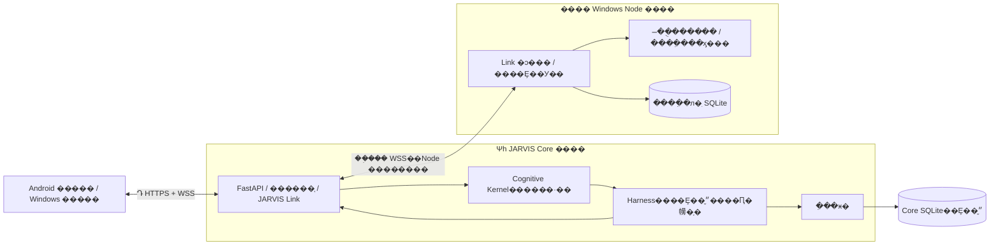
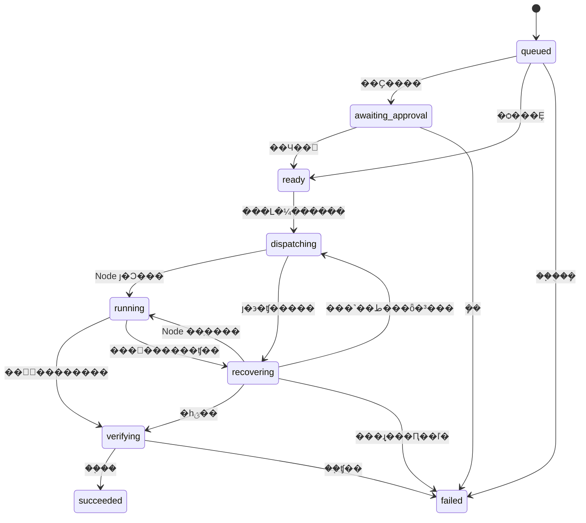
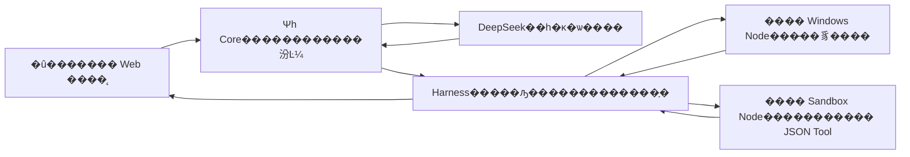

# NEXUS �ܹ����

���ļ�����ϵͳ��ι������Լ�����ʱ���뱣�ֵı߽硣����״̬������汾����׼��Χ��ʣ�๤���� M5/M6 �Ⱥ����ƻ�ͳһ���� [ROADMAP](ROADMAP.md)��ʹ�ú���֤�ĵ��� [�ĵ�����](README.md)���ҡ�����ǰ���������Ķ����ļ���[AGENTS](../AGENTS.md)��·��ͼ��

## ���˽�����

�������ʹ����ڣ�Core ��Ψһ���ķ���Node ���豸ִ�жˡ��û���������Core �������⡢��¼���˶�Ȩ�޺Ͱ���ִ�У�Node ִֻ�л�׼�ľ�����������ؽ����Core ���������չʾ���û���

ģ�Ϳ��԰����������󡢸�������ͽ��ͻ�׼�����������������Ȩ�ޡ���дִ�м�¼���һ�䡰�ɹ��ˡ�����������ɡ������¼��ִ����ʷ���û���ȷͬ�Ᵽ��ij��ڼ���ֱ������

ǰ 1�C13 �ڱ��� M1 ��ִ�л�����ƣ����С���ģ�͡������������̶��������ߡ�ָ M1 ���ߡ��� 14 �ڲ��� M2 ģ�ͽ��룬�� 15 ��˵�� M4 �Զ����������� 16 ��˵�� M3 ���졣M3 �� M4 ֮ǰʵʩ�����������½ڱ���Լ���ԭ���ӡ�

| �Ķ����� | �½� |
| --- | --- |
| ϵͳ�ֹ��빤�߷�Χ | �� 1�C5 �� |
| ���ݡ�������������Ⱥͻָ� | �� 6�C8 �� |
| ��Դ���ޡ��洢������ʹ���λ�� | �� 9�C11 �� |
| M1 ���ų���Χ����ƾ��� | �� 12�C13 �� |
| ��Ȼ����ģ�ͽ��� | [�� 14 ��](#14-m2��ʵģ������Ȼ��������) |
| �Զ��幤�������� | [�� 15 ��](#15-����չtool-��-skill-����) |
| �����빤�߽�� | [�� 16 ��](#16-����������Ự�����νӷ���) |
| ��ҳǰ������� App | [�� 17 ��](#17-web-ǰ����-app-��Ʊ߽�) |
| �����е����޶ಽ���� | [�� 18 ��](#18-m5�����е���������) |
| ��Ŀ�����ġ��ɿؼ������������ | [�� 19 ��](#19-m6��Ŀ���������ܿػ�������) |

## ��������

| ���� | ����Ŀ�е���˼ |
| --- | --- |
| Core | Ψһ���ķ��񣬱�������Ȩ�ޡ����������ִ�м�¼ |
| Node | �豸ִ�жˣ�ִ�о�������������Լ���Ŀ����ڼ��� |
| Cognitive Kernel | �����ѡ��ģ�飺���ù̶����򣬱�Ҫ�һ�׼ʱʹ��ģ�� |
| Harness | ִ�й���ģ�飺��Ȩ�ޡ��������ɷ���ȡ�����ָ���Ԥ��ͽ����� |
| JARVIS Link | Core ���豸/�����֮�����֤ͨ�ţ������������� |
| Tool / Skill | һ��С�����Ĺ��� / ���̶�������Ϲ��ߵĿɸ������� |
| Provider | ��ij��ģ�ͷ���ͨ�ŵ������� |
| Sandbox / runsc | �������ɴ���Ķ������뻷�� / ��ѡ�ĸ�������ʱ���Ƿ������Ч����ʵ�� |
| �־û� | �Ѽ�¼�ɿ����浽���ݿ⣬�������������ܲ�ѯ |
| �ݵ� | ͬһ�������ظ�����ʱ������ͬһ��¼�������ظ�������ִ�� |
| ���� | ���߻�������Ƚ� Core �� Node ��ִ�м�¼�������Ƿ�ִ�м���� |
| attempt / ack / unknown | һ��ִ�г��� / �ѱ�������ȷ�� / ִ�н�����޷�ȷ�� |
| ��Լ / ժҪ / ADR | �ϸ�����ݸ�ʽ / �����ݵ�ָ�� / ������Ҫ���ѡ��ļ�¼ |

�����ֶα���ԭ����������մ��룻�����û���ҳ����˵������ʹ�á����ķ����豸�����̡�ִ�м�¼���˶ԡ������ı�����

## ��ĿԸ��

NEXUS ��������ˡ��������е�ͳһ��֪����������� AI ϵͳ��Ŀ�����𲽾߱����� JARVIS �Ļ�����֪�����ڼ��䡢Ŀ�����������ִ�кͷ�������������

**One Mind, Many Bodies �� һ�����ԣ�������塣** Windows��Android ��δ���豸����ͬһ�� Core �����壬�������γɶ����˸�Ŀ����ϵ������֪�洢���豸�ɽ��й���ִ�С���ʽ�����ͻ�ִ�ָ��ȱ�Ҫ�ı��ش�����

����Ը��ͨ������֤��С��̱��ƽ�����һ�׶β�Ʒ��̱���Ϊ M1��ROADMAP �� S0�CS7 �ǿ����ӽ׶Σ���׼����ij���ӽ׶β�������׼������Ʒ��̱���

## 1. ��������Ʊ߽�

����һ�� Python ���� Core ����һ������ Windows Node ���̡�һ���� Core �йܵľ�̬ Web �ͻ��ˡ�Core �ڲ���ģ�飬ģ���ʹ�ú��������ͽӿڣ��豸֮��ʹ�� JARVIS Link v1��

������������

1. **һ������**��ֻ�� Core ���Դ���Ŀ�ꡢ�ı�����Ȩ��״̬���������Ȩ�޺�д�볤�ڼ��䡣Node ֻ���ܾ�����֤����Ȩ�ľ������
2. **�ͳɱ�����**�������������ѯ�������ͻָ�ʹ�ù̶����򣬲�����ģ�͡�M1 ���ձ�����ģ�ͣ�M2 ��ֻ����ʽ���á�ͬ�ⷶΧ��Ԥ���ڵ��á�
3. **�ɿ�����ִ��**���ȳ־û����ɷ����ɹ���Ҫƥ�䵱ǰִ�г��ԵĹ���֤�ݼ���֤��δִ֪�н��������ʽ�����������ƶϳɳɹ���ֱ�����ԡ�

��һ�׶�ֻ��֤�ɿ�ִ�еĻ�����ʩ����������ʵ��ͨ���������ܡ�

## 2. ��������Ҫ�������ĵط�

| ���� | Ӱ�� | ���������õı߽� |
| --- | --- | --- |
| ͳһ��֪���ױ������һ����ģ�ͻ�һ������ѭ�� | ģ�͹��ϻ���������ϵͳ��Ҳ������ģ��ԽȨ | Core ��״̬��Ȩ�޵�ΨһȨ����ģ���ǿ��滻��������첽 I/O ���ı�Ȩ������ |
| �����߻ָ���û�ж����ظ���δ֪��� | ��ִ�е���ִ��ʧʱ���ط���������ظ����� | �־û�ִ�г��ԡ�Node ��ִ�Ͷ��ˣ�����ŵ�ֲ�ʽ exactly-once |
| ��ֻ����û���޶��ɶ�ȡ������ | �ļ���������������ϵͳ��ϢҲ����й¶��˽ | �����ߡ��ڵ㡢��Դ�������ֶ���Ȩ��MVP ���ṩ�����ļ���ȡ |
| Tailscale ֻ�ܽ�������������� | ����������豸�Բ�Ӧ���ִ��Ȩ�� | Ӧ�ü�ƾ֤����Ϣ��Ȩ��HTTPS/WSS �ͳ��������������ʵ�� |
| ������������Ч��δ���� | �޸IJ�����Ŀ�����ܴ����þ����� | ���������񡢹��߰汾���淶������ժҪ���ڵ�Ͳ��԰汾������������ |
| ���ڼ�����ִ����ʷû������ | ����������Ʋ���ܱ��󵱳��û��Ͽɵ���ʵ | ִ����־����Ȩ����ֿ��洢��������Ҫ��ȷͬ�⣬����¼֤����ʱЧ |
| ������ɹ���ȱ�ٿɲ������� | ���װ�ģ�ͻش��һ�� success ��־������� | �����ض���֤��У��ṹ�����������Լ����֤�ݣ�������֤���� |
| Core Ǩ����ͬʱ�������� Core δ���� | ����Ȩ�������ظ��ɷ����� | MVP ֻ֧��ͣ��Ǩ�ƣ���ֹ�˫����ͬһ����Ŀ¼ʹ�ö�ռ������ |
| ȫ�������ȱ����Դ�͹��ϱ߽� | ���С���־�����Կ����������� | �н���С������С���ơ��������ޡ�ִ�д�����ģ��Ԥ�㣻����д��ʧ��ֹͣ�ɷ� |
| ����ͬʱ�漰��������������ϵͳ | ���˿������������ܽ��� | �����һ����ģ�͡�������ֻ������ʵ�ջ����滮�������������������� |

��Щ�� M1 ������Ƶ�ȡ�ᡣ�����Ѿ�ȷ���� DeepSeek ������� 14 �ڣ������ƶ˲������ 3 �ڣ�Android ԭ�������԰�·��ͼ�����滮��

## 3. ��С����ܹ�



- Windows ���ͬʱ���� Core �� Node���������������������̣��ɷֱ�������
- Harness �� Cognitive Kernel �� Core �ڵ�ģ�飬���Ƕ������
- Node �������� Core������Ҫ�����������˿ڡ����������ֱ�ӿ��� Node��
- Core ���ݿ�ֻ�� Core ���ʡ�Node ��ִֻ��¼�������ݡ��ֲ�ִ�н׶μ����޽���������泤��Ŀ�ꡢ�û������滮��
- ��һ��̶����� Core worker��ÿ�� Node ͬʱִ��һ������Core ��ͬʱ��������������ӡ�
- �������󶨹淶������Ŀ¼����ֹ�������ڶ�ʵ���������ṩ�������ֲ�ʽ������ֹ�������ݿ��ͬʱ�������� Core��
- �����ƶ� Core ʱ��ͣ�� Core��ȡ��һ�±��ݡ�Ǩ�����ݼ��������ã����� Node �޸����ӵ�ַ���ƶ�����Ȩ�����ݣ��������½���һ���˸�
- 2026-10-18 �û���ȷ��׼���� Ubuntu �ƶ˵��� Core�������� IP ֱ�� HTTPS/WSS����ʽ֤����Զ����ڡ�ʵ��Ǩ�Ʊ���ԭ���ݼ�Ȩ����ʷ��Windows ��ֻ���� Node��������ڶ� Core ���¹��ߡ����粻������ Tailscale��CA ֻ����ǩ�������ڣ����߼� [ADR 0008](decisions/0008-self-hosted-core-ip-tls.md)������� ROADMAP �Ͳ���˵����
- ������ Redis��Celery��Kafka���������š��������ݿ���������΢����

FastAPI ֧�� WebSocket ������֤�����ڴ������б�ʾ��Ҳ��ȷ�������ڴ��ĵ����̡�NEXUS ��˽�������ʵ�������ݿ⣬�ڴ�ֻ�������ؽ��������뻽���źš�[FastAPI �ٷ��ĵ�](https://fastapi.tiangolo.com/advanced/websockets/)

## 4. ģ��ְ����ӿ�

������Ŀ��ӿ���ְ��߽磬��ʵ�ֵ� S2 �ӿںͺ�������Ҫ��� [storage-security.md](storage-security.md)������ʹ����ȷ�����ͣ���������Լʹ�� Pydantic ģ�Ͳ��ܾ�δ֪�ֶΡ�

| ģ�� | ���� | ��Ҫ�ӿ� | ������ |
| --- | --- | --- | --- |
| Core Ӧ�ò� | ���ݡ�������ڡ��豸�Ǽǡ���ʷ��ѯ����������� API����װ��ģ�� | `submit(request, principal) -> TaskSnapshot`��`query_tasks(filter, principal)` | ֱ��ִ���豸���� |
| Cognitive Kernel | ����֪��ͼ����ƥ�䣬�����Ƿ���Ҫģ�ͣ������ɽ���·�ɽ��� | `route(intent, context) -> RoutingDecision` | ����������Ȩ�ޡ�д������̬ |
| Harness | �̶��ƻ��������ж���������Ԥ�㡢���ԡ��ɷ�����֤��ȡ�����ָ� | `advance(task_id)`��`decide_approval(...)`��`request_cancel(...)`��`reconcile(node_id)` | �豸�ļ���������ģ���޸�Ȩ�� |
| JARVIS Link | ������֤����Ϣ�������Ự��������������ȷ�Ϻͻָ����� | `dispatch(command)`��`request_attempt_status(...)`��`publish(event)` | �ж�����ɹ���ά������ҵ��״̬ |
| Node Runtime | ע����������鱾�ز��ԡ�ִ�й̶����ߡ����漰�ش���ִ | `execute(AuthorizedCommand) -> ToolResult`��`cancel(attempt_id)`��`status(attempt_id)` | ����û�Ŀ�ꡢѡ�� LLM�������������� |
| Tool Registry | �ṩ��������汾�������ͽ��ģ�͡����ռ����������ʼ���֤�� | `resolve(tool_name, version) -> ToolSpec` | �Զ����ػ�ִ�������� |
| Policy Engine | �����ݡ����ߡ���������Դ���ڵ�����������ܾ�������� | `evaluate(principal, action, context) -> PolicyVerdict` | ��ģ����Ȼ���Ծ���Ȩ�� |
| Storage | ��������״̬�Ƚϸ��¡��¼����������¼��ѯ | `transaction()`��`transition(expected_revision, ...)` | �����ݿ������ڵȴ������ģ�� |

`RoutingDecision` ���ٰ�����`mode`��rule / decision_model / llm / reject����`reason_code`��`policy_version`�����鹤�߼��汾������֤������ʹ��ģ��ʱ���� `model_id` ��Ԥ����ơ�·�ɽ�����뾭�� Harness ����Ȩ��

Ԥ��������ʵ�ʱ߽��ģ�ͽӿڣ�

- `DecisionModel.decide(context, budget) -> DecisionAssessment`�����滻�������ж���������Ƿ���Ҫ���������Ŷȼ���ѡ������M1 ���ṩ��ʵʵ�֡�
- `ModelProvider.estimate(request)` �� `invoke(request, limits) -> ModelResponse`�����γ��̲��죬�������ݡ���������ʱ�����M1 ʹ�ý������������κε��ö����� `MODEL_DISABLED`��M2 ����ʵ Provider ������ 14 �ڡ�

δ��ģ��ѡ��˳���ȼ����Ȩ��Ԥ�㣬��ƥ���������������������ĺ�ѡ�бȽϹ���������ӳ١�û���㹻Ԥ�㡢�۸����޻����ģ��ʱ��ʽֹͣ������������ģ�ͻ����ԡ�ģ���������δ���Ž��飬�������󹤾��б����ļ���Χ��Ԥ�㡣

## 5. MVP �������빤��

��һ��ҳ���ṩ��ȷ������ť������ŵ������Ȼ�������⡣��ť�ύ�ṹ����ͼ���ɹ���·�ɳ�һ���̶����裻δ֪��ͼ���� `UNSUPPORTED_TASK`�����Զ����� LLM��

| ��ͼ | Node ���� | ���� | �������Ȩ |
| --- | --- | --- | --- |
| `get_system_info` | `system.info@1` | �ն��� | ������ϵͳ���ơ��汾���ܹ��� Python �汾�����û����õ�ֻ����Ȩ���� |
| `list_directory` | `filesystem.list@1` | `root_id`��`limit` | ֻ��������Դ����ֱ����Ŀ���״� MVP ÿ��������Ҫ��ȷ���� |

`root_id` �� `workspace` �����ı������� Node ��������ӳ��ΪĿ¼��Core ���������ı�����Node ���� Core ����һ������·���Ϳ��ŷ��ʡ�Ĭ��û���κ��ļ���Դ��Ȩ����������������ȷָ����

Ŀ¼����Լ����

- ֻ����������������ʱУ��ı���Ŀ¼��������������·�������·����UNC ·����ͨ�����
- ���ݹ顢����ȡ�ļ����ġ�����������ķ������ӻ� Windows junction/reparse point�����ø��������Ⱥ��ؽ�����תʱ�ܾ����á�
- ������������Ŀ���ͣ�������Ŀ���Ϊ���Ӳ��Ҳ���ȡĿ�ꡣ�ﵽ�������ֽ�����ʱ���� `truncated: true`�������ƽ��������
- ��й¶����·��������������ƾ֤����������С�ҳ�����ı���ʾ��Ŀ������ֹ�ѹ������ֱ����Ϊ HTML ��Ⱦ��
- Node ����ͨ�û����С�Ӧ��·����鲻���ɵ������Ȿ������Ա�򱾵�·����̬�� OS ɳ�䣻MVP ��ִ�в����ű��ش��룬Ҳ������ͨ���ļ���ȡ��δ�������ļ�����ǰ��������ƾ�������ʱ߽硣

Godot ��Ŀ״̬����ʺ���һ��ֻ�����ߣ��� MVP �Ȳ����ӵ����ֹ��ߡ�

## 6. ���ݡ�Ȩ��������

### 6.1 ���ݺʹ���

- �װ浥�û����ֱ��� owner ���ݺ�ÿ�� Node �Ķ������ݡ��ȶ� `node_id` �����������Ʒ��룬���ƿɳ����Ҳ����໥�����
- ͨ�����ع����������ߵǼǽڵ㣬���ṩ��������ע�ᡣCore ����������Ƶ�ժҪ��Node ͨ�����������򱾵�δ������û���Լ������ơ�
- Node �� WebSocket ����ʹ�� Bearer ��֤��ͬʱ��֤ Core TLS ֤�飻��ֹ�ر�֤��У�顣����������֤���ӣ��������� JSON �Ա��� `node_id`��
- �����ͨ��ͬԴ HTTPS ��¼��ȡ��ʱ�ޡ��ɳ����� HttpOnly / Secure / SameSite �Ự Cookie�������ԭ�� WebSocket ���ṩ���� Authorization ����ͷ�ӿڣ����������� Python Node ������ͬһ�����ַ�ʽ��[MDN WebSocket ������](https://developer.mozilla.org/en-US/docs/Web/API/WebSocket/WebSocket)
- ����������ֺ� HTTP д������������� Origin��HTTP д������У��Ự������ CSRF ���ơ��Ự���ڻ�ƾ֤����ʱ�ر��������ӡ�������Ϣ����ִ����Ȩ��顣
- ���ѳ������Ʒ��� URL��LocalStorage��ʾ�����û���־������� CORS �Զ����� WebSocket��
- Ĭ��ֻ�� localhost���˿���ģʽ���� HTTP/WS��Cookie Secure ֻ�ڸ���ʽ����ģʽ�رա�Android ���������ʽ����Զ��ģʽ���ṩ Android ���ε� HTTPS/WSS ֤�顣��ǰ����� Uvicorn ֱ�Ӽ��أ����ô���ͷ���������ֹ TLS ��Ŀ��ѡ���δ�����ý���ģʽ�����ú� TLS ǰ������Զ�̷��ʡ�
- LAN �� Tailscale ��ֻ������·����Ӧ��Ȩ�޼����ͬ�����Զ��޸ķ���ǽ��֤�����λ�ϵͳ��ȫ���á�

Origin������Ϣ��Ȩ�����ڻỰ�رպ���Ϣ�޶��Dzο� OWASP ������õı߽磻�����ɫ������� NEXUS �����ѡ��[OWASP WebSocket ��ȫָ��](https://cheatsheetseries.owasp.org/cheatsheets/WebSocket_Security_Cheat_Sheet.html)

### 6.2 ��Ȩģ��

��Ч���� = Core ��֪���� �� owner ��Ȩ �� Node �������� �� Node ��ע������ �� Node ����������Χ��

�ڵ�����֧��һ�����ߣ������������Զ���׼ִ�С�����ֻ����׼��������ͨ���˹���Ȩ�IJ��������ܰ�δʵ�ֻ�Ӳ�Խ�ֹ�Ĺ��߱�ɿ��ù��ߡ�

MVP �� `system.info` ��Ϊ�����õ�Ԥ��Ȩֻ���������� `filesystem.list` ��Ϊ��Ҫ������ֻ����������������ʵֻ��������֤�������ƣ�����������Σ�չ��ߡ�

������¼�󶨣�`approval_id`��`task_id`��owner��Ŀ�� `node_id`�����������汾���淶������ SHA-256����Դ/���԰汾�͵���ʱ�䡣������׼ֻ��������������ȫһ�µĶ������������Ԥ���ڵ�ֻ�����ԣ����������õ������񡣲������ڵ����Ա仯�����������������Ҫʱ�������������ɷ�����ԭ�ظ�д������

S2 ��ʵ����������/��Ȩ���������ƾ֤ժҪ��8 Сʱ������Ự����� 10 ����Ч�Ự����ͬԴ�Ự·�ɼ� HTTP/WS ��֤������P06 �� Node Link �ѽ��� `SecurityHTTP.receive_text`��ÿ����������ӵij���/���ڣ����ڷ���ÿ����Ϣǰ�ٴμ�顣��Դ��ΧժҪ�� `NodeScope.resource_version`���־���Ȩ�����ݱ仯����ȫ�ֲ��԰汾��Link ����֤�ڵ㡢���Ź���/��Դ������־���Ȩ����������Χ���Ա���������������Ȩ��loopback WS �� S7 ʵ�ʹ��� HTTPS/WSS��Android ���������֤�ݣ���Χ�� [S7 ��֤](S7-VERIFICATION.md)��

ɾ����Ҫ�ļ������Ͷ�����Ϣ��֧�����޸İ�ȫ����Ŀǰ��û�й���ʵ�֣�ֱ�Ӿܾ����Ժ����ʱ������ͬʱ�߱���ȷ��Ȩ��Ч����֤���ݵ�/���˲��ԣ�����ֻ����һ����ͬ�⡱��ť��

## 7. ����״̬����ִ������

### 7.1 ״̬



ͼ��չʾ�����̡�������������

| ���� | ת�ƻ��� |
| --- | --- |
| ��δ�ɷ��� queued / awaiting_approval / ready �յ�ȡ�� | �������� cancelled����ԭ�ӳ������ɷ���¼ |
| dispatching / running / recovering �յ�ȡ�� | �־û� `cancel_requested`��Ҫ�� Node ֹͣ���ϱ����н�����յ�ȷ��ǰ���ٳ� cancelled |
| Node ȷ����ֹͣ��û������ɽ�� | ���� cancelled����¼ִ�г���ʵ�ʽ����׶� |
| Node ����ɲ��ύ��� | �������֤��ȡ�������¼Ϊ��������ȡ�� |
| ����ѳ־û������� verifying ���յ�ȡ�� | ���� `ALREADY_FINISHED`����ɱ�����֤ |
| �κη���̬���������� | ���� timed_out�����л����ʱ����ֹͣ���󣬲���¼����Ƿ�δ֪ |
| running ������ȷ�IJ������Դ��� | ���� failed�������ṹ������ |
| dispatching ֱ���յ���Ч�����ȷ�ϰ�ȱʧ | ��ֱ�ӽ��� verifying�����ȴ�һ�����ޱ�Ҫ��ȷ�ϰ� |
| ��֤ǰ����������ʱ�Ѵ�����Ч��� | �ָ��� verifying����������ȷ������֤�� |
| ������̬�յ��ٵ���Ϣ | ֻ������ƻ����֤�ݣ���������̬���������³��� |

��̬Ϊ `succeeded / failed / cancelled / timed_out`���������� `execution_outcome = not_started / known / unknown`������ѡ��Ѿ���ʱ�����ɡ��϶�û��ִ�С���δ֪���������� succeeded��

ÿ��ת��ʹ������ `revision` �Ƚϸ��£�����ȡ�����������ʱ����ʱ���า�ǡ�����ƻ��ͽ���ֿ����棻��̬���ɱ� Node ���и��ġ�

### 7.2 ���ԡ��ݵ���ָ�

�������һ�����裬���������������ִ�г��ԣ���Ϊ���� MVP �����������ӹ��������档���Լ�¼���� `attempt_id`��`task_id`��`step_index`��`attempt_no`���ڵ㡢����ժҪ���ɷ��������׶Ρ�����������

1. Core ��ͬһ�����б�������״̬�����ԡ���ƺ��¼��󣬲ŷ���������Ա�������С�־��ɷ����У�������Ϣ�м����
2. Node ��ִ��ǰ�־û��� `attempt_id` �Ľ��ջ�ִ������ժҪ����ȷ�Ͻ��ա���ͬ attempt����ͬ�������ش�״̬�򻺴�����ͬ ID ��ͬ�������� `IDEMPOTENCY_CONFLICT`��
3. Node �������ڱ��ؼ�¼ started �������̶������ӽ��̣�started ��ʵ�ʿ�ʼ֮���Կ��ܷ����������ָ�ʱһ����Ϊδ֪�����ٶ�δִ�С��ӽ����ɸ����̳��м���������������ȷ�Ͼ�ִ���ѽ������޷�ȷ��ʱ���¿����ԡ�
4. Node ��ɺ��ȱ������޽�����ٻش���Core �־û������ظ� `result.ack`������ʱ Node ����������������ش���
5. Core ������ Node �����󣬰���Ծ `attempt_id` ����״̬�����������֤����������ȴ���ȷ�ϴ�δִ�л�ȷ�Ͼ�ִ���Ѿ������ҹ��߿ɰ�ȫ����ʱ����������Ԥ�����½� attempt��
6. ͬһ����������ش�����ԭ attempt���������µ�ִ�г��ԣ������е����ɷ��������ޡ�ֻ�� Core ���Դ����� attempt��
7. MVP ֻ������������ȫ���ܣ������ܱ�֤���ζ�ȡ������ͬ���գ���������۲�ʱ�䡣δ�����и������ҽ��δ֪�Ĺ��߲����Զ����ԣ����������ⲿ�ݵȼ�����ѯ���˹����ˡ�
8. Core ��̬��ȷ�����յ��ٵ�����������ѽ���ȷ�ϲ�����ƣ������������ִ�С�Node ��ִ�� MVP �б��������Զ�����������˵ļ�¼��

����ʵ�ֵ�����ȷ�ϡ���ȥ�غͿɻָ�״̬��Э�飬������������ǡ��ִ��һ�Ρ���WebSocket ��֤�����ڵĴ���˳�򣬲��ṩ��������Ӧ������

### 7.3 �ɹ���֤����ͣ

- Node �� success �ֶν���֤��֮һ��Core У����֤�ڵ㡢task/attempt ���������߰汾������ժҪ�����ģ�͡���С���Ƽ������ض����ԡ�
- `system.info` ��֤�����ֶκ����ͣ�Ŀ¼������֤ root_id һ�¡���Ŀ/�ֽ����ơ���Ŀ�����ݡ��ضϱ�ǵȡ���������ֻ�е�ǰ��Ч����ͨ����֤�� succeeded��
- ��֤������Ϊ `node_report_schema_checked`���ⲻ��֤������ Node ��ʵ��Ҳ����֤������ϵͳ�ײ���ʵ������ʵ����ǿ�Ķ����ⲿ��֤��δ�����幤�����ӡ�
- Node ʹ���ܹ����Ĺ̶������ӽ���ʵʩ��ʱ��ȡ�������ܽ�ȡ���ȴ��߳�ȴ��ʵ�ʹ��߼������С�Windows Ŀ��Ϊ Windows 10/11�����߽������������� KILL_ON_JOB_CLOSE �� Job Object���� Node ��ռ���ɼ̳еĹ������������ɹ�ǰ���ӽ��̲��ý��빤��ִ�С��ɹ�ʧ����ܾ�ִ�С�Node ����ʱ�� OS �������߽��̣�����������ˣ���Ϊ�������̲��ܳ����Ѿ���ɵĶ�ȡ���û��Ʒ�װ�� Node �ڣ����� Core ���� Windows ������[Microsoft Job Objects �ĵ�](https://learn.microsoft.com/en-us/windows/win32/procthread/job-objects)
- ��ֹ shell=True������ű��������ִ��������ڡ�Job Object �����������ڹ������������������Ŵ���İ�ȫɳ�䡣
- ȫ�� `pause` �־û�����������ֹ�µ��ɷ������Ժ�ģ�͵��ã�����ִ�е�ֻ���������ɡ�����ֹͣʹ�ö����� `cancel_all`��������δ������������Ƶ�ȡ����
- ȡ������ͣ���������ɷ�ͨ��ͬһ��״̬�������飻�Ѿ����͵������޷������ݿ����񳷻أ���Ҫ�ڵ�ֹͣЭ�顣����������֡�ֹͣ�ɷ����͡�ȷ��ִֹͣ�С���
- ���ݿⲻ�ܿɿ�д��ʱ��Core ���������������ɷ���Node ����д��ִʱ�ܾ�ִ�С�

## 8. JARVIS Link v1 ��

P02 ��ʵ�ֱ��� 25 ����Ϣ��������Լ���ֶΡ��ϸ�����������ֽ�Լ���� [protocol-v1.md](protocol-v1.md)��P06 ��ʵ����֤���ӡ��������Ự�滻��������P07 �ѽ���־��ɷ���ִ�н��㣻P08 ��ʵ��������ˡ�ȡ����ȫ�ֿ��ƣ��� [S5 �ָ�](s5-recovery.md)��status_result ������ѡ execution_stopped=false��δ֪���������ֹ֤ͣ��ʱ����Ԥ�������ԣ��ϸ� Core/Node Ӧͬ��������

P09 �ѽ���ͬԴ��̬ҳ�桢�Ự�ָ�������� WS ����Ϣ��Ȩ������/��������ͨ��������׷��ͳһ client_events �α꣬��Ч�α��н�طţ���Ч�α���ȡ�� HTTP ���գ������Ӷ����ŶӲ���ʱ�Ͽ�����ʷ�¼�����ǰ���ύ״̬����Ӧ revision����α��ɿ��ա������ [S6](s6-browser-records.md)�� [ADR 0006](decisions/0006-s6-browser-records.md)��

### 8.1 �˵����Ϣ�ŷ�

HTTP��`/api/v1/session` ���ڵ�¼/�˳���`/api/v1/tasks` �� `/api/v1/tasks/{id}` ���ڷ�ҳ��ʷ�����飻`/api/v1/memories` ������ʽ��Ȩ���������HTTP �� WS ����Ӧ�ò���Ȩ��

WebSocket��`/ws/v1/client` �����������`/ws/v1/node` ���� Node�����ӽ�ɫ������������Ϣ����ʹ�ÿ�α��� sender �ֶ���Ȩ��

ͨ���ŷ⣺

```json
{
  "protocol_version": 1,
  "type": "task.submit",
  "message_id": "d641f031-65ec-41f4-9933-297ed3856906",
  "correlation_id": null,
  "sent_at": "2026-10-17T08:00:00Z",
  "payload": {
    "request_id": "5d489189-2958-4fb2-a59d-2cba31974d96",
    "intent": "list_directory",
    "arguments": {"root_id": "workspace", "limit": 100}
  }
}
```

- `message_id` ��ʶһ����Ϣ����Ӧ�� `correlation_id` ָ��������Ϣ��
- `request_id` ��ҵ���ݵȼ���ͬһ owner ������������������Core �� `(owner_id, request_id)` ��ΨһԼ������ͬ���ݷ���ԭ���񣬲�ͬ���ݷ��س�ͻ��
- task_id��attempt_id���������ݼ�״̬�� Core ���ɣ��ͻ��˲���ָ����ԽȨ�޸ġ�
- ����ʱ��Ϊ UTC RFC 3339��ҳ�水�û�����ʱ����ʾ���ͻ��� sent_at ������ϣ�����Ϊ���ݻ���ij�ʱ���ݡ�
- �ŷ�� payload ���ϸ�У�飻�ܾ�δ֪Э�����汾��δ֪��Ϣ���ͼ������ֶΡ������� Python ���������ļ�·����

### 8.2 ��Ϣ����

| ���� | ���� | ��Ҫ���� |
| --- | --- | --- |
| ����� �� Core | `client.sync` | �ϴγ־� `event_id` �� null |
| ����� �� Core | `task.submit` | request_id��intent��arguments |
| ����� �� Core | `task.cancel` | task_id |
| ����� �� Core | `approval.decide` | approval_id��approve/reject���������ɻỰȷ�� |
| ����� �� Core | `control.pause / control.resume / control.cancel_all` | request_id���� owner ���� |
| Core �� ����� | `client.synced` | ͬ���߽��αꡢ�Ƿ���Ҫ������ѯ |
| Core �� ����� | `task.accepted` | task_id����ǰ״̬��ֻ��ŵ��������� |
| Core �� ����� | `task.updated` | event_id��task_id��revision��״̬�����޽������� |
| Core �� ����� | `approval.required` | event_id��approval_id������ժҪ���ڵ㡢����ʱ�� |
| Core �� ����� | `control.updated` | event_id����ͣ״̬���汾 |
| Node �� Core | `node.hello` | node_id���ڵ�汾��֧�ֵĹ��߰汾����Դ��������ǰ boot_id |
| Core �� Node | `node.welcome` | session_id���������޶����� |
| Node �� Core | `node.heartbeat` | session_id����Ծ attempt_id������������Ļ���ļ����� |
| Core �� Node | `command.execute` | task_id��attempt_id�����߼��汾������������ժҪ��grant_id������ʱ�䡢ִ�г�ʱ |
| Node �� Core | `command.accepted / command.started` | task_id��attempt_id������ժҪ��boot_id |
| Core �� Node | `command.status` | attempt_id |
| Node �� Core | `command.status_result` | attempt_id���׶λ� not_found������ժҪ�����ý�� |
| Core �� Node | `command.cancel` | attempt_id��ԭ�� |
| Node �� Core | `command.cancelled` | attempt_id��ʵ��ֹͣ�׶Σ�������򷵻�ԭ��� |
| Node �� Core | `command.result` | task_id��attempt_id������ժҪ�����߰汾���۲�ʱ�䡢outcome��result �� error |
| Core �� Node | `result.ack` | attempt_id��stored/already_settled |
| ˫�� | `error` | code������ message��retryable��������Ϣ ID |

��� node.hello / node.welcome ��˫����������Ϣ��Я����ǰ���ӵ� session_id��ֻ���յ�ǰ����֤���ӣ��滻����ʱ�رվɻỰ���־�ȥ�ؼ����� attempt_id���������Ӹı䡣����ժҪ���Dz��ɱ����������Ự�ֶμ��ش�ʱ�䲻���붯��ժҪ��

Core �� grant_id �����ѳ־���Ȩ����ͨ������֤�� Core ���Ӵ��� Node������һ�����ɿͻ����ύ��ֱ����Ч��Ȩ�����ơ�Node ��������Լ�鱾�ع��ߺ���Դ���ԡ�

`command.result` �� payload ʾ����

```json
{
  "session_id": "1716eb9e-78c4-4baa-9a9c-49b47fcde962",
  "task_id": "93e32968-43ba-43dc-9f07-610d672b4884",
  "attempt_id": "6f74fd13-05d2-48dd-ae79-751a900a7d37",
  "command_digest": "aaaaaaaaaaaaaaaaaaaaaaaaaaaaaaaaaaaaaaaaaaaaaaaaaaaaaaaaaaaaaaaa",
  "tool": "filesystem.list",
  "tool_version": 1,
  "observed_at": "2026-10-17T08:00:02Z",
  "outcome": "succeeded",
  "result": {
    "root_id": "workspace",
    "entries": [{"name": "docs", "kind": "directory"}],
    "truncated": false
  }
}
```

### 8.3 ���������������

- Node Ĭ�� 10 ��������30 ��δ�յ��������ߣ����ǿ����Թ۲⣬��ֱ�Ӹı�����Ϊ failed���������� 1�C30 ��ָ���˱ܼ���������������������ģ�͡�
- Core ������Ҫ�� Node ������֤������ע�����������ˡ�boot_id �ı���ζ�� Node ���������������ܾݴ˶϶���ִ��δ������
- �ͻ����Գ־� event_id ��ȡ�¼����¼��α����� Core ���ݿ⣬��ʾΪʮ�����ַ����������ݹ����¼�������ͬ���߽�طŲ�����ʵʱ������ event_id/revision ȥ�أ�����ط��붩��֮��©�¼���
- �α���Ч���¼�������ʱ��ȷ֪ͨ������ѯ���ͻ���ͨ�� HTTP ����ȡ��������ա�������Ͽ���ȡ������
- ÿ�����ӵķ��Ͷ����н磻���ͻ��˱��Ͽ���ӳ־ü�¼�ָ������������ȡ�һ�ζ�ȡ�����������װ�����޴�С����Ϣ��MVP ��ʵ���ļ����䡣
- ��Ҫ�����룺`AUTH_REQUIRED`��`FORBIDDEN`��`INVALID_MESSAGE`��`PROTOCOL_UNSUPPORTED`��`UNSUPPORTED_TASK`��`POLICY_DENIED`��`APPROVAL_EXPIRED`��`NODE_OFFLINE`��`IDEMPOTENCY_CONFLICT`��`TOOL_TIMEOUT`��`BUDGET_EXCEEDED`��`RESULT_INVALID`��`EXECUTION_UNKNOWN`��`BUSY`��`MODEL_DISABLED`��
- retryable ���ṩ���Ϸ��࣬�Ƿ������� Harness ͬʱ��鹤�����ʡ���ִ��ʣ��Ԥ������ޣ�������Ϣ�����������Զ�ִ�С�

## 9. Ĭ����ԴԤ��

������ M1 ִ�л�����Ĭ�����ޣ����ɿ��������ս����ͻ��˺�ģ��ֻ�������С��ֵ������ģ�����Զ��������Ķ������Ʒֱ���� 14�C16 �ڼ���Ӧ���á�

| �޶� | Ĭ��ֵ |
| --- | --- |
| ÿ����ƻ����� | 1 |
| ÿ����ִ�г����� | �ܼ� 2 �Σ����״Σ�ֻ�԰�����ֻ�����߿������� |
| ÿ�γ��Ե������ɷ��� | �ܼ� 3 �Σ����״Σ���ʹ����ͬ attempt_id |
| ���ι���ִ��ʱ�� | 10 �룬Node �õ���ʱ����ʱ |
| ����ȷ�ϵȴ� | 5 �룻��ʧ����ˣ�����ֱ���϶�δִ�� |
| ÿ����״̬/ֹͣ���� | �ܼ� 64 �Σ�ÿ 5 ������һ����������ȡ�����������𣻺ľ���δ֪����ִ�в� |
| Node δȷ�Ͻ�������ش� | ÿ 5 ��ɨ����� 4 ����������ÿ����� 3 �Σ��Կ���Ӧ Core ��ѯ |
| ���������� | 5 ���ӣ������ȴ����������ߺ����� |
| ������Ч�� | ��� 2 ���ӣ��Ҳ��������������� |
| ÿ Node ���߲��� | 1 |
| Core �������������� | 100���������� BUSY |
| ���������������� | ÿ������� 10 ��������/��ϢҲ���н��������� |
| ����Ϣ / ���߽�� | 64 KiB / 32 KiB����������ֽڼ��� |
| Ŀ¼��Ŀ���� | ��� 200��������ȷ�ض� |
| ÿ����ģ�͵��� / ģ�ͷ��� | 0 �� / 0��ȫ��ͬ������ģ�͵��� |

�ش���ʧ�ܺ�ȡ�������������ĵ�ִ�д������� attempt ǰ����ȷ�Ͼ�ִ�н�����ȷ��δ��ʼ�������ʱ�����ڶ��������ڶ��Ρ�

Core ���������޼����ճ�ʱ�ж���Node ִ�н���ʱʣ��Ԥ���뵥�γ�ʱ�н�С��ֵ�����ܾ��ѹ����������Ҫ�����ʱ��ͬ��������ʱ��ƫ��ʱֹͣ�ɷ�����ʾУʱ������ͨ���ſ�����У�����ִ�С�

M2 ����ģ��ʱ������ԭ�ӷ���Ԥ������� token�����ô������ܷ�����ÿ�ն�����ƣ�ʧ�ܳ���ͬ�����롣�ɱ���¼����Ԥ��������������δֵ֪������δ֪�ɱ���Ϊ�㣻����߽���� 14 �ڣ�M3/M4 �������ø��˱���

## 10. SQLite �볤�ڼ���

ʹ�� `aiosqlite` �����첽���ݿ���ʣ���������д�룬Ǩ��ʹ���а汾�� SQL �ļ��� `schema_migrations`���ݲ����� ORM���ִ��ӿ�ʹҵ��״̬�������� SQLite ��ѯ�﷨��������Ǩ�����ݿ�����Ҫר��Ǩ�Ƽ����ԡ�

Core �������

| �� | ���� |
| --- | --- |
| identities / sessions / grants | owner �� Node ���ݡ�ƾ֤ժҪ���Ự���޼���̬��Ȩ |
| projects | ��Ŀ��ʶ��Ԫ���ݣ������ѡ������Ŀ |
| tasks | ��ͼ���̶��ƻ���״̬��revision�����ޡ�Ԥ�㡢ȡ����־�����޽�� |
| task_attempts | �ɷ���ȥ�ء�ִ�н׶Ρ�����Ԥ�㡢�������ִ |
| task_events | �־õ����¼��������αꣻ������ʵ���¼���ʷ |
| devices | ���������Է�Χ��������������߹۲⣻����������״̬����ȷ�� |
| approvals | ���������󶨡����ޡ������������� |
| audit_events | ���ݡ�Ȩ�ޡ����������Ƽ�ִ����ƣ����������ܻ�������� |
| memory_entries | ����ȷͬ��ij�����Ϣ����Դ����֤��ʱЧ |
| routing_decisions | ·�ɷ�ʽ�����ɡ����԰汾����ʱ������������� |
| model_calls | Provider��ģ�͡�Ԥ��Ԥ��������������״̬���ӳ١������MVP ����ʵ������ |
| system_state | ȫ�� pause ״̬�����ð汾 |
| schema_migrations | ��ִ��Ǩ�ư汾 |

Node �� `receipts.sqlite3` ���� execution_receipts��schema_migrations / node_identity���Լ� S5 Ǩ�� 002 �� cancellation_tombstones�������ڳ�����֪�洢��ʹ��ר�����ݡ�ģʽժҪ�� FULL ͬ����received/started/��������̡��ظ� attempt ȥ�ء����� unknown �ͽ���ָ�����֤�ݡ���ִ��Ĺ����Ĭ����� 10000 ��������ܾ�������������֤�ݡ�S5 ��������ǰһ�±��ݼ�ǰ��Ǩ�ơ��־�ȡ�����Ϻ�ֹ֤ͣ�ݡ�Windows Job �ſء���������������Ŀ¼�����ָ��� [Node Runtime](node-runtime.md)�� [S5](s5-recovery.md)��

ģ�͵��ü�¼�����չ�����֤����������Ժ�ֱ������ÿ����ʺ�������֤ͨ���ʣ����ܰ�ģ���������ص�ͬ������ɹ���MVP ����������·�ɼ�¼��ģ�ͳɹ�����ʾ�������á�����������ɱ����ü�¼��

�ؼ����������ݵȴ�����״̬���¼�/���ͬʱ�ύ���ɷ�ǰ�������ԣ�������̺��ȷ�ϣ�������������һ״̬ͬʱ�ύ�������ģ�͵��þ�����������С�

���� WAL��busy_timeout������ÿ��������ʽ������������ݿ�λ�� Core ���ش��̣����ܷ������繲��Ŀ¼��WAL ���ǿ��豸�������ݿ�ķ�����[SQLite WAL](https://www.sqlite.org/wal.html)��[SQLite ����ĵ�](https://www.sqlite.org/foreignkeys.html)

ʹ�� SQLite һ�±��ݽӿڻ���ȫͣ����ı��ݣ���������ʱֻ����һ�� .sqlite3 �ļ���Ǩ��ǰ���ݲ�У�飻��һ��ֻ�ṩ��ǰǨ�ƣ�ʧ�ָܻ�ʹ�ñ��ݣ����Զ�ִ���ƻ��Խ�����

S2 ʵ�����ݡ��Ự����̬��Ȩ�������¼��������������S4 Ǩ�� 003 ���� execution_grants��task_attempts ���������ֶΣ�S5 Ǩ�� 004 ����ȡ��/ֹͣ/���˼�����system_state��control_requests �� control_events��ֻ������ǰʹ�õı���Ǩ����֤�����汾��ժҪ������ǰ����Ψһһ�±��ݲ� quick_check���ܾ��ް汾�ɿ��δ֪�°汾������Ȩ���� Harness �������߹�����Ƶ� actor Ϊ�գ�subject ��¼���������ݡ���Ƽ� [ADR 0001](decisions/0001-s2-storage-security.md)�� [ADR 0005](decisions/0005-s5-recovery-controls.md)��

S6 Ǩ�� 005 ���� projects��memory_consents��memory_entries��routing_decisions��model_calls �� client_events��tasks ��ѡ������Ŀ�����桢�����������ȷͬ��ͬ���񣻳���/����Ĭ�ϲ���Ϊ��ǰ��Ϣ��ѯ��������ɾ����ÿ��������ԭ�Ӽ�¼����·�ɣ���ʷ·�ɲ�����ȷ migrated �Ҳ������ʱ��model_calls �������У�Ӧ�ý�װ��������Ľ��� Provider/DecisionModel�������鹹������õ�������¼��

���������������¶����ֶΣ�

- `kind = fact / inference / plan`�����Ǻ��ֳ�����
- `verification = unverified / verified`���Ƿ����㹻���ݣ���¼ evidence_ref �� verified_at������������������Զ���� verified fact��
- `valid_until`��`superseded_at`��`retracted_at`����Ϣ��ʱ���ڡ������������
- owner����Դ��consent_event_id��˭��ȷ��������ʲô���ݡ�

�װ��ṩ�򵥼������ API��ֻ����ȷ�ı��������д�룬��������򹤾߽���Զ���ȡ��������ϢĬ�ϲ���Ϊ��ǰ��ʵ���أ���ʷ�Կɲ�ѯ������ִ�м�¼�������ʷ����������Ȩ���˼��䡣

�װ治�Զ�����������ִ������д�С���ޣ����ݿ�ʹ�����ṩ�۲⣻�ﵽ�洢�澯��д��ʧ��ʱֹͣ��ִ�С��������к�Ĺ鵵�������ں�ɾ����������ȷ�ϣ�������ɾ���û���¼���װ���־����ת�����������ɾ�����ݿ���ơ�

## 11. ��ĿĿ¼�ṹ

�����Dzֿ⵱ǰ��Ҫ������ĵ���λ�ã�ʡ��ϸ���ļ�����Ϊδ���׶�Ԥ����ģ�顣

```text
NEXUS/
������ README.md                      # ��Ŀ������ʹ�����
������ AGENTS.md                      # �����淶
������ pyproject.toml                 # ��������������
������ config/                        # Core��Windows Node��Sandbox ʾ��
������ docs/
��   ������ README.md                  # ���ർ������ά������״̬
��   ������ ARCHITECTURE.md            # �������
��   ������ ROADMAP.md                 # Ψһ״̬����׼��������ƻ����
��   ������ history/                   # �̶���ʷ��¼����׷�ӵ�ǰ����
��   ������ decisions/                 # ��ƾ���
��   ������ assets/                    # ����֤�����ͼ
������ src/nexus/
��   ������ contracts/                 # ͨ�š����񡢹��ߡ��������չ���ݸ�ʽ
��   ������ core/
��   ��   ������ app.py                 # ���ķ�����װ����ͣ
��   ��   ������ cognitive/             # ������Ȼ���ԡ�����ͽ������
��   ��   ������ harness/               # ����ִ����ָ�
��   ��   ������ security/              # ���ݡ�Ȩ��������
��   ��   ������ link/                  # �豸���������ɳ������
��   ��   ������ storage/               # ���ݱ�����汾Ǩ��
��   ��   ������ models/                # ģ�������Ԥ��
��   ��   ������ memory/                # ��Ŀ����ʽ�������¼��ѯ
��   ��   ������ extensions/            # �Զ���汾�����ԡ���׼������ִ��
��   ������ node/                      # Windows ���ߡ����̹����ͱ���ִ�м�¼
��   ������ sandbox/                   # ��������ִ�жˣ�������ڲ���������������
��   ������ web/                       # HTML��CSS ��ԭ�� JavaScript ҳ��
��   ������ service_config.py          # ���� TOML ��ȡ
��   ������ settings.py                # ���߹���ʹ�õĻ�������
������ tests/                         # �����������IJ���ģ�����������
������ var/                           # �������ݺ���ʱ��֤���ϣ�Git ����
```

`contracts` ֻ����ͨ��/������Լ����������֪�߼���Node ������ Core �� Harness�������ģ��ģ�顣Э���� JSON �����߰汾���壬ʹ���� Kotlin Node ������д Core��

�������ȼ���ָ���������� > ָ�� TOML > ��ȫĬ��ֵ��ƾ֤���ý��� TOML������ʹ���ϸ� CoreConfig / NodeServiceConfig ���н� TOML ��������Core �ɸ��� NEXUS_DATA_DIR/HOST/PORT��Node �ɸ��� NEXUS_NODE_DATA_DIR/CORE_URL��Node ƾ֤���� NEXUS_NODE_TOKEN ���������ṩ����ʽ loopback ģʽ���� HTTP/WS��Զ�� Core ��������֤���˽Կ��Node WSS ����Ĭ�� CA ����������֤�����ü��ز�����Ŀ¼�����ݿ⣻���� Core �����������г�����ų�ʼ���洢��P01 �� load_settings �����������������ԭ�нӿڣ�ֻ��ȡ����������ֻ���� localhost�����Զ���ȡ .env����ǰֱ�� TLS ���á��ָ����豸��֤�߽�� [S7 ����](s7-deployment.md)�� [S7 ��֤](S7-VERIFICATION.md)��

����ѡ���¼������ʹ�� pytest �� httpx2�����ñ�׼ `asyncio.run`��δ���� pytest-asyncio��S2 ���Ӽܹ�ָ���� aiosqlite 0.22.1���������� Starlette 1.8.0 TestClient ������ httpx��ʹ�� httpx2 2.13.1 �滻�޴�����÷��ľ� httpx ���������������� httpcore2/truststore��û���������� FastAPI��Starlette��Pydantic��`requirements.lock` ��ʵ�� wheel ���� Windows / Python 3.13.9 �����������߰�װ��֤���������� `setuptools>=75,<81` ��Ϊ��ΧԼ�������� Ubuntu / Python 3.12 ����֤��������·��ͼ��������ϲ��ݴ��ƶ����á�

S3 Ψһ������װ��Ϊ������ websockets 17.1������ Node �ͻ����� Uvicorn Sans-I/O ��ˣ����� 24 �����汾���䡣Core/Node ���ÿ���ֲ����Ŀ¼�����н���Ϣ������������������Է�ҵ��ģ�顣���ӹ۲�������ڿ��ؽ��ڴ��У�����/�Ͽ�д��������ƣ�û��Ϊ P06 ���� devices �� attempt �±���S3 ����ʱ�ܾ�����ִ���ɷ����� [ADR 0003](decisions/0003-s3-authenticated-link.md)��S4 ��ͨ��ר�� Harness ·�����ó־��ɷ�������֤����ͨ send ���ƽӿ��Խ�ִֹ������� [ADR 0004](decisions/0004-s4-durable-execution.md)��

ƽ̨��֤�߽磺���� Ubuntu 24.04 / Python 3.12.3 �� Core ���Ϳ�����ֻ��ִ��֤�ݣ�Windows Node �����׶κ�ѡ���ľ��帲����·��ͼ��������֤��¼Ϊ׼���ⲻ��ʾ Linux Node�������汾��ȫƽ̨������֤��

## 12. ��һ����ȷ����

���ڱ��� M1 ���ų���Χ��M2 ����������ʵģ�ͣ�M3 ���������빤�߽���ش���M4 ������������̺Ͷ������뻷���е����ɹ��ߣ���Щ��չ�����ڿ����������ִ�С�������ʵ��״̬ͳһ�� [����״̬](ROADMAP.md#����״̬)��

- Kotlin Android Node��Android ���ϰ����ơ��ֻ���������פ�ɼ���
- �������ѡ�ȫ���¼������Ļ��פ�۲졣
- M1 ������ʵģ�ͣ�Jev �����������ж�ģ�͡�������Ȼ���Թ滮�Բ�����һ��������ڡ�
- �ಽ��ͨ�ù滮���Զ���������Ŀ�ꡢģ�����з����̨������
- ���� shell��Python ����ִ�С���д�����ļ����޸�ϵͳ���á�
- ������Ϣ���͡�ɾ����֧�����Զ���������Ȩ�޻򹤾ߴ��롣
- Godot �༭����������Ŀɨ�蹤�ߡ�
- ���û�������ע�ᡢ�ƶ��⻧���˫�����Զ���Ǩ�ơ��û���ȷ��׼�����з��������û� IP HTTPS/WSS �������ü�����֤��Ȩ�ޱ߽硣
- �����������Զ����˻���δ�����ɵļ�����ȡ��
- ��������г����ֲ�ʽ���С�ͨ�� DAG ��������ͨ�ö����Э����ܡ�

## 13. ��Ҫ�ܹ��������Ժ��ݽ�

��ƾ�����¼�� [decisions/](decisions/)�����б߽�ᴩ���׶Σ�

1. Ψһ Core ����� Node��ͬһ��Ȩ������ֻ��һ��� Core ������
2. ������¼��ȱ������ɷ���Node ����ִ�м�¼���޷�ȷ��ʱ��ȷ����δ֪�����
3. �������ȣ�ģ��Ĭ�Ϲرգ������뽨�鲻�ܴ���ִ����Ȩ��
4. ���ݡ���ԴȨ������嶯�������ֱ��顣
5. �ɹ���ʵ�ʹ���֤�ݼ���������֤����Ϊ׼��
6. �Զ����������뾭�������������׼��������벻������ͨ���������

��������˳��� M5/M6 �Ƚ���ֻά���� [·��ͼ](ROADMAP.md#�����滮)�����ļ����ٱ�����һ������������������ʹ��ͬһ Core��Ȩ�ޡ�Ԥ����ִ�м�¼�������������Ӧ�����׼�󲹳䡣

## 14. M2����ʵģ������Ȼ��������

2026-10-18 �û���� M1 ���ղ�ѡ�� M2 ���Ƚ��� DeepSeek��Ԥ��ÿ�� USD 1��ÿ���� USD 0.05������ȷѡ����������� Godot �������ȵĽ��顣M1 ����ģ��Ҫ����Ϊ M1 ���ߣ�M2 �����Ԥ�����ƺ��ͨ����ʽ���������׸���ʵ Provider��

- Core ����Ψһ��֪��Ȩ��Ȩ����Node Э��/���߲�������Ȼ���Խ�����Ϊ����������������������ʽȷ�Ϻ��ύ Harness��Ŀ¼�����Զ�����顣ģ�Ͳ���������Ŀ����̨ѭ����
- �� language_requests �����������롢����ⷢͬ�⡢״̬������Ͷ�Ӧ���񡣹̶��������߹��������������ģ�����������ұ��� allow_model=true ʱ���á�ȷ�Ϻ����������ͬһ���������̣�����ȷ��ʹ�� Core ���ɵ��ȶ� request_id��
- Provider �̶����� https://api.deepseek.com/chat/completions��ʹ�� deepseek-flash����˼��ģʽ�� JSON �������������������������˹��ߡ���ʽ������ض��򡢴����������û��Զ����ԡ������������� httpx2 ��Ϊ�����������������汾��
- �����͵�ǰ�ı��뾲̬��������˵�������ϴ�����ƾ֤��������Դ·������ʷ�����˼���򹤾߽����API Key ֻ�� Core �� DEEPSEEK_API_KEY ����������ȡ�������/Node/���ݿ�/TOML �������� Key��
- Ǩ�� 006 ������ǰ����һ�±��ݣ�������չ model_calls��ԭ���м����о��б�����ʹ���ͽ׶ο�������ִ�� task_id ʱ��¼���á�model_calls ��¼���󡢷���Ԥ�����������۸���ա����/δ֪״̬�ͺ�������
- ÿ������� 1 ��ģ�͵��ã�ȫ��ÿ����� 100 �Σ��������������� 512 token��HTTP ��������� 8 KiB����Ӧ��� 32 KiB��30 ����ʱ�ޡ������ȳ־û�������ͬһԤ��������Ԥ������ USD 0.05 ���޲��Ǽǵ��ã�����λ�������⡣
- UTC ÿ�ն�� USD 1�������������Ѻ˶ԵĹ�����ֵ����δ���е��ۼ����Ͻ磻��ð�侫ȷ�˵���ʧ��/��ʱ/ȡ��/��������ò���ʱ��������Ԥ����������ռ����Ҳ����ԡ��۸���չ���ʱֹͣ�µ��á�
- ��ͣ�����������ͬһ Harness �����������ѿ�ʼ�ĵ��ÿ���ɡ�cancel_all ͬ����ȡ��������/��ȷ�����󣬲��ر��ѿ�ʼ HTTP �������ⲻ�ܳ����Ѿ����͵����ݻ�Ӧ�̼Ʒѡ��������ط� interpreting ����תΪʧ�ܺͷ���δ֪��
- ģ�ͽ���ϸ����Ϊ�����������ͣ��ܾ�δ֪�ֶΡ�·�������⶯����ԽȨ������ģ�ͽ���ͨ������������ɹ����������� Node ����֤����ԭ��֤����

Ĭ�ϱ���ģ�ͽ��ã�ʵ���ƶ����ú���ʵ API/Android ��֤�� ROADMAP ��ʵ�ʼ�¼Ϊ׼������ӿ��������� [M2 ˵��](m2-language.md)�������� [ADR 0009](decisions/0009-m2-deepseek-language.md)���ٷ����ݣ�[ģ���붨��](https://api-docs.deepseek.com/quick_start/pricing/)��[JSON ���](https://api-docs.deepseek.com/guides/json_mode/)��[Chat API](https://api-docs.deepseek.com/zh-cn/api/create-chat-completion/)�����ۺ˶��� 2026-10-18�����������˹����˿��գ����Զ�ץȡ�۸�ı�Ԥ�㡣

## 15. ����չ��Tool �� Skill ����

2026-10-18 �û�������Խ����������Լ�д tool���Լ�д Skill�������ѡ�����Զ����ɺ͸�����ԣ�������׼����汾�����á�������ȷ���Ȳ���ʵ�֣����ɷ����������ڸ����������װ�ʵ�ֱ߽磻��׼�Ϳ���״̬ͳһ�� [M4 ·�߼�¼](ROADMAP.md#m4�Զ��幤��������)������ĸĽ������ǿɰ汾���Ĺ��������̣�������ģ��Ȩ��ѵ����

��Ʒ�Χ����Ǩ�� 011���̶��汾�ĺ�ѡ/����/��׼/���á�����ģ���˱�������/���� Skill���ܿز��Ժ� v2 Sandbox Э�顣��Щ�Ѿ�ʵ�֡���Щ��ȱ��ʵ����֤�ݣ�ͳһ�� [M4 �������](ROADMAP.md#m4-�������)���ӿ�������ֱ�� [v2 Э��](m4-extension-protocol.md)�� [M4 ʹ��˵��](m4-usage.md)��

ʵ�ʲ�Ʒ˳��Ϊ�� M3 ���졢�� M4 �Զ�������������ֻ������ƣ������½�˳���������ݲ���ʵʩ��Ȩ��

### 15.1 Ŀ�����װ淶Χ

�û����һ��Ŀ�꣬NEXUS �ȼ��������������ȱʧʱ�γ���չ�������ɺ�ѡ���Ｐ���ԣ����������͸�����Ժ�չʾ���û����û���׼����汾�󣬸������������Ŀ¼������������ظ�ʹ�á�ִ��ʧ�ܿ�������޶����飻ÿ���޶�����ģ�ʹ��������ú��°汾��׼Լ����

| ���� | ְ�� | �װ淶Χ |
| --- | --- | --- |
| Tool | ʵ��һ�ֿ���֤��ԭ�Ӳ��� | Python ��׼����룬ֻ������ʽ������н� JSON������ͳ��Ŀ¼��Ŀ�е��ļ����ͣ���ֱ�ӷ����豸�ļ������� |
| Skill | ��������֯�ɿɸ��õ����񷽷� | Markdown ʹ��˵�����ϸ�����ʽִ�мƻ������ 3 ��˳���裬���������õĹ̶����߰汾 |

�װ��������ɡ����ԡ������׼�����á����á�ͣ�úͻ��ˡ��Զ���д Core/Node Դ�롢���ԡ���֤�������ű����Զ���װ�������ݹ�������������פ���Ҹ�д���޽��޸��������װ档�����豸��д��Godot ���Ƶ������Ժ�ͨ���������ĵĿ��Žӿڽ��룻JSON Tool ������������Щ�豸Ȩ�ޡ�

### 15.2 ����Ψһ Core ��ְ�𻮷�



Core ����չ������֪��ڡ�Harness���ִ��� Provider���汾Ŀ¼�� Core ��ģ�飬���½����߷���Sandbox Node ����һ��ִ�����壬ֻ�����н硢�ɶ��˵����������Ŀ�ꡢ���ڼ����ģ����Կ��ɳ���ڲ�����¶�κ� Node ���ƻ� Core ���ݿ⡣

Skill �� Markdown �����ͺ����ģ�����ֱ����Ϊ��Ȩָ�ִ�����������ϸ�IJ���ṹ���̶����߰汾��������/����У����û�����/��ǰ����֤����еİ������ֶΡ���ֹ����ʽ��ֵ��ģ����롢ѭ������֧�ݹ��Ƕ�� Skill��ÿ������У�������Ȩ�ޡ���Դ��������һ��ʧ�ܻ���δ֪ʱֹͣ�������裬�����ѷ�����ִ����ʵ��

### 15.3 ������Լ��汾

��ѡ�Բ���ִ�����ݱ��档Tool ������� manifest�����������ļ�������������Skill ������� manifest��˵��������ʽ���衣�װ治���տ�ִ�а�װ��������ѹ������������װ�ű���ģ��ָ��������·����

| ���� | �����ֶλ���� |
| --- | --- |
| ���� | kind���ȶ� capability_id��schema_version�����ɱ� revision������ SHA-256��ģ�Ͳ��ܸ������ù��������ռ� |
| ��Ϊ | ˵���������������ϸ�����/�����Լ�������������������/��Դ������ִ�м�������� |
| �汾���� | �̶����� revision/ժҪ���������о���ժҪ����֤����ɳ����԰汾����ֹ latest ��δ�̶����� |
| ��Դ��֤�� | ԭ��չ�������ɵ��á����汾�����޲������뼰Ԥ�ڽ����ʵ�ʲ��Լ�¼����׼��ͣ�ü�¼ |

����/�����Լ����Ԥ��������� JSON Schema �Ӽ������Ʋ��������顢�ַ��������ֽڣ��ܾ�Զ�����á�Core ���������ɵ� Python ��֤����ʹ��ϵͳά���Ľṹ��������޶��ԡ���δ��ȷ������֤���룬Ҳ�������Ŵ������ִ�У��������н��� Core��

����ժҪ���� manifest��Դ��/˵�������衢���ԡ���������֤���ã����Լ�¼���󶨸�ժҪ�����л�������ժҪ����һ�����ݸı������ revision������׼���̳С����ﱣ����ר�ú�ѡ�洢��·����ϵͳ���ɣ�������/�ռ������ޣ���ʱ�ܾ��º�ѡ����ʾ���������Զ�ɾ��ʷ֤�ݡ�

### 15.4 �����ɵ����õ���������

| ���� | ϵͳ�Զ���� | �û����Ƶ� |
| --- | --- | --- |
| ��ȷ���� | ��������������γ�Ŀ�ꡢ����/���������ȱ�ں��������� | ���޸ķ�Χ���ⷢǰȷ��ʵ�ʷ������� |
| ���ɺ�ѡ | �����̺�Ԥ�����ã���һ�����ɲ��Ｐ���� | ��ȡ�������������ļ���Ϊ������� |
| �������� | �ϸ������Ȩ�޼�顢��������������ֻ�ںϸ�ɳ���в��� | �鿴����/������졢ʵ�ʲ��Ա���ͷ��ã�ʧ��ʱ��������� |
| ��׼������ | �˶�ժҪ�����ԺͲ�������Ч��ͬ�����¼��׼������״̬ | �û���׼����汾��Tool �� Skill �����Զ����� |
| ��������֤ | �汾�̶����𲽳־û�����Ȩ���ɷ�����֤�Ͷ��� | ҵ������������Ч��Ȩ��ԭĿ¼��������������Ч |
| �޶������ | ͳ��ʧ��ԭ������޶�����ֹ��ͣ�ð汾�����ɷ� | �޶���Ҫ��������°汾��׼����ͣ�û��лغϸ�ɰ汾 |

���������е����ɲ������ڸ���֤�ݡ����������ɿ��Ų��Կ�����ά�������ܱ���ѡ�޸ģ���������ɳ����Ƚ����롢ʵ���н������Ԥ�ڽ���������κ�ѡ����ġ�passed�������Ʊ��档�� Skill ʹ���ܿع����������в�����˳����Ȩ��ʧ�������������ڻ�׼����ǰֱ��������ʵ�豸���������ɲ��Դ����� Tool ���������ɳ�䣬���ſ��������������ǡ�

�汾������׼��ҵ������ִ����׼�������������ֻ�øð汾���ʸ��������ҵ���������ݡ��ڵ㡢������Դ�;��嶯����ȨԼ����ԭҵ�����������Ȩ����������Чʱ��������������ȷ�ϣ�������׼�������ָ���ȡ������ڵ����񡣲���ͨ����˵��ָ����������֤�߽��������֤������δ�����붼��ȷ��

### 15.5 �Ƽ�ɳ�䷽��

����ʹ��**���� Linux ִ�л����е� Sandbox Node + gVisor runsc**��ÿ�β���/���д�������������ɳ�䣬ʹ��Ԥ�������̶�ժҪ�� Python ��׼�⾵��������������н� JSON��������Ȩ�� Core �����ڲ�ͬ�������/ִ���������ɸ����ѻ�׼��ר�û�������������Դ����������о�����Ŀ���������뵥����֤ runsc �����ԣ����ܴӱ�����ƶ��ѹ����Ѳ������ͨ����顣

ѡ�����ݣ�runsc �ṩ OCI ����ʱ���û�̬Ӧ���ں˸��룬���������ļ�ӳ�䡢�����������Դ���ԣ������Ա���ʵ�⣬���ܾ��ĵ������Ѿ����á�[gVisor ����](https://gvisor.dev/docs/)��[��ȫģ��](https://gvisor.dev/docs/architecture_guide/security/)��[������](https://gvisor.dev/docs/user_guide/compatibility/)

����ִ���������£�������ʵʩ����ʵ������ޣ�

- ���ⲿ���硢������Ŀ¼/�豸/���� socket ӳ�䡢����Ԫ���ݷ��ʣ�ֻ�ṩ�̶�ֻ�������ļ�������͵������롣Python ������ȡ�����ڱ�׼�ⲻ����������ȡ�����ļ���
- ����Ȩ�û������������ݺ���Կ����ʹ�� privileged �� host network���̶���ڣ�������ģ�͹���������С�OCI ���û�������á�
- ���� Tool ��� 10 �룻��������������� 60 �롢��� 20 ��������ÿ�������� 1���������� cgroup Ԥ��Ϊ 1 vCPU��512 MiB �ڴ桢64 �����̡�16 MiB ��ʱ�ռ䣬��֤ʱ��������ʱ��������֤���ս��������
- stdout ֻ������� 32 KiB �Ľ�� JSON�����������޶��Ұ��ı���ʾ������ʱ�䡢���̡��洢���������ʱֹͣ����ɳ�䣬���ǽ�ȡ���ȴ���
- Node �ȱ���ִ�л�ִ��������ɳ�䣻ȡ�����������������ѯʵ��ɳ��״̬������ȷ����ֹͣʱ���� unknown��ռ��ִ�вۣ��������³��ԡ�ÿ������ʹ��ȫ����ʱ״̬�����Ի�������ʽ����ʹ����ͬ����ժҪ��

gVisor ��������Լ���Դ�޶���Ҫ��������ϣ����䲻�ܰ�ɳ���� cgroup ���˵�����ǿ��ִ����Դ���ޣ�����ʵ�ֱ�����֤�������ƺͽ���������[�ٷ���ȫģ��](https://gvisor.dev/docs/architecture_guide/security/)��[����������](https://gvisor.dev/docs/user_guide/compatibility/)

���� Windows Job Object ֻ�����������ڹ�����Python ��ƹ��ӡ����� import �;�̬ɨ��Ҳ�����氲ȫɳ�䡣[Python �ٷ�˵��](https://docs.python.org/3/library/sys.html#sys.addaudithook) ���Ƽ��������߱�������������ѡ����ʾ�����Բ����á������û��˵���ͨ�ӽ��̻��������ƶ� Core/Windows Node ��ֱ���������ɴ��롣ɳ�併�ͷ��գ����ܱ�֤��������©����Ӳ�����ŵ����������������������ά��

### 15.6 �־û���Э����ָ�

�������ݷ�Ϊ��չ���󡢲��ɱ����汾���������С��汾������׼�� Skill �����¼�����ȸ������� task/attempt/event/audit/model_calls������������״̬�����������Ǩ����ʵʩʱ����;����������ǰһ�±��ݣ����в��ؽ��͡�����״̬������״̬������״̬�ֿ������ɳɹ�����ֱ��ת��ҵ�� succeeded��

Skill �̶���� 3 ������������attempt ���¼����ύ�����ɷ�����������־���֤�󣬲��ܴ�����һ�����ָ�ʱֻ����δȷ�����裬��������������ɲ��裬Ҳ����ָ�����ģ�͡����������� 5 ���ӣ�ÿ��ʹ��������Ȩ/ȡ�����壬���� Tool �װ治�Զ��³��ԡ�ͣ����ֹ������������ɷ�����;ִ��������ȷֹͣ����ˡ�

��ǰ ToolCall �������̶��������ͣ�Node ע����Ǿ�̬��������������������ʽЭ�̵���չЭ�����汾���ء����� ID��revision������ժҪ������ժҪ�Ͳ�������ִ���ŷ⣻�ɽڵ㱣�� v1��ִֻ��ԭ�������ߡ�Skill �Ծɹ������ɷ�ԭ v1 ������� Tool ���ɷ���֧����Э�����ѵǼǵ� Sandbox Node����չ����ͨ����֤���н��ר�ô��䰴ժҪ��ȡ������ Node ����ģ�͸����� URL��Ҳ����Դ������ԭ�����ֶΡ������ֶΡ���Ȩ��ͬ������������ʵ��ǰ�γ�Э����δ֪�汾/�ֶ�/ժҪ�ܾ��������ķſ� v1 У�顣

�汾��׼�󶨲����������֤�����������ԡ����ýڵ�/��Դ��Χ����Ч�ڣ�ÿ���ɷ��ز顣Node ע������������Ȩ�ޣ�Core/�û�/����/�ڵ�����/���ز�����ȡ����������ֻ�ı�������ð汾����ʷ�����ú��ѷ������ⲿЧ�������������ɲ��ﱣ������;ִ����ɻ���ˡ�

### 15.7 ģ�͡�Ԥ������˽

���� DeepSeek HTTPS ����������ȫ�ַ����˱���������ȷ�ġ������������������ͺ���ʾ/�����Լ����ֱ�ӷſ� M2 �������ͽӿڡ�����Ϊ����ģʽ��������ޣ������Ƿ����ü�����汾��·��ͼΪ׼��

| ��Ŀ | ������� |
| --- | --- |
| ģ�ͷ��ü����� | �� UTC �ռ��㣬ȫ��ÿ�� USD 1��ÿ������ USD 0.05��ȫ��ÿ����� 100 �Σ����ɡ����ͺ��޶����ö�� |
| �������� | ��� 1 ��ģ�͵��ã���������30 ��ʱ�ޣ����Զ����Ի�ƴ����д |
| ģ������/��� | ��� 16384 ���� token �ķ���Ԥ���߽磻���������� 4096 token��M2 ������Ϊ 512 token |
| ����/���� | ���� HTTP ������� 32 KiB����Ӧ��� 64 KiB����ѡ����� 64 KiB���ضϻ�Ƿ��ṹ��ʧ�ܣ������в�ȱ���� |
| �޶� | �û���ȷ�½��޶����󣻴�ǰ���úͷ��ñ��������Զ����������ƹ�������������� |

��ԭ�������ù�һ��ģ�͵��ã�ֻ�ܵǼ�����ȱ�ڲ���ʾ�½���չ���󣬲������Զ�������������ģ��������޲��ǡ��ض����㹻���롱�ij�ŵ����������ʱ��С�����ֹͣ��Ԥ�����۸������ϡ�����δ֪���ͷź�ȡ�����ⷢ���ܳ����ƷѵĹ������� M2��ɳ���������ö�����ģ�Ͷ�ȣ�ѡ����ʱ������ȷ��

Ĭ���ⷢ����ǰ���󡢹���������Լ�ͻ�׼���ߵ���С���������Զ����ͼ��䡢��ʷ���豸·����ƾ֤�򹤾߽�����޶����跢�;�Դ�롢ʧ�ܱ����������ҳ����չʾ�����ֶβ����ȡ��ͬ�⡣���߽����Ϊ���� Tool ���������ܿؽڵ�䴫�ݣ�����˷��͸�ģ�ͣ�ͬ��Ҫ������ݷ�Χ������ֽڡ���ѡ�ļ��ͽ�������������ı���ʾ����ֹ��Ⱦ�ɿ�ִ�� HTML��

### 15.8 �׸���ʾ���Ʒ����

�׸� Skill ����Ϊ������������������ȡϵͳ��Ϣ�����г� workspace ֱ����Ŀ������Ϊ�ṹ����������½�����������ʽ��ʽʾ�⣬�������п�ִ�нӿڣ�

```json
{
  "schema_version": 1,
  "kind": "skill",
  "capability_id": "user.workspace_overview",
  "revision": 1,
  "steps": [
    {"id": "system", "tool": "system.info", "tool_version": 1, "arguments": {}},
    {"id": "directory", "tool": "filesystem.list", "tool_version": 1, "arguments": {"root_id": "workspace", "limit": 100}}
  ],
  "completion": {"kind": "all_steps_verified"}
}
```

�״����ܿع���������֤���û���׼�汾�������ʵ��������Ŀ¼ʱ����ԭ�������������ؽṹ���������ģ���ܽᣬ�ض���Ŀ������ʾ��������

�׸� Tool ����Ϊ��Ŀ¼��Ŀ����ͳ�ơ���������ʽ��������Ŀ���飬����ļ���Ŀ¼�����ӵ����������԰��������顢δ֪���͡����޺ͷǷ��ֶΡ����ú󣬿����ɸ� Skill ���°汾���ڵ��������ô� Tool ��Ŀ¼���ͳ�ƣ��� Skill �Ե�����׼��ֻ��ͳ�Ʒ��ص���Ŀ�����ܰѽض��б���Ϊ����Ŀ¼������

���� Web ����̨��������������ڣ��ṩ���� Tool/Skill���������ⷢԤ������ѡ�汾������/������졢��������á���׼/�ܾ�������/ͣ�úͰ汾��ʷ����׼ҳ��ʾ�汾��ժҪ���ڵ�/��Դ��Ȩ�ޡ�������������ڣ������� revision ʱ���ܸ��þ�ȷ�ϡ�����ͨ����ʽѡ������ʹ�ã�ģ����Ȼ����ƥ���������鵫���Զ������²��

���ڸĽ���ͬһ�������������ʵ��������ʡ�ʧ���ʡ��ӳ١����ú����гɱ��Ƚϰ汾������ʵ�ʹ۲���δ��֤���װ����¼������Ľ����飬������ʧ�������޽��̨�޸�����һ�׶ο����û�������׼�Ĺ̶����񴰿ڡ������ͷ����ڼ����Զ��޶������Բ��Զ������°汾��

### 15.9 �װ�ʵ�ֽӿ���߽�

- ��Լ��`contracts/extensions.py` �����ϸ� manifest������ JSON Schema �Ӽ���Skill ����/���á��淶������ժҪ��`contracts/sandbox.py` ������� v2 ��Ϣ��
- Core��`core/extensions/` ��������/���ɡ��汾/����/��׼/���á�Skill �ܿز��������С�Tool ���ſ�������`core/link/sandbox.py` �ṩ `/ws/v2/sandbox`��
- Node��`nexus.sandbox` ֻ���� Linux ������`RunscRuntime` �� runsc �뾵����ժҪԤ��ʧ��ʱ�ܾ�������Windows �ϵ� `SandboxConfig` ֱ�Ӿܾ���������ͨ���̽�����
- Ǩ�� 011 ������չ����/�汾/����/��׼/����/Skill run/����/Tool ִ�б�����ֻ�� `model_calls` ���ӿɿյ� `extension_request_id`�����в��ؽ��͡���������ʹ��һ�±��ݺ� quick_check/�����顣
- Ǩ�� 012 ��ԭ�������� Skill �����ݵȼ�������ժҪ�������־ò��������� `sandbox_executions` �ɷ�/�����־������дǨ�� 011 ���ҵ���С����������̣�������̺�ȷ�ϣ�ԭ execution_id ����״̬���ˣ�ÿ������ѯ 64 �Ρ�δȷ�������� Tool ���Զ��½����ԡ�
- ������ѡ���̺��Զ�����һ���ܿز��ԣ���ͣ��ȡ�����С�����ʧЧ�������ż���ֹ�²��ԡ�����ʧ�ܻ򻷾�������ֻ����ԭ�򣬼Ȳ��Զ�������Ҳ���Զ���׼/���á�
- Skill ��ͨ���ϸ� `$input.field` ����������������ֱ�������ֶΣ�����ǰ������롢��Ҫ�ֶκͶ�����ǰ������IJ�������� 3 ����������ڵ��ظ����󷵻�ͬһ���У����ݳ�ͻ�ܾ������С��������̺�ɳ��ִ�и�Ĭ����� 10000 ����������֤�ݲ��ܾ�������
- Sandbox Node �̶� runsc ��װժҪ�������� sentry �������������ժҪ����ȷ�� systrap/KVM ƽ̨��hello �� Core �Ǽ�ƥ�䡣��ר�÷���Ȩ�û����У�������ÿ��ִ��ǰ�˶������� cgroup �� 1 CPU��512 MiB��64 ��������� swap ���ޣ����� guest cgroup ��������ǿ��֤�ݡ�WSL2 ���Ѳ��������뱣������Ҫ��� [����˵��](m4-sandbox-wsl.md)��
- �����󶨾��� `artifact_digest`������ͨ�����ԡ�����ժҪ��Ŀ��ڵ㡢��Դ/����ժҪ�����԰汾�����ޣ�Skill ÿ����Tool ÿ��ִ��ǰ�ز顣ͣ����ֹ���ɷ������ɷ������԰�ԭȡ��/�������崦����
- Web����������ͼֻ��Դ��/Markdown/JSON ��Ϊ�ı���ʾ���ṩ�ⷢԤ��������/��׼/����/ͣ�á�Skill ʹ�ú����в���֤�ݡ�

ʵ��Լ�����汾��׼ͳһ�ز鵱ǰ���ԡ����²���/���������ժҪ��Skill ������ԭ������ͬһ���������ȡ��/ͣ�ú����շ��͹��� Harness ������������ Tool ʹ�����Լ���ɳ��ڵ㣬v2 execution_id �󶨳־� Tool ���м�¼��ֹͣ�¼����������ڼ䴫�� Node��δֹ֪ͣ��ֹ����ִ�С�Node �ȴ�����������������ͷ�����Ŀ¼����stdout/stderr ʹ�������ڼ��н�ܵ������������ļ�����д����

��Щ���������鲻��֤��ʵ��ɳ��ϸ�ʵ�����޸�֤�ݼ� [��������](M4-CODEX-REVIEW.md)����ȱ�ĸ��롢�ָ����豸֤��ͳһ�� [M4 �������](ROADMAP.md#m4-�������)��

## 16. ����������Ự�����νӷ���

M3 �ṩ DeepSeek �����������졢�Ự��ʷ������ʾ�ظ���ֹͣ���ɣ��Լ�ÿ�ֵ�ǰ�Ự������Ϣ���ⷢѡ�������еĹ��߽��������νӼ��� 16.4 �ڣ���׼�����Ͳ���汾ͳһ�� [M3 ·�߼�¼](ROADMAP.md#m3�����빤�߽��)��

### 16.1 �û��������װ淶Χ

- ���� Web ����̨���ӡ����족����ͼ�����½����л������������鵵�Ự���Զ�����������ͬһ��ģ�ͻظ��и����û������������޺ϸ����ʱ������������ƣ���Ϊ��������ģ�͵��á��鵵ֻӰ���б���������ɾ����ʷ�򳷻��ѷ��͵����ݡ�
- �����������������⡢���͸�������û�ճ�������ݡ�����׷�ʻ��������һ���Ự�Ľ�����Ϣ��Ϊ�����ģ��»Ự���Զ����������Ự��
- �ظ���ʵ�ʽ��յ��������𲽳��֣�֧�ֶ��䡢�б��ʹ����İ�ȫ��ʾ�����������ֻ������ڿ��Ķ���ԭʼ HTML ��ִ�У����Զ�����ģ���ṩ��ͼƬ������Զ����Դ��
- ��ʾ�ȴ��������С�����ɡ���ֹͣ��δ����������ʧ��״̬��ֹͣ��ť�ر�ʵ�� Provider ���������������ɲ��ּ�����״̬��ˢ�»��豸��ɲ��ѳ־����ݣ������µ���ģ�͡�
- ���춯���������û�������׼�IJ����н���� 16.4 �ڣ�ֻ��ȷ�Ϻ���ύԭ Harness��Ŀ¼�������������������汾��������֤״̬�� ROADMAP��ģ�����ֲ����豸�ɹ�֤�ݡ�

�װ�ֻ�������� DeepSeek �ı�ģ�ͣ��������������ļ��ϴ����Ӿ����������������� shell ���Ự���˼�����ȡ����Ŀ���������γ��ճ���ͨ��ڣ���Ϊ�Ժ����ۺ����� Tool/Skill �ṩ�Ự����������ŵ����������Ʒ��ȫ�����ܻ�ش�������

### 16.2 �Ự�����������ⷢͬ��

Core ���� conversations��chat_turns ����Ҫ����¼������ж�д�� owner ���룻���������ָ�� system ��ɫ��α�� assistant ��ʷ���ȡ�������ݵĻỰ����Ϣ���ݼ�δ���״̬�ǶԻ���¼�����Զ�תΪ���ڸ��˼��䡣�װ治������Ŀ�����������ӹ�����Ҳ��Ӧ�Զ�������Ŀ�ļ����������������

�װ�ÿ����฽�����Ự��� 10 ���������������ʴ��ִΣ���ͬʱ���������ֽڼ� token Ԥ�����ƣ����ȱ�����ǰ���룬�����ִ���ɴ��ü���ҳ����ȷ��ʾ�ضϷ�Χ���װ治�������ģ����ժҪ��Ҳ�������ܼ�ס����������ʷ��ֹͣ��ʧ�ܵIJ��ֻظ�����Ϊ�����ش��Զ��������֡�

M2 ֻ�ⷢ�������룬M3 ���Ը�����ǰ�Ự������Ϣ����Ҫ��ȷͬ��÷�Χ�����ֽ��͡���������ͱ��Ự������Ϣ������ DeepSeek�����ṩ�����͵�ǰ��Ϣ��ѡ��ÿ�ε����ȷ��ע�ⷢ����ķ��Ͱ�ť����¼���־��������Ŀ��յ�ͬ�⡣�����ı������ʧ�ܺ�������󲻸��þɿ���ͬ�⣬�»Ự����ѡ��Χ��

Ĭ�ϲ����������Ự�����ڼ��䡢ƾ֤���豸����·���򹤾߽�����û� 2026-10-19 ��׼���߽���ش���ִ�гɹ���ѡ���������İ������ֶΣ�Ԥ��ʵ�����ݲ���ȷͬ�⣬�������ӱ����������ջش�ȡ�������ⷢ�����ش�ǰ�ѷ������ݡ�ϵͳ����������̶���ɫ��������ժҪ����ʷ�е���ʾ��ģ���������ܸı� Core Ȩ�ޡ�

�û������ȷ��׼ִ��ǰ�����ͬ�ⷽʽ������ȷ�Ͽ��ɹ�ѡ���������ΰ���������ش� DeepSeek����Ĭ��δѡ��ȷ�ϰ󶨱��ֹ��ߡ��������ڵ㡢�ֶΡ�����/��Χ��ԭ�����ļ���������ޣ��ɹ����� Core �Զ��������ջش�δ��ѡ����ִ�к�Ԥ�������Զ������ɼ�¼���ȴ��������ܽ�����ڼ䱣�ֱ��ֻ���������ٽ���׷�ʣ�ֹͣ�Զ��ش���ȡ�����߷ֱ���ʾ���� [ADR 0013](decisions/0013-chat-auto-result-consent.md)��

### 16.3 Provider ��ɱ��߽�

���ù̶� DeepSeek HTTPS �˵㡢����ƾ֤���۸���ա�����Ԥ���������ƣ����������� chat ����/�ظ���Լ��ԭ M2 �ĵ��������ͽӿڼ��������ϸ� JSON �ͼ����޶��ͨ���첻ǿ�Ʒ���������ͼ���������ĺ�׷�ʱ����� unsupported��

��ͨ����ÿ�� 1 ��ģ�͵��ã���������ǰ��ѡ��ִ�к�Ԥ��ͬ��ش������׷�� 1 �����ջش𣬺ϼ���� 2 �Ρ�ÿ����� 2048 ��� token��30 ����ʱ�ޣ�ԭ���������л������ 24 KiB������������� messages ��� 28 KiB������ HTTP ������� 32 KiB���������ð���� 32768 ���� token �ı��ر߽���۸��Ƿ���ϵ���Ԥ�㡣ÿ���Ự���һ����ִΣ�ȫ��ģ�͵�������ȫ����� 100 ���Ự��10000 �֣�ÿ�Ự��� 200 �֣�ÿ������� 10 �������������������ݴﵽ 268000000 �ֽ�ʱ�ܾ�����������Ĭɾ��ʷ�������ı���� 2000 �ַ�/6000 UTF-8 �ֽڣ�ÿ�λظ���� 32 KiB�����ÿ��ս�������ޣ�ģ����Ȩ��ߡ�

�������� UTC ��ȫ�� USD 1��ÿ�� USD 0.05��ȫ��ÿ����� 100 �Σ��� M2 �������ͼ�δ���������������˱���ÿ���û�������һ�ζ������󣻹��߽�����Ҳ����ͬһ���ִΣ��ڶ��ν�Ԥ��ԭ��ȿ۳���һ����֪���ú����������һ�η���δ֪ʱ��ֹ���ӡ���Ϊ���ࡢ���⡢��ʷժҪ���Զ���д���ӵ��á��۸���չ��ڡ����㡢��ͣ���˱������ύʱ��ֹ�µ��ã�δ֪���ñ�������Ԥ��������ֹͣ�����Ͽ��ƶ�����á����� 2048 token �����ɶ������ÿ��ƣ�M2 �� 512 token �����ſ���

ʹ�� Provider ʵ�� SSE ���������� Core ����Ϊ�����¼����ٷ� Chat Completions API �� messages ������ջỰ��֧�� stream ����ʽ��������Ҫ��Ӧ������У�麯�������������¼������� usage ������ʱ�˶ԵĽӿڽ��������ܼ�����ͨ�ı������������Ӧ��[DeepSeek Chat API](https://api-docs.deepseek.com/api/create-chat-completion/)

### 16.4 ������ִ���ν�

2026-10-18 �û�����Ҫ�����ְ�����������֧�ֹ��߲��ϴ� GitHub������ʵ�ֱ��ڣ������û���������Ҫ�����ߡ�����ͬһ�λظ�����һ�� title JSON Ԫ���ݣ���� 40 �֣����������ʾ���ģ��޺ϸ����ʱ����������������ƣ��ֶ��������ȡ���׷���������á�

API Ĭ�� allow_tools=false�����������ȷ�������鲢ѡ�� node_id���ڵ����ݲ��ⷢ��ͬһ��ģ�ͽ��������������һ�����й��ߵ�ԭ���������飻���ȵ��÷���ģ�͡����������ϸ��������ԭ����������δ֪���ߡ�����������Ƿ�������ضϽ���һ�ɲ�������ִ�����������ı�������ʾ�����߽�����������������У����չʾȷ����ڡ�

ȷ��ժҪ���ִΡ�������������߰汾���ڵ㡢��ǰȨ�ް汾����Դ��ΧժҪ�����ޡ������ִκ͵����˱�����ͬ�����ύ���ظ�ȷ�Ϸ���ͬһ���񣻹��ڡ��鵵��ȡ�����л���Ա仯��ֹ��ȷ�ϡ��Ķ�������������Ŀ¼����ԭ��������ͨ���졢���ô��롢����һ�������Լ�ģ���ڻش���д���Ѿ�ִ�С�����������ִ����Ȩ��ģ�͵Ĺ��߽���Ҳ���������ɷ���

ִ�к��ڻỰ�ڸ���ԭ������ʾȷ����״̬�������������ִ�м�¼���ɹ��� verified/known �Ĺ��������ѡ��������ֶβ�Ԥ������ȷͬ���ش�ģ�ͣ����������ջش𣻵ڶ��β��ṩ���ߡ�ֻ�������¿����ִΣ������Ԥ��ժҪ��ʵ�ʽ�������񡢲���/��Χ���Ự�޶���ȷ�ϺͿ�ʼǰ�ֱ��ز顣������ 8 KiB��Ŀ¼�����ü�����ǣ�ʡ���ֶ���ȷ�г���������ԭʼ·�����ļ����ݡ����ݻ��������ԭ�����ĺ���ʵԭ�� tool_call ID��ȱ�� ID ����ʷ��¼����α�����ӣ�������ͨ�Ի�ʹ�����ջش�ֹͣ��ʧ�ܻ��������ظ�ִ�й��ߣ�ģ�ͽ�����ı乤����֤����Ǩ�� 008 ������/��������������Ǩ�� 009 �������ӿ��ա�ͬ������׶��˱�ΨһԼ������ [ADR 0012](decisions/0012-chat-result-feedback.md)��

### 16.5 �־û���ȡ����ָ�

�û���Ϣ���ִ��ݵȼ��������Ŀ��ա�ͬ�ⷶΧ�ͷ���Ԥ�����ύ�������� Provider��������ǩҳͨ���Ự revision �ͻ�ִ�Լ�����������Ľ��棻��ͬ request_id ����ͬ���շ���ԭ�ִΣ����ݲ�ͬ���ͻ�����ظ��۷ѡ�

Provider SSE �� Core ������ԭʼ������� 1 MiB��4096 ���¼���������� 16 KiB���ܾ��������ݣ�������������ʱ��������һ��ԭ���������飬������������� 2 KiB���ϸ��������֤����ִ�����е����ݡ������ı�������ÿ 0.1 ��һ�ε����γ־û������ִκ� revision�������ͨ���н���ʷ������ѯ��ȡ��ʵ�������ʱԼ 0.5 �롢����ʱԼ 3 �룬��α�����Ч���������� WS Э�顣���ߺ��ȡ�־ÿ��գ��� revision �滻�ı��������ظ�ƴ�ӡ����������رղ����� Provider��Ҳ���Զ��ط���ȡ�����û�ֹͣ�ŷ���ȷȡ������

����������У����ֹԭ���ܴ�С��������������ԭ�ӱ���ش�״̬������˱����ﵽ�������ʱ���δ���������������Զ��������á�ֹͣ/��ʱ/�������������ı������ʵ��״̬��ȱ��������ʱ����δ֪��Core �������ط��������ɵ��ִΣ�תΪ�жϲ�����δ֪���ã��������ʷ�Ͷ����������ֿɲ�ѯ��pause��cancel_all �����ִ������������п������ͳ־���ơ�

### 16.6 ������ʾ

�����ֻ��½��Ự��ѯ�ʡ�������һ�� Godot С��Ϸ�������۷��򡱣���˵���ѵڶ�������չ������ȷ���ܻ��ڱ��Ự�ش��¿��Ự��ȷ�ϲ��Զ������ϴ����ݡ�������ʵ�������ֹͣ���ɡ�ˢ��/���µ�¼�� Core ���������ʷ�����˶�ÿ�ֵ��úͷ��á�

�����ͬһ�ỰҪ��鿴ϵͳ��Ϣ��Ӧ���ֿ�ȷ�϶�������ȷ�Ϻ�����ʵ Windows ���߽��������Ŀ¼����ԭ�����������еĶ��� HTML��ԽȨҪ��α���ɫ�������Ự ID���ظ��ύ�������� usage�����ͻ��ˡ��������͡�Ԥ��ľ��ͼ۸���ھ�����Ӧ�ľܾ���ָ�֤�ݡ����ڶ������ճ��������ݴ������Ѿ�ͨ����

ʵ��ͨ����豸��Χ������������ [M3 ·�߼�¼](ROADMAP.md#m3�����빤�߽��)��Ǩ�� 008�C010 �ĸ������ߡ��м�ʧ�ܺͻָ���鱣���� [��ʷ��¼](history/2026-10-delivery.md)��������ӿڼ� [M3 ����˵��](m3-chat.md)��

## 17. Web ǰ���� App ��Ʊ߽�

����˵���ͻ��˵�ְ��ͺ������Ҫ�󣬲������¿ͻ�����ʵ�֡�ҳ������App ����������״̬ͳһ�� [ǰ���� App ����](ROADMAP.md#ǰ����-app-����)��

### 17.1 ��ҳ��App ���豸ִ�ж˵ķֹ�

- Web ǰ�˺Ͷ��� App �����û���ڣ�չʾ�Ի����ƻ���������ִ�н���ͷ��ã����û��������� Core��Ȩ�޺���������� Core �жϣ��ͻ��˲����Լ�д��ִ�гɹ�����
- Android App ��������Ϊ�ֻ��ϵ����������̨��Android Node ��������豸ִ��ְ�𡣼�ʹ��������ͬһ����װ����û����ݡ��豸�����뱾��Ȩ���Էֱ��飬���ܰѵ�¼�����豸ִ����Ȩ��
- ��ҳ��App ���豸ʹ��ͬһ�� Core �ļ�¼��App ��ֱ�Ӳ��� Windows Node��Ҳ�������ڶ���Ŀ�����ġ����ڼ�����ģ�͹滮ѭ����

### 17.2 Web ǰ����֯

����ҳ��ʹ�� HTML��CSS ��ԭ�� JavaScript���� Core ͬԴ�ṩ�������ȸĽ�����ģ�飬ͳһ������������״̬��ʾ�ͽ����Ƭ���Ƿ������ܻ��������������ʵ��ά�������پ���������滮�ͻ��˶�Ĭ���滻����ջ��

ҳ�水���졢��������������Ŀ���������豸��������֯��ÿ������ȶ�Ӧ�ѻ�׼��ҵ��������ԭ����ҳ�������汾�����Կɷ��ʣ������������չ���鿴����Ҫ����ʹ���û�������Ķ�����״̬��

����������֡�ֹͣģ�ͻظ�����ȡ���������񡱡���ͣ���ɷ�������ʾ�ȴ��������ȴ��豸��ִ���С����δ֪��ʧ�ܼ�����ɡ�ģ�ͻش�����ʵ���߽���ֿ�չʾ�����ݲü����ⷢ��Χ������δ֪�͵�¼ʧЧҪ��ȷ�ɼ����������ֹ۶�����������ȷ�ϡ�

����ͬʱ�������桢�ֻ������������̺ͼ��̲��������ı�������顢�б���������ťӦ���ֿɶ��ɲ������ֺš���ࡢ�Աȶȡ����������˵�����ڽ������ݣ�������ʽ��ҳ�淽�������ġ�

### 17.3 App ����������

App �װ潨������ Android���ȸ����������á���¼/�˳������졢����ȷ�ϡ��������������ʷ��ʵ��ǰ�Ƚ�ԭ������ƽ̨������ҳ�ķ�ʽ������ȷ��װ������ӿڼ��ݲ��ԣ�iOS �Ͷ������� App ���� Android ��Χ�Զ��ƶ���

App ��֤��Ҫ�����˶�����ͬԴ Cookie��Origin �� CSRF Լ����ԭ�����������������Լ��Ӧ��˵���仯�������ơ�����ʹ�� Node ƾ֤�����û���¼������ͨ��α�� Origin���ſ���Դ��ر�֤��У�������롣������ҳʱֻ������ȷ���ŵ� Core����������ҳ�濪�ű���ִ���š�

ģ����Կ����ֻ���� Core���ͻ��˽���������ȷ��;�����������Ƶ��������á��Ự�����棬ʹ��ƽ̨���ʵı�����ʽ���˳������������������Ч����Ҫ����֤������ֻ��չʾ�����ܳ�Ϊ����������������һ��Ȩ����¼��

### 17.4 ���ߡ�ǰ��̨��֪ͨ

��ҳˢ�¡�App �е���̨������������˳���������ȡ��������������´򿪺��ȶ�ȡ Core ����ʵ״̬�������ѱ���������ʶ�˶ԣ����Զ��ط��������롢���������в���ȷ��ִ�С�����ʱ��ȷ��ʾ״̬���װ治�����Զ�����ִ�ж��С�

App �װ��Դ򿪺�ͬ��Ϊ׼������ŵ������̨���ߡ�ϵͳ֪ͨ������׼�����ѹ��ܡ��û�֪ͨȨ�޺���ȷ�����ݷ�Χ��֪ͨ��Я�����н���������������֤�����²�ѯ���������ֻ��������߷ֱ���������Ȩ�ޣ�����װ App Ĭ�����á�

ǰ���� App �����վ�Ҫ������ʵ�����ظ��������¼���ڡ������ָ���ȡ���Ͱ汾�����ݡ��������ͼ���ܴ���ʵ�� Android ������App �ܰ�װҲ���ܴ�������������·ͨ����

## 18. M5���������������

�û��� 2026-10-19 Ҫ����� M5����ͣ���� 10 �� 20 ����ȷ�ָ��������� [ADR 0016](decisions/0016-m5-chat-skills.md)��������ӿڼ� [M5 ˵��](m5-chat-skills.md)��ʵ����֤�뷢��״̬ͳһ�� [·��ͼ](ROADMAP.md#m5��������ɶಽ����)��

- ��������������ʱ�ⷢ��� 8 ��/8 KiB �������� Skill Ŀ¼���ύ�ز�Ŀ¼ժҪ���ִα���ʵ��Ŀ¼���գ�ͬһ��ģ�ͽ�����ཨ��һ�����̻�ԭ�е���������û�ж�Ӧ����ʱ�������ɴ���������°汾��
- ģ��ֻ�����̶� version_id ���н� input��Core У��Ŀ¼����������/������׼���ڵ㡢��Դ������������Լ���������������Ԥ����ȱ�ٲ���ʱ����չʾ����ȷ�ϵIJݸ壬���û����벢����Ԥ����Markdown ��ģ�����ֲ�������Ϊִ�д��롣
- �ƻ�ժҪ���ǰ汾/����/����/������׼���������ڵ㷶Χ�����Ժ���������ޡ�ȷ��ʱ�ٴι��첢�Ƚϰ����ݣ������仯ʹ��ժҪʧЧ��SkillService ��ԭ���д��������ڹ����ִκ� model_calls���ظ�ȷ������ԭ request_id/run_id��д��ʧ��ȫ���ع���
- �������ڶ���ִ��״̬����ԭ SkillService��Harness �� v1/v2 Э�����������ִ�С�������ֹͣ���ָ����Ự��ѯԭ�������벽�裬ģ�������ظ����ܽ��豸״̬�ijɳɹ��������ڼ䱣�ֱ��ֻ��ȡ��������ֹͣģ�ͷֱ������
- ����������� M3 ��ԭ�� tool_call ID���ڶ��ε��ú�ͬ��Ԥ�㡣�������ɹ�����֪��ƥ��ʵ�ʲ���İ����������Ԥ�����ٴκ˶�֤�ݡ�Ȩ�ޡ��Ự��ժҪ���ⷢ��ģ�Ͳ����������ֶΣ�Ŀ¼�ض��롰ֻͳ�Ʒ�����Ŀ���ķ�Χʼ�ձ�����
- Ǩ�� 013 ����������Ŀ¼/�ƻ������й��������ù��������ֶκ����ݲ��ؽ��͡��Բ�������ǰһ�±��ݣ�������Ƚϲ������ֶεİ�ȫĬ��ֵ���ɼ�¼���Զ��ⷢ��ִ�С�û�������������ڵ㹤�߻��ڼ�����ڡ�

## 19. M6����Ŀ���������ܿػ�������

�û� 2026-10-20 ��׼ M6 �������ļ�/����ߣ�����ȷѡ��ָ����������д���������ܿ������Ƽ� [ADR 0017](decisions/0017-m6-projects-basic-tools.md)�������� [M6 ʹ��˵��](m6-projects-tools.md)��ʵʩ������״̬ͳһ��·��ͼ��������չǰ�ĵ� M1 �����߻��ߣ����������� shell ���Զ��ļ�ɨ�衣

- �Ự�̶�������ѡ��Ŀ������������ Skill ���ò���̳���Ŀ������ԭ���������м�¼����Ŀ����̨���ûỰ���������������γɵڶ���ִ��״̬�����������޶����̣������Ҫͬ��Ŀ����ʵ�ɹ�����֤�ݡ�
- ���������ȷ���桢����ͳ������䡣ÿ����� 8 �� / 8 KiB����Ԥ��ʵ�����ݺ���Դ�������ͬ���ⷢ���ύ��ģ������ǰ�ٴμ����Ч�Լ�ժҪ��������ʷ���Զ�Я��ʹ�ù�����ľ��ִΣ��������þ�ͬ�⣻ÿ����ʵ���ÿ��տ����ġ�
- Ǩ�� 014 ������Ŀ�Ự�������ִμ������ü������¼���015 ��������Ȩ����չ����Լ��������һ�±���֮��ԭ���������ɼ�¼Ĭ���޼����ⷢ����Ȩ�ޡ�
- �»�������Ϊ `filesystem.read/search/write_preview/write@1` �� `command.run@1`�������ϸ� v1 ������Լ��ע�ύ������������ִ����֤��ԭ Windows Job��ͬ������ Core/Node��ÿ�Ĭ�Ϲرղ�����������װ�������ҳ����ʽ����������������/���� Skill ���Զ�����Ŀ¼��
- �ļ�ֻ���� workspace �ڹ淶���·�����������Ŀ¼���ȣ��ܾ��ؽ�������Ӳ���ӡ�UTF-8 ��ȡ������������д�����ļ�����������ޡ�д����ɹ�Ԥ����ժҪ�󶨡���������� Node ���ļ������飬ʹ��ͬĿ¼��ʱ�ļ��滻������У�顣���ű����༭���ļ��̲����滻����������ȷ���ƣ��������ǵ����������Ա��ɳ�䡣
- �����ɹ���Ա���þ��Գ��򡢳��� SHA-256 �͹̶�������Core/Node �˶�ģ��ժҪ��API �� shell �ַ�������������򻷾���ڡ�����Ŀ¼�̶����������̳�ƾ֤��8 �뼰�� 8 KiB ������ޣ�ȡ����ֹ��ʵ������������Ŀ¼���Ʋ�Լ�����������ļ�/����Ȩ�ޣ�ֻ�Ǽ������Ⲣ����������˳�������������֤�ݣ�������ҵ��Ŀ����ɡ�
- д����������һ�� attempt��unknown �ȶ��ˣ������Զ����ܡ��ļ�����������������Զ��ⷢģ�͡�M7 ���Ѻͺ�̨�����������ڱ��η�Χ��

### 19.1 ׷�ӣ��Ự��Χ�ڵ����޹���

�û���һ��Ҫ�󹤾��� Skill �����������е��á�����Ȼ��������Ȩ�ޣ�����׼����� GitHub ������ʵ���� [ADR 0018](decisions/0018-scoped-chat-work.md) ��չ�����ֶ����ߣ��û�һ�ο���� 30 ���� / 20 �β����ĻỰ��Ȩ����Χ���Զ�ִ�У��ļ�д��������ʵԤ������ȷ�𸴣�����ͬ�Ȿ��Ŀ¼�ͽ���ⷢ����� 4 ��ԭ������ / 5 ��ģ�ͽ������Թ���ԭÿ�� USD 0.05��ÿ�� USD 1 ������˱�������Э������ԭ Harness/Skill/Tool ִ������ÿ���ɷ��ز���Ȩ��ȡ��������ʵִ�У�δ֪�����ܣ��������Զ����Ӹ��ѵ��á�

Ǩ�� 016 ֻ������Ȩ/����/�𸴹�����ԭ�˱��Ĺ������ִ��ֶΡ�`get_node_status` �� Core ��ǰ����/����/æ��/��Ч��������ʱ��۲⣬����Ӳ�������������ɻỰ������Ȩ�ޣ��� Tool/Skill �汾��׼�Զ����������� [���칤��](chat-work.md)��

### 19.2 Ĭ�Ϲ��������๤�߽�������ҳ����

�û�������ȷҪ�����úõĹ�������д���������Ȩ����������ҳ����/ץȡ���� [ADR 0019](decisions/0019-workspace-defaults-web-tools.md) ����������ļ���������ȷ��Ĭ�ϡ���Դ�������ݽ����� Node ·������������д������ʵԤ�����󶨾����ݲ����ء��ɴ�ȷ�������Զ�ִ�У�����չ�汾��׼������

Ĭ�����칤��ʹ���������ò����������/20 �����ڲ���Χ�����ַ�����ʾ����������ʵ�ʽ���ⷢ��������Ӧ�ɺ���� 4 ������������У�����ִ�У��������ż������������Ķ��������������������ģ�ʹ���������Ч������ʧ�ܰ���֪�Ͻ���㣬ȱ������ unknown��

Core ���� `web_search` / `web_fetch` ֱ�ӵ��ù̶� DeepSeek API����ͨ�� Node���������滮������ʽ�������ú��� Core ��Կ��ÿ������ԭ�˱�Ԥ�����η��ã�10 ��/256 KiB ���ơ������ԣ�������� 5 �ҳ����� 8 KiB����������dzɹ���Ӧ��������ѣ��޷��ж�����Ԥ�������ִκ�ÿ��Ԥ�������ҳ��ģ�ͷ��á�

��ҳֻ�������� HTTP(S) URL���ܾ�ƾ֤������������Core ��ֱ�ӷ���Ŀ�꣬��Ӧ��ִ��ץȡ��վ����ԡ���ҳֻ��Ϊ���ϣ�ͶӰ��Դ���ض�״̬��Ҫ�����ã����ܳ�ΪȨ��ָ�ֹͣ/����/��ͣ�ر���ҳ�������������ط���Ǩ�� 017 ����Ĭ���ļ���Ǻ���ҳ�����˱���������������ʷ��
