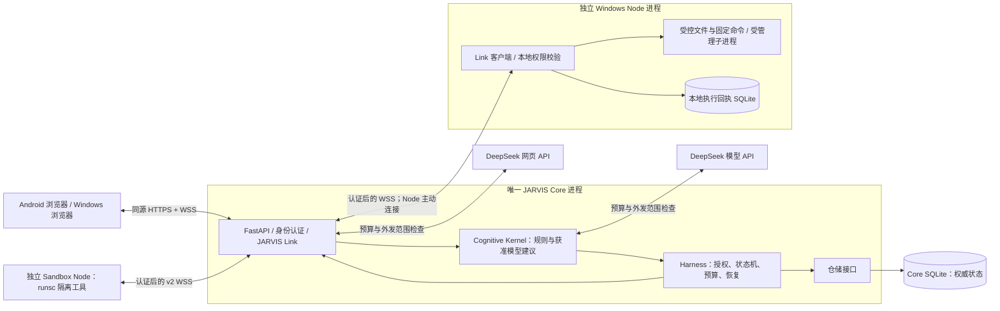
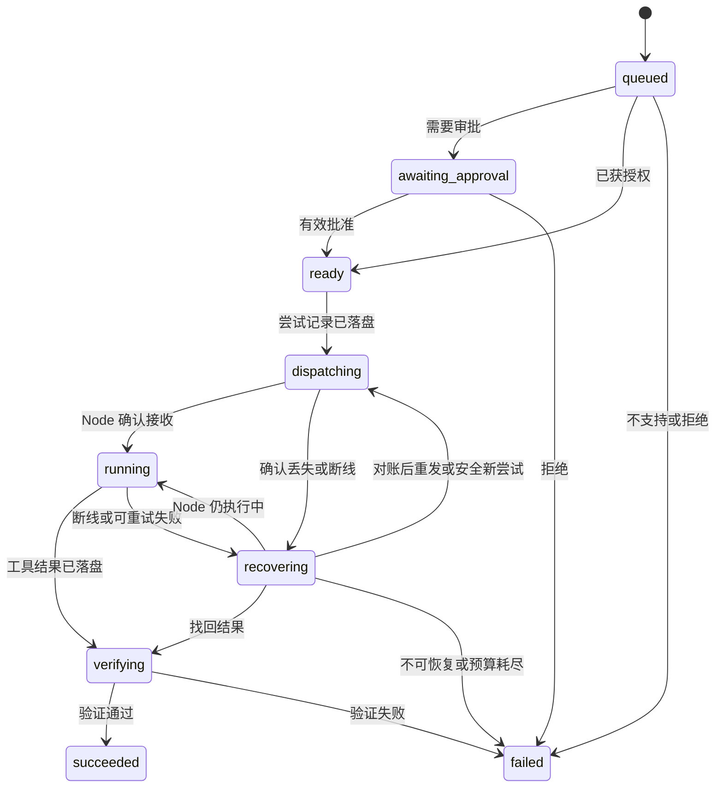
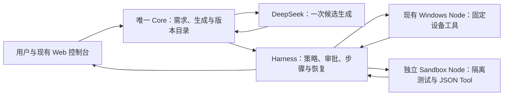

# NEXUS 架构设计

本文件解释系统如何工作，以及开发时必须保持的边界。功能状态、部署版本、批准范围、剩余工作和后续计划统一查阅 [ROADMAP](ROADMAP.md)；使用和验证文档按 [文档导航](README.md)查找。开发前仍须完整阅读本文件、[AGENTS](../AGENTS.md)和路线图。

## 先了解整体

浏览器是使用入口，Core 是唯一中心服务，Node 是设备执行端。用户提出请求后，Core 负责理解、记录、核对权限和安排执行；Node 只执行获准的具体操作，返回结果；Core 检查结果后再展示给用户。

模型可以帮助理解请求、给出建议和解释获准结果，不能自行授予权限、改写执行记录或把一句“成功了”当作任务完成。聊天记录、执行历史和用户明确同意保存的长期记忆分别管理。

项目已从 M1 可靠执行底座演进到模型、聊天、自定义能力、项目记忆和有界工具工作。前 1–13 节说明共用架构与当前能力边界；M1 的零模型、单步、两个只读工具只保留为历史基线，不再约束后续开发。第 14–19 节说明各次扩展及适用入口；旧入口限制不覆盖后续明确替代它的设计。保留既有章节编号和旧标题锚点以兼容链接。

| 阅读主题 | 章节 |
| --- | --- |
| 系统分工与工具范围 | 第 1–5 节 |
| 身份、审批、任务进度和恢复 | 第 6–8 节 |
| 资源上限、存储、记忆和代码位置 | 第 9–11 节 |
| 历史限制的替代关系与持续边界 | 第 12–13 节 |
| 自然语言模型接入 | [第 14 节](#14-m2真实模型与自然语言任务) |
| 自定义工具与流程 | [第 15 节](#15-自扩展tool-与-skill-方案) |
| 聊天与工具结果 | [第 16 节](#16-自由聊天与会话任务衔接方案) |
| 网页前端与独立 App | [第 17 节](#17-web-前端与-app-设计边界) |
| 聊天中的有限多步流程 | [第 18 节](#18-m5聊天中的有限流程) |
| 项目上下文、可控记忆与基础工具 | [第 19 节](#19-m6项目上下文与受控基础工具) |

## 常用名词

2026-10-22 原生插件扩展：Core 继续拥有版本、权限、任务、预算及恢复权威；Node 的 `plugin.call@1` 复用原执行回执，严格绑定插件版本和本地配置摘要。全局 normal/full 由会话覆盖；生成插件独立 runsc 测试后按模式决定批准/自动启用，宿主执行以 Windows 当前用户权限进行。具体边界与协议见 [ADR 0028](decisions/0028-native-plugins-permission-modes.md) 和 [插件接口](plugins.md)，交付状态只记 [ROADMAP](ROADMAP.md)。它替代本文件早期固定 Shell 和所有生成版本一律逐次批准的相关限制，不改变既有独立 M4 Tool 执行器或把旧 Skill 自动升级为宿主代码权限。

| 名词 | 本项目中的意思 |
| --- | --- |
| Core | 唯一中心服务，保存任务、权限、记忆和最终执行记录 |
| Node | 设备执行端；执行具体命令，不另建自己的目标或长期记忆 |
| Cognitive Kernel | 理解和选择模块：先用固定规则，必要且获准时使用模型 |
| Harness | 执行管理模块：管权限、审批、派发、取消、恢复、预算和结果检查 |
| JARVIS Link | Core 与设备/浏览器之间的认证通信，不替代任务管理 |
| Tool / Skill | 一个小操作的工具 / 按固定步骤组合工具的可复用流程 |
| Provider | 与某个模型服务通信的适配器 |
| Sandbox / runsc | 运行生成代码的独立隔离环境 / 所选的隔离运行时；是否隔离有效必须实测 |
| 持久化 | 把记录可靠保存到数据库，进程重启后仍能查询 |
| 幂等 | 同一个请求重复到达时，返回同一记录，避免重复创建或执行 |
| 对账 | 断线或重启后比较 Core 和 Node 的执行记录，查清是否执行及结果 |
| attempt / ack / unknown | 一次执行尝试 / 已保存结果的确认 / 执行结果尚无法确认 |
| 契约 / 摘要 / ADR | 严格的数据格式 / 绑定内容的指纹 / 解释重要设计选择的记录 |

技术字段保留原名，方便对照代码；面向用户的页面与说明优先使用“中心服务、设备、流程、执行记录、核对”等中文表述。

## 项目愿景

NEXUS 是面向个人、长期运行的统一认知与多身体自主 AI 系统，目标是逐步具备类似 JARVIS 的环境感知、长期记忆、目标管理、任务执行和反馈调整能力。

**One Mind, Many Bodies — 一个大脑，多个身体。** Windows、Android 及未来设备都是同一个 Core 的身体，不各自形成独立人格、目标体系或长期认知存储。设备可进行工具执行、格式处理和回执恢复等必要的本地处理。

长期愿景通过可验证的小里程碑推进。M 表示产品里程碑，S 表示开发子阶段，P 表示任务；S0–S7 / P01–P12 对应已结束的 M1，不是当前开发的范围上限。实施仍按用户本次目标与既有授权推进。

## 1. 结论与设计边界

采用一个 Python 单体 Core 服务、独立 Windows Node、独立 Linux/WSL Sandbox Node，以及由 Core 托管的 Web 客户端。Core 内部分模块，模块间使用函数及类型接口；Windows 基础工具使用扩展后的 JARVIS Link v1，生成工具使用独立 v2 Sandbox 协议。模型与网页 API 由 Core 在预算和外发范围内调用。独立 App 复用同一个 Core，具体客户端方案按第 17 节评估。

三个不变量：

1. **一个大脑**：只有 Core 可以创建目标、改变任务权威状态、授予操作权限和写入长期记忆。Node 只接受经过认证和授权的具体命令。
2. **低成本运行**：心跳、任务查询、重连和恢复使用固定规则，不调用模型。自然语言、聊天、能力生成和有限工具工作可在显式启用、同意范围与预算内调用模型。
3. **可靠自主执行**：先持久化再派发；成功需要匹配当前执行尝试的工具证据及验证；未知执行结果必须显式保留，不能推断成成功或直接重试。

系统可进行有界的多步工作，但模型建议始终经过确定性授权、持久执行和结果验证；不据此宣称已实现通用自主智能。

## 2. 需求中需要澄清或补足的地方

| 问题 | 影响 | 本方案采用的边界 |
| --- | --- | --- |
| 统一认知容易被理解成一个大模型或一个串行循环 | 模型故障会阻塞整个系统，也容易让模型越权 | Core 是状态和权限的唯一权威；模型是可替换计算服务，异步 I/O 不改变权威归属 |
| “断线恢复”没有定义重复与未知结果 | 已执行但回执丢失时，重发可能造成重复操作 | 持久化执行尝试、Node 回执和对账；不承诺分布式 exactly-once |
| “只读”没有限定可读取的数据 | 文件名、环境变量和系统信息也可能泄露隐私 | 按工具、节点、资源别名及字段授权；受控文件读写限配置 workspace，不开放任意路径 |
| Tailscale 只能解决部分网络问题 | 连上网络的设备仍不应获得执行权限 | 应用级凭证、消息授权、HTTPS/WSS 和撤销能力仍须独立实现 |
| 审批对象与有效期未定义 | 修改参数或目标后可能错误复用旧审批 | 审批绑定任务、工具版本、规范化参数摘要、节点和策略版本，并设置期限 |
| 长期记忆与执行历史没有区分 | 工具输出、推测可能被误当成用户认可的事实 | 执行日志与授权记忆分开存储；记忆需要明确同意，并记录证据与时效 |
| “任务成功”缺少可操作定义 | 容易把模型回答或一个 success 标志当成完成 | 工具特定验证器校验结构、任务归属、约束和证据；声明验证级别 |
| Core 迁移与同时运行两个 Core 未区分 | 两套权威可能重复派发任务 | 当前支持停机迁移，保持单活；同一数据目录使用独占进程锁 |
| 全天候运行缺少资源和故障边界 | 队列、日志、重试可能无限增长 | 有界队列、结果大小限制、任务期限、执行次数和模型预算；磁盘写入失败停止派发 |
| 需求同时涉及底座与完整自主系统 | 个人开发容易陷入框架建设 | 在原执行底座上逐步扩展有限流程和工具循环；后台目标与调度按实际需求设计 |

这些边界适用于各次扩展；具体能力不再限于 M1 两工具。DeepSeek 接入见第 14 节，自有云端部署见第 3 节，文件、网页与聊天工作见第 19 节；Android 原生能力按路线图单独规划。

<a id="3-最小部署架构"></a>

## 3. 部署架构



- Windows 最初同时运行 Core 和 Node，但必须是两个独立进程，可分别重启。
- Harness 和 Cognitive Kernel 是 Core 内的模块，不是额外服务。
- Node 主动连接 Core，不需要对外监听服务端口。浏览器不能直接控制 Node。
- Core 数据库只由 Core 访问。Node 回执只记录命令身份、局部执行阶段及有限结果，不保存长期目标、用户画像或规划。
- 当前固定单个 Core worker、每个 Node 同时执行一个工具尝试；Core 可同时处理多个网络连接。多步流程依次复用执行槽，不等于多活 Core 或无界并行。
- 单例锁绑定规范化数据目录，防止误启动第二实例。它不提供跨主机分布式锁；禁止复制数据库后同时启动两套 Core。
- 将来移动 Core 时，停旧 Core、取得一致备份、迁移数据及身份配置，再让 Node 修改连接地址。移动的是权威数据，不是重新建立一套人格。
- 2026-10-18 用户明确批准自有 Ubuntu 云端单活 Core、无域名 IP 直连 HTTPS/WSS、正式证书和自动续期。实际迁移保留原身份及权威历史，Windows 仍只运行 Node；不引入第二 Core 或新工具。网络不再依赖 Tailscale，CA 只负责签发和续期；决策见 [ADR 0008](decisions/0008-self-hosted-core-ip-tls.md)，结果见 ROADMAP 和部署说明。
- 当前不依赖 Redis、Celery、Kafka、容器编排、向量数据库或独立调度微服务。新增基础设施须证明实际需求、维护成本与迁移方案，按重要依赖或架构变更评估；早期 MVP 排除清单不构成永久禁令。

FastAPI 支持 WebSocket 依赖认证；其内存连接列表示例也明确仅适用于存活的单进程。NEXUS 因此将任务事实放入数据库，内存只保留可重建的连接与唤醒信号。[FastAPI 官方文档](https://fastapi.tiangolo.com/advanced/websockets/)

## 4. 模块职责与接口

以下是目标接口与职责边界，已实现的 S2 接口和后续接入要求见 [storage-security.md](storage-security.md)。对象都使用明确的类型；跨网络契约使用 Pydantic 模型并拒绝未知字段。

| 模块 | 负责 | 主要接口 | 不负责 |
| --- | --- | --- | --- |
| Core 应用层 | 身份、任务入口、设备登记、历史查询、记忆与控制 API，组装各模块 | `submit(request, principal) -> TaskSnapshot`；`query_tasks(filter, principal)` | 直接执行设备工具 |
| Cognitive Kernel | 对已知意图规则匹配，决定是否需要模型，给出可解释路由建议 | `route(intent, context) -> RoutingDecision` | 审批、授予权限、写任务终态 |
| Harness | 固定计划、策略判定、审批、预算、尝试、派发、验证、取消、恢复 | `advance(task_id)`；`decide_approval(...)`；`request_cancel(...)`；`reconcile(node_id)` | 设备文件操作、让模型修改权限 |
| JARVIS Link | 连接认证、消息解析、会话、心跳、重连、确认和恢复传输 | `dispatch(command)`；`request_attempt_status(...)`；`publish(event)` | 判断任务成功、维护独立业务状态 |
| Node Runtime | 注册能力、检查本地策略、执行获准工具、保存及重传回执 | `execute(AuthorizedCommand) -> ToolResult`；`cancel(attempt_id)`；`status(attempt_id)` | 拆解用户目标、选择 LLM、创建后续任务 |
| Tool Registry | 提供工具名与版本、参数和结果模型、风险级别、重试性质及验证器 | `resolve(tool_name, version) -> ToolSpec` | 自动下载或执行任意插件 |
| Policy Engine | 按身份、工具、参数、资源、节点计算允许、拒绝或待审批 | `evaluate(principal, action, context) -> PolicyVerdict` | 由模型自然语言决定权限 |
| Storage | 事务、任务状态比较更新、事件、身份与记录查询 | `transaction()`；`transition(expected_revision, ...)` | 在数据库事务内等待网络或模型 |

`RoutingDecision` 至少包含：`mode`（rule / decision_model / llm / reject）、`reason_code`、`policy_version`、建议工具及版本、已验证参数；使用模型时才有 `model_id` 和预算估计。路由建议必须经过 Harness 再授权。

模型接口区分可选判断器与实际 Provider：

- `DecisionModel.decide(context, budget) -> DecisionAssessment`：可替换的轻量判断器，输出是否需要推理、置信度及候选能力；不因保留接口自动部署额外分类模型。
- `ModelProvider.estimate(request)` 与 `invoke(request, limits) -> ModelResponse`：屏蔽厂商差异，返回内容、用量、耗时与错误。配置未启用时使用禁用适配器并返回 `MODEL_DISABLED`；真实 Provider、流式聊天和工具交换见第 14、16、19 节。

模型调用先检查授权和预算，再匹配能力；未来增加多个候选时才比较估算费用与延迟。没有足够预算、价格上限或合适模型时显式停止，不无限升级模型或重试。模型输出属于未受信建议，不能扩大工具列表、文件范围或预算。

<a id="5-mvp-的任务与工具"></a>

## 5. 任务入口与工具范围

结构化任务、自然语言单步入口、聊天工作和固定 Skill 共用授权与执行底座。结构化入口不支持的意图返回 `UNSUPPORTED_TASK`；已启用的聊天入口可在逐轮同意及预算内使用模型选择工具。单个基础任务仍对应一个动作，整个用户目标可由多个有界动作或 Skill 步骤完成。

| 能力 | 执行位置 | 参数与授权边界 |
| --- | --- | --- |
| `system.info@1` | Windows Node | 空参数；仅系统名称、版本、架构和 Python 版本，需持久授权 |
| `filesystem.list@1` | Windows Node | `root_id`、`limit`；只列根目录直接条目。原单步入口保留审批，聊天工作可按有效范围执行 |
| `filesystem.read/search/write_preview/write@1` | Windows Node | workspace 相对路径、有界 UTF-8 及查找；配置范围内无额外文件审批，写入仍核对预览、旧内容与读回 |
| `command.run@1` | Windows Node | 已登记的程序、摘要与固定参数模板；任务入口审批和聊天工作范围分别核对 |
| 已批准且启用的 Tool / Skill | 独立 Sandbox Node / Core 协调各执行端 | 固定版本、测试与批准；生成 Tool 只在合格沙箱运行，Skill 最多 3 个顺序步骤 |
| `get_node_status`、`inspect_capability` | Core | 有时点的节点状态 / 合格能力详情；不是新增设备执行权限，具体交付版本见路线图 |
| `web_search` / `web_fetch` | Core 调用网页 API | 显式配置、公开查询或 URL、有界结果和来源；共享模型费用账本 |

上表说明已建立的能力类别，不把工具数量锁定为两种；新增工具仍需严格契约、资源范围、结果验证与相应交付证据。代码中存在新条目不等于生产已部署、配置或用户已验收。

`root_id` 由 Node 本地配置映射为目录，当前文件资源使用 `workspace`。Core 只保存允许的别名；未配置或未授予持久身份权限时不能访问，不能因模型给出绝对路径而开放范围。工作区默认策略复用已有配置，不是自动登记新目录或新身份。

文件工具约束按操作区分：

- 原 `filesystem.list` 不递归、不读正文；名称搜索与文本读写使用各自严格、有界的参数，不把列目录工具的限制套用于全部文件工具。
- 文件路径须在 workspace 内规范化，拒绝越界、UNC、重解析跳转及相应链接风险；写入使用句柄保护、摘要绑定、临时文件替换和读回检查，细节见第 19 节。
- 结果达到条目、正文或字节上限时明确标记截断，不把片段称为全量内容。页面将输出作为文本显示。
- Node 以普通用户运行；路径保护与 Windows Job 是本地资源及生命周期边界，不代替不受信代码沙箱。生成 Tool 使用第 15 节的独立环境。

Godot、桌面或其他工具按具体场景与授权评估，不再受“第一版不增加第三种工具”的限制；是否已实现仍由路线图及证据确定。

## 6. 身份、权限与审批

### 6.1 身份和传输

- 首版单用户；分别建立 owner 身份和每个 Node 的独立身份。稳定 `node_id` 与高熵随机令牌分离，令牌可撤销且不能相互替代。
- 通过本地管理命令离线登记节点，不提供开放自助注册。Core 保存随机令牌的摘要；Node 通过环境变量或本地未入库配置获得自己的令牌。
- Node 在 WebSocket 握手使用 Bearer 认证，同时验证 Core TLS 证书；禁止关闭证书校验。身份来自认证连接，不能信任 JSON 自报的 `node_id`。
- 浏览器通过同源 HTTPS 登录换取有时限、可撤销的 HttpOnly / Secure / SameSite 会话 Cookie。浏览器原生 WebSocket 不提供任意 Authorization 请求头接口，因此浏览器与 Python Node 不共用同一种握手方式。[MDN WebSocket 构造器](https://developer.mozilla.org/en-US/docs/Web/API/WebSocket/WebSocket)
- 对浏览器握手和 HTTP 写操作检查允许的 Origin；HTTP 写操作另校验会话关联的 CSRF 令牌。会话过期或凭证撤销时关闭现有连接。所有消息继续执行授权检查。
- 不把长期令牌放在 URL、LocalStorage、示例配置或日志里。不依赖 CORS 自动保护 WebSocket。
- 默认只绑定 localhost；此开发模式允许 HTTP/WS，Cookie Secure 只在该显式本机模式关闭。Android 接入必须显式开启远程模式并提供 Android 信任的 HTTPS/WSS 证书。当前入口由 Uvicorn 直接加载，禁用代理头；部署层终止 TLS 是目标选项，尚未交付该接入模式。配置好 TLS 前不开放远程访问。
- LAN 和 Tailscale 都只是连接路径；应用权限检查相同。不自动修改防火墙、证书信任或系统安全设置。

Origin、逐消息授权、过期会话关闭和消息限额是参考 OWASP 建议采用的边界；具体角色与策略是 NEXUS 的设计选择。[OWASP WebSocket 安全指南](https://cheatsheetseries.owasp.org/cheatsheets/WebSocket_Security_Cheat_Sheet.html)

### 6.2 授权模型

有效能力 = Core 已知工具 ∩ owner 授权 ∩ Node 身份许可 ∩ Node 已注册能力 ∩ Node 本地允许范围。

节点声称支持一个工具，并不代表它自动获准执行。审批只能批准本来允许通过人工授权的操作；不能把未实现或硬性禁止的工具变成可用工具。

授权结果由工具、入口和当前策略共同决定。原单步入口的 `system.info` 使用持久预授权，`filesystem.list` 保留逐任务审批；M6 工作区文件读写/查找由已配置策略自动形成绑定记录，聊天工作还核对本轮有效范围。不能把原目录审批推广为所有工具均需逐次确认，也不能把工作区默认权限推广到未配置资源、固定命令或新扩展版本。

审批记录绑定：`approval_id`、`task_id`、owner、目标 `node_id`、工具名及版本、规范化参数 SHA-256、资源/策略版本和到期时间。单个批准只解锁该任务中完全一致的动作，最多允许预算内的只读重试，不允许复用到新任务。参数、节点或策略变化后必须重新评估，必要时重新审批；已派发任务不原地改写动作。

S2 已实现离线身份/授权管理、随机凭证摘要、8 小时浏览器会话（最多 10 个有效会话）、同源会话路由及 HTTP/WS 认证守卫。P06 的 Node Link 已接入 `SecurityHTTP.receive_text`，每秒检查空闲连接的撤销/过期，并在返回每条消息前再次检查。资源范围摘要绑定 `NodeScope.resource_version`，持久授权或身份变化递增全局策略版本。Link 从认证节点、可信工具/资源配置与持久授权交集构建范围；自报能力不能扩大授权。loopback WS 及 S7 实际公信 HTTPS/WSS、Android 接入均已有证据，范围见 [S7 验证](S7-VERIFICATION.md)。

重要删除、对外消息、支付和系统安全设置没有现成工具时拒绝执行；未来明确需求可另行设计，必须同时具备精确授权、效果验证、幂等/对账策略，不能只增加一个“同意”按钮。早期排除不构成永久产品禁令。

## 7. 任务状态机与执行语义

### 7.1 状态



图仅展示主流程。完整公共规则：

| 条件 | 转移或处理 |
| --- | --- |
| 尚未派发的 queued / awaiting_approval / ready 收到取消 | 立即进入 cancelled，并原子撤销待派发记录 |
| dispatching / running / recovering 收到取消 | 持久化 `cancel_requested`；要求 Node 停止或上报既有结果，收到确认前不假称 cancelled |
| Node 确认已停止且没有已完成结果 | 进入 cancelled，记录执行尝试实际结束阶段 |
| Node 已完成并提交结果 | 按结果验证；取消请求记录为已来不及取消 |
| 结果已持久化并进入 verifying 后收到取消 | 返回 `ALREADY_FINISHED`，完成本地验证 |
| 任何非终态到达总期限 | 进入 timed_out；仍有活动尝试时发送停止请求，并记录结果是否未知 |
| running 返回明确的不可重试错误 | 进入 failed，保留结构化错误 |
| dispatching 直接收到有效结果而确认包缺失 | 可直接进入 verifying，不等待一个已无必要的确认包 |
| 验证前崩溃、重启时已存在有效结果 | 恢复到 verifying，重新运行确定性验证器 |
| 任意终态收到迟到消息 | 只补充审计或对账证据，不倒改终态，不覆盖新尝试 |

终态为 `succeeded / failed / cancelled / timed_out`。任务另有 `execution_outcome = not_started / known / unknown`，避免把“已经超时”误解成“肯定没有执行”。未知结果不会进入 succeeded。

每次转移使用事务及 `revision` 比较更新，避免取消、结果、超时竞争时互相覆盖。任务计划和结果分开保存；终态不可被 Node 自行更改。

### 7.2 尝试、幂等与恢复

单个基础任务对应一个工具动作；只读且明确可重试的动作至多两次执行尝试，写入、命令和生成 Tool 不自动新建尝试。Skill 和聊天工作在原任务之上记录有限步骤，不另建第二套权威状态机。尝试记录包含 `attempt_id`、`task_id`、`step_index`、`attempt_no`、节点、参数摘要、派发次数、阶段、期限与结果。

1. Core 在同一事务中保存任务状态、尝试、审计和事件后，才发送命令。尝试表就是最小持久派发队列，无需消息中间件。
2. Node 在执行前持久化该 `attempt_id` 的接收回执及命令摘要，再确认接收。相同 attempt、相同动作仅重传状态或缓存结果；同 ID 不同动作返回 `IDEMPOTENCY_CONFLICT`。
3. Node 父进程在本地记录 started 后启动固定工具子进程；started 与实际开始之间仍可能发生崩溃，恢复时一律视为未知，不假定未执行。子进程由父进程持有及管理，重启后先确认旧执行已结束，无法确认时不新开尝试。
4. Node 完成后先保存有限结果，再回传。Core 持久化结果后回复 `result.ack`；断线时 Node 保留结果并于重连重传。
5. Core 重启或 Node 重连后，按活跃 `attempt_id` 请求状态。已完成则验证；仍运行则等待；确认从未执行或确认旧执行已经结束且工具可安全重跑时，才允许在预算内新建 attempt。
6. 同一命令的网络重传沿用原 attempt，不计作新的执行尝试，但仍有单独派发次数上限。只有 Core 可以创建新 attempt。
7. 白名单只读工具允许按预算安全重跑，但不能保证两次读取产生相同快照；结果包含观测时间。具有副作用且结果未知的工具不得自动重试，必须依赖外部幂等键、查询或人工对账。
8. Core 终态已确定后收到迟到结果，返回已结算确认并留审计；不会继续驱动执行。不自动清理尚需对账的 Node 回执。

结果时间与执行停止分别判定：认证 Node 提交的完成回执必须匹配 task/attempt、工具版本及命令摘要。观测时间超出原 5 秒容差时，输出不进入成功验证，记录 `attempt.result_time_rejected`，但完成回执仍可证明该执行已经结束。Core 持久化停止证据后释放执行槽，保留未知业务结果及原终态，不自动重试该动作。Node 的已完成、已取消及有真实停止证据的未知回执都进入原有有界重传，Core 落盘后确认；无停止证据的未知回执不确认、不释放槽。每尝试 64 次主动查询预算保持，不因重连重置。

连接认证通过后，Node 以 `node.welcome` 信封的 Core UTC 时间和本机单调时钟建立本次运行的时间基准，计算命令期限并在工具进程结束后保存一次回执观测时间。缓存回执跨重连保持原时间，不用新偏移重新改写；独立离线运行沿用本机 UTC。握手等待仍受原 5 秒期限限制，Core 的结果时间容差、总期限及身份校验不变，不调整操作系统时钟。

这里实现的是有确认、有去重和可恢复状态的协议，不是无条件“恰好执行一次”。WebSocket 保证连接内的传输顺序，不提供跨重连的应用事务。

### 7.3 成功验证与暂停

- Node 的 success 字段仅是证据之一。Core 校验认证节点、task/attempt 归属、工具版本、命令摘要、结果模型、大小限制及工具特定断言。
- `system.info` 验证必需字段和类型；目录工具验证 root_id 一致、条目/字节限制、无目标内容、截断标记等。单步任务只有当前有效尝试通过验证才 succeeded。
- 验证级别标记为 `node_report_schema_checked`。这不能证明恶意 Node 诚实，也不能证明操作系统底层事实绝对真实；更强的独立外部验证随未来具体工具添加。
- Node 使用受管理的固定工具子进程实施超时和取消；不能仅取消等待线程却让实际工具继续运行。Windows 目标为 Windows 10/11，工具进程纳入设置了 KILL_ON_JOB_CLOSE 的 Job Object，由 Node 独占不可继承的管理句柄；完成纳管前，子进程不得进入工具执行。纳管失败则拒绝执行。Node 崩溃时由 OS 清理工具进程；重启仍须对账，因为清理进程不能撤销已经完成的读取。该机制封装在 Node 内，不给 Core 引入 Windows 依赖。[Microsoft Job Objects 文档](https://learn.microsoft.com/en-us/windows/win32/procthread/job-objects)
- 禁止 shell=True、任意脚本或任意可执行命令入口。Job Object 用于生命周期管理，不被当作不受信代码的安全沙箱。
- 全局 `pause` 持久化，并立即阻止新的派发、重试和模型调用；已在执行的只读任务可完成。紧急停止使用独立的 `cancel_all`，对所有未完成任务发起可审计的取消。
- 取消、暂停、审批与派发通过同一个状态机事务检查；已经发送的命令无法被数据库事务撤回，需要节点停止协议。界面必须区分“停止派发”和“确认停止执行”。
- 数据库不能可靠写入时，Core 不接新任务或继续派发；Node 不能写回执时拒绝执行。

## 8. JARVIS Link v1 协议

P02 已实现本节 25 种消息的数据契约；字段、严格解析、错误及字节约定见 [protocol-v1.md](protocol-v1.md)。P06 已实现认证连接、心跳、会话替换和重连；P07 已接入持久派发和执行结算；P08 已实现网络对账、取消及全局控制，见 [S5 恢复](s5-recovery.md)。status_result 新增可选 execution_stopped=false；未知结果仅在有停止证据时允许预算内重试，严格 Core/Node 应同步升级。

P09 已接入同源静态页面、会话恢复、浏览器 WS 及消息授权。任务/控制事务通过触发器追加统一 client_events 游标，有效游标有界回放，无效游标先取得 HTTP 快照；慢连接独立排队并超时断开。历史事件附当前已提交状态及对应 revision，不伪造旧快照。详情见 [S6](s6-browser-records.md)及 [ADR 0006](decisions/0006-s6-browser-records.md)。

### 8.1 端点和消息信封

HTTP：`/api/v1/session` 用于登录/退出；`/api/v1/tasks` 和 `/api/v1/tasks/{id}` 用于分页历史与详情；`/api/v1/memories` 用于显式授权记忆管理。HTTP 与 WS 共用应用层授权。

WebSocket：`/ws/v1/client` 服务浏览器；`/ws/v1/node` 服务 Node。连接角色决定允许的消息，不使用可伪造的 sender 字段授权。

通用信封：

```json
{
  "protocol_version": 1,
  "type": "task.submit",
  "message_id": "d641f031-65ec-41f4-9933-297ed3856906",
  "correlation_id": null,
  "sent_at": "2026-10-17T08:00:00Z",
  "payload": {
    "request_id": "5d489189-2958-4fb2-a59d-2cba31974d96",
    "intent": "list_directory",
    "arguments": {"root_id": "workspace", "limit": 100}
  }
}
```

- `message_id` 标识一次消息；响应的 `correlation_id` 指向请求消息。
- `request_id` 是业务幂等键；同一 owner 的重连补发沿用它。Core 对 `(owner_id, request_id)` 建唯一约束；相同内容返回原任务，不同内容返回冲突。
- task_id、attempt_id、审批身份及状态由 Core 生成，客户端不能指定或越权修改。
- 所有时间为 UTC RFC 3339；页面按用户本地时区显示。客户端 sent_at 仅供诊断，不作为身份或核心超时依据。
- 信封和 payload 都严格校验；拒绝未知协议主版本、未知消息类型及多余字段。不发送 Python 对象或绝对文件路径。

### 8.2 消息类型

| 方向 | 类型 | 必要负载 |
| --- | --- | --- |
| 浏览器 → Core | `client.sync` | 上次持久 `event_id` 或 null |
| 浏览器 → Core | `task.submit` | request_id、intent、arguments |
| 浏览器 → Core | `task.cancel` | task_id |
| 浏览器 → Core | `approval.decide` | approval_id、approve/reject；审批人由会话确定 |
| 浏览器 → Core | `control.pause / control.resume / control.cancel_all` | request_id；仅 owner 可用 |
| Core → 浏览器 | `client.synced` | 同步边界游标、是否需要完整查询 |
| Core → 浏览器 | `task.accepted` | task_id、当前状态；只承诺任务已入库 |
| Core → 浏览器 | `task.updated` | event_id、task_id、revision、状态、有限结果或错误 |
| Core → 浏览器 | `approval.required` | event_id、approval_id、动作摘要、节点、到期时间 |
| Core → 浏览器 | `control.updated` | event_id、暂停状态及版本 |
| Node → Core | `node.hello` | node_id、节点版本、支持的工具版本和资源别名、当前 boot_id |
| Core → Node | `node.welcome` | session_id、心跳及限额配置 |
| Node → Core | `node.heartbeat` | session_id、活跃 attempt_id；不传任意屏幕或文件数据 |
| Core → Node | `command.execute` | task_id、attempt_id、工具及版本、参数、命令摘要、grant_id、到期时间、执行超时 |
| Node → Core | `command.accepted / command.started` | task_id、attempt_id、命令摘要、boot_id |
| Core → Node | `command.status` | attempt_id |
| Node → Core | `command.status_result` | attempt_id、阶段或 not_found、命令摘要、可用结果 |
| Core → Node | `command.cancel` | attempt_id、原因 |
| Node → Core | `command.cancelled` | attempt_id、实际停止阶段；已完成则返回原结果 |
| Node → Core | `command.result` | task_id、attempt_id、命令摘要、工具版本、观测时间、outcome、result 或 error |
| Core → Node | `result.ack` | attempt_id、stored/already_settled |
| 双向 | `error` | code、有限 message、retryable、关联消息 ID |

完成 node.hello / node.welcome 后，双方运行期消息还携带当前连接的 session_id；只接收当前已认证连接，替换连接时关闭旧会话。持久去重键仍是 attempt_id，不随连接改变。命令摘要覆盖不可变任务动作；会话字段及重传时间不进入动作摘要。

Core 的 grant_id 引用已持久授权；它通过已验证的 Core 连接传给 Node，不是一个可由客户端提交后直接生效的权限令牌。Node 无论如何仍检查本地工具和资源策略。

`command.result` 的 payload 示例：

```json
{
  "session_id": "1716eb9e-78c4-4baa-9a9c-49b47fcde962",
  "task_id": "93e32968-43ba-43dc-9f07-610d672b4884",
  "attempt_id": "6f74fd13-05d2-48dd-ae79-751a900a7d37",
  "command_digest": "aaaaaaaaaaaaaaaaaaaaaaaaaaaaaaaaaaaaaaaaaaaaaaaaaaaaaaaaaaaaaaaa",
  "tool": "filesystem.list",
  "tool_version": 1,
  "observed_at": "2026-10-17T08:00:02Z",
  "outcome": "succeeded",
  "result": {
    "root_id": "workspace",
    "entries": [{"name": "docs", "kind": "directory"}],
    "truncated": false
  }
}
```

### 8.3 重连、流控与错误

- Node 默认 10 秒心跳，30 秒未收到则判离线；这是可用性观测，不直接改变任务为 failed。重连采用 1–30 秒指数退避及抖动，持续重连不调用模型。
- Core 重启后要求 Node 重新认证、重新注册能力并对账。boot_id 改变意味着 Node 进程已重启，不能据此断定旧执行未发生。
- 客户端以持久 event_id 补取事件；事件游标来自 Core 数据库，表示为十进制字符串。按身份过滤事件；基于同步边界回放并接入实时流，按 event_id/revision 去重，避免回放与订阅之间漏事件。
- 游标无效或事件不可用时明确通知完整查询，客户端通过 HTTP 重新取得任务快照。浏览器断开不取消任务。
- 每个连接的发送队列有界；慢客户端被断开后从持久记录恢复，不阻塞调度。文件正文仅通过有界工具结果传输，不提供无限文件流；扩展产物使用独立有界接口。
- 主要错误码：`AUTH_REQUIRED`、`FORBIDDEN`、`INVALID_MESSAGE`、`PROTOCOL_UNSUPPORTED`、`UNSUPPORTED_TASK`、`POLICY_DENIED`、`APPROVAL_EXPIRED`、`NODE_OFFLINE`、`IDEMPOTENCY_CONFLICT`、`TOOL_TIMEOUT`、`BUDGET_EXCEEDED`、`RESULT_INVALID`、`EXECUTION_UNKNOWN`、`BUSY`、`MODEL_DISABLED`。
- retryable 仅提供故障分类，是否重试由 Harness 同时检查工具性质、回执、剩余预算和期限；错误消息本身不触发自动执行。

## 9. 默认资源预算

以下列出共用执行底座与当前各入口的主要上限。各入口分别约束动作、步骤和模型交换，不把 M1 的一个动作/零模型套用于整个用户目标。可信配置及对应严格契约决定实际值，模型和客户端不能自行提高上限；其他限制见第 14–19 节。

| 限额 | 默认值 |
| --- | --- |
| 基础任务动作 / 固定 Skill 步数 | 每个基础任务 1 动作；每个 Skill 最多 3 步 |
| 聊天工作动作 / 模型交换 | 每轮最多 4 动作 / 5 次模型交换；底层操作另受工作范围限制 |
| 工作范围 | 默认内部 5 分钟 / 20 操作；旧显式授权最长 30 分钟 / 20 操作 |
| 每动作执行尝试数 | 白名单只读动作总计最多 2 次，含首次；写入、命令和生成 Tool 不自动新尝试 |
| 每次尝试的命令派发数 | 总计 3 次，含首次；均使用相同 attempt_id |
| 单次工具执行时间 | 10 秒，Node 用单调时钟限时 |
| 接收确认等待 | 5 秒；丢失后对账，不能直接认定未执行 |
| 每尝试状态/停止请求 | 总计 64 次；每 5 秒至多一个周期请求，取消可立即发起；耗尽仍未知则保留执行槽 |
| Node 未确认结果主动重传 | 每 5 秒扫描最多 4 条，单连接每条最多 3 次；仍可响应 Core 查询 |
| 任务总期限 | 5 分钟，包含等待审批、离线和重试 |
| 审批有效期 | 最多 2 分钟，且不得晚于任务期限 |
| 每 Node 工具并发 | 1 |
| Core 待处理任务数量 | 100，超出返回 BUSY |
| 单身份新任务速率 | 每分钟最多 10 个；连接/消息也设有界速率限制 |
| 单消息 / 工具结果 | 64 KiB / 32 KiB，按编码后字节计算 |
| 目录条目数量 | 最多 200；超限明确截断 |
| 模型费用与 API 次数 | 每根请求/聊天轮次 USD 0.05，每 UTC 日 USD 1 / 100 次 API，模型与网页共用账本 |
| 模型调用范围 | M2 单步解释 1 次；M3 普通聊天 1 次、结果解读合计最多 2 次；M4 每次生成 1 次；M6 工作每轮最多 5 次模型交换 |

重传、失败和取消不返还已消耗的执行次数。新 attempt 前必须确认旧执行结束或确定未开始；不因计时器到期而并发开第二次。

Core 负责总期限及最终超时判定，Node 执行接收时剩余预算与单次超时中较小的值，并拒绝已过期命令。部署要求基本时钟同步；严重时钟偏差时停止派发并提示校时，不能通过放宽过期校验继续执行。

模型及网页调用使用原子费用预留、输出/结果限制、调用次数、总费用与每日额度限制，失败尝试同样计入。成本记录区分预估、报告用量和未知值，不把未知成本记为零；各入口共用同一账本。默认关闭是新环境的配置选择，不表示当前产品禁止模型。

## 10. SQLite 与长期记忆

使用 `aiosqlite` 进行异步数据库访问，短事务串行写入，迁移使用有版本的 SQL 文件与 `schema_migrations`。暂不引入 ORM；仓储接口使业务状态机不依赖 SQLite 查询语法，但将来迁移数据库仍需要专门迁移及测试。

Core 概念表：

| 表 | 内容 |
| --- | --- |
| identities / sessions / grants | owner 和 Node 身份、凭证摘要、会话期限及静态授权 |
| projects | 项目标识与元数据，任务可选关联项目 |
| tasks | 意图、固定计划、状态、revision、期限、预算、取消标志及有限结果 |
| task_attempts | 派发、去重、执行阶段、尝试预算、错误与回执 |
| task_events | 持久递增事件和重连游标；任务事实的事件历史 |
| devices | 能力、策略范围、最近心跳、在线观测；重启后在线状态重新确认 |
| approvals | 审批动作绑定、期限、决定及操作者 |
| audit_events | 身份、权限、审批、控制及执行审计；不复制秘密或无限输出 |
| memory_entries | 经明确同意的长期信息及来源、验证和时效 |
| routing_decisions | 路由方式、理由、策略版本、耗时及后续结果关联 |
| model_calls | Provider、模型/网页调用、预算预留、用量、费用状态、延迟、结果与根请求关联 |
| system_state | 全局 pause 状态和配置版本 |
| schema_migrations | 已执行迁移版本 |

Node 的 `receipts.sqlite3` 保存 execution_receipts、schema_migrations / node_identity，以及 S5 迁移 002 的 cancellation_tombstones，不属于长期认知存储。使用专用身份、模式摘要与 FULL 同步；received/started/结果先落盘、重复 attempt 去重、重启 unknown 和结果恢复均有证据。回执和墓碑各默认最多 10000 条，满后拒绝新增并保留旧证据。S5 增加升级前一致备份及前向迁移、持久取消屏障和停止证据。Windows Job 门控、进程清理、数据目录锁及恢复见 [Node Runtime](node-runtime.md)和 [S5](s5-recovery.md)。

模型调用记录与最终工具验证结果关联，分别观察调用可用性和任务验证结果，不能把模型正常返回等同于任务成功。没有实际调用的规则任务不伪造调用记录；M1 的零调用证据不覆盖后续真实账本。

关键事务：任务幂等创建；状态与事件/审计同时提交；派发前创建尝试；结果落盘后才确认；审批决定与下一状态同时提交。网络和模型调用均在事务外进行。

启用 WAL、busy_timeout，并在每个连接显式启用外键。数据库位于 Core 本地磁盘，不能放入网络共享目录；WAL 不是跨设备共享数据库的方案。[SQLite WAL](https://www.sqlite.org/wal.html)、[SQLite 外键文档](https://www.sqlite.org/foreignkeys.html)

使用 SQLite 一致备份接口或完全停机后的备份，不在运行时只复制一个 .sqlite3 文件。迁移前备份并校验；第一版只提供向前迁移，失败恢复使用备份，不自动执行破坏性降级。

S2 实现身份、会话、静态授权、任务、事件、审计与审批；S4 迁移 003 增加 execution_grants、task_attempts 和任务结果字段；S5 迁移 004 增加取消/停止/对账计数、system_state、control_requests 和 control_events。只创建当前使用的表。迁移验证连续版本及摘要，升级前生成唯一一致备份并 quick_check；拒绝无版本旧库或未知新版本。任务权威由 Harness 负责；离线管理审计的 actor 为空，subject 记录被管理身份。设计见 [ADR 0001](decisions/0001-s2-storage-security.md)及 [ADR 0005](decisions/0005-s5-recovery-controls.md)。

S6 迁移 005 增加 projects、memory_consents、memory_entries、routing_decisions、model_calls 和 client_events；tasks 可选关联项目。保存、替代记忆与明确同意同事务；撤销/过期默认不作为当前信息查询，不物理删除。每个新任务原子记录路由；历史路由补记明确 migrated 且不捏造耗时。S6 当时仅使用禁用 Provider，model_calls 为零行；后续迁移在保留旧数据的基础上接入真实调用、聊天、扩展、工作步骤和费用关联，不能将旧库形态作为当前模型限制。

记忆至少区分以下独立字段：

- `kind = fact / inference / plan`：这是何种陈述。
- `verification = unverified / verified`：是否有足够依据，记录 evidence_ref 与 verified_at；工具输出本身不会自动变成 verified fact。
- `valid_until`、`superseded_at`、`retracted_at`：信息何时过期、被替代或撤销。
- owner、来源、consent_event_id：谁明确允许保存什么内容。

首版提供简单记忆管理 API，只有明确的保存请求才写入，不从聊天或工具结果自动提取。过期信息默认不作为当前事实返回，历史仍可查询。任务执行记录是审计历史，不等于授权个人记忆。

首版不自动清除任务与回执。结果有大小上限，数据库使用量提供观测；达到存储告警或写入失败时停止新执行。长期运行后的归档、保留期和删除策略另行确认，不悄悄删除用户记录。首版日志可轮转，但不会因此删除数据库审计。

## 11. 项目目录结构

下列是仓库当前主要代码和文档的位置；省略细节文件，不为未来阶段预建空模块。

```text
NEXUS/
├── README.md                      # 项目介绍与使用入口
├── AGENTS.md                      # 开发规范
├── pyproject.toml                 # 工程与依赖声明
├── config/                        # Core、Windows Node、Sandbox 示例
├── docs/
│   ├── README.md                  # 分类导航，不维护功能状态
│   ├── ARCHITECTURE.md            # 技术设计
│   ├── ROADMAP.md                 # 唯一状态、批准、验收与计划入口
│   ├── history/                   # 固定历史记录，不追加当前进度
│   ├── decisions/                 # 设计决定
│   └── assets/                    # 脱敏证据与截图
├── src/nexus/
│   ├── contracts/                 # 通信、任务、工具、聊天和扩展数据格式
│   ├── core/
│   │   ├── app.py                 # 中心服务组装与启停
│   │   ├── cognitive/             # 规则、自然语言、聊天和结果续接
│   │   ├── harness/               # 任务执行与恢复
│   │   ├── security/              # 身份、权限与审批
│   │   ├── link/                  # 设备、浏览器与沙箱连接
│   │   ├── storage/               # 数据保存与版本迁移
│   │   ├── models/                # 模型适配和预算
│   │   ├── memory/                # 项目、显式记忆与记录查询
│   │   └── extensions/            # 自定义版本、测试、批准与流程执行
│   ├── node/                      # Windows 工具、进程管理和本地执行记录
│   ├── sandbox/                   # 独立隔离执行端；代码存在不代表隔离已验收
│   ├── web/                       # HTML、CSS 和原生 JavaScript 页面
│   ├── service_config.py          # 服务 TOML 读取
│   └── settings.py                # 离线管理使用的环境配置
├── tests/                         # 按功能命名的测试模块和浏览器检查
└── var/                           # 运行数据和临时验证材料，Git 忽略
```

`contracts` 只共享通信/数据契约，不共享认知逻辑。Node 不导入 Core 的 Harness、记忆或模型模块。协议以 JSON 及工具版本定义，使后续 Kotlin Node 无需重写 Core。

配置优先级：指定环境变量 > 指定 TOML > 安全默认值；凭证不得进入 TOML。服务使用严格 CoreConfig / NodeServiceConfig 和有界 TOML 加载器；Core 可覆盖 NEXUS_DATA_DIR/HOST/PORT，Node 可覆盖 NEXUS_NODE_DATA_DIR/CORE_URL，Node 凭证仅由 NEXUS_NODE_TOKEN 环境变量提供。显式 loopback 模式允许 HTTP/WS，远程 Core 必须配置证书和私钥，Node WSS 保留默认 CA 与主机名验证。配置加载不创建目录或数据库；单活 Core 在生命周期中持锁后才初始化存储。P01 的 load_settings 保留给离线身份命令及原有接口，只读取环境变量且只允许 localhost；不自动读取 .env。当前直接 TLS 配置、恢复与设备验证边界见 [S7 部署](s7-deployment.md)和 [S7 验证](S7-VERIFICATION.md)。

依赖选择记录：测试使用 pytest 与 httpx2，采用标准 `asyncio.run`，未引入 pytest-asyncio。S2 增加架构指定的 aiosqlite 0.22.1；由于现有 Starlette 1.8.0 TestClient 已弃用 httpx，使用 httpx2 2.13.1 替换无代码调用方的旧 httpx 开发依赖，并锁定 httpcore2/truststore；没有升级现有 FastAPI、Starlette、Pydantic。`requirements.lock` 和实际 wheel 已在 Windows / Python 3.13.9 独立环境离线安装验证；构建依赖 `setuptools>=75,<81` 仍为范围约束。后续 Ubuntu / Python 3.12 的验证见下文与路线图，其他组合不据此推定可用。

S3 唯一新增安装包为锁定的 websockets 17.1，用作 Node 客户端与 Uvicorn Sans-I/O 后端；其他 24 个包版本不变。Core/Node 共用可移植数据目录锁和有界消息辅助函数，互不导入对方业务模块。连接观测仅保存在可重建内存中，接入/断开写入现有审计；没有为 P06 创建 devices 或 attempt 新表。S3 交付时拒绝网络执行派发，见 [ADR 0003](decisions/0003-s3-authenticated-link.md)。S4 已通过专用 Harness 路径启用持久派发与结果验证；普通 send 控制接口仍禁止执行命令，见 [ADR 0004](decisions/0004-s4-durable-execution.md)。

平台验证边界：已有 Ubuntu 24.04 / Python 3.12.3 的 Core 检查和跨主机只读执行证据；Windows Node 及各阶段候选包的具体覆盖以路线图关联的验证记录为准。这不表示 Linux Node、其他版本或全平台都已验证。

<a id="12-第一版明确不做"></a>

## 12. 历史限制与后续扩展边界

M1 的排除清单用于当时的实施范围，不作为永久产品禁令。已替代的限制直接按后续设计理解，不再要求先恢复到第一版能力。各功能的交付、上线与验收状态统一见 [功能状态](ROADMAP.md#功能状态)。

| 早期限制 | 后续适用设计 |
| --- | --- |
| 零模型、仅结构化按钮 | 第 14、16、19 节：自然语言、聊天、生成能力与有界工具交换 |
| 一个目标只执行一步、最多两个工具 | 第 5、15、18、19 节：严格注册的基础工具、固定 Skill 与有限工作循环 |
| 只列目录、不读写正文、目录一律逐次确认 | 第 6、19 节：workspace 内受控文件能力及默认策略；旧入口和旧待确认任务保持原语义 |
| 禁止所有生成代码执行 | 第 15 节：候选经过测试和具体版本批准，只在合格独立沙箱执行 |
| 初期 Core 与 Windows Node 同机部署 | 第 3 节及 ADR 0008：自有云端单活 Core，保留原身份、数据和可信 TLS |

持续保留的安全与可靠性要求：唯一 Core 权威、身份与资源交集、版本和参数绑定、预算与有界执行、真实结果验证、未知先对账、秘密保护、记忆保存及外发同意。任意宿主代码、任意 shell、越界文件访问或模型自行升级权限不因移除 MVP 限制而开放。

提醒、App、Android 执行、语音、Godot、更多模型、向量检索或其他基础设施，按实际需求、授权和设计证据评估；未实施不等于永久禁止。重要删除、对外消息、支付及安全设置等高影响能力需要独立明确授权与可验证的效果/恢复方案。多用户、多租户或多活 Core 会改变现有架构边界，须先完成相应架构决策。

## 13. 重要架构决策与以后演进

设计决定记录在 [decisions/](decisions/)；下列边界贯穿各阶段：

1. 唯一 Core 与独立 Node；同一套权威数据只由一个活动 Core 管理。
2. 任务和事件先保存再派发，Node 保存执行记录，无法确认时明确保留未知结果。
3. 规则优先，模型默认关闭；理解与建议不能代替执行授权。
4. 身份、资源权限与具体动作审批分别检查。
5. 成功以实际工具证据及声明的验证级别为准。
6. 自定义能力必须经过测试与逐版批准；代码隔离不能用普通进程替代。

里程碑状态、后续优先顺序和未完成项只维护在 [路线图](ROADMAP.md#后续规划)，本文件不再保留另一套排序。新增能力继续使用同一 Core、权限、预算与执行记录；具体设计随相应获准任务补充。

## 14. M2：真实模型与自然语言任务

2026-10-18 用户完成 M1 验收并选择 M2 优先接入 DeepSeek，预算每天 USD 1、每请求 USD 0.05。此明确选择替代了早期 Godot 工具优先的建议。M1 的零模型要求保留为 M1 基线；M2 在完成预算和审计后可通过显式配置启用首个真实 Provider。

- Core 仍是唯一认知与权限权威，Node 协议/工具不扩大。自然语言仅解释为现有两个动作，单步、显式确认后提交 Harness；目录审批仍独立检查。模型不创建长期目标或后台循环。
- 新 language_requests 保存有限输入、逐次外发同意、状态、建议和对应任务。固定短语先走规则；其他输入仅在模型配置启用且本次 allow_model=true 时调用。确认和任务关联在同一事务内落盘，重试确认使用 Core 生成的稳定 request_id。
- Provider 固定访问 https://api.deepseek.com/chat/completions，使用 deepseek-flash、非思考模式和 JSON 输出。不启用联网搜索、服务端工具、流式输出、重定向、代理环境配置或自动重试。复用已锁定的 httpx2 作为运行依赖，无新增版本。
- 仅发送当前文本与静态允许动作说明；不上传身份凭证、绝对资源路径、历史、个人记忆或工具结果。API Key 只从 Core 的 DEEPSEEK_API_KEY 环境变量读取；浏览器/Node/数据库/TOML 均不保存 Key。
- 迁移 006 在升级前沿用一致备份；无损扩展 model_calls，原七列及所有旧行保留，使解释阶段可在尚无执行 task_id 时记录调用。model_calls 记录请求、费用预留、用量、价格快照、完成/未知状态和后续任务。
- 每请求最多 1 次模型调用；全局每日最多 100 次，单并发；输出最多 512 token，HTTP 请求体最多 8 KiB、响应最多 32 KiB，30 秒总时限。请求先持久化，再在同一预算事务中预留整项 USD 0.05 上限并登记调用，网络位于事务外。
- UTC 每日额度 USD 1。报告用量按已核对的公开峰值缓存未命中单价计算上界；不冒充精确账单。失联/超时/取消/崩溃后费用不明时保留完整预留，跨日仍占额度且不重试。价格快照过期时停止新调用。
- 暂停与调用启动按同一 Harness 操作锁排序；已开始的调用可完成。cancel_all 同事务取消待解释/待确认请求，并关闭已开始 HTTP 交换；这不能撤销已经发送的数据或供应商计费。重启不重发 interpreting 请求，转为失败和费用未知。
- 模型结果严格解析为有限联合类型；拒绝未知字段、路径、额外动作和越权声明。模型解释通过不等于任务成功；任务仍需 Node 工具证据与原验证级别。

默认保持模型禁用；实际云端启用和真实 API/Android 验证以 ROADMAP 的实际记录为准。具体接口与启动见 [M2 说明](m2-language.md)，决定见 [ADR 0009](decisions/0009-m2-deepseek-language.md)。官方依据：[模型与定价](https://api-docs.deepseek.com/quick_start/pricing/)、[JSON 输出](https://api-docs.deepseek.com/guides/json_mode/)、[Chat API](https://api-docs.deepseek.com/zh-cn/api/create-chat-completion/)。单价核对日 2026-10-18；后续必须人工复核快照，不自动抓取价格改变预算。

## 15. 自扩展：Tool 与 Skill 方案

2026-10-18 用户提出“自进化，比如自己写 tool，自己写 Skill”，选定“自动生成和隔离测试，由我批准具体版本后启用”。早期仅做方案的要求已被后续 M4 实施授权替代；本节说明自扩展设计，实际交付和批准记录统一见 [M4 路线记录](ROADMAP.md#m4自定义工具与流程)。这里的改进对象是可版本化的工具与流程，不包含模型权重训练。

设计范围包括迁移 011、固定版本的候选/测试/批准/启用、共享模型账本、两步/三步 Skill、受控测试和 v2 Sandbox 协议。隔离、恢复的实测范围与剩余验收统一见 [M4 待完成项](ROADMAP.md#m4-待完成项)；接口与操作分别见 [v2 协议](m4-extension-protocol.md)和 [M4 使用说明](m4-usage.md)。

实际产品顺序为先 M3 聊天、再 M4 自定义能力；这里只解释设计，不据章节顺序或设计内容产生实施授权。

### 15.1 目标与首版范围

用户提出一个目标，NEXUS 先检查已启用能力；缺失时形成扩展需求，生成候选产物及测试，经独立检查和隔离测试后展示给用户。用户批准具体版本后，该能力进入可用目录，后续任务可重复使用。执行失败可以提出修订建议；每次修订仍受模型次数、费用和新版本批准约束。

| 产物 | 职责 | 首版范围 |
| --- | --- | --- |
| Tool | 实现一种可验证的原子操作 | Python 标准库代码，只处理显式传入的有界 JSON；例如统计目录条目中的文件类型，不直接访问设备文件或网络 |
| Skill | 将工具组织成可复用的任务方法 | Markdown 使用说明加严格声明式执行计划，最多 3 个顺序步骤，引用已启用的固定工具版本 |

当前自扩展支持生成、测试、逐版批准、启用、复用、停用和回退。该运行时链路不自动改写 Core/Node 源码、策略、验证规则或部署脚本，不自动安装依赖、递归生成能力或无界修复。设备读写已通过第 19 节的可信接口接入，Godot 等后续能力继续单独审阅；JSON Tool 本身不产生设备权限。这些产品运行时边界不禁止开发者在用户授权任务中维护源码和依赖。

### 15.2 沿用唯一 Core 的职责划分



Core 内扩展现有认知入口、Harness、仓储和 Provider；版本目录是 Core 内模块，不新建决策服务。Sandbox Node 是另一种执行身体，只接收有界、可对账的命令，不保存目标、长期记忆或模型密钥。沙箱内部不暴露任何 Node 令牌或 Core 数据库。

Skill 的 Markdown 供解释和审阅，不能直接作为授权指令。执行器仅解释严格的步骤结构：固定工具版本、字面量/经过校验的用户输入/此前已验证结果中的白名单字段。禁止表达式求值、模板代码、循环、分支递归和嵌套 Skill；每步重新校验参数、权限、资源与结果。第一步失败或结果未知时停止后续步骤，保留已发生的执行事实。

### 15.3 产物契约与版本

候选以不可执行数据保存。Tool 产物包含 manifest、单个代码文件及有限用例；Skill 产物包含 manifest、说明和声明式步骤。首版不接收可执行安装包、任意压缩包、依赖安装脚本或模型指定的宿主路径。

| 内容 | 必需字段或规则 |
| --- | --- |
| 身份 | kind、稳定 capability_id、schema_version、不可变 revision、内容 SHA-256；模型不能覆盖内置工具命名空间 |
| 行为 | 说明、适用条件、严格输入/结果契约、完成条件、所需能力/资源别名、执行及输出限制 |
| 版本依赖 | 固定工具 revision/摘要、可信运行镜像摘要、验证器及沙箱策略版本；禁止 latest 和未固定依赖 |
| 来源与证据 | 原扩展请求、生成调用、父版本、有限测试输入及预期结果、实际测试记录、批准及停用记录 |

输入/结果契约采用预定义的有限 JSON Schema 子集，限制层数、数组、字符串和总字节，拒绝远程引用。Core 不运行生成的 Python 验证器；使用系统维护的结构检查与有限断言。若未来确需新验证代码，也按不受信代码隔离执行，不能自行进入 Core。

发布摘要覆盖 manifest、源码/说明、步骤、测试、依赖与验证配置；测试记录另绑定该摘要和运行环境配置摘要。任一绑定内容改变产生新 revision，旧批准不继承。产物保存在专用候选存储，路径由系统生成；总数量/空间有上限，满时拒绝新候选并提示清理，不自动删历史证据。

### 15.4 从生成到复用的生命周期

| 环节 | 系统自动完成 | 用户控制点 |
| --- | --- | --- |
| 明确需求 | 检查现有能力，形成目标、输入/输出、能力缺口和验收条件 | 可修改范围；外发前确认实际发送内容 |
| 生成候选 | 先落盘和预留费用，再一次生成产物及用例 | 可取消；不以生成文件视为完成任务 |
| 检查与测试 | 严格解析、权限检查、独立用例；代码只在合格沙箱中测试 | 查看代码/步骤差异、实际测试报告和费用；失败时无启用入口 |
| 批准与启用 | 核对摘要、测试和策略仍有效，同事务记录批准与启用状态 | 用户批准具体版本；Tool 和 Skill 均不自动启用 |
| 运行与验证 | 版本固定，逐步持久化、授权、派发、验证和对账 | 业务任务仍需有效授权；原目录动作审批继续有效 |
| 修订或回退 | 统计失败原因，提出修订；阻止已停用版本的新派发 | 修订需要新请求和新版本批准；可停用或切回合格旧版本 |

测试流程中的生成测试属于辅助证据。独立测试由可信测试控制器维护，不能被候选修改；控制器在沙箱外比较输入、实际有界输出与预期结果，不信任候选输出的“passed”或自制报告。对 Skill 使用受控工具替身进行参数、顺序、授权及失败演练，不能在获准启用前直接试跑真实设备动作。生成测试代码与 Tool 代码均进入沙箱，可信控制器不导入它们。

版本启用批准与业务任务执行批准是两个概念。启用只让该版本有资格参与任务；业务仍受身份、节点、本地资源和具体动作授权约束。原业务任务可在授权及期限仍有效时继续，否则重新确认；不因批准能力而恢复已取消或过期的任务。测试通过仅说明指定用例及验证边界成立，不证明任意未来输入都正确。

### 15.5 推荐沙箱方案

建议使用**独立 Linux 执行环境中的 Sandbox Node + gVisor runsc**：每次测试/运行创建短生命周期沙箱，使用预构建并固定摘要的 Python 标准库镜像，输入输出仅限有界 JSON。优先与权威 Core 部署在不同的虚拟机/执行主机；可复用已获准的专用环境，新增云资源与费用需另行决定。目标主机必须单独验证 runsc 兼容性，不能从本设计推定已购买、已部署或已通过检查。

选择依据：runsc 提供 OCI 运行时和用户态应用内核隔离，但仍需结合文件映射、网络和宿主资源策略；兼容性必须实测，不能据文档宣称已经可用。[gVisor 概览](https://gvisor.dev/docs/)、[安全模型](https://gvisor.dev/docs/architecture_guide/security/)、[兼容性](https://gvisor.dev/docs/user_guide/compatibility/)

执行配置设计如下；是否满足隔离与限额必须依据具体运行环境的实测记录，不能仅凭这些配置声明合格：

- 无外部网络、无宿主目录/设备/控制 socket 映射、无云元数据访问；只提供固定只读运行文件、产物和单次输入。Python 正常读取镜像内标准库不等于允许读取宿主文件。
- 非特权用户、无宿主身份和密钥、不使用 privileged 或 host network；固定入口，不接受模型构造的命令行、OCI 配置或挂载配置。
- 单个 Tool 最多 10 秒；整个测试流程最多 60 秒、最多 20 个用例；每环境并发 1。建议宿主 cgroup 预算为 1 vCPU、512 MiB 内存、64 个进程、16 MiB 临时空间，验证时计入运行时开销并据证据收紧或调整。
- stdout 只允许最多 32 KiB 的结果 JSON，诊断输出另限额且按文本显示；超过时间、进程、存储或输出限制时停止整个沙箱，而非仅取消等待。
- Node 先保存执行回执，再启动沙箱；取消、崩溃及重启后查询实际沙箱状态。不能确认已停止时保留 unknown、占用执行槽，不创建新尝试。每次运行使用全新临时状态，测试环境和正式运行使用相同配置摘要。

gVisor 的网络策略及资源限额需要宿主层配合，尤其不能把沙箱内 cgroup 记账当作已强制执行资源上限；具体实现必须验证宿主限制和进程清理。[官方安全模型](https://gvisor.dev/docs/architecture_guide/security/)、[兼容性限制](https://gvisor.dev/docs/user_guide/compatibility/)

现有 Windows Job Object 只负责生命周期管理；Python 审计钩子、受限 import 和静态扫描也不代替安全沙箱。[Python 官方说明](https://docs.python.org/3/library/sys.html#sys.addaudithook) 若推荐环境不具备条件，保留候选并显示“测试不可用”；不得回退到普通子进程或在现有云端 Core/Windows Node 中直接运行生成代码。沙箱降低风险，不能保证抵御所有漏洞或硬件侧信道；独立环境仍需更新与运维。

### 15.6 持久化、协议与恢复

概念数据分为扩展请求、不可变产物版本、测试运行、版本启用批准和 Skill 步骤记录；优先复用现有 task/attempt/event/audit/model_calls，不复制整个状态机。具体表及迁移在实施时按用途新增，升级前一致备份，旧行不重解释。生成状态、测试状态和启用状态分开，生成成功不能直接转成业务 succeeded。

Skill 固定最多 3 步：本步任务、attempt 和事件先提交，才派发；本步结果持久验证后，才能创建下一步。恢复时只对账未确定步骤，不重新运行已完成步骤，也不因恢复调用模型。总期限沿用 5 分钟；每步使用已有授权/取消语义，生成 Tool 首版不自动新尝试。停用阻止后续步骤的新派发，在途执行仍须明确停止或对账。

原 M1 ToolCall 只有两个联合类型；后续 v1 已按严格契约加入基础文件与固定命令工具，不能再用“只有两个工具”描述当前注册表。生成 Tool 使用独立 v2 协议承载能力 ID、revision、内容摘要、环境摘要和参数；Windows 基础工具继续走 v1，生成 Tool 仅派发至支持 v2 且已登记的 Sandbox Node。扩展产物通过认证、有界的专用传输按摘要获取，不让 Node 下载模型给出的 URL，也不把源码塞入原命令字段。具体规格见 [v2 协议](m4-extension-protocol.md)；严格旧节点只使用它实际支持的工具，未知版本/字段/摘要拒绝。

版本批准绑定产物、依赖、验证器、环境策略、可用节点/资源范围及有效期；每次派发重查。Node 注册能力不授予权限，Core/用户/身份/节点能力/本地策略仍取交集。回退只改变后续可用版本；历史、费用和已发生的外部效果不被撤销，旧产物保留至在途执行完成或对账。

### 15.7 模型、预算与隐私

复用 DeepSeek HTTPS 传输与现有全局费用账本，新增明确的“生成能力”请求类型和提示/结果契约；不直接放宽 M2 动作解释接口。以下为生成模式的设计上限；线上是否启用及具体版本以路线图为准：

| 项目 | 设计限制 |
| --- | --- |
| 模型费用及次数 | 按 UTC 日计算，全局每天 USD 1、每根请求 USD 0.05、全局每天最多 100 次；生成、解释和修订共用额度 |
| 单次请求 | 最多 1 次模型调用，单并发，30 秒时限；不自动重试或拼接续写 |
| 模型输入/输出 | 最多 16384 输入 token 的费用预留边界；生成输出最多 4096 token；M2 解释仍为 512 token |
| 传输/产物 | 生成 HTTP 请求最多 32 KiB、响应最多 64 KiB、候选包最多 64 KiB；截断或非法结构均失败，不运行残缺代码 |
| 修订 | 用户明确新建修订请求；此前调用和费用保留，不自动拆子任务绕过单请求调用上限 |

若原任务已用过一次模型调用，只能登记能力缺口并提示新建扩展请求，不能再自动调用生成器。模型输出上限不是“必定有足够代码”的承诺；超过上限时缩小需求或停止。预留、价格过期阻断、费用未知不释放和取消已外发不能撤销计费的规则沿用 M2。沙箱主机费用独立于模型额度，选环境时单独明确。

默认外发仅当前需求、公共产物契约和获准工具的最小描述；不自动发送记忆、历史、设备路径、凭证或工具结果。修订如需发送旧源码、失败报告或样本，页面先展示具体字段并逐次取得同意。工具结果作为后续 Tool 的输入在受控节点间传递，不因此发送给模型；同样要检查数据范围和最大字节。候选文件和结果均按不受信文本显示，禁止渲染成可执行 HTML。

### 15.8 首个演示与产品界面

首个 Skill 建议为“工作区概览”：读取系统信息，再列出 workspace 直接条目，汇总为结构化结果。以下仅是拟议声明式格式示意，不是现有可执行接口：

```json
{
  "schema_version": 1,
  "kind": "skill",
  "capability_id": "user.workspace_overview",
  "revision": 1,
  "steps": [
    {"id": "system", "tool": "system.info", "tool_version": 1, "arguments": {}},
    {"id": "directory", "tool": "filesystem.list", "tool_version": 1, "arguments": {"root_id": "workspace", "limit": 100}}
  ],
  "completion": {"kind": "all_steps_verified"}
}
```

首次用受控工具替身验证，用户批准版本后才用于实际任务；列目录时保留原动作审批。返回结构化结果无需模型总结，截断条目必须显示不完整。

首个 Tool 建议为“目录条目类型统计”：输入显式给定的条目数组，输出文件、目录、链接等数量；测试包含空数组、未知类型、超限和非法字段。启用后，可生成该 Skill 的新版本，在第三步调用此 Tool 对目录结果统计；新 Skill 仍单独批准。只能统计返回的条目，不能把截断列表称为整个目录总数。

现有 Web 控制台新增“能力”入口，提供创建 Tool/Skill、需求与外发预览、候选版本、代码/步骤差异、测试与费用、批准/拒绝、启用/停用和版本历史。批准页显示版本、摘要、节点/资源、权限、环境与测试日期；发现新 revision 时不能复用旧确认。首先通过显式选择能力使用，模糊自然语言匹配可提出建议但不自动启用新产物。

长期改进以同一组独立用例及真实任务完成率、失败率、延迟、调用和运行成本比较版本；区分实际观测与未验证。首版仅记录并提出改进建议，不根据失败启动无界后台修复。下一阶段可在用户另行批准的固定任务窗口、次数和费用内加入自动修订，但仍不自动启用新版本。

### 15.9 首版实现接口与边界

- 契约：`contracts/extensions.py` 定义严格 manifest、有限 JSON Schema 子集、Skill 步骤/引用、规范化发布摘要；`contracts/sandbox.py` 定义独立 v2 消息。
- Core：`core/extensions/` 分离请求/生成、版本/测试/批准/启用、Skill 受控测试与运行、Tool 可信控制器；`core/link/sandbox.py` 提供 `/ws/v2/sandbox`。
- Node：`nexus.sandbox` 只接受 Linux 主机；`RunscRuntime` 在 runsc 与镜像树摘要预检失败时拒绝启动。Windows 上的 `SandboxConfig` 直接拒绝，避免普通进程降级。
- 迁移 011 新增扩展请求/版本/测试/批准/启用/Skill run/步骤/Tool 执行表，并只给 `model_calls` 增加可空的 `extension_request_id`；旧行不重解释。升级继续使用一致备份和 quick_check/外键检查。
- 迁移 012 在原表中增加 Skill 请求幂等键和内容摘要，新增持久测试流程与 `sandbox_executions` 派发/结果日志，不改写迁移 011 或旧业务行。命令先落盘，结果落盘后确认；原 execution_id 用于状态对账，每条最多查询 64 次。未确定的生成 Tool 不自动新建尝试。
- 完整候选落盘后自动进行一次受控测试；暂停、取消所有、身份失效或容量门槛阻止新测试。测试失败或环境不可用只保存原因，既不自动再生成也不自动批准/启用。
- Skill 可通过严格 `$input.field` 对象引用已声明的直接输入字段；运行前检查输入、必要字段和独立于前步结果的参数，最多 3 步。运行入口的重复请求返回同一运行，内容冲突拒绝；运行、测试流程和沙箱执行各默认最多 10000 条，满后保留证据并拒绝新增。
- Sandbox Node 固定 runsc 安装摘要（含外置 sentry 组件）、镜像树摘要和明确的 systrap/KVM 平台，hello 与 Core 登记匹配。以专用非特权用户运行，启动及每次执行前核对宿主父 cgroup 的 1 CPU、512 MiB、64 个任务和零 swap 上限；不将 guest cgroup 声明当成强制证据。WSL2 的已测试配置与保持运行要求见 [部署说明](m4-sandbox-wsl.md)。
- 审批绑定具体 `artifact_digest`、最新通过测试、环境摘要、目标节点、资源/参数摘要、策略版本和期限；Skill 每步、Tool 每次执行前重查。停用阻止新派发，已派发步骤仍按原取消/对账语义处理。
- Web“能力”视图只把源码/Markdown/JSON 作为文本显示，提供外发预览、测试/批准/启用/停用、Skill 使用和运行步骤证据。

实现约束：版本批准统一重查当前策略、最新测试/决定与参数摘要；Skill 步骤与原任务在同一事务关联，取消/停用和最终发送共用 Harness 操作锁。生成 Tool 使用其自己的沙箱节点，v2 execution_id 绑定持久 Tool 运行记录；停止事件可在运行期间传到 Node，未知停止阻止后续执行。Node 等待所持运行清理后才释放数据目录锁，stdout/stderr 使用运行期间有界管道，不向宿主文件无限写出。

设计与代码检查不能替代实际沙箱验证。既有实测与修复证据见 [独立复核](M4-CODEX-REVIEW.md)及 [补充验证](M4-COMPLETION.md)，当前剩余设备和最终验收项统一见 [M4 待完成项](ROADMAP.md#m4-待完成项)。

## 16. 自由聊天与会话任务衔接方案

M3 提供 DeepSeek 多轮文字聊天、会话历史、逐步显示回复、停止生成，以及每轮当前会话近期消息的外发选择。聊天中的工具建议与结果衔接见第 16.4 节；批准经过和部署版本统一见 [M3 路线记录](ROADMAP.md#m3聊天与工具结果)。

本节的单动作建议、两次调用与逐次确认描述 M3 保留入口；当前默认聊天工作已按第 18–19 节支持固定流程和有限工具循环、项目记忆及网页资料，不能用本节首版排除项限制这些后续能力。

### 16.1 用户体验与首版范围

- 现有 Web 控制台增加“聊天”主视图，可新建、切换、重命名、归档会话；自动标题在首轮同一次模型回复中根据用户输入提炼，无合格标题时保留输入短名称，不为标题增加模型调用。归档只影响列表，不等于删除历史或撤回已发送的数据。
- 可讨论任意文字主题、解释概念、分析用户粘贴的内容、连续追问或澄清需求。一个会话的近期消息作为上下文，新会话不自动带入其他会话。
- 回复按实际接收到的内容逐步呈现；支持段落、列表和代码块的安全显示，长内容在手机宽度内可阅读。原始 HTML 不执行，不自动请求模型提供的图片或其他远程资源。
- 显示等待、生成中、已完成、已停止、未完整结束及失败状态；停止按钮关闭实际 Provider 交换，保留已生成部分及费用状态。刷新或换设备后可查已持久内容，不重新调用模型。
- 聊天动作建议在用户另行批准的补充中接入第 16.4 节，只有确认后才提交原 Harness，目录审批继续工作；生产版本及本地验证状态见 ROADMAP，模型文字不作设备成功证据。

首版只接入已有 DeepSeek 文本模型，不新增语音、文件上传、视觉、联网搜索、任意 shell 或跨会话个人记忆提取。其目的在于先形成日常沟通入口，再为以后讨论和审阅 Tool/Skill 提供会话基础；不承诺复制其他产品的全部功能或回答能力。

### 16.2 会话、上下文与外发同意

Core 保存 conversations、chat_turns 及必要审计事件，所有读写按 owner 隔离；浏览器不能指定 system 角色、伪造 assistant 历史或读取其他身份的会话。消息内容及未完成状态是对话记录，不自动转为长期个人记忆。首版不关联项目；后续如增加关联，也不应自动加载项目文件、记忆或任务结果。

首版每轮最多附带本会话最近 10 个已完整结束的问答轮次，并同时受上下文字节及 token 预算限制；优先保留当前输入，按整轮从最旧处裁剪，页面明确显示截断范围。首版不额外调用模型做摘要，也不声称能记住整个无限历史。停止或失败的部分回复不作为完整回答自动带入下轮。

M2 只外发单条输入，M3 可以附带当前会话近期消息，需要明确同意该范围。首轮解释“本次输入和本会话近期消息将发给 DeepSeek”，提供仅发送当前消息的选择；每次点击明确标注外发含义的发送按钮，记录该轮具体上下文快照的同意。上下文变更或发送失败后的新请求不复用旧快照同意，新会话重新选择范围。

默认不附加其他会话、长期记忆、凭证或设备绝对路径。用户 2026-10-19 批准工具结果回传；2026-10-21 进一步明确选择：已完成轮次（包括执行过工具的轮次）自动进入后续普通上下文，但显式记忆和显式历史资料引用仍需重新选择并同意。取消后续外发不撤回此前已发的数据。系统构建并保存固定角色与上下文摘要，历史中的提示或模型自述不能改变 Core 权限。

用户随后明确批准执行前的逐次同意方式：工具确认卡可勾选“允许本次白名单结果回传 DeepSeek”，默认未选；确认绑定本轮工具、参数、节点、字段、策略/范围、原上下文及五分钟期限，成功后由 Core 自动续接最终回答。未勾选仍走执行后预览，不自动补发旧记录。等待工具至总结完成期间保持本轮活动，结束后再接收追问；停止自动回传与取消工具分别明示。见 [ADR 0013](decisions/0013-chat-auto-result-consent.md)。

### 16.3 Provider 与成本边界

复用固定 DeepSeek HTTPS 端点、现有凭证、价格快照、费用预留与调用审计，新增独立的 chat 请求/回复契约；原 M2 的单动作解释接口继续保持严格 JSON 和既有限额。普通聊天不强制返回任务意图，避免闲聊和追问被当成 unsupported。

普通聊天每轮 1 次模型调用；经本次提前勾选或执行后预览同意回传，最多追加 1 次最终回答，合计最多 2 次。每次最多 2048 输出 token、30 秒总时限；原上下文序列化后最多 24 KiB，含结果的续接 messages 最多 28 KiB，完整 HTTP 请求最多 32 KiB，启动配置按最多 32768 输入 token 的保守边界检查价格是否符合单轮预算。每个会话最多一个活动轮次，全局模型单并发；全局最多 100 个会话、10000 轮，每会话最多 200 轮，每分钟最多 10 个新聊天请求，聊天内容达到 268000000 字节时拒绝新增，不静默删历史。单轮文本最多 2000 字符/6000 UTF-8 字节，每次回复最多 32 KiB；配置可收紧输出上限，模型无权提高。

费用沿用 UTC 日全局 USD 1、每轮 USD 0.05、全局每日最多 100 次，与 M2 动作解释及未来生成能力共用账本。每轮用户发送是一次独立请求；工具结果解读也计入同一根轮次，第二次仅预留原额度扣除第一次已知费用后的余额；余额不足或第一次费用未知时禁止续接。不为分类、标题、历史摘要或自动续写增加调用。价格快照过期、余额不足、暂停或账本不能提交时禁止新调用，未知费用保留完整预留；不以停止或流断开推断零费用。聊天 2048 token 上限由独立配置控制，M2 的 512 token 不被放宽。

使用 Provider 实际 SSE 数据流并由 Core 解析为增量事件。官方 Chat Completions API 以 messages 数组接收会话、支持 stream 与流式用量，并要求应用自行校验函数参数；具体事件和最终 usage 按接入时核对的接口解析，不能假设普通文本块就是完整响应。[DeepSeek Chat API](https://api-docs.deepseek.com/api/create-chat-completion/)

### 16.4 聊天与执行衔接

2026-10-18 用户另行要求首轮按输入命名、支持工具并上传 GitHub，现已实现本节，并按用户后续部署要求上线。首轮同一次回复返回一行 title JSON 元数据（最多 40 字），剥离后显示正文，无合格标题时保留首条输入短名称，手动名称优先。不追加命名调用。

API 默认 allow_tools=false；浏览器可明确允许建议并选择 node_id，节点身份不外发。同一次模型交换允许提出至多一个已有工具的原生函数建议；不先调用分类模型。工具名和严格参数仅限原两个动作，未知工具、多个动作、非法参数或截断建议一律不创建可执行任务。聊天文本可逐步显示，工具建议必须等完整解析和校验后才展示确认入口。

确认摘要绑定轮次、建议参数、工具版本、节点、当前权限版本、资源范围摘要及期限。任务、轮次和调用账本关联同事务提交，重复确认返回同一任务；过期、归档、取消所有或策略变化阻止新确认。改动参数需新请求。目录仍需原审批。普通聊天、引用代码、讨论一个操作以及模型在回答中写“已经执行”，均不构成执行授权；模型的工具建议也不能自行派发。

执行后在会话内复用原任务卡显示确定性状态、结果、审批及执行记录。成功且 verified/known 的关联结果可选择白名单字段并预览，明确同意后回传模型，再生成最终回答；第二次不提供工具。只续接最新空闲轮次，五分钟预览摘要绑定实际结果、任务、策略/范围及会话修订，确认和开始前分别重查。结果最多 8 KiB，目录超量裁剪并标记，省略字段明确列出；不发送原始路径、文件内容、身份或错误。续接原上下文和真实原生 tool_call ID，缺少 ID 的历史记录不能伪造续接；后续普通对话使用最终回答。停止、失败或重启不重复执行工具；模型解读不改变工具验证级别。迁移 008 的命名/动作关联保留，迁移 009 增加续接快照、同意和两阶段账本唯一约束，见 [ADR 0012](decisions/0012-chat-result-feedback.md)。

### 16.5 持久化、取消与恢复

用户消息、轮次幂等键、上下文快照、同意范围和费用预留先提交，再启动 Provider。并发标签页通过会话 revision 和活动轮次约束避免上下文交叉；相同 request_id 和相同快照返回原轮次，内容不同则冲突，不重复扣费。

Provider SSE 在 Core 解析，原始交换最多 1 MiB、4096 个事件，单行最多 16 KiB，拒绝推理内容；仅在逐轮允许时接收至多一个原生函数建议，函数参数串最多 2 KiB，严格白名单验证，不执行流中的内容。增量文本按至多每 0.1 秒一次的批次持久化，带轮次和 revision；浏览器通过有界历史快照轮询读取真实增量，活动时约 0.5 秒、空闲时约 3 秒，不伪造打字效果，不增加 WS 协议。断线后读取持久快照，按 revision 替换文本，避免重复拼接。浏览器慢或关闭不阻塞 Provider，也不自动重发或取消；用户停止才发明确取消请求。

正常结束须校验终止原因、总大小和最终用量，再原子保存回答状态与调用账本。达到输出上限时标记未完整结束，不能自动继续调用。停止/超时/断流保留有限文本并标记实际状态；缺最终用量时费用未知。Core 重启不重发正在生成的轮次，转为中断并保留未知费用；已完成历史和动作关联保持可查询。pause、cancel_all 与新轮次启动沿用已有控制锁和持久审计。

### 16.6 验收演示

先在手机新建会话，询问“我想做一个 Godot 小游戏，先讨论方向”，再说“把第二个方案展开”，确认能基于本会话回答；新开会话后确认不自动包含上次内容。测试真实逐步输出、停止生成、刷新/重新登录及 Core 重启后的历史，并核对每轮调用和费用。

随后在同一会话要求查看系统信息，应出现可确认动作卡，确认后有真实 Windows 工具结果；请求目录仍需原审批。聊天中的恶意 HTML、越权要求、伪造角色、其他会话 ID、重复提交、断流无 usage、慢客户端、并发发送、预算耗尽和价格过期均需相应的拒绝或恢复证据。本节定义验收场景，不据此声明已经通过。

实际通过项、设备范围与待补验项查阅 [M3 路线记录](ROADMAP.md#m3聊天与工具结果)；迁移 008–010 的各次上线、中间失败和恢复检查保存在 [历史记录](history/2026-10-delivery.md)。操作与接口见 [M3 聊天说明](m3-chat.md)。

### 16.7 公开处理过程与最终总结

用户选择展示执行时的公开分析摘要、进度和工具步骤，结束后折叠过程、保留最终总结。Core 在原轮次接口附加 `presentation` v1，从已有交换、任务、执行尝试、Skill 和沙箱记录作只读投影；不新增执行状态机、Tool、数据库迁移或模型调用。供应商原始推理仍不接入，模型仅被指导输出简短公开进度，并在最后一次正常交换中总结实际结果、验证和限制。

最终回答与过程摘要分开；中途模型交换的 `completed` 不代表整轮结束。等待工具、审批、恢复、未知或尚未停止的子执行时不自动折叠；已知失败即使有解释性最终回答也保持过程展开。旧结果回传的逐次同意仍有效，不为展示自动补发。前端负责可重新展开的折叠交互，原工具证据和状态继续作为执行依据。契约、限制及用户直接交给 DSH 的适配说明见[过程展示与总结](CHAT-PROGRESS-FRONTEND.md)，实际交付与验证状态见路线图。

## 17. Web 前端与 App 设计边界

本节说明客户端的职责和后续设计要求，不声明新客户端已实现。页面任务、App 分项与验收状态统一见 [前端与 App 开发](ROADMAP.md#前端与-app-开发)。

### 17.1 网页、App 与设备执行端的分工

- Web 前端和独立 App 都是用户入口：展示对话、计划、审批、执行结果和费用，将用户决定交给 Core。权限和任务进度由 Core 判断，客户端不能自己写“执行成功”。
- Android App 可以先作为手机上的聊天与控制台；Android Node 是另外的设备执行职责。即使将来放在同一个安装包里，用户身份、设备身份与本机权限仍分别检查，不能把登录当作设备执行授权。
- 网页、App 和设备使用同一个 Core 的记录。App 不直接执行 Windows Node 的工具，也不建立第二个目标中心、长期记忆库或模型规划循环。用户明确批准把 Node 随 Windows App 分发时，App 只负责该独立进程的启动、停止和本地配置；任务、权限、审批和结果仍由 Core 决定，见 [ADR 0023](decisions/0023-windows-app-bundled-node.md)。

### 17.2 Web 前端组织

现有页面使用 HTML、CSS 和原生 JavaScript，由 Core 同源提供。后续先改进现有模块，统一导航、表单、状态提示和结果卡片；是否引入框架或独立构建，需结合实际维护问题再决定，不因规划客户端而默认替换技术栈。

页面按聊天、任务与审批、项目、能力、设备与设置组织。每个入口先对应已获准的业务能力，原任务页和能力版本审阅仍可访问；技术详情可以展开查看，主要流程使用用户能理解的动作和状态。

界面必须区分“停止模型回复”“取消具体任务”“暂停新派发”，显示等待审批、等待设备、执行中、结果未知、失败及已完成。模型回答与真实工具结果分开展示；数据裁剪、外发范围、费用未知和登录失效要明确可见，不能用乐观动画替代服务端确认。

布局同时考虑桌面、手机触屏、软键盘和键盘操作。长文本、代码块、列表和审批按钮应保持可读可操作；字号、间距、对比度、焦点与错误说明属于交付内容，具体样式在页面方案中审阅。

### 17.3 App 接入与数据

客户端目标包含用户已提出的 Windows App 与 Android App，先覆盖连接设置、登录/退出、聊天、任务确认、审批、结果和历史。实现前比较原生、跨平台或复用网页的方式，并明确安装更新与接口兼容策略；具体选型和实施范围见路线图及前端工作说明，iOS 不从双端目标自动推定。

App 认证需要单独核对现有同源 Cookie、Origin 和 CSRF 约束；原生网络接入如需新契约，应先说明变化并完成设计。不能使用 Node 凭证代替用户登录，不能通过伪造 Origin、放开来源或关闭证书校验来接入。复用网页时只连接明确受信的 Core，不向任意页面开放本机执行桥。

模型密钥继续只放在 Core。客户端仅保留有明确用途且有容量限制的连接设置、会话及缓存，使用平台合适的保护方式；退出、撤销和清理缓存的效果需要可验证。缓存只供展示，不能成为任务、审批或记忆的另一套权威记录。

### 17.4 断线、前后台与通知

网页刷新、App 切到后台、锁屏或进程退出都不等于取消服务端任务。重新打开后先读取 Core 的真实状态，沿用已保存的请求标识核对；不自动重发付费输入、旧审批或尚不明确的执行。离线时明确显示状态，首版不新增自动离线执行队列。

App 首版以打开后同步为准，不承诺持续后台在线。系统通知依赖获准的提醒功能、用户通知权限和明确的数据范围；通知不携带敏感结果，点击后仍需认证并重新查询。语音与手机本机工具分别申请所需权限，不因安装 App 默认启用。

前端与 App 的验收均要覆盖真实任务、重复点击、登录过期、断网恢复、取消和版本不兼容。浏览器截图不能代替实际 Android 操作，App 能安装也不能代替整个功能链路通过。

## 18. M5：聊天中的有限流程

用户于 2026-10-19 要求完成 M5，暂停后于 10 月 20 日明确恢复。方案见 [ADR 0016](decisions/0016-m5-chat-skills.md)，操作与接口见 [M5 说明](m5-chat-skills.md)，实际验证与发布状态统一见 [路线图](ROADMAP.md#m5从聊天完成多步任务)。

- 聊天仅在逐次允许时外发最多 8 项/8 KiB 的已启用 Skill 目录。提交重查目录摘要，轮次保存实际目录快照；同一次模型交换最多建议一个流程或原有单步动作。没有对应能力时不能生成代码或启用新版本。
- 模型只给出固定 version_id 和有界 input。Core 校验目录归属、能力/依赖批准、节点、资源交集和输入契约，生成最多三步的预览。缺少参数时允许展示不可确认的草稿，由用户补齐并重新预览；Markdown 和模型文字不被解释为执行代码。
- 计划摘要覆盖版本/产物/环境/依赖批准、参数、节点范围、策略和五分钟期限。确认时再次构造并比较绑定内容；参数变化使旧摘要失效。SkillService 在原运行创建事务内关联轮次和 model_calls；重复确认沿用原 request_id/run_id，写入失败全部回滚。
- 不创建第二个执行状态机。原 SkillService、Harness 和 v1/v2 协议继续负责逐步执行、审批、停止及恢复。会话查询原有运行与步骤，模型正常回复不能将设备状态改成成功。运行期间保持本轮活动，取消流程与停止模型分别操作。
- 结果续接沿用 M3 的原生 tool_call ID、第二次调用和同轮预算。仅完整成功、已知且匹配实际步骤的白名单结果可预览；再次核对证据、权限、会话及摘要后外发。模型不得扩大发送字段，目录截断与“只统计返回条目”的范围始终保留。
- 迁移 013 仅新增聊天目录/计划、运行关联及调用关联，旧字段和数据不重解释。仍采用升级前一致备份，旧请求比较补齐新字段的安全默认值，旧记录不自动外发或执行。没有增加依赖、节点工具或长期记忆入口。

## 19. M6：项目上下文与受控基础工具

用户 2026-10-20 批准 M6 及基础文件/命令工具，后续进一步批准聊天自动调用、工作区默认读写与网页工具。初始设计见 [ADR 0017](decisions/0017-m6-projects-basic-tools.md)，后续替代关系见第 19.1–19.3 节；操作见 [M6 使用说明](m6-projects-tools.md)，实施及部署状态统一见路线图。文件访问以配置范围为边界，不开放任意 shell 或无授权自动扫描。

图片与查询扩展见 [ADR 0026](decisions/0026-dsh-builtin-image-queries.md)：`filesystem.read_image@1` 沿用原 Node 受控读路径、持久回执和验证；该设备工具的可选固定解码器在 Node 使用，用户上传图片按第 19.6 节使用 Core 独立 helper 和同一纯字节模块，模型图片外发默认关闭。Core 的时间和任务查询只读现有记录；Skill 说明复用原能力检查。32 KiB 请求、动作/调用与费用上限不提高，前端由用户控制 DSH 按[接入要求](DSH-BUILTIN-TOOLS-FRONTEND.md)修改。

- 会话固定关联可选项目；聊天任务与 Skill 内置步骤继承项目，仍在原创建事务中记录。项目工作台复用会话、任务与结果，不形成第二套执行状态机。待办与修订落盘，完成需要同项目的真实成功任务证据。
- 聊天可以明确保存、替代和撤销记忆。每轮最多 8 条 / 8 KiB，先预览实际内容和来源，再逐次同意外发；提交和模型启动前再次检查有效性及摘要。近期历史不自动携带使用过记忆的旧轮次，避免沿用旧同意；每轮真实引用快照可审阅。
- 迁移 014 新增项目会话关联、轮次记忆引用及待办事件；015 保留旧授权并扩展工具约束，仍在一致备份之后原子升级。旧记录默认无记忆外发和新权限。
- 基础工具包括 `filesystem.read/search/write_preview/write@1` 与 `command.run@1`，复用严格 v1 联合契约、注册交集、审批记录、回执、验证及原 Windows Job；同步升级 Core/Node。默认聊天可使用已配置且获准的基础工具和已启用扩展；未配置工具仍不可用。文件无需额外审批，固定命令按具体入口及工作范围检查，不再沿用初始“所有工具逐次审批、仅任务页使用”的限制。
- 文件只接受 workspace 内规范相对路径；句柄保护目录祖先，拒绝重解析点与硬链接。UTF-8 读取、名称搜索、写入正文及差异均有上限。写入需内部成功预览、摘要绑定和 Node 的文件变更检查，使用同目录临时文件替换并读回校验。受信本机编辑器的极短并发替换窗口仍是明确限制，不宣称是抵御恶意管理员的沙箱。
- 命令由管理员配置绝对程序、程序 SHA-256 和固定参数，Core/Node 核对模板摘要；API 无 shell 字符串、任意参数或环境入口。工作目录固定、环境不继承凭证、8 秒及各 8 KiB 输出上限，取消终止真实进程树。工作目录限制不约束程序本来的文件/网络权限；只登记已理解并允许的命令。退出码和输出是运行证据，不等于业务目标完成。
- 写入和命令最多一次 attempt；unknown 先对账，不能自动重跑。任务页结果不自动外发模型，聊天工作按逐轮同意的目录及实际结果范围外发。M7 提醒和后台自主工作仍按后续需求与授权单独推进。

### 19.1 追加：会话范围内的有限工作

用户进一步要求工具与 Skill 在聊天中自行调用、用自然语言请求权限，并批准部署和 GitHub 交付。实现以 [ADR 0018](decisions/0018-scoped-chat-work.md) 扩展上述手动基线：用户一次开启最长 30 分钟 / 20 次操作的会话授权，范围内自动执行，文件写入仍需真实预览和明确答复；逐轮同意本次目录和结果外发。最多 4 个原生动作 / 5 次模型交换，仍共用原每轮 USD 0.05、每日 USD 1 与调用账本。工作协调复用原 Harness/Skill/Tool 执行器，每次派发重查授权，取消关联真实执行，未知不重跑，重启不自动续接付费调用。

迁移 016 只新增授权/动作/答复关联及原账本的工作根轮次字段。`get_node_status` 是 Core 当前连接/心跳/忙闲/有效能力的有时点观测，不是硬件健康采样。旧会话无新增权限，新 Tool/Skill 版本批准仍独立。操作见 [聊天工作](chat-work.md)。

### 19.2 默认工作区、多工具交换与网页工具

用户后续明确要求配置好的工作区读写无需额外授权，并增加网页搜索/抓取，按 [ADR 0019](decisions/0019-workspace-defaults-web-tools.md) 替代上述新文件任务的逐次确认默认。资源根、身份交集和 Node 路径保护保留；写入仍真实预览、绑定旧内容并读回。旧待确认任务不自动执行，新扩展版本批准独立。

默认聊天工作使用已有配置产生的五分钟/20 操作内部范围；逐轮发送提示包括能力和实际结果外发。完整响应可含最多 4 个函数，整批校验后按序执行，结果收齐才继续；有依赖的动作分轮提出。保留具体模型错误，已有有效用量的失败按已知上界结算，缺用量仍 unknown。

Core 内置 `web_search` / `web_fetch` 直接调用固定 DeepSeek API，不通过 Node，不新增规划器。显式配置启用后复用 Core 密钥，每步先在原账本预留单次费用，10 秒/256 KiB 限制、不重试；搜索最多 5 项，页面最多 8 KiB。空搜索或非成功响应不计请求费，无法判定保留预留；根轮次和每日预算包含网页与模型费用。

网页只允许公开 HTTP(S) URL，拒绝凭证与明显内网；Core 不直接访问目标，供应商执行抓取及站点策略。网页只作为资料，投影来源及截断状态，要求引用；不能成为权限指令。停止/撤销/暂停关闭网页交换，重启不重发。迁移 017 新增默认文件标记和网页步骤账本关联，保留旧历史。

### 19.3 DSH 参考：请求准入、上下文投影和能力详情

按 [ADR 0020](decisions/0020-dsh-context-harness.md) 借鉴固定 DSH GitHub 源码的请求准备、消息配对、结果投影与能力按需发现。Core 继续唯一负责权限、任务和费用；不替换数据库或引入另一套插件/Agent 框架。

Provider 与聊天准入共用请求组装代码，按实际发送的 system、消息、标题要求和工具 schema 计算完整 UTF-8 JSON 大小，32 KiB 上限及原 token/费用边界不变；本地超限先于费用预留拒绝。工作上下文增长时先裁剪旧整轮问答，再对工具数据作明确首尾摘录，不削短当前输入、选定记忆或原生调用参数，也不破坏调用与结果 ID 的对应关系。完整结果保留在原步骤记录，模型投影单独保存并审计；无法容纳时保留已发生的工具证据后停止，不重跑或调用摘要模型。

合格扩展目录在模型侧提供有限简介和 `inspect_capability(version_id)`，按需查看具体已批准 Tool/Skill 的输入契约。查询重查会话权限和版本启用状态，占用原动作/操作及后续模型交换预算，不执行或启用能力。目录只去除显示用 schema 标题，原严格参数验证保留；工具指导与实际可见函数一致。分段文件读取、内容搜索、局部替换、计划与后台能力的适用性见 ADR，具体批准与交付状态仍只查 ROADMAP。


### 19.4 DSH 文件工具、会话日志与中途交互

用户后续明确要求加入 DSH 文件工具，并补齐连续执行、任务范围、完整记录、上下文、中途交互与恢复；浏览器选择 Edge/Chrome，应用限定明确配置的程序。技术选择见 [ADR 0021](decisions/0021-dsh-tools-session-journal.md)，操作见 [新工具与会话交互](dsh-tools-usage.md)。本节扩展前文实现，不改变单活 Core、原 Harness、Node 执行身体、持久回执或费用权威。

- 新增带行号分页 read、路径 glob、字面 grep 及摘要绑定的精确 edit，复用原路径/链接保护和写入预览、原子替换、读回；edit 不自动新 attempt。固定命令用于项目验证，非零退出码在工作步骤中标失败并保留输出。
- Node 的 interaction.observe/act 只访问两端配置摘要一致的固定目标/动作：专用 Edge/Chrome CDP 页面或固定路径/程序摘要/AutomationId 的运行程序。模型不能传入选择器、脚本、程序或命令行。操作绑定有限观察摘要，界面变化拒绝；返回表示观察/动作返回，业务完成需实际证据。
- 会话中已有授权范围内连续执行。默认文件权限不扩大为界面权限；首次目标操作需相应任务范围确认，之后该任务同目标内复用。配置、身份、策略、设备或期限改变会使范围失效。
- 迁移 018 保留原 grants 并扩展工具枚举，不自动新增授权。019 增加按 call_id 的完整请求体/摘要及逐次回复/中断事实、纠正记录、队列关联、恢复 hold 与上下文来源；旧数据不重解释、历史缺失请求不补造，升级仍先一致备份。
- 请求体与费用预留在同一事务落盘，提交后发送相同序列化内容；日志不含认证头/密钥，总量有界。工具完整结果留在原任务/步骤，摘录不覆盖证据。上下文包括当前输入与工具状态、近期完整问答、更早的有来源摘录及本轮明确选定资料；按 8–32 KiB 完整请求容量选择，不另调用摘要模型。
- 显式同项目历史引用先预览并逐轮同意外发，启动前重查来源、记忆有效性和内容摘要，不递归引用；不把会话历史自动转为长期记忆。
- 中途纠正保存原输入和生效调用；已派发操作收敛后应用，未派发调用以 not_started 补齐原生配对。最多 5 条后续消息按发送时上下文排队，不越过前序工作、恢复 hold 或未确认停止。
- 重启先核对已有 attempt/回执，再由用户在原范围和期限内明确继续；未确定费用/执行保持 unknown，hold 阻止新派发。停止作用于真实 Provider、网页交换和 Node 操作桥；已发出点击/导航或应用业务效果不承诺回滚。

工具协议继续 v1，增加新的判别工具和可选 interaction_digests；严格旧 Core 不接受新 Node 字段，应先升级 Core 再升级 Node。详细接口和限制见 ADR，具体本地/生产及验收状态只查 ROADMAP。


### 19.5 DSH 上下文压力与持久压缩

用户明确要求按 DSH 增加自动/手动压缩并提交部署。[ADR 0022](decisions/0022-dsh-context-compaction.md) 扩展此前确定性摘录：完整请求统一估算 token、测量字节，结合模型窗口、输出预留与本地限额决定压力；先修剪工具数据，再压缩带来源的旧普通历史，保留近期原文和当前输入/选定资料。每轮需明确压缩同意，最多一次辅助调用，共用原费用和日调用上限；支持 `/compact`。原始记录保留，摘要必须完整、缩小且来源未变才能替换投影。取消/重启保留未知费用、不重试；长期记忆同意与历史摘要分开。迁移 020 持久保存检查点、来源及压缩事实。当前部署与验收只查路线图；操作见[上下文与压缩](context-compaction.md)。

普通历史、压缩历史与压缩来源重查使用一致边界：只开启工作区工具、没有实际工作步骤的完整文字和代码回答仍可承接；自 2026-10-21 起，已完成工具轮次也按用户选择进入普通历史；记忆和显式资料引用继续阻断隐式复用。工具可用范围不被当成工具执行或私有结果。文件写入指导仅在实际提供 `write_file` 时启用，沿用预览、旧内容绑定与读回；该工具既可新建也可覆盖 UTF-8 文本文件，空正文可创建空文件，父目录须已存在，不另设 create 工具。聊天历史、显式记忆保存和本地文件保存分别说明，模型不得将回复结束称为文件已落盘。

已知的工具执行失败与写入预览失败使用同一有界反馈，绑定原生调用 ID，并保留任务错误码、公开错误信息、执行结论与验证级别；预览失败明确尚未执行写入。未创建任何子执行、且授权仍有效的参数准备/设备不可用错误可返回 `not_started`，继续受原动作、次数和费用限制。生成 Tool 的可信控制器错误同时反馈；权限拒绝、撤销、取消、预算耗尽或执行/费用未知保留停止及对账语义，不为解释失败而绕过授权追加调用。

### 19.6 会话图片和任意文件上传

用户明确选择先支持所有文件上传，内容解析分批补齐。按 [ADR 0027](decisions/0027-conversation-attachments.md)，附件是会话资料，由唯一 Core 以受控 SQLite BLOB 原子保存；不映射为 Node 工作区路径，不执行或解压上传件。迁移 022 新增附件/轮次关联表，旧轮次只增加默认空清单，升级前备份。单件 16 MiB、合计 256 MiB、最多 1000 条、每轮最多 4 件，原件下载强制 octet-stream/attachment；传输与解析均有并发、时间、字节边界。

当前预览有限 UTF-8 文本和 PNG/JPEG/GIF/WebP；其他类型及无法解码图片保留原件，明确未解析。Core 用独立固定媒体 helper 复用 Node 的纯字节归一化，主进程不导入 Pillow；helper 不是生成代码沙箱。上传和下载均不调用模型、不依赖 Node。图片模型外发仍默认关闭。

模型预览绑定本轮附件清单、实际文本/图片/元数据和摘要，提交及调用前重新校验归属与同意；文件正文作为不受信 user 数据。32 KiB 完整请求及原费用上限保留，超限在预留费用前拒绝。附件轮次形成与记忆/显式资料相同的隐私边界，不隐式进入后续普通历史或压缩；再读需重新选择同意，不能沿用上传动作作为外发授权。接口见[附件说明](chat-attachments.md)，前端及 Windows 传输由用户直接控制 DSH 按[工作单](CHAT-ATTACHMENTS-FRONTEND.md)实施，状态和证据统一查 ROADMAP。
