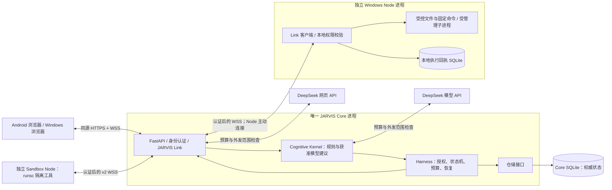
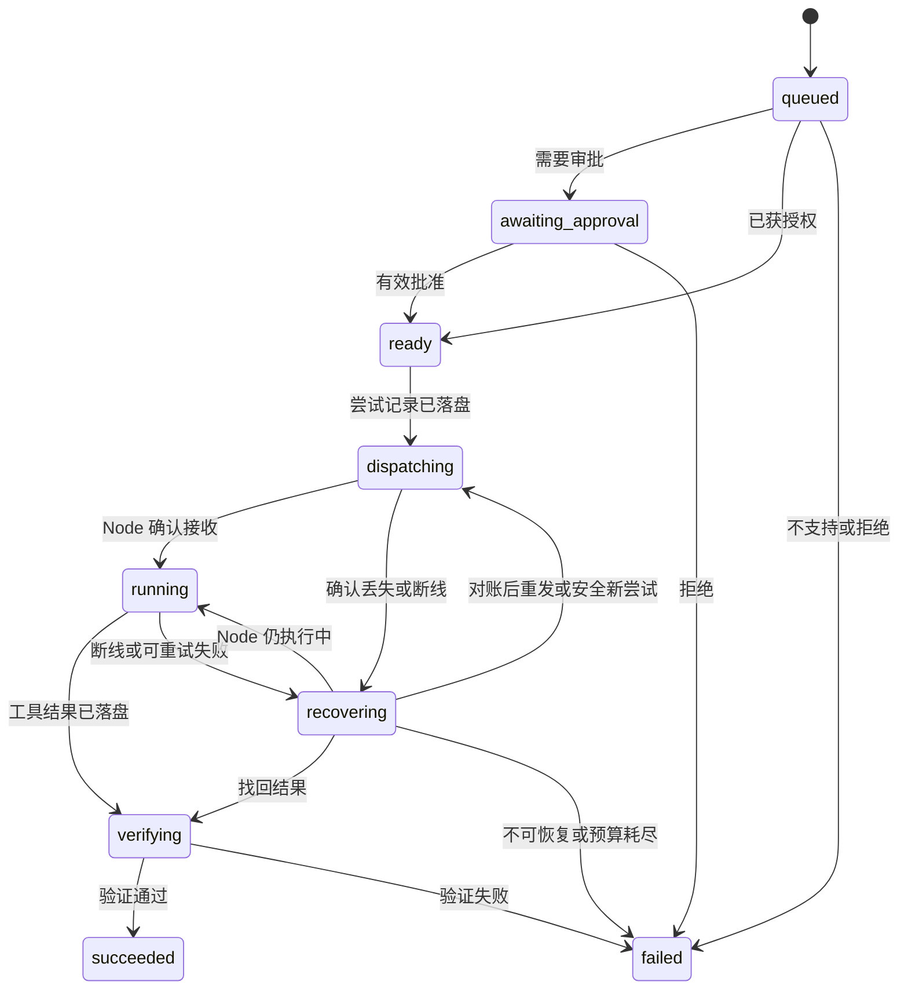
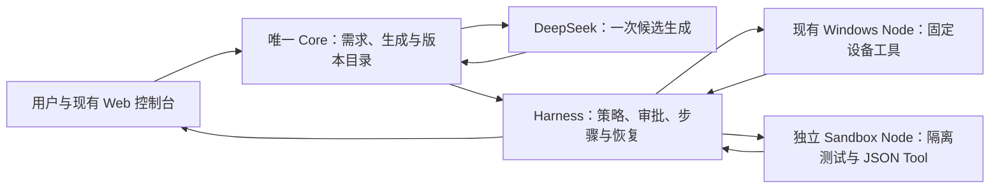
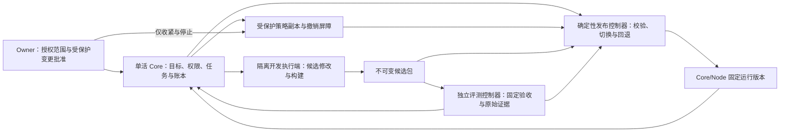

# NEXUS 架构设计

本文件解释系统如何工作，以及开发时必须保持的边界。功能状态、部署版本、批准范围、剩余工作和后续计划统一查阅 [ROADMAP](ROADMAP.md)；使用和验证文档按 [文档导航](README.md)查找。开发前仍须完整阅读本文件、[AGENTS](../AGENTS.md)和路线图。

## 先了解整体

浏览器是使用入口，Core 是唯一中心服务，Node 是设备执行端。用户提出请求后，Core 负责理解、记录、核对权限和安排执行；Node 只执行获准的具体操作，返回结果；Core 检查结果后再展示给用户。

模型可以帮助理解请求、给出建议和解释获准结果，不能自行授予权限、改写执行记录或把一句“成功了”当作任务完成。聊天记录、执行历史和用户明确同意保存的长期记忆分别管理。

项目已从 M1 可靠执行底座演进到模型、聊天、自定义能力、项目记忆和有界工具工作。前 1–13 节说明共用架构与当前能力边界；M1 的零模型、单步、两个只读工具只保留为历史基线，不再约束后续开发。第 14–19 节说明各次扩展及适用入口；旧入口限制不覆盖后续明确替代它的设计。第 20 节是高自由度自迭代提案，尚未实施，不改变现行运行权限。保留既有章节编号和旧标题锚点以兼容链接。

| 阅读主题 | 章节 |
| --- | --- |
| 系统分工与工具范围 | 第 1–5 节 |
| 身份、审批、任务进度和恢复 | 第 6–8 节 |
| 资源上限、存储、记忆和代码位置 | 第 9–11 节 |
| 历史限制的替代关系与持续边界 | 第 12–13 节 |
| 自然语言模型接入 | [第 14 节](#14-m2真实模型与自然语言任务) |
| 自定义工具与流程 | [第 15 节](#15-自扩展tool-与-skill-方案) |
| 聊天与工具结果 | [第 16 节](#16-自由聊天与会话任务衔接方案) |
| 网页前端与独立 App | [第 17 节](#17-web-前端与-app-设计边界) |
| 聊天中的有限多步流程 | [第 18 节](#18-m5聊天中的有限流程) |
| 项目上下文、可控记忆与基础工具 | [第 19 节](#19-m6项目上下文与受控基础工具) |
| 插件、Skill 与 Core/Node 自迭代提案 | [第 20 节](#self-iteration-design) |

## 常用名词

2026-10-27 虚拟手机 MuMu 接入：`builtin.android_emulator@1.1.0` 复用原 `plugin.call@1` 权限、任务和回执，由 Windows Node 操作 owner 指定的现有 MuMu 实例；实例编号和创建时间绑定身份，运行版本固定，独立 ADB 只监听 localhost，并仅连接该实例报告的本机端点。应用和账号留在 MuMu 原磁盘；旧 SDK 专用 AVD 支持和数据保留。退出／游戏模式只自动关闭 NEXUS 启动的实例，手动停止可以关闭配置实例，不终止 MuMu 公共服务。截图、画面绑定输入和中文助手沿用原实现；没有新增 Core 权威、模型循环或真实手机访问。详见[虚拟手机](android-emulator.md)，交付状态见[P106](ROADMAP.md#p106-android-emulator)。

2026-10-25 full 宿主目录追加：文件参数及 `plugin_execute` 外层的可选 `access_root` 指定目标设备的任意本地绝对目录，`path` 相对此目录；省略时仍用 workspace。Core 按有效 full 工作授权、owner、设备与模式指纹在准备和派发前重查，normal 或无绑定工作授权时拒绝。预览摘要绑定访问根，旧命令缺省不序列化新字段，保留回执、CAS/读回、链接检查与取消。Shell/终端本来就按当前账户宿主权限运行，不将默认工作目录当隔离边界。本段替代下文对 full 文件范围统一限定 workspace 的旧表述；normal 原边界保持，不扩大 Android 系统沙箱或自动源码发布范围。见 [ADR 0046](decisions/0046-full-mode-host-roots.md)，状态查 [P91](ROADMAP.md#p91-full-host)。

2026-10-24 使用额度追加：用户明确要求取消所有累计调用及金额额度。`models.call_limits_enabled=false` 关闭每日模型／网页调用、每轮动作／模型交换、工作授权操作累计数、目标轮数、语音次数与轮数；`models.cost_limits_enabled=false` 关闭任务／每日金额、跨轮根金额及语音 ASR／TTS 用量额度。模型审计、费用快照与未知账本保留，旧未知执行仍不重发；价格快照过期不在金额额度关闭时阻断调用。Schema036只移除工作步骤索引16的上界并为新授权保存是否启用操作额度，不改旧授权或历史结果。单次传输批量、请求／存储容量、截止时间、授权及取消不变；用户明确设置的提醒运行次数仍是任务语义。下文历史4/5、16/17、20操作及100次每日额度仅适用于开关启用的兼容模式，当前部署见 [P89](ROADMAP.md#p89-unlimited-usage)。

MCP 能力判断：聊天目录在各设备的 `plugin_inspect` 描述中附带同 owner／设备的有界托管登记摘要，不包含程序路径、参数或实时在线状态；入口为手机不限制电脑工具。查询具体 `builtin.mcp` 同时返回执行器状态和当前登记，模型应核对目标设备后区分已登记、可执行、需审批与实际成功，不能把旧聊天中的自述当作能力证据。登记列表与详情优先返回仍 active 的版本，新 pending／failed 修订不掩盖旧 active。摘要不授予权限，也不证明设备静态配置不存在；发布状态查 [P87](ROADMAP.md#p87-mobile-mcp)。

2026-10-24 会话能力接通：执行可用性取已部署契约、目标 Node 配置/完整摘要和权限交集，不能只看注册表或旧提示；跨设备 Skill 版本按目标设备查找。安装经 Shell 的实际完成证据，MCP 真实发现/激活后调用，再复用原 Skill 版本流程。原生步骤失败保留底层 MCP/Shell 证据，Windows-MCP 用户让权保护不绕过。`models.chat_work_max_actions` 默认4、最大16，最多动作数+1次模型交换；完整请求默认32 KiB、可配置到64 KiB，P83发布时采用16动作/17交换和64 KiB；P89已关闭累计动作／交换额度，64 KiB请求容量保持。此配置替代下文旧入口固定4/5和32 KiB的全局表述，不改变生成工具独立限额、每批4调用、权限及恢复边界。准入与发送均计入自动记忆提示。见 [ADR 0042](decisions/0042-conversation-capability-readiness.md)；生产与证据查 [P83](ROADMAP.md#p83-windows-mcp)。

2026-10-23 金额策略扩展：按用户明确指令，`models.cost_limits_enabled=false` 可关闭单轮与每日金额限制，以及金额引起的聊天输出收紧；本次聊天输出上限为 256000。费用预估/用量/未知仍保留，每日次数、token、超时、权限及恢复继续独立检查。该策略覆盖本文早期将 USD 0.05/轮与 USD 1/日写作固定要求的部分，默认新安装仍开启金额限额；见 [ADR 0032](decisions/0032-owner-cost-limits.md)，实际部署查 ROADMAP。

2026-10-23 工具参数反馈：完整工具信封中已提供函数的参数校验失败，整批不产生执行；Core 保存有界诊断并在原 4 动作/5 交换内返回未执行证据供修正。继续前重查授权、调用预算与停止状态；未知结果、截断、信封错误和重启不进入自动修正。文件 12000 UTF-8 字节与路径/预览保护保持，见 [ADR 0033](decisions/0033-tool-argument-feedback.md)。

2026-10-22 原生插件扩展：Core 继续拥有版本、权限、任务、预算及恢复权威；Node 的 `plugin.call@1` 复用原执行回执，严格绑定插件版本和本地配置摘要。全局 normal/full 由会话覆盖；生成插件独立 runsc 测试后按模式决定批准/自动启用，宿主执行以 Windows 当前用户权限进行。具体边界与协议见 [ADR 0028](decisions/0028-native-plugins-permission-modes.md) 和 [插件接口](plugins.md)，交付状态只记 [ROADMAP](ROADMAP.md)。它替代本文件早期固定 Shell 和所有生成版本一律逐次批准的相关限制，不改变既有独立 M4 Tool 执行器或把旧 Skill 自动升级为宿主代码权限。

原生 Skill/MCP 扩展：`skill_native_steps_v1` 显式允许现有 Skill 执行器派发固定摘要的 Shell/MCP `plugin.call@1`，版本测试仍使用不执行宿主命令的契约替身，版本批准保留。运行绑定 owner 会话及有效权限指纹，normal 对具体任务审批，full 按当前范围免执行确认。Core 保存 MCP 配置/目录版本并核验 Node 的真实发现结果后原子激活；调用重新发现并核对目录摘要，配置或权限变化阻止旧命令。迁移 028 保留旧 Skill 行及默认空权限字段；无 MCP binding 的旧命令序列化不变。Node 通过显式 `allow_managed_mcp` 策略接入，stdio 每次操作使用独立初始化/受控进程，非持久会话。设计见 [ADR 0034](decisions/0034-skill-managed-mcp.md)，接口和兼容限制见 [Skill/MCP](skill-mcp.md)，不据本段推定生产已升级。

| 名词 | 本项目中的意思 |
| --- | --- |
| Core | 唯一中心服务，保存任务、权限、记忆和最终执行记录 |
| Node | 设备执行端；执行具体命令，不另建自己的目标或长期记忆 |
| Cognitive Kernel | 理解和选择模块：先用固定规则，必要且获准时使用模型 |
| Harness | 执行管理模块：管权限、审批、派发、取消、恢复、预算和结果检查 |
| JARVIS Link | Core 与设备/浏览器之间的认证通信，不替代任务管理 |
| Tool / Skill | 一个小操作的工具 / 按固定步骤组合工具的可复用流程 |
| Provider | 与某个模型服务通信的适配器 |
| Sandbox / runsc | 运行生成代码的独立隔离环境 / 所选的隔离运行时；是否隔离有效必须实测 |
| 持久化 | 把记录可靠保存到数据库，进程重启后仍能查询 |
| 幂等 | 同一个请求重复到达时，返回同一记录，避免重复创建或执行 |
| 对账 | 断线或重启后比较 Core 和 Node 的执行记录，查清是否执行及结果 |
| attempt / ack / unknown | 一次执行尝试 / 已保存结果的确认 / 执行结果尚无法确认 |
| 契约 / 摘要 / ADR | 严格的数据格式 / 绑定内容的指纹 / 解释重要设计选择的记录 |

技术字段保留原名，方便对照代码；面向用户的页面与说明优先使用“中心服务、设备、流程、执行记录、核对”等中文表述。

## 项目愿景

NEXUS 是面向个人、长期运行的统一认知与多身体自主 AI 系统，目标是逐步具备类似 JARVIS 的环境感知、长期记忆、目标管理、任务执行和反馈调整能力。

**One Mind, Many Bodies — 一个大脑，多个身体。** Windows、Android 及未来设备都是同一个 Core 的身体，不各自形成独立人格、目标体系或长期认知存储。设备可进行工具执行、格式处理和回执恢复等必要的本地处理。

长期愿景通过可验证的小里程碑推进。M 表示产品里程碑，S 表示开发子阶段，P 表示任务；S0–S7 / P01–P12 对应已结束的 M1，不是当前开发的范围上限。实施仍按用户本次目标与既有授权推进。

## 1. 结论与设计边界

采用一个 Python 单体 Core 服务、独立 Windows Node、独立 Linux/WSL Sandbox Node，以及由 Core 托管的 Web 客户端。Core 内部分模块，模块间使用函数及类型接口；Windows 基础工具使用扩展后的 JARVIS Link v1，生成工具使用独立 v2 Sandbox 协议。模型与网页 API 由 Core 在预算和外发范围内调用。独立 App 复用同一个 Core，具体客户端方案按第 17 节评估。

三个不变量：

1. **一个大脑**：只有 Core 可以创建目标、改变任务权威状态、授予操作权限和写入长期记忆。Node 只接受经过认证和授权的具体命令。
2. **低成本运行**：心跳、任务查询、重连和恢复使用固定规则，不调用模型。自然语言、聊天、能力生成和有限工具工作可在显式启用、同意范围与预算内调用模型。
3. **可靠自主执行**：先持久化再派发；成功需要匹配当前执行尝试的工具证据及验证；未知执行结果必须显式保留，不能推断成成功或直接重试。

系统可进行有界的多步工作，但模型建议始终经过确定性授权、持久执行和结果验证；不据此宣称已实现通用自主智能。

## 2. 需求中需要澄清或补足的地方

| 问题 | 影响 | 本方案采用的边界 |
| --- | --- | --- |
| 统一认知容易被理解成一个大模型或一个串行循环 | 模型故障会阻塞整个系统，也容易让模型越权 | Core 是状态和权限的唯一权威；模型是可替换计算服务，异步 I/O 不改变权威归属 |
| “断线恢复”没有定义重复与未知结果 | 已执行但回执丢失时，重发可能造成重复操作 | 持久化执行尝试、Node 回执和对账；不承诺分布式 exactly-once |
| “只读”没有限定可读取的数据 | 文件名、环境变量和系统信息也可能泄露隐私 | 按工具、节点、资源别名及字段授权；受控文件读写限配置 workspace，不开放任意路径 |
| Tailscale 只能解决部分网络问题 | 连上网络的设备仍不应获得执行权限 | 应用级凭证、消息授权、HTTPS/WSS 和撤销能力仍须独立实现 |
| 审批对象与有效期未定义 | 修改参数或目标后可能错误复用旧审批 | 审批绑定任务、工具版本、规范化参数摘要、节点和策略版本，并设置期限 |
| 长期记忆与执行历史没有区分 | 工具输出、推测可能被误当成用户认可的事实 | 执行日志与授权记忆分开存储；记忆需要明确同意，并记录证据与时效 |
| “任务成功”缺少可操作定义 | 容易把模型回答或一个 success 标志当成完成 | 工具特定验证器校验结构、任务归属、约束和证据；声明验证级别 |
| Core 迁移与同时运行两个 Core 未区分 | 两套权威可能重复派发任务 | 当前支持停机迁移，保持单活；同一数据目录使用独占进程锁 |
| 全天候运行缺少资源和故障边界 | 队列、日志、重试可能无限增长 | 有界队列、结果大小限制、任务期限、执行次数和模型预算；磁盘写入失败停止派发 |
| 需求同时涉及底座与完整自主系统 | 个人开发容易陷入框架建设 | 在原执行底座上逐步扩展有限流程和工具循环；后台目标与调度按实际需求设计 |

这些边界适用于各次扩展；具体能力不再限于 M1 两工具。DeepSeek 接入见第 14 节，自有云端部署见第 3 节，文件、网页与聊天工作见第 19 节；Android 原生能力按路线图单独规划。

<a id="3-最小部署架构"></a>

## 3. 部署架构



- Windows 最初同时运行 Core 和 Node，但必须是两个独立进程，可分别重启。
- Harness 和 Cognitive Kernel 是 Core 内的模块，不是额外服务。
- Node 主动连接 Core，不需要对外监听服务端口。浏览器不能直接控制 Node。
- Core 数据库只由 Core 访问。Node 回执只记录命令身份、局部执行阶段及有限结果，不保存长期目标、用户画像或规划。
- 当前固定单个 Core worker、每个 Node 同时执行一个工具尝试；Core 可同时处理多个网络连接。多步流程依次复用执行槽，不等于多活 Core 或无界并行。
- 单例锁绑定规范化数据目录，防止误启动第二实例。它不提供跨主机分布式锁；禁止复制数据库后同时启动两套 Core。
- 将来移动 Core 时，停旧 Core、取得一致备份、迁移数据及身份配置，再让 Node 修改连接地址。移动的是权威数据，不是重新建立一套人格。
- 2026-10-18 用户明确批准自有 Ubuntu 云端单活 Core、无域名 IP 直连 HTTPS/WSS、正式证书和自动续期。实际迁移保留原身份及权威历史，Windows 仍只运行 Node；不引入第二 Core 或新工具。网络不再依赖 Tailscale，CA 只负责签发和续期；决策见 [ADR 0008](decisions/0008-self-hosted-core-ip-tls.md)，结果见 ROADMAP 和部署说明。
- 当前不依赖 Redis、Celery、Kafka、容器编排、向量数据库或独立调度微服务。新增基础设施须证明实际需求、维护成本与迁移方案，按重要依赖或架构变更评估；早期 MVP 排除清单不构成永久禁令。

Core启动在创建事件循环前调用 `configure_transport()`。非Windows的CPython3.12使用进程内传输兼容修正：缓冲输出关闭时保留写回调，待 `connection_lost` 完成后释放，并让 `writelines` 复用带连接状态检查的 `write` 路径。修正对应上游[gh-115514](https://github.com/python/cpython/issues/115514)与[gh-136234](https://github.com/python/cpython/issues/136234)，按受影响实现特征避免重复包装；不修改系统Python、不屏蔽事件循环异常。更换解释器版本时重新验证真实套接字背压、重入写入和关闭流程；本次复现及上线证据见[ROADMAP P111](ROADMAP.md#p111-server-cpu)。

FastAPI 支持 WebSocket 依赖认证；其内存连接列表示例也明确仅适用于存活的单进程。NEXUS 因此将任务事实放入数据库，内存只保留可重建的连接与唤醒信号。[FastAPI 官方文档](https://fastapi.tiangolo.com/advanced/websockets/)

## 4. 模块职责与接口

以下是目标接口与职责边界，已实现的 S2 接口和后续接入要求见 [storage-security.md](storage-security.md)。对象都使用明确的类型；跨网络契约使用 Pydantic 模型并拒绝未知字段。

| 模块 | 负责 | 主要接口 | 不负责 |
| --- | --- | --- | --- |
| Core 应用层 | 身份、任务入口、设备登记、历史查询、记忆与控制 API，组装各模块 | `submit(request, principal) -> TaskSnapshot`；`query_tasks(filter, principal)` | 直接执行设备工具 |
| Cognitive Kernel | 对已知意图规则匹配，决定是否需要模型，给出可解释路由建议 | `route(intent, context) -> RoutingDecision` | 审批、授予权限、写任务终态 |
| Harness | 固定计划、策略判定、审批、预算、尝试、派发、验证、取消、恢复 | `advance(task_id)`；`decide_approval(...)`；`request_cancel(...)`；`reconcile(node_id)` | 设备文件操作、让模型修改权限 |
| JARVIS Link | 连接认证、消息解析、会话、心跳、重连、确认和恢复传输 | `dispatch(command)`；`request_attempt_status(...)`；`publish(event)` | 判断任务成功、维护独立业务状态 |
| Node Runtime | 注册能力、检查本地策略、执行获准工具、保存及重传回执 | `execute(AuthorizedCommand) -> ToolResult`；`cancel(attempt_id)`；`status(attempt_id)` | 拆解用户目标、选择 LLM、创建后续任务 |
| Tool Registry | 提供工具名与版本、参数和结果模型、风险级别、重试性质及验证器 | `resolve(tool_name, version) -> ToolSpec` | 自动下载或执行任意插件 |
| Policy Engine | 按身份、工具、参数、资源、节点计算允许、拒绝或待审批 | `evaluate(principal, action, context) -> PolicyVerdict` | 由模型自然语言决定权限 |
| Storage | 事务、任务状态比较更新、事件、身份与记录查询 | `transaction()`；`transition(expected_revision, ...)` | 在数据库事务内等待网络或模型 |

`RoutingDecision` 至少包含：`mode`（rule / decision_model / llm / reject）、`reason_code`、`policy_version`、建议工具及版本、已验证参数；使用模型时才有 `model_id` 和预算估计。路由建议必须经过 Harness 再授权。

模型接口区分可选判断器与实际 Provider：

- `DecisionModel.decide(context, budget) -> DecisionAssessment`：可替换的轻量判断器，输出是否需要推理、置信度及候选能力；不因保留接口自动部署额外分类模型。
- `ModelProvider.estimate(request)` 与 `invoke(request, limits) -> ModelResponse`：屏蔽厂商差异，返回内容、用量、耗时与错误。配置未启用时使用禁用适配器并返回 `MODEL_DISABLED`；真实 Provider、流式聊天和工具交换见第 14、16、19 节。

模型调用先检查授权和预算，再匹配能力；未来增加多个候选时才比较估算费用与延迟。没有足够预算、价格上限或合适模型时显式停止，不无限升级模型或重试。模型输出属于未受信建议，不能扩大工具列表、文件范围或预算。

<a id="5-mvp-的任务与工具"></a>

## 5. 任务入口与工具范围

结构化任务、自然语言单步入口、聊天工作和固定 Skill 共用授权与执行底座。结构化入口不支持的意图返回 `UNSUPPORTED_TASK`；已启用的聊天入口可在逐轮同意及预算内使用模型选择工具。单个基础任务仍对应一个动作，整个用户目标可由多个有界动作或 Skill 步骤完成。

| 能力 | 执行位置 | 参数与授权边界 |
| --- | --- | --- |
| `system.info@1` | Windows Node | 空参数；仅系统名称、版本、架构和 Python 版本，需持久授权 |
| `filesystem.list@1` | Windows Node | `root_id`、`limit`；只列根目录直接条目。原单步入口保留审批，聊天工作可按有效范围执行 |
| `filesystem.read/search/write_preview/write@1` | Windows Node | workspace 相对路径、有界 UTF-8 及查找；配置范围内无额外文件审批，写入仍核对预览、旧内容与读回 |
| `command.run@1` | Windows Node | 已登记的程序、摘要与固定参数模板；任务入口审批和聊天工作范围分别核对 |
| 已批准且启用的 Tool / Skill | 独立 Sandbox Node / Core 协调各执行端 | 固定版本、测试与批准；生成 Tool 只在合格沙箱运行，Skill 最多 3 个顺序步骤 |
| `get_node_status`、`inspect_capability` | Core | 有时点的节点状态 / 合格能力详情；不是新增设备执行权限，具体交付版本见路线图 |
| `web_search` / `web_fetch` | Core 调用网页 API | 显式配置、公开查询或 URL、有界结果和来源；共享模型费用账本 |

上表说明已建立的能力类别，不把工具数量锁定为两种；新增工具仍需严格契约、资源范围、结果验证与相应交付证据。代码中存在新条目不等于生产已部署、配置或用户已验收。

`root_id` 由 Node 本地配置映射为目录，当前文件资源使用 `workspace`。Core 只保存允许的别名；未配置或未授予持久身份权限时不能访问，不能因模型给出绝对路径而开放范围。工作区默认策略复用已有配置，不是自动登记新目录或新身份。

文件工具约束按操作区分：

- 原 `filesystem.list` 不递归、不读正文；名称搜索与文本读写使用各自严格、有界的参数，不把列目录工具的限制套用于全部文件工具。
- 文件路径须在 workspace 内规范化，拒绝越界、UNC、重解析跳转及相应链接风险；写入使用句柄保护、摘要绑定、临时文件替换和读回检查，细节见第 19 节。
- 结果达到条目、正文或字节上限时明确标记截断，不把片段称为全量内容。页面将输出作为文本显示。
- Node 以普通用户运行；路径保护与 Windows Job 是本地资源及生命周期边界，不代替不受信代码沙箱。生成 Tool 使用第 15 节的独立环境。

Godot、桌面或其他工具按具体场景与授权评估，不再受“第一版不增加第三种工具”的限制；是否已实现仍由路线图及证据确定。

## 6. 身份、权限与审批

### 6.1 身份和传输

- 首版单用户；分别建立 owner 身份和每个 Node 的独立身份。稳定 `node_id` 与高熵随机令牌分离，令牌可撤销且不能相互替代。
- 通过本地管理命令离线登记节点，不提供开放自助注册。Core 保存随机令牌的摘要；Node 通过环境变量或本地未入库配置获得自己的令牌。
- Node 在 WebSocket 握手使用 Bearer 认证，同时验证 Core TLS 证书；禁止关闭证书校验。身份来自认证连接，不能信任 JSON 自报的 `node_id`。
- 浏览器通过同源 HTTPS 登录换取有时限、可撤销的 HttpOnly / Secure / SameSite 会话 Cookie。浏览器原生 WebSocket 不提供任意 Authorization 请求头接口，因此浏览器与 Python Node 不共用同一种握手方式。[MDN WebSocket 构造器](https://developer.mozilla.org/en-US/docs/Web/API/WebSocket/WebSocket)
- 对浏览器握手和 HTTP 写操作检查允许的 Origin；HTTP 写操作另校验会话关联的 CSRF 令牌。会话过期或凭证撤销时关闭现有连接。所有消息继续执行授权检查。
- 不把长期令牌放在 URL、LocalStorage、示例配置或日志里。不依赖 CORS 自动保护 WebSocket。
- 默认只绑定 localhost；此开发模式允许 HTTP/WS，Cookie Secure 只在该显式本机模式关闭。Android 接入必须显式开启远程模式并提供 Android 信任的 HTTPS/WSS 证书。当前入口由 Uvicorn 直接加载，禁用代理头；部署层终止 TLS 是目标选项，尚未交付该接入模式。配置好 TLS 前不开放远程访问。
- LAN 和 Tailscale 都只是连接路径；应用权限检查相同。不自动修改防火墙、证书信任或系统安全设置。

Origin、逐消息授权、过期会话关闭和消息限额是参考 OWASP 建议采用的边界；具体角色与策略是 NEXUS 的设计选择。[OWASP WebSocket 安全指南](https://cheatsheetseries.owasp.org/cheatsheets/WebSocket_Security_Cheat_Sheet.html)

### 6.2 授权模型

有效能力 = Core 已知工具 ∩ owner 授权 ∩ Node 身份许可 ∩ Node 已注册能力 ∩ Node 本地允许范围。

节点声称支持一个工具，并不代表它自动获准执行。审批只能批准本来允许通过人工授权的操作；不能把未实现或硬性禁止的工具变成可用工具。

Android 本机权限开关属于 owner 的显式选择：经 owner 会话、CSRF 和安装证明绑定后可自动同步到 Core 的节点范围授权，无需重复操作服务器。Node hello／系统能力上报仍不授予权限；系统服务、所选目录、具体任务审批与本地开关继续取交集。重复的本机快照不恢复之后的远端撤销，决定见 [ADR0050](decisions/0050-device-permission-sync.md)。

授权结果由工具、入口和当前策略共同决定。原单步入口的 `system.info` 使用持久预授权，`filesystem.list` 保留逐任务审批；M6 工作区文件读写/查找由已配置策略自动形成绑定记录，聊天工作还核对本轮有效范围。不能把原目录审批推广为所有工具均需逐次确认，也不能把工作区默认权限推广到未配置资源、固定命令或新扩展版本。

审批记录绑定：`approval_id`、`task_id`、owner、目标 `node_id`、工具名及版本、规范化参数 SHA-256、资源/策略版本和到期时间。单个批准只解锁该任务中完全一致的动作，最多允许预算内的只读重试，不允许复用到新任务。参数、节点或策略变化后必须重新评估，必要时重新审批；已派发任务不原地改写动作。

S2 已实现离线身份/授权管理、随机凭证摘要、8 小时浏览器会话（最多 10 个有效会话）、同源会话路由及 HTTP/WS 认证守卫。P06 的 Node Link 已接入 `SecurityHTTP.receive_text`，每秒检查空闲连接的撤销/过期，并在返回每条消息前再次检查。资源范围摘要绑定 `NodeScope.resource_version`，持久授权或身份变化递增全局策略版本。Link 从认证节点、可信工具/资源配置与持久授权交集构建范围；自报能力不能扩大授权。loopback WS 及 S7 实际公信 HTTPS/WSS、Android 接入均已有证据，范围见 [S7 验证](S7-VERIFICATION.md)。

重要删除、对外消息、支付和系统安全设置没有现成工具时拒绝执行；未来明确需求可另行设计，必须同时具备精确授权、效果验证、幂等/对账策略，不能只增加一个“同意”按钮。早期排除不构成永久产品禁令。

## 7. 任务状态机与执行语义

### 7.1 状态



图仅展示主流程。完整公共规则：

| 条件 | 转移或处理 |
| --- | --- |
| 尚未派发的 queued / awaiting_approval / ready 收到取消 | 立即进入 cancelled，并原子撤销待派发记录 |
| dispatching / running / recovering 收到取消 | 持久化 `cancel_requested`；要求 Node 停止或上报既有结果，收到确认前不假称 cancelled |
| Node 确认已停止且没有已完成结果 | 进入 cancelled，记录执行尝试实际结束阶段 |
| Node 已完成并提交结果 | 按结果验证；取消请求记录为已来不及取消 |
| 结果已持久化并进入 verifying 后收到取消 | 返回 `ALREADY_FINISHED`，完成本地验证 |
| 任何非终态到达总期限 | 进入 timed_out；仍有活动尝试时发送停止请求，并记录结果是否未知 |
| running 返回明确的不可重试错误 | 进入 failed，保留结构化错误 |
| dispatching 直接收到有效结果而确认包缺失 | 可直接进入 verifying，不等待一个已无必要的确认包 |
| 验证前崩溃、重启时已存在有效结果 | 恢复到 verifying，重新运行确定性验证器 |
| 任意终态收到迟到消息 | 只补充审计或对账证据，不倒改终态，不覆盖新尝试 |

终态为 `succeeded / failed / cancelled / timed_out`。任务另有 `execution_outcome = not_started / known / unknown`，避免把“已经超时”误解成“肯定没有执行”。未知结果不会进入 succeeded。

每次转移使用事务及 `revision` 比较更新，避免取消、结果、超时竞争时互相覆盖。任务计划和结果分开保存；终态不可被 Node 自行更改。

### 7.2 尝试、幂等与恢复

单个基础任务对应一个工具动作；只读且明确可重试的动作至多两次执行尝试，写入、命令和生成 Tool 不自动新建尝试。Skill 和聊天工作在原任务之上记录有限步骤，不另建第二套权威状态机。尝试记录包含 `attempt_id`、`task_id`、`step_index`、`attempt_no`、节点、参数摘要、派发次数、阶段、期限与结果。

1. Core 在同一事务中保存任务状态、尝试、审计和事件后，才发送命令。尝试表就是最小持久派发队列，无需消息中间件。
2. Node 在执行前持久化该 `attempt_id` 的接收回执及命令摘要，再确认接收。相同 attempt、相同动作仅重传状态或缓存结果；同 ID 不同动作返回 `IDEMPOTENCY_CONFLICT`。
3. Node 父进程在本地记录 started 后启动固定工具子进程；started 与实际开始之间仍可能发生崩溃，恢复时一律视为未知，不假定未执行。子进程由父进程持有及管理，重启后先确认旧执行已结束，无法确认时不新开尝试。
4. Node 完成后先保存有限结果，再回传。Core 持久化结果后回复 `result.ack`；断线时 Node 保留结果并于重连重传。
5. Core 重启或 Node 重连后，按活跃 `attempt_id` 请求状态。已完成则验证；仍运行则等待；确认从未执行或确认旧执行已经结束且工具可安全重跑时，才允许在预算内新建 attempt。
6. 同一命令的网络重传沿用原 attempt，不计作新的执行尝试，但仍有单独派发次数上限。只有 Core 可以创建新 attempt。
7. 白名单只读工具允许按预算安全重跑，但不能保证两次读取产生相同快照；结果包含观测时间。具有副作用且结果未知的工具不得自动重试，必须依赖外部幂等键、查询或人工对账。
8. Core 终态已确定后收到迟到结果，返回已结算确认并留审计；不会继续驱动执行。不自动清理尚需对账的 Node 回执。

结果时间与执行停止分别判定：认证 Node 提交的完成回执必须匹配 task/attempt、工具版本及命令摘要。观测时间超出原 5 秒容差时，输出不进入成功验证，记录 `attempt.result_time_rejected`，但完成回执仍可证明该执行已经结束。Core 持久化停止证据后释放执行槽，保留未知业务结果及原终态，不自动重试该动作。Node 的已完成、已取消及有真实停止证据的未知回执都进入原有有界重传，Core 落盘后确认；无停止证据的未知回执不确认、不释放槽。每尝试 64 次主动查询预算保持，不因重连重置。

连接认证通过后，Node 以 `node.welcome` 信封的 Core UTC 时间和本机单调时钟建立本次运行的时间基准，计算命令期限并在工具进程结束后保存一次回执观测时间。缓存回执跨重连保持原时间，不用新偏移重新改写；独立离线运行沿用本机 UTC。握手等待仍受原 5 秒期限限制，Core 的结果时间容差、总期限及身份校验不变，不调整操作系统时钟。

这里实现的是有确认、有去重和可恢复状态的协议，不是无条件“恰好执行一次”。WebSocket 保证连接内的传输顺序，不提供跨重连的应用事务。

### 7.3 成功验证与暂停

- Node 的 success 字段仅是证据之一。Core 校验认证节点、task/attempt 归属、工具版本、命令摘要、结果模型、大小限制及工具特定断言。
- `system.info` 验证必需字段和类型；目录工具验证 root_id 一致、条目/字节限制、无目标内容、截断标记等。单步任务只有当前有效尝试通过验证才 succeeded。
- 验证级别标记为 `node_report_schema_checked`。这不能证明恶意 Node 诚实，也不能证明操作系统底层事实绝对真实；更强的独立外部验证随未来具体工具添加。
- Node 使用受管理的固定工具子进程实施超时和取消；不能仅取消等待线程却让实际工具继续运行。Windows 目标为 Windows 10/11，工具进程纳入设置了 KILL_ON_JOB_CLOSE 的 Job Object，由 Node 独占不可继承的管理句柄；完成纳管前，子进程不得进入工具执行。纳管失败则拒绝执行。Node 崩溃时由 OS 清理工具进程；重启仍须对账，因为清理进程不能撤销已经完成的读取。该机制封装在 Node 内，不给 Core 引入 Windows 依赖。[Microsoft Job Objects 文档](https://learn.microsoft.com/en-us/windows/win32/procthread/job-objects)
- 禁止 shell=True、任意脚本或任意可执行命令入口。Job Object 用于生命周期管理，不被当作不受信代码的安全沙箱。
- 全局 `pause` 持久化，并立即阻止新的派发、重试和模型调用；已在执行的只读任务可完成。紧急停止使用独立的 `cancel_all`，对所有未完成任务发起可审计的取消。
- 取消、暂停、审批与派发通过同一个状态机事务检查；已经发送的命令无法被数据库事务撤回，需要节点停止协议。界面必须区分“停止派发”和“确认停止执行”。
- 数据库不能可靠写入时，Core 不接新任务或继续派发；Node 不能写回执时拒绝执行。

## 8. JARVIS Link v1 协议

P02 已实现本节 25 种消息的数据契约；字段、严格解析、错误及字节约定见 [protocol-v1.md](protocol-v1.md)。P06 已实现认证连接、心跳、会话替换和重连；P07 已接入持久派发和执行结算；P08 已实现网络对账、取消及全局控制，见 [S5 恢复](s5-recovery.md)。status_result 新增可选 execution_stopped=false；未知结果仅在有停止证据时允许预算内重试，严格 Core/Node 应同步升级。

P09 已接入同源静态页面、会话恢复、浏览器 WS 及消息授权。任务/控制事务通过触发器追加统一 client_events 游标，有效游标有界回放，无效游标先取得 HTTP 快照；慢连接独立排队并超时断开。历史事件附当前已提交状态及对应 revision，不伪造旧快照。详情见 [S6](s6-browser-records.md)及 [ADR 0006](decisions/0006-s6-browser-records.md)。

### 8.1 端点和消息信封

HTTP：`/api/v1/session` 用于登录/退出；`/api/v1/tasks` 和 `/api/v1/tasks/{id}` 用于分页历史与详情；`/api/v1/memories` 用于显式授权记忆管理。HTTP 与 WS 共用应用层授权。

WebSocket：`/ws/v1/client` 服务浏览器；`/ws/v1/node` 服务 Node。连接角色决定允许的消息，不使用可伪造的 sender 字段授权。

通用信封：

```json
{
  "protocol_version": 1,
  "type": "task.submit",
  "message_id": "d641f031-65ec-41f4-9933-297ed3856906",
  "correlation_id": null,
  "sent_at": "2026-10-17T08:00:00Z",
  "payload": {
    "request_id": "5d489189-2958-4fb2-a59d-2cba31974d96",
    "intent": "list_directory",
    "arguments": {"root_id": "workspace", "limit": 100}
  }
}
```

- `message_id` 标识一次消息；响应的 `correlation_id` 指向请求消息。
- `request_id` 是业务幂等键；同一 owner 的重连补发沿用它。Core 对 `(owner_id, request_id)` 建唯一约束；相同内容返回原任务，不同内容返回冲突。
- task_id、attempt_id、审批身份及状态由 Core 生成，客户端不能指定或越权修改。
- 所有时间为 UTC RFC 3339；页面按用户本地时区显示。客户端 sent_at 仅供诊断，不作为身份或核心超时依据。
- 信封和 payload 都严格校验；拒绝未知协议主版本、未知消息类型及多余字段。不发送 Python 对象或绝对文件路径。

### 8.2 消息类型

| 方向 | 类型 | 必要负载 |
| --- | --- | --- |
| 浏览器 → Core | `client.sync` | 上次持久 `event_id` 或 null |
| 浏览器 → Core | `task.submit` | request_id、intent、arguments |
| 浏览器 → Core | `task.cancel` | task_id |
| 浏览器 → Core | `approval.decide` | approval_id、approve/reject；审批人由会话确定 |
| 浏览器 → Core | `control.pause / control.resume / control.cancel_all` | request_id；仅 owner 可用 |
| Core → 浏览器 | `client.synced` | 同步边界游标、是否需要完整查询 |
| Core → 浏览器 | `task.accepted` | task_id、当前状态；只承诺任务已入库 |
| Core → 浏览器 | `task.updated` | event_id、task_id、revision、状态、有限结果或错误 |
| Core → 浏览器 | `approval.required` | event_id、approval_id、动作摘要、节点、到期时间 |
| Core → 浏览器 | `control.updated` | event_id、暂停状态及版本 |
| Node → Core | `node.hello` | node_id、节点版本、支持的工具版本和资源别名、当前 boot_id |
| Core → Node | `node.welcome` | session_id、心跳及限额配置 |
| Node → Core | `node.heartbeat` | session_id、活跃 attempt_id；不传任意屏幕或文件数据 |
| Core → Node | `command.execute` | task_id、attempt_id、工具及版本、参数、命令摘要、grant_id、到期时间、执行超时 |
| Node → Core | `command.accepted / command.started` | task_id、attempt_id、命令摘要、boot_id |
| Core → Node | `command.status` | attempt_id |
| Node → Core | `command.status_result` | attempt_id、阶段或 not_found、命令摘要、可用结果 |
| Core → Node | `command.cancel` | attempt_id、原因 |
| Node → Core | `command.cancelled` | attempt_id、实际停止阶段；已完成则返回原结果 |
| Node → Core | `command.result` | task_id、attempt_id、命令摘要、工具版本、观测时间、outcome、result 或 error |
| Core → Node | `result.ack` | attempt_id、stored/already_settled |
| 双向 | `error` | code、有限 message、retryable、关联消息 ID |

完成 node.hello / node.welcome 后，双方运行期消息还携带当前连接的 session_id；只接收当前已认证连接，替换连接时关闭旧会话。持久去重键仍是 attempt_id，不随连接改变。命令摘要覆盖不可变任务动作；会话字段及重传时间不进入动作摘要。

Core 的 grant_id 引用已持久授权；它通过已验证的 Core 连接传给 Node，不是一个可由客户端提交后直接生效的权限令牌。Node 无论如何仍检查本地工具和资源策略。

`command.result` 的 payload 示例：

```json
{
  "session_id": "1716eb9e-78c4-4baa-9a9c-49b47fcde962",
  "task_id": "93e32968-43ba-43dc-9f07-610d672b4884",
  "attempt_id": "6f74fd13-05d2-48dd-ae79-751a900a7d37",
  "command_digest": "aaaaaaaaaaaaaaaaaaaaaaaaaaaaaaaaaaaaaaaaaaaaaaaaaaaaaaaaaaaaaaaa",
  "tool": "filesystem.list",
  "tool_version": 1,
  "observed_at": "2026-10-17T08:00:02Z",
  "outcome": "succeeded",
  "result": {
    "root_id": "workspace",
    "entries": [{"name": "docs", "kind": "directory"}],
    "truncated": false
  }
}
```

### 8.3 重连、流控与错误

- Node 默认 10 秒心跳，30 秒未收到则判离线；这是可用性观测，不直接改变任务为 failed。重连采用 1–30 秒指数退避及抖动，持续重连不调用模型。
- Core 重启后要求 Node 重新认证、重新注册能力并对账。boot_id 改变意味着 Node 进程已重启，不能据此断定旧执行未发生。
- 客户端以持久 event_id 补取事件；事件游标来自 Core 数据库，表示为十进制字符串。按身份过滤事件；基于同步边界回放并接入实时流，按 event_id/revision 去重，避免回放与订阅之间漏事件。
- 游标无效或事件不可用时明确通知完整查询，客户端通过 HTTP 重新取得任务快照。浏览器断开不取消任务。
- 每个连接的发送队列有界；慢客户端被断开后从持久记录恢复，不阻塞调度。文件正文仅通过有界工具结果传输，不提供无限文件流；扩展产物使用独立有界接口。
- 主要错误码：`AUTH_REQUIRED`、`FORBIDDEN`、`INVALID_MESSAGE`、`PROTOCOL_UNSUPPORTED`、`UNSUPPORTED_TASK`、`POLICY_DENIED`、`APPROVAL_EXPIRED`、`NODE_OFFLINE`、`IDEMPOTENCY_CONFLICT`、`TOOL_TIMEOUT`、`BUDGET_EXCEEDED`、`RESULT_INVALID`、`EXECUTION_UNKNOWN`、`BUSY`、`MODEL_DISABLED`。
- retryable 仅提供故障分类，是否重试由 Harness 同时检查工具性质、回执、剩余预算和期限；错误消息本身不触发自动执行。

## 9. 默认资源预算

以下列出共用执行底座与当前各入口的主要上限。各入口分别约束动作、步骤和模型交换，不把 M1 的一个动作/零模型套用于整个用户目标。可信配置及对应严格契约决定实际值，模型和客户端不能自行提高上限；其他限制见第 14–19 节。

| 限额 | 默认值 |
| --- | --- |
| 基础任务动作 / 固定 Skill 步数 | 每个基础任务 1 动作；每个 Skill 最多 3 步 |
| 聊天工作动作 / 模型交换 | owner配置，默认4动作/5交换，最大16动作/17交换；每批最多4调用，底层操作另受工作范围限制 |
| 工作范围 | 默认内部 5 分钟 / 20 操作；旧显式授权最长 30 分钟 / 20 操作 |
| 每动作执行尝试数 | 白名单只读动作总计最多 2 次，含首次；写入、命令和生成 Tool 不自动新尝试 |
| 每次尝试的命令派发数 | 总计 3 次，含首次；均使用相同 attempt_id |
| 单次工具执行时间 | 普通工具 10 秒；`builtin.mcp` 由 Core／Node 协商，默认和上限 60 秒，包含启动、初始化、目录核对及工具调用。旧 Node 未声明支持时仍为 10 秒；Node 用单调时钟限时并服从授权有效期 |
| 接收确认等待 | 5 秒；丢失后对账，不能直接认定未执行 |
| 每尝试状态/停止请求 | 总计 64 次；每 5 秒至多一个周期请求，取消可立即发起；耗尽仍未知则保留执行槽 |
| Node 未确认结果主动重传 | 每 5 秒扫描最多 4 条，单连接每条最多 3 次；仍可响应 Core 查询 |
| 任务总期限 | 5 分钟，包含等待审批、离线和重试 |
| 审批有效期 | 最多 2 分钟，且不得晚于任务期限 |
| 每 Node 工具并发 | 1 |
| Core 待处理任务数量 | 100，超出返回 BUSY |
| 单身份新任务速率 | 每分钟最多 10 个；连接/消息也设有界速率限制 |
| 单消息 / 工具结果 | 64 KiB / 32 KiB，按编码后字节计算 |
| 目录条目数量 | 最多 200；超限明确截断 |
| 模型费用与 API 次数 | 每根请求/聊天轮次 USD 0.05，每 UTC 日 USD 1 / 100 次 API，模型与网页共用账本 |
| 模型调用范围 | M2 单步解释1次；M3普通聊天1次、结果解读合计最多2次；M4每次生成1次；会话工作最多配置动作数+1次交换 |

重传、失败和取消不返还已消耗的执行次数。新 attempt 前必须确认旧执行结束或确定未开始；不因计时器到期而并发开第二次。

Core 负责总期限及最终超时判定，Node 执行接收时剩余预算与单次超时中较小的值，并拒绝已过期命令。部署要求基本时钟同步；严重时钟偏差时停止派发并提示校时，不能通过放宽过期校验继续执行。

模型及网页调用使用原子费用预留、输出/结果限制、调用次数、总费用与每日额度限制，失败尝试同样计入。成本记录区分预估、报告用量和未知值，不把未知成本记为零；各入口共用同一账本。默认关闭是新环境的配置选择，不表示当前产品禁止模型。

## 10. SQLite 与长期记忆

使用 `aiosqlite` 进行异步数据库访问，短事务串行写入，迁移使用有版本的 SQL 文件与 `schema_migrations`。暂不引入 ORM；仓储接口使业务状态机不依赖 SQLite 查询语法，但将来迁移数据库仍需要专门迁移及测试。

Core 概念表：

| 表 | 内容 |
| --- | --- |
| identities / sessions / grants | owner 和 Node 身份、凭证摘要、会话期限及静态授权 |
| projects | 项目标识与元数据，任务可选关联项目 |
| tasks | 意图、固定计划、状态、revision、期限、预算、取消标志及有限结果 |
| task_attempts | 派发、去重、执行阶段、尝试预算、错误与回执 |
| task_events | 持久递增事件和重连游标；任务事实的事件历史 |
| devices | 能力、策略范围、最近心跳、在线观测；重启后在线状态重新确认 |
| approvals | 审批动作绑定、期限、决定及操作者 |
| audit_events | 身份、权限、审批、控制及执行审计；不复制秘密或无限输出 |
| memory_entries | 经明确同意的长期信息及来源、验证和时效 |
| routing_decisions | 路由方式、理由、策略版本、耗时及后续结果关联 |
| model_calls | Provider、模型/网页调用、预算预留、用量、费用状态、延迟、结果与根请求关联 |
| system_state | 全局 pause 状态和配置版本 |
| schema_migrations | 已执行迁移版本 |

Node 的 `receipts.sqlite3` 保存 execution_receipts、schema_migrations / node_identity，以及 S5 迁移 002 的 cancellation_tombstones，不属于长期认知存储。使用专用身份、模式摘要与 FULL 同步；received/started/结果先落盘、重复 attempt 去重、重启 unknown 和结果恢复均有证据。回执和墓碑各默认最多 10000 条，满后拒绝新增并保留旧证据。S5 增加升级前一致备份及前向迁移、持久取消屏障和停止证据。Windows Job 门控、进程清理、数据目录锁及恢复见 [Node Runtime](node-runtime.md)和 [S5](s5-recovery.md)。

模型调用记录与最终工具验证结果关联，分别观察调用可用性和任务验证结果，不能把模型正常返回等同于任务成功。没有实际调用的规则任务不伪造调用记录；M1 的零调用证据不覆盖后续真实账本。

关键事务：任务幂等创建；状态与事件/审计同时提交；派发前创建尝试；结果落盘后才确认；审批决定与下一状态同时提交。网络和模型调用均在事务外进行。

启用 WAL、busy_timeout，并在每个连接显式启用外键。数据库位于 Core 本地磁盘，不能放入网络共享目录；WAL 不是跨设备共享数据库的方案。[SQLite WAL](https://www.sqlite.org/wal.html)、[SQLite 外键文档](https://www.sqlite.org/foreignkeys.html)

使用 SQLite 一致备份接口或完全停机后的备份，不在运行时只复制一个 .sqlite3 文件。迁移前备份并校验；第一版只提供向前迁移，失败恢复使用备份，不自动执行破坏性降级。

S2 实现身份、会话、静态授权、任务、事件、审计与审批；S4 迁移 003 增加 execution_grants、task_attempts 和任务结果字段；S5 迁移 004 增加取消/停止/对账计数、system_state、control_requests 和 control_events。只创建当前使用的表。迁移验证连续版本及摘要，升级前生成唯一一致备份并 quick_check；拒绝无版本旧库或未知新版本。任务权威由 Harness 负责；离线管理审计的 actor 为空，subject 记录被管理身份。设计见 [ADR 0001](decisions/0001-s2-storage-security.md)及 [ADR 0005](decisions/0005-s5-recovery-controls.md)。

S6 迁移 005 增加 projects、memory_consents、memory_entries、routing_decisions、model_calls 和 client_events；tasks 可选关联项目。保存、替代记忆与明确同意同事务；撤销/过期默认不作为当前信息查询，不物理删除。每个新任务原子记录路由；历史路由补记明确 migrated 且不捏造耗时。S6 当时仅使用禁用 Provider，model_calls 为零行；后续迁移在保留旧数据的基础上接入真实调用、聊天、扩展、工作步骤和费用关联，不能将旧库形态作为当前模型限制。

记忆至少区分以下独立字段：

- `kind = fact / inference / plan`：这是何种陈述。
- `verification = unverified / verified`：是否有足够依据，记录 evidence_ref 与 verified_at；工具输出本身不会自动变成 verified fact。
- `valid_until`、`superseded_at`、`retracted_at`：信息何时过期、被替代或撤销。
- owner、来源、consent_event_id：谁明确允许保存什么内容。

首版提供简单记忆管理 API，只有明确的保存请求才写入；用户另行启用第 19.9 节的持续授权后，可从新聊天的用户原文自动提取，不从工具结果提取。过期信息默认不作为当前事实返回，历史仍可查询。任务执行记录是审计历史，不等于授权个人记忆。

首版不自动清除任务与回执。结果有大小上限，数据库使用量提供观测；达到存储告警或写入失败时停止新执行。长期运行后的归档、保留期和删除策略另行确认，不悄悄删除用户记录。首版日志可轮转，但不会因此删除数据库审计。

## 11. 项目目录结构

下列是仓库当前主要代码和文档的位置；省略细节文件，不为未来阶段预建空模块。

```text
NEXUS/
├── README.md                      # 项目介绍与使用入口
├── AGENTS.md                      # 开发规范
├── pyproject.toml                 # 工程与依赖声明
├── config/                        # Core、Windows Node、Sandbox 示例
├── docs/
│   ├── README.md                  # 分类导航，不维护功能状态
│   ├── ARCHITECTURE.md            # 技术设计
│   ├── ROADMAP.md                 # 唯一状态、批准、验收与计划入口
│   ├── history/                   # 固定历史记录，不追加当前进度
│   ├── decisions/                 # 设计决定
│   └── assets/                    # 脱敏证据与截图
├── src/nexus/
│   ├── contracts/                 # 通信、任务、工具、聊天和扩展数据格式
│   ├── core/
│   │   ├── app.py                 # 中心服务组装与启停
│   │   ├── cognitive/             # 规则、自然语言、聊天和结果续接
│   │   ├── harness/               # 任务执行与恢复
│   │   ├── security/              # 身份、权限与审批
│   │   ├── link/                  # 设备、浏览器与沙箱连接
│   │   ├── storage/               # 数据保存与版本迁移
│   │   ├── models/                # 模型适配和预算
│   │   ├── memory/                # 项目、显式记忆与记录查询
│   │   └── extensions/            # 自定义版本、测试、批准与流程执行
│   ├── node/                      # Windows 工具、进程管理和本地执行记录
│   ├── sandbox/                   # 独立隔离执行端；代码存在不代表隔离已验收
│   ├── web/                       # HTML、CSS 和原生 JavaScript 页面
│   ├── service_config.py          # 服务 TOML 读取
│   └── settings.py                # 离线管理使用的环境配置
├── tests/                         # 按功能命名的测试模块和浏览器检查
└── var/                           # 运行数据和临时验证材料，Git 忽略
```

`contracts` 只共享通信/数据契约，不共享认知逻辑。Node 不导入 Core 的 Harness、记忆或模型模块。协议以 JSON 及工具版本定义，使后续 Kotlin Node 无需重写 Core。

配置优先级：指定环境变量 > 指定 TOML > 安全默认值；凭证不得进入 TOML。服务使用严格 CoreConfig / NodeServiceConfig 和有界 TOML 加载器；Core 可覆盖 NEXUS_DATA_DIR/HOST/PORT，Node 可覆盖 NEXUS_NODE_DATA_DIR/CORE_URL，Node 凭证仅由 NEXUS_NODE_TOKEN 环境变量提供。显式 loopback 模式允许 HTTP/WS，远程 Core 必须配置证书和私钥，Node WSS 保留默认 CA 与主机名验证。配置加载不创建目录或数据库；单活 Core 在生命周期中持锁后才初始化存储。P01 的 load_settings 保留给离线身份命令及原有接口，只读取环境变量且只允许 localhost；不自动读取 .env。当前直接 TLS 配置、恢复与设备验证边界见 [S7 部署](s7-deployment.md)和 [S7 验证](S7-VERIFICATION.md)。

依赖选择记录：测试使用 pytest 与 httpx2，采用标准 `asyncio.run`，未引入 pytest-asyncio。S2 增加架构指定的 aiosqlite 0.22.1；由于现有 Starlette 1.8.0 TestClient 已弃用 httpx，使用 httpx2 2.13.1 替换无代码调用方的旧 httpx 开发依赖，并锁定 httpcore2/truststore；没有升级现有 FastAPI、Starlette、Pydantic。`requirements.lock` 和实际 wheel 已在 Windows / Python 3.13.9 独立环境离线安装验证；构建依赖 `setuptools>=75,<81` 仍为范围约束。后续 Ubuntu / Python 3.12 的验证见下文与路线图，其他组合不据此推定可用。

S3 唯一新增安装包为锁定的 websockets 17.1，用作 Node 客户端与 Uvicorn Sans-I/O 后端；其他 24 个包版本不变。Core/Node 共用可移植数据目录锁和有界消息辅助函数，互不导入对方业务模块。连接观测仅保存在可重建内存中，接入/断开写入现有审计；没有为 P06 创建 devices 或 attempt 新表。S3 交付时拒绝网络执行派发，见 [ADR 0003](decisions/0003-s3-authenticated-link.md)。S4 已通过专用 Harness 路径启用持久派发与结果验证；普通 send 控制接口仍禁止执行命令，见 [ADR 0004](decisions/0004-s4-durable-execution.md)。

平台验证边界：已有 Ubuntu 24.04 / Python 3.12.3 的 Core 检查和跨主机只读执行证据；Windows Node 及各阶段候选包的具体覆盖以路线图关联的验证记录为准。这不表示 Linux Node、其他版本或全平台都已验证。

<a id="12-第一版明确不做"></a>

## 12. 历史限制与后续扩展边界

M1 的排除清单用于当时的实施范围，不作为永久产品禁令。已替代的限制直接按后续设计理解，不再要求先恢复到第一版能力。各功能的交付、上线与验收状态统一见 [功能状态](ROADMAP.md#功能状态)。

| 早期限制 | 后续适用设计 |
| --- | --- |
| 零模型、仅结构化按钮 | 第 14、16、19 节：自然语言、聊天、生成能力与有界工具交换 |
| 一个目标只执行一步、最多两个工具 | 第 5、15、18、19 节：严格注册的基础工具、固定 Skill 与有限工作循环 |
| 只列目录、不读写正文、目录一律逐次确认 | 第 6、19 节：workspace 内受控文件能力及默认策略；旧入口和旧待确认任务保持原语义 |
| 禁止所有生成代码执行 | 第 15 节：候选经过测试和具体版本批准，只在合格独立沙箱执行 |
| 初期 Core 与 Windows Node 同机部署 | 第 3 节及 ADR 0008：自有云端单活 Core，保留原身份、数据和可信 TLS |

持续保留的安全与可靠性要求：唯一 Core 权威、身份与资源交集、版本和参数绑定、预算与有界执行、真实结果验证、未知先对账、秘密保护、记忆保存及外发同意。任意宿主代码、任意 shell、越界文件访问或模型自行升级权限不因移除 MVP 限制而开放。

提醒、App、Android 执行、语音、Godot、更多模型、向量检索或其他基础设施，按实际需求、授权和设计证据评估；未实施不等于永久禁止。重要删除、对外消息、支付及安全设置等高影响能力需要独立明确授权与可验证的效果/恢复方案。多用户、多租户或多活 Core 会改变现有架构边界，须先完成相应架构决策。

## 13. 重要架构决策与以后演进

设计决定记录在 [decisions/](decisions/)；下列边界贯穿各阶段：

1. 唯一 Core 与独立 Node；同一套权威数据只由一个活动 Core 管理。
2. 任务和事件先保存再派发，Node 保存执行记录，无法确认时明确保留未知结果。
3. 规则优先，模型默认关闭；理解与建议不能代替执行授权。
4. 身份、资源权限与具体动作审批分别检查。
5. 成功以实际工具证据及声明的验证级别为准。
6. 自定义能力必须经过测试与适用的版本授权：既有 Tool/Skill 保留逐版批准，原生插件按 ADR 0028 的 normal/full 决定人工批准或预授权下自动启用。第 20 节的新授权机制仅为提案；代码隔离不能用普通进程替代。

里程碑状态、后续优先顺序和未完成项只维护在 [路线图](ROADMAP.md#后续规划)，本文件不再保留另一套排序。新增能力继续使用同一 Core、权限、预算与执行记录；具体设计随相应获准任务补充。

## 14. M2：真实模型与自然语言任务

2026-10-18 用户完成 M1 验收并选择 M2 优先接入 DeepSeek，预算每天 USD 1、每请求 USD 0.05。此明确选择替代了早期 Godot 工具优先的建议。M1 的零模型要求保留为 M1 基线；M2 在完成预算和审计后可通过显式配置启用首个真实 Provider。

- Core 仍是唯一认知与权限权威，Node 协议/工具不扩大。自然语言仅解释为现有两个动作，单步、显式确认后提交 Harness；目录审批仍独立检查。模型不创建长期目标或后台循环。
- 新 language_requests 保存有限输入、逐次外发同意、状态、建议和对应任务。固定短语先走规则；其他输入仅在模型配置启用且本次 allow_model=true 时调用。确认和任务关联在同一事务内落盘，重试确认使用 Core 生成的稳定 request_id。
- Provider 固定访问 https://api.deepseek.com/chat/completions，使用 deepseek-flash、非思考模式和 JSON 输出。不启用联网搜索、服务端工具、流式输出、重定向、代理环境配置或自动重试。复用已锁定的 httpx2 作为运行依赖，无新增版本。
- 仅发送当前文本与静态允许动作说明；不上传身份凭证、绝对资源路径、历史、个人记忆或工具结果。API Key 只从 Core 的 DEEPSEEK_API_KEY 环境变量读取；浏览器/Node/数据库/TOML 均不保存 Key。
- 迁移 006 在升级前沿用一致备份；无损扩展 model_calls，原七列及所有旧行保留，使解释阶段可在尚无执行 task_id 时记录调用。model_calls 记录请求、费用预留、用量、价格快照、完成/未知状态和后续任务。
- 每请求最多 1 次模型调用；全局每日最多 100 次，单并发；输出最多 512 token，HTTP 请求体最多 8 KiB、响应最多 32 KiB，30 秒总时限。请求先持久化，再在同一预算事务中预留整项 USD 0.05 上限并登记调用，网络位于事务外。
- UTC 每日额度 USD 1。报告用量按已核对的公开峰值缓存未命中单价计算上界；不冒充精确账单。失联/超时/取消/崩溃后费用不明时保留完整预留，跨日仍占额度且不重试。价格快照过期时停止新调用。
- 暂停与调用启动按同一 Harness 操作锁排序；已开始的调用可完成。cancel_all 同事务取消待解释/待确认请求，并关闭已开始 HTTP 交换；这不能撤销已经发送的数据或供应商计费。重启不重发 interpreting 请求，转为失败和费用未知。
- 模型结果严格解析为有限联合类型；拒绝未知字段、路径、额外动作和越权声明。模型解释通过不等于任务成功；任务仍需 Node 工具证据与原验证级别。

默认保持模型禁用；实际云端启用和真实 API/Android 验证以 ROADMAP 的实际记录为准。具体接口与启动见 [M2 说明](m2-language.md)，决定见 [ADR 0009](decisions/0009-m2-deepseek-language.md)。官方依据：[模型与定价](https://api-docs.deepseek.com/quick_start/pricing/)、[JSON 输出](https://api-docs.deepseek.com/guides/json_mode/)、[Chat API](https://api-docs.deepseek.com/zh-cn/api/create-chat-completion/)。单价核对日 2026-10-18；后续必须人工复核快照，不自动抓取价格改变预算。

## 15. 自扩展：Tool 与 Skill 方案

2026-10-18 用户提出“自进化，比如自己写 tool，自己写 Skill”，选定“自动生成和隔离测试，由我批准具体版本后启用”。早期仅做方案的要求已被后续 M4 实施授权替代；本节说明自扩展设计，实际交付和批准记录统一见 [M4 路线记录](ROADMAP.md#m4自定义工具与流程)。这里的改进对象是可版本化的工具与流程，不包含模型权重训练。

设计范围包括迁移 011、固定版本的候选/测试/批准/启用、共享模型账本、两步/三步 Skill、受控测试和 v2 Sandbox 协议。隔离、恢复的实测范围与剩余验收统一见 [M4 待完成项](ROADMAP.md#m4-待完成项)；接口与操作分别见 [v2 协议](m4-extension-protocol.md)和 [M4 使用说明](m4-usage.md)。

实际产品顺序为先 M3 聊天、再 M4 自定义能力；这里只解释设计，不据章节顺序或设计内容产生实施授权。

### 15.1 目标与首版范围

用户提出一个目标，NEXUS 先检查已启用能力；缺失时形成扩展需求，生成候选产物及测试，经独立检查和隔离测试后展示给用户。用户批准具体版本后，该能力进入可用目录，后续任务可重复使用。执行失败可以提出修订建议；每次修订仍受模型次数、费用和新版本批准约束。

| 产物 | 职责 | 首版范围 |
| --- | --- | --- |
| Tool | 实现一种可验证的原子操作 | Python 标准库代码，只处理显式传入的有界 JSON；例如统计目录条目中的文件类型，不直接访问设备文件或网络 |
| Skill | 将工具组织成可复用的任务方法 | Markdown 使用说明加严格声明式执行计划，最多 3 个顺序步骤，引用已启用的固定工具版本 |

当前自扩展支持生成、测试、逐版批准、启用、复用、停用和回退。该运行时链路不自动改写 Core/Node 源码、策略、验证规则或部署脚本，不自动安装依赖、递归生成能力或无界修复。设备读写已通过第 19 节的可信接口接入，Godot 等后续能力继续单独审阅；JSON Tool 本身不产生设备权限。这些产品运行时边界不禁止开发者在用户授权任务中维护源码和依赖。

2026-10-23 的[高自由度自迭代提案](#self-iteration-design)进一步设计插件、Skill 和 Core/Node 源码的自动修改、验证、发布与回滚。该提案只有文档授权；其中的持续授权、Skill 自动版本批准、源码发布及重启后自动续跑均需后续实施和启用，不能套用于当前旧版本。

### 15.2 沿用唯一 Core 的职责划分



Core 内扩展现有认知入口、Harness、仓储和 Provider；版本目录是 Core 内模块，不新建决策服务。Sandbox Node 是另一种执行身体，只接收有界、可对账的命令，不保存目标、长期记忆或模型密钥。沙箱内部不暴露任何 Node 令牌或 Core 数据库。

Skill 的 Markdown 供解释和审阅，不能直接作为授权指令。执行器仅解释严格的步骤结构：固定工具版本、字面量/经过校验的用户输入/此前已验证结果中的白名单字段。禁止表达式求值、模板代码、循环、分支递归和嵌套 Skill；每步重新校验参数、权限、资源与结果。第一步失败或结果未知时停止后续步骤，保留已发生的执行事实。

### 15.3 产物契约与版本

候选以不可执行数据保存。Tool 产物包含 manifest、单个代码文件及有限用例；Skill 产物包含 manifest、说明和声明式步骤。首版不接收可执行安装包、任意压缩包、依赖安装脚本或模型指定的宿主路径。

| 内容 | 必需字段或规则 |
| --- | --- |
| 身份 | kind、稳定 capability_id、schema_version、不可变 revision、内容 SHA-256；模型不能覆盖内置工具命名空间 |
| 行为 | 说明、适用条件、严格输入/结果契约、完成条件、所需能力/资源别名、执行及输出限制 |
| 版本依赖 | 固定工具 revision/摘要、可信运行镜像摘要、验证器及沙箱策略版本；禁止 latest 和未固定依赖 |
| 来源与证据 | 原扩展请求、生成调用、父版本、有限测试输入及预期结果、实际测试记录、批准及停用记录 |

输入/结果契约采用预定义的有限 JSON Schema 子集，限制层数、数组、字符串和总字节，拒绝远程引用。Core 不运行生成的 Python 验证器；使用系统维护的结构检查与有限断言。若未来确需新验证代码，也按不受信代码隔离执行，不能自行进入 Core。

发布摘要覆盖 manifest、源码/说明、步骤、测试、依赖与验证配置；测试记录另绑定该摘要和运行环境配置摘要。任一绑定内容改变产生新 revision，旧批准不继承。产物保存在专用候选存储，路径由系统生成；总数量/空间有上限，满时拒绝新候选并提示清理，不自动删历史证据。

### 15.4 从生成到复用的生命周期

| 环节 | 系统自动完成 | 用户控制点 |
| --- | --- | --- |
| 明确需求 | 检查现有能力，形成目标、输入/输出、能力缺口和验收条件 | 可修改范围；外发前确认实际发送内容 |
| 生成候选 | 先落盘和预留费用，再一次生成产物及用例 | 可取消；不以生成文件视为完成任务 |
| 检查与测试 | 严格解析、权限检查、独立用例；代码只在合格沙箱中测试 | 查看代码/步骤差异、实际测试报告和费用；失败时无启用入口 |
| 批准与启用 | 核对摘要、测试和策略仍有效，同事务记录批准与启用状态 | 用户批准具体版本；Tool 和 Skill 均不自动启用 |
| 运行与验证 | 版本固定，逐步持久化、授权、派发、验证和对账 | 业务任务仍需有效授权；原目录动作审批继续有效 |
| 修订或回退 | 统计失败原因，提出修订；阻止已停用版本的新派发 | 修订需要新请求和新版本批准；可停用或切回合格旧版本 |

测试流程中的生成测试属于辅助证据。独立测试由可信测试控制器维护，不能被候选修改；控制器在沙箱外比较输入、实际有界输出与预期结果，不信任候选输出的“passed”或自制报告。对 Skill 使用受控工具替身进行参数、顺序、授权及失败演练，不能在获准启用前直接试跑真实设备动作。生成测试代码与 Tool 代码均进入沙箱，可信控制器不导入它们。

版本启用批准与业务任务执行批准是两个概念。启用只让该版本有资格参与任务；业务仍受身份、节点、本地资源和具体动作授权约束。原业务任务可在授权及期限仍有效时继续，否则重新确认；不因批准能力而恢复已取消或过期的任务。测试通过仅说明指定用例及验证边界成立，不证明任意未来输入都正确。

### 15.5 推荐沙箱方案

建议使用**独立 Linux 执行环境中的 Sandbox Node + gVisor runsc**：每次测试/运行创建短生命周期沙箱，使用预构建并固定摘要的 Python 标准库镜像，输入输出仅限有界 JSON。优先与权威 Core 部署在不同的虚拟机/执行主机；可复用已获准的专用环境，新增云资源与费用需另行决定。目标主机必须单独验证 runsc 兼容性，不能从本设计推定已购买、已部署或已通过检查。

选择依据：runsc 提供 OCI 运行时和用户态应用内核隔离，但仍需结合文件映射、网络和宿主资源策略；兼容性必须实测，不能据文档宣称已经可用。[gVisor 概览](https://gvisor.dev/docs/)、[安全模型](https://gvisor.dev/docs/architecture_guide/security/)、[兼容性](https://gvisor.dev/docs/user_guide/compatibility/)

执行配置设计如下；是否满足隔离与限额必须依据具体运行环境的实测记录，不能仅凭这些配置声明合格：

- 无外部网络、无宿主目录/设备/控制 socket 映射、无云元数据访问；只提供固定只读运行文件、产物和单次输入。Python 正常读取镜像内标准库不等于允许读取宿主文件。
- 非特权用户、无宿主身份和密钥、不使用 privileged 或 host network；固定入口，不接受模型构造的命令行、OCI 配置或挂载配置。
- 单个 Tool 最多 10 秒；整个测试流程最多 60 秒、最多 20 个用例；每环境并发 1。建议宿主 cgroup 预算为 1 vCPU、512 MiB 内存、64 个进程、16 MiB 临时空间，验证时计入运行时开销并据证据收紧或调整。
- stdout 只允许最多 32 KiB 的结果 JSON，诊断输出另限额且按文本显示；超过时间、进程、存储或输出限制时停止整个沙箱，而非仅取消等待。
- Node 先保存执行回执，再启动沙箱；取消、崩溃及重启后查询实际沙箱状态。不能确认已停止时保留 unknown、占用执行槽，不创建新尝试。每次运行使用全新临时状态，测试环境和正式运行使用相同配置摘要。

gVisor 的网络策略及资源限额需要宿主层配合，尤其不能把沙箱内 cgroup 记账当作已强制执行资源上限；具体实现必须验证宿主限制和进程清理。[官方安全模型](https://gvisor.dev/docs/architecture_guide/security/)、[兼容性限制](https://gvisor.dev/docs/user_guide/compatibility/)

现有 Windows Job Object 只负责生命周期管理；Python 审计钩子、受限 import 和静态扫描也不代替安全沙箱。[Python 官方说明](https://docs.python.org/3/library/sys.html#sys.addaudithook) 若推荐环境不具备条件，保留候选并显示“测试不可用”；不得回退到普通子进程或在现有云端 Core/Windows Node 中直接运行生成代码。沙箱降低风险，不能保证抵御所有漏洞或硬件侧信道；独立环境仍需更新与运维。

### 15.6 持久化、协议与恢复

概念数据分为扩展请求、不可变产物版本、测试运行、版本启用批准和 Skill 步骤记录；优先复用现有 task/attempt/event/audit/model_calls，不复制整个状态机。具体表及迁移在实施时按用途新增，升级前一致备份，旧行不重解释。生成状态、测试状态和启用状态分开，生成成功不能直接转成业务 succeeded。

Skill 固定最多 3 步：本步任务、attempt 和事件先提交，才派发；本步结果持久验证后，才能创建下一步。恢复时只对账未确定步骤，不重新运行已完成步骤，也不因恢复调用模型。总期限沿用 5 分钟；每步使用已有授权/取消语义，生成 Tool 首版不自动新尝试。停用阻止后续步骤的新派发，在途执行仍须明确停止或对账。

原 M1 ToolCall 只有两个联合类型；后续 v1 已按严格契约加入基础文件与固定命令工具，不能再用“只有两个工具”描述当前注册表。生成 Tool 使用独立 v2 协议承载能力 ID、revision、内容摘要、环境摘要和参数；Windows 基础工具继续走 v1，生成 Tool 仅派发至支持 v2 且已登记的 Sandbox Node。扩展产物通过认证、有界的专用传输按摘要获取，不让 Node 下载模型给出的 URL，也不把源码塞入原命令字段。具体规格见 [v2 协议](m4-extension-protocol.md)；严格旧节点只使用它实际支持的工具，未知版本/字段/摘要拒绝。

版本批准绑定产物、依赖、验证器、环境策略、可用节点/资源范围及有效期；每次派发重查。Node 注册能力不授予权限，Core/用户/身份/节点能力/本地策略仍取交集。回退只改变后续可用版本；历史、费用和已发生的外部效果不被撤销，旧产物保留至在途执行完成或对账。

### 15.7 模型、预算与隐私

复用 DeepSeek HTTPS 传输与现有全局费用账本，新增明确的“生成能力”请求类型和提示/结果契约；不直接放宽 M2 动作解释接口。以下为生成模式的设计上限；线上是否启用及具体版本以路线图为准：

| 项目 | 设计限制 |
| --- | --- |
| 模型费用及次数 | 按 UTC 日计算，全局每天 USD 1、每根请求 USD 0.05、全局每天最多 100 次；生成、解释和修订共用额度 |
| 单次请求 | 最多 1 次模型调用，单并发，30 秒时限；不自动重试或拼接续写 |
| 模型输入/输出 | 最多 16384 输入 token 的费用预留边界；生成输出最多 4096 token；M2 解释仍为 512 token |
| 传输/产物 | 生成 HTTP 请求最多 32 KiB、响应最多 64 KiB、候选包最多 64 KiB；截断或非法结构均失败，不运行残缺代码 |
| 修订 | 用户明确新建修订请求；此前调用和费用保留，不自动拆子任务绕过单请求调用上限 |

若原任务已用过一次模型调用，只能登记能力缺口并提示新建扩展请求，不能再自动调用生成器。模型输出上限不是“必定有足够代码”的承诺；超过上限时缩小需求或停止。预留、价格过期阻断、费用未知不释放和取消已外发不能撤销计费的规则沿用 M2。沙箱主机费用独立于模型额度，选环境时单独明确。

默认外发仅当前需求、公共产物契约和获准工具的最小描述；不自动发送记忆、历史、设备路径、凭证或工具结果。修订如需发送旧源码、失败报告或样本，页面先展示具体字段并逐次取得同意。工具结果作为后续 Tool 的输入在受控节点间传递，不因此发送给模型；同样要检查数据范围和最大字节。候选文件和结果均按不受信文本显示，禁止渲染成可执行 HTML。

### 15.8 首个演示与产品界面

首个 Skill 建议为“工作区概览”：读取系统信息，再列出 workspace 直接条目，汇总为结构化结果。以下仅是拟议声明式格式示意，不是现有可执行接口：

```json
{
  "schema_version": 1,
  "kind": "skill",
  "capability_id": "user.workspace_overview",
  "revision": 1,
  "steps": [
    {"id": "system", "tool": "system.info", "tool_version": 1, "arguments": {}},
    {"id": "directory", "tool": "filesystem.list", "tool_version": 1, "arguments": {"root_id": "workspace", "limit": 100}}
  ],
  "completion": {"kind": "all_steps_verified"}
}
```

首次用受控工具替身验证，用户批准版本后才用于实际任务；列目录时保留原动作审批。返回结构化结果无需模型总结，截断条目必须显示不完整。

首个 Tool 建议为“目录条目类型统计”：输入显式给定的条目数组，输出文件、目录、链接等数量；测试包含空数组、未知类型、超限和非法字段。启用后，可生成该 Skill 的新版本，在第三步调用此 Tool 对目录结果统计；新 Skill 仍单独批准。只能统计返回的条目，不能把截断列表称为整个目录总数。

现有 Web 控制台新增“能力”入口，提供创建 Tool/Skill、需求与外发预览、候选版本、代码/步骤差异、测试与费用、批准/拒绝、启用/停用和版本历史。批准页显示版本、摘要、节点/资源、权限、环境与测试日期；发现新 revision 时不能复用旧确认。首先通过显式选择能力使用，模糊自然语言匹配可提出建议但不自动启用新产物。

长期改进以同一组独立用例及真实任务完成率、失败率、延迟、调用和运行成本比较版本；区分实际观测与未验证。首版仅记录并提出改进建议，不根据失败启动无界后台修复。下一阶段可在用户另行批准的固定任务窗口、次数和费用内加入自动修订，但仍不自动启用新版本。

### 15.9 首版实现接口与边界

- 契约：`contracts/extensions.py` 定义严格 manifest、有限 JSON Schema 子集、Skill 步骤/引用、规范化发布摘要；`contracts/sandbox.py` 定义独立 v2 消息。
- Core：`core/extensions/` 分离请求/生成、版本/测试/批准/启用、Skill 受控测试与运行、Tool 可信控制器；`core/link/sandbox.py` 提供 `/ws/v2/sandbox`。
- Node：`nexus.sandbox` 只接受 Linux 主机；`RunscRuntime` 在 runsc 与镜像树摘要预检失败时拒绝启动。Windows 上的 `SandboxConfig` 直接拒绝，避免普通进程降级。
- 迁移 011 新增扩展请求/版本/测试/批准/启用/Skill run/步骤/Tool 执行表，并只给 `model_calls` 增加可空的 `extension_request_id`；旧行不重解释。升级继续使用一致备份和 quick_check/外键检查。
- 迁移 012 在原表中增加 Skill 请求幂等键和内容摘要，新增持久测试流程与 `sandbox_executions` 派发/结果日志，不改写迁移 011 或旧业务行。命令先落盘，结果落盘后确认；原 execution_id 用于状态对账，每条最多查询 64 次。未确定的生成 Tool 不自动新建尝试。
- 完整候选落盘后自动进行一次受控测试；暂停、取消所有、身份失效或容量门槛阻止新测试。测试失败或环境不可用只保存原因，既不自动再生成也不自动批准/启用。
- Skill 可通过严格 `$input.field` 对象引用已声明的直接输入字段；运行前检查输入、必要字段和独立于前步结果的参数，最多 3 步。运行入口的重复请求返回同一运行，内容冲突拒绝；运行、测试流程和沙箱执行各默认最多 10000 条，满后保留证据并拒绝新增。
- Sandbox Node 固定 runsc 安装摘要（含外置 sentry 组件）、镜像树摘要和明确的 systrap/KVM 平台，hello 与 Core 登记匹配。以专用非特权用户运行，启动及每次执行前核对宿主父 cgroup 的 1 CPU、512 MiB、64 个任务和零 swap 上限；不将 guest cgroup 声明当成强制证据。WSL2 的已测试配置与保持运行要求见 [部署说明](m4-sandbox-wsl.md)。
- 审批绑定具体 `artifact_digest`、最新通过测试、环境摘要、目标节点、资源/参数摘要、策略版本和期限；Skill 每步、Tool 每次执行前重查。停用阻止新派发，已派发步骤仍按原取消/对账语义处理。
- Web“能力”视图只把源码/Markdown/JSON 作为文本显示，提供外发预览、测试/批准/启用/停用、Skill 使用和运行步骤证据。

实现约束：版本批准统一重查当前策略、最新测试/决定与参数摘要；Skill 步骤与原任务在同一事务关联，取消/停用和最终发送共用 Harness 操作锁。生成 Tool 使用其自己的沙箱节点，v2 execution_id 绑定持久 Tool 运行记录；停止事件可在运行期间传到 Node，未知停止阻止后续执行。Node 等待所持运行清理后才释放数据目录锁，stdout/stderr 使用运行期间有界管道，不向宿主文件无限写出。

设计与代码检查不能替代实际沙箱验证。既有实测与修复证据见 [独立复核](M4-CODEX-REVIEW.md)及 [补充验证](M4-COMPLETION.md)，当前剩余设备和最终验收项统一见 [M4 待完成项](ROADMAP.md#m4-待完成项)。

## 16. 自由聊天与会话任务衔接方案

M3 提供 DeepSeek 多轮文字聊天、会话历史、逐步显示回复、停止生成，以及每轮当前会话近期消息的外发选择。聊天中的工具建议与结果衔接见第 16.4 节；批准经过和部署版本统一见 [M3 路线记录](ROADMAP.md#m3聊天与工具结果)。

本节的单动作建议、两次调用与逐次确认描述 M3 保留入口；当前默认聊天工作已按第 18–19 节支持固定流程和有限工具循环、项目记忆及网页资料，不能用本节首版排除项限制这些后续能力。

### 16.1 用户体验与首版范围

- 现有 Web 控制台增加“聊天”主视图，可新建、切换、重命名、归档会话；自动标题在首轮同一次模型回复中根据用户输入提炼，无合格标题时保留输入短名称，不为标题增加模型调用。归档只影响列表，不等于删除历史或撤回已发送的数据。
- 可讨论任意文字主题、解释概念、分析用户粘贴的内容、连续追问或澄清需求。一个会话的近期消息作为上下文，新会话不自动带入其他会话。
- 回复按实际接收到的内容逐步呈现；支持段落、列表和代码块的安全显示，长内容在手机宽度内可阅读。原始 HTML 不执行，不自动请求模型提供的图片或其他远程资源。
- 显示等待、生成中、已完成、已停止、未完整结束及失败状态；停止按钮关闭实际 Provider 交换，保留已生成部分及费用状态。刷新或换设备后可查已持久内容，不重新调用模型。
- 聊天动作建议在用户另行批准的补充中接入第 16.4 节，只有确认后才提交原 Harness，目录审批继续工作；生产版本及本地验证状态见 ROADMAP，模型文字不作设备成功证据。

首版只接入已有 DeepSeek 文本模型，不新增语音、文件上传、视觉、联网搜索、任意 shell 或跨会话个人记忆提取。其目的在于先形成日常沟通入口，再为以后讨论和审阅 Tool/Skill 提供会话基础；不承诺复制其他产品的全部功能或回答能力。

### 16.2 会话、上下文与外发同意

2026-10-26 会话数量调整：参考本机 DSH 0.2.1-rc.2 创建／JSONL持久化链路不按总会话数拒绝的方式，移除创建和冷归档恢复的100会话门槛，以及80会话预警。保留轮次／正文／冷存储容量、磁盘不足停止、身份与审计。列表继续20条游标分页，网页／Windows可加载更多并逐行归档／恢复；普通归档只隐藏列表并沿用原授权撤销语义，不删除或自动冷压缩历史。当前发布状态见[P105](ROADMAP.md#p105-conversation-list)。

对话路由通过原聊天工具流程的 `conversation_route` 按 owner 查询原始聊天、关联执行和项目待办；支持跨会话/项目发现与北京时间日期过滤，不自动建立长期记忆。显式引用/附件轮次不外发，自动记忆撤权和有效期沿检索结果传播。Core 生成来源卡片与导航投影；仅发起本轮文字请求的客户端在回复完成后消费一次跳转，不发送消息、不续跑或恢复旧会话。查询、展示和任务验收保持分离；协议及限制见[对话路由](conversation-routing.md)，当前交付见[P96](ROADMAP.md#p96-conversation-routing)。

Core 保存 conversations、chat_turns 及必要审计事件，所有读写按 owner 隔离；浏览器不能指定 system 角色、伪造 assistant 历史或读取其他身份的会话。消息内容及未完成状态是对话记录，不自动转为长期个人记忆。首版不关联项目；后续如增加关联，也不应自动加载项目文件、记忆或任务结果。

首版每轮最多附带本会话最近 10 个已完整结束的问答轮次，并同时受上下文字节及 token 预算限制；优先保留当前输入，按整轮从最旧处裁剪，页面明确显示截断范围。首版不额外调用模型做摘要，也不声称能记住整个无限历史。停止或失败的部分回复不作为完整回答自动带入下轮。

M2 只外发单条输入，M3 可以附带当前会话近期消息，需要明确同意该范围。首轮解释“本次输入和本会话近期消息将发给 DeepSeek”，提供仅发送当前消息的选择；每次点击明确标注外发含义的发送按钮，记录该轮具体上下文快照的同意。上下文变更或发送失败后的新请求不复用旧快照同意，新会话重新选择范围。

默认不附加其他会话、长期记忆、凭证或设备绝对路径。用户 2026-10-19 批准工具结果回传；2026-10-21 进一步明确选择：已完成轮次（包括执行过工具的轮次）自动进入后续普通上下文，但显式记忆和显式历史资料引用仍需重新选择并同意。取消后续外发不撤回此前已发的数据。系统构建并保存固定角色与上下文摘要，历史中的提示或模型自述不能改变 Core 权限。

用户随后明确批准执行前的逐次同意方式：工具确认卡可勾选“允许本次白名单结果回传 DeepSeek”，默认未选；确认绑定本轮工具、参数、节点、字段、策略/范围、原上下文及五分钟期限，成功后由 Core 自动续接最终回答。未勾选仍走执行后预览，不自动补发旧记录。等待工具至总结完成期间保持本轮活动，结束后再接收追问；停止自动回传与取消工具分别明示。见 [ADR 0013](decisions/0013-chat-auto-result-consent.md)。

### 16.3 Provider 与成本边界

复用固定 DeepSeek HTTPS 端点、现有凭证、价格快照、费用预留与调用审计，新增独立的 chat 请求/回复契约；原 M2 的单动作解释接口继续保持严格 JSON 和既有限额。普通聊天不强制返回任务意图，避免闲聊和追问被当成 unsupported。

普通聊天每轮 1 次模型调用；经本次提前勾选或执行后预览同意回传，最多追加 1 次最终回答，合计最多 2 次。2026-10-23 按 [ADR 0031](decisions/0031-dsh-chat-output-limits.md) 将聊天配置输出上限默认和最大值改为 DSH Provider 的 256000 token，实际每次按本轮剩余预留及 32768 输入 token 保守费用收紧，默认首次最多 33474，30 秒总时限保留。当前普通历史选择与完整 HTTP 请求按第 19.5 节统一容量准入，旧 24 KiB 历史／32 KiB 请求限制已由 P99 替代；工具结果数据仍保留独立的有界投影，带历史的结果续接同样使用完整请求容量。每个会话最多一个活动轮次，全局模型单并发；会话总数不设固定上限；热存储最多 10000 轮，每会话最多 200 轮，每分钟最多 10 个新聊天请求，聊天内容达到 268000000 字节前预留有界新回复空间，拒绝新增而不静默删历史。单轮文本最多 2000 字符/6000 UTF-8 字节，每次回复正文最多 1 MiB；配置可收紧输出上限，模型无权提高。

费用沿用 UTC 日全局 USD 1、每轮 USD 0.05、全局每日最多 100 次，与 M2 动作解释及未来生成能力共用账本。每轮用户发送是一次独立请求；工具结果解读也计入同一根轮次，第二次仅预留原额度扣除第一次已知费用后的余额；余额不足或第一次费用未知时禁止续接。首轮标题不另调用；自动压缩的独立同意与一次额外调用按第 19.5 节，不自动续写。价格快照过期、余额不足、暂停或账本不能提交时禁止新调用，未知费用保留完整预留；不以停止或流断开推断零费用。聊天输出由独立配置和每次实际预留共同约束，显式旧配置 2048 继续生效；M2 的 512 token 不被放宽。

使用 Provider 实际 SSE 数据流并由 Core 解析为增量事件。官方 Chat Completions API 以 messages 数组接收会话、支持 stream 与流式用量，并要求应用自行校验函数参数；具体事件和最终 usage 按接入时核对的接口解析，不能假设普通文本块就是完整响应。[DeepSeek Chat API](https://api-docs.deepseek.com/api/create-chat-completion/)

### 16.4 聊天与执行衔接

2026-10-18 用户另行要求首轮按输入命名、支持工具并上传 GitHub，现已实现本节，并按用户后续部署要求上线。首轮同一次回复返回一行 title JSON 元数据（最多 40 字），剥离后显示正文，无合格标题时保留首条输入短名称，手动名称优先。不追加命名调用。

API 默认 allow_tools=false；浏览器可明确允许建议并选择 node_id，节点身份不外发。同一次模型交换允许提出至多一个已有工具的原生函数建议；不先调用分类模型。工具名和严格参数仅限原两个动作，未知工具、多个动作、非法参数或截断建议一律不创建可执行任务。聊天文本可逐步显示，工具建议必须等完整解析和校验后才展示确认入口。

确认摘要绑定轮次、建议参数、工具版本、节点、当前权限版本、资源范围摘要及期限。任务、轮次和调用账本关联同事务提交，重复确认返回同一任务；过期、归档、取消所有或策略变化阻止新确认。改动参数需新请求。目录仍需原审批。普通聊天、引用代码、讨论一个操作以及模型在回答中写“已经执行”，均不构成执行授权；模型的工具建议也不能自行派发。

执行后在会话内复用原任务卡显示确定性状态、结果、审批及执行记录。成功且 verified/known 的关联结果可选择白名单字段并预览，明确同意后回传模型，再生成最终回答；第二次不提供工具。只续接最新空闲轮次，五分钟预览摘要绑定实际结果、任务、策略/范围及会话修订，确认和开始前分别重查。结果最多 8 KiB，目录超量裁剪并标记，省略字段明确列出；不发送原始路径、文件内容、身份或错误。续接原上下文和真实原生 tool_call ID，缺少 ID 的历史记录不能伪造续接；后续普通对话使用最终回答。停止、失败或重启不重复执行工具；模型解读不改变工具验证级别。迁移 008 的命名/动作关联保留，迁移 009 增加续接快照、同意和两阶段账本唯一约束，见 [ADR 0012](decisions/0012-chat-result-feedback.md)。

### 16.5 持久化、取消与恢复

用户消息、轮次幂等键、上下文快照、同意范围和费用预留先提交，再启动 Provider。并发标签页通过会话 revision 和活动轮次约束避免上下文交叉；相同 request_id 和相同快照返回原轮次，内容不同则冲突，不重复扣费。

Provider SSE 在 Core 解析，原始交换最多 `max(1 MiB, 实际输出 token 上限 × 512)` 字节、`max(4096, 实际输出 token 上限 × 2 + 16)` 个事件，单行最多 16 KiB，拒绝推理内容；仅在逐轮允许时接收原生函数建议。原 M3 入口最多一个建议、函数参数串最多 2 KiB，M6 工作批次沿用自己的数量与参数边界；严格白名单验证，不执行流中的内容。`finish_reason=length` 时保留有效用量及文字、标记 `incomplete / MODEL_OUTPUT_LIMIT`，该批工具整体不执行，不自动续写。增量文本按至多每 0.1 秒一次的批次持久化，带轮次和 revision；浏览器通过有界历史快照轮询读取真实增量，活动时约 0.5 秒、空闲时约 3 秒，不伪造打字效果，不增加 WS 协议。断线后读取持久快照，按 revision 替换文本，避免重复拼接。浏览器慢或关闭不阻塞 Provider，也不自动重发或取消；用户停止才发明确取消请求。

正常结束须校验终止原因、总大小和最终用量，再原子保存回答状态与调用账本。达到输出上限时标记未完整结束，不能自动继续调用。停止/超时/断流保留有限文本并标记实际状态；缺最终用量时费用未知。Core 重启不重发正在生成的轮次，转为中断并保留未知费用；已完成历史和动作关联保持可查询。pause、cancel_all 与新轮次启动沿用已有控制锁和持久审计。

### 16.6 验收演示

先在手机新建会话，询问“我想做一个 Godot 小游戏，先讨论方向”，再说“把第二个方案展开”，确认能基于本会话回答；新开会话后确认不自动包含上次内容。测试真实逐步输出、停止生成、刷新/重新登录及 Core 重启后的历史，并核对每轮调用和费用。

随后在同一会话要求查看系统信息，应出现可确认动作卡，确认后有真实 Windows 工具结果；请求目录仍需原审批。聊天中的恶意 HTML、越权要求、伪造角色、其他会话 ID、重复提交、断流无 usage、慢客户端、并发发送、预算耗尽和价格过期均需相应的拒绝或恢复证据。本节定义验收场景，不据此声明已经通过。

实际通过项、设备范围与待补验项查阅 [M3 路线记录](ROADMAP.md#m3聊天与工具结果)；迁移 008–010 的各次上线、中间失败和恢复检查保存在 [历史记录](history/2026-10-delivery.md)。操作与接口见 [M3 聊天说明](m3-chat.md)。

### 16.7 公开处理过程与最终总结

2026-10-23 错误反馈扩展见 [ADR 0036](decisions/0036-natural-failure-feedback.md)：普通工具错误交回原循环；致整轮终止的错误可在现有授权、5 次交换、费用和真实停止边界内追加至多一次仅解释的 LLM 回答。无法继续调用时，展示投影提供自然语言兜底。下面的“不新增模型调用”仅指过程展示本身；模型解释仍须单独经过原调用准入，不由读取历史触发。

用户选择展示执行时的公开分析摘要、进度和工具步骤，结束后折叠过程、保留最终总结。Core 在原轮次接口附加 `presentation` v1，从已有交换、任务、执行尝试、Skill 和沙箱记录作只读投影；不新增执行状态机、Tool、数据库迁移或模型调用。供应商原始推理仍不接入，模型仅被指导输出简短公开进度，并在最后一次正常交换中总结实际结果、验证和限制。

最终回答与过程摘要分开；中途模型交换的 `completed` 不代表整轮结束。等待工具、审批、恢复、未知或尚未停止的子执行时不自动折叠；真正结束且已有最终反馈时，成功、已知失败或已停止的过程均可折叠，简短异常状态仍保留。前端在首次历史加载或 `collapse_process` 从否变是时收起一次，结束后手动展开跨轮询保留。旧结果回传的逐次同意仍有效，不为展示自动补发。前端负责可重新展开的折叠交互，原工具证据和状态继续作为执行依据。契约、限制及用户直接交给 DSH 的适配说明见[过程展示与总结](CHAT-PROGRESS-FRONTEND.md)，实际交付与验证状态见路线图。

### 16.8 共同的助手性格与对话承接

2026-10-23 用户选择以沉稳、机智的助手为底色，多一点朋友般的亲近感。Core 的 `models/chat.py` 在普通聊天、旧工具建议、工作循环及结果/错误解释中统一加入同一份性格提示，再结合各入口的执行规则；开启工具不会覆盖助手定位。不另建人格服务、角色路由器或额外模型调用，也不靠前端拼接回复。

交流要求包括自然接话、先理解具体感受、有依据地表达判断、适度幽默、按问题复杂度组织回答。工具可用不代表闲聊必须变成任务；工作结束后仍说明真实结果、相关验证与限制。亲近感不依赖默认敬称、虚构共同经历、未提供的个人记忆或未经授权的后台关注。风格不能改变工具权限、停止、费用、事实证据或输出协议。

2026-10-26 人格选择追加：固定人格文本集中于 `models/personality.py`，复用原 `models/chat.py` 组装链路。仅加入共同底色、选中的一个预设和 Emoji 偏好；预设说明与界面示例不送模型。schema041 按 owner 保存 `assistant_preferences`，用 revision 防止跨端覆盖；提交新轮次时将两项风格快照写入原 `chat_turns`，同轮工具续接、结果/错误解释与请求准入使用同一快照。设置修改不影响已开始的轮次，不改记忆、模式或授权，也不产生模型调用。网页、Windows 与 Android 通过同一个 owner/CSRF 接口读写；老 Core 明确提示暂不支持。Emoji 使用原 Unicode/Markdown 渲染，关闭仅指导新回复，不删除旧消息、引用或代码。接口见[人格与表达](assistant-personality.md)，交付见[P103](ROADMAP.md#p101-personality-settings)。

内部压缩请求不加入这份面向用户的性格提示，仍输出原有六节检查点。摘要在 Decisions and Constraints 中保留明确交流偏好与纠正，在 Facts and Evidence 中保留相关话题、明确表达的感受及当时语境；不将临时情绪推断为固定性格或诊断，不替闲聊编造待办。只处理原本可用的普通会话历史，显式记忆/附件/资料同意、来源核对、原文保存与跨会话隔离保持不变。

完整提示仍计入原请求字节/token 准入及调用审计。接入正确性用既有聊天、工具与压缩回归检查；表达质量需实际模型对话及用户反馈，不能用提示词存在或模拟 Provider 回答证明。验证与部署状态见 [P78](ROADMAP.md#p78-assistant-personality)。

2026-10-26 统一执行指导：普通聊天、旧工具建议、工作循环及结果解释复用 `CONVERSATION_GUIDANCE`，统一上下文承接、先调查可查事实、普通细节自主决定、仅询问实质缺失信息与必要授权。只有提供工作工具的执行请求加入 `WORK_EXECUTION_GUIDANCE`，要求完成调查、必要准备、实施、已知失败修复和适当验证，有可执行的下一步时继续推进。能力询问不触发安装；任务必需的软件／运行时经实际检查缺失后，可使用已有授权 Shell／安装能力补齐，优先项目／用户级隔离环境和可信来源的固定兼容版本，核验可用后继续原任务。MCP 接入沿用同一准备规则，不再要求用户另发安装指令。

参考本机 DSH `@deepseek-ai/dsh-system-prompt@0.2.1-rc.2` 的分层组装，以及 `dsh-web-app/presets/standard.patch.yml` 计划指导中的“可查事实先检查，用户专属选择或实质歧义才询问”。NEXUS 在现有请求入口适配，不移植 DSH 的模式切换或交互执行器。公开进度只描述重要发现、方案变化或较长等待；收尾核对原目标与实际证据。旧单步建议仍由 Core 确认执行，无工具／只解释请求不能继续执行，内部压缩不加入新的共同对话与执行指导。normal/full、只读／计划模式、停止、未知对账、Skill 版本批准与调用准入仍由原执行层控制；Prompt 既不授予权限，也不保证模型一定完成任务。实施及验证见 [P100](ROADMAP.md#p100-unified-prompt)。

## 17. Web 前端与 App 设计边界

本节说明客户端的职责和后续设计要求，不声明新客户端已实现。页面任务、App 分项与验收状态统一见 [前端与 App 开发](ROADMAP.md#前端与-app-开发)。

### 17.1 网页、App 与设备执行端的分工

- Web 前端和独立 App 都是用户入口：展示对话、计划、审批、执行结果和费用，将用户决定交给 Core。权限和任务进度由 Core 判断，客户端不能自己写“执行成功”。
- Android App 可以先作为手机上的聊天与控制台；Android Node 是另外的设备执行职责。即使将来放在同一个安装包里，用户身份、设备身份与本机权限仍分别检查，不能把登录当作设备执行授权。
- 网页、App 和设备使用同一个 Core 的记录。App 不直接执行 Windows Node 的工具，也不建立第二个目标中心、长期记忆库或模型规划循环。用户明确批准把 Node 随 Windows App 分发时，App 只负责该独立进程的启动、停止和本地配置；任务、权限、审批和结果仍由 Core 决定，见 [ADR 0023](decisions/0023-windows-app-bundled-node.md)。

### 17.2 Web 前端组织

网页与 Windows 随包 UI 以“动态／对话”作为主导航。低频的权限与插件、手势及游戏模式入口集中到工具菜单；摄像头运行时，停止手势入口留在顶部。设置按权限、设备、人格、语音等分组，项目、用量、隐私及账户详情按需展开。确认卡片、错误和停止操作保持可见；共享模块与样式同步维护，Windows 原生桥和登录差异保留，不增加新的界面框架。

主界面的可视化覆盖完整内容区域，快速对话框悬浮在底部；两侧仍可拖动、缩放和点选，输入框独立接收交互。Android 沿用同一场景资源，窄屏动态页采用悬浮输入框；底部保留对话、任务、设备、设置，提醒放在顶部。设备页先展示状态与启停，手机操作权限和高级连接按需展开；权限选择、系统授权、外发确认和执行回执语义保持不变。

现有页面使用 HTML、CSS 和原生 JavaScript，由 Core 同源提供。后续先改进现有模块，统一导航、表单、状态提示和结果卡片；是否引入框架或独立构建，需结合实际维护问题再决定，不因规划客户端而默认替换技术栈。

页面按聊天、任务与审批、项目、能力、设备与设置组织。每个入口先对应已获准的业务能力，原任务页和能力版本审阅仍可访问；技术详情可以展开查看，主要流程使用用户能理解的动作和状态。

界面必须区分“停止模型回复”“取消具体任务”“暂停新派发”，显示等待审批、等待设备、执行中、结果未知、失败及已完成。模型回答与真实工具结果分开展示；数据裁剪、外发范围、费用未知和登录失效要明确可见，不能用乐观动画替代服务端确认。

布局同时考虑桌面、手机触屏、软键盘和键盘操作。长文本、代码块、列表和审批按钮应保持可读可操作；字号、间距、对比度、焦点与错误说明属于交付内容，具体样式在页面方案中审阅。

### 17.3 App 接入与数据

客户端目标包含用户已提出的 Windows App 与 Android App，先覆盖连接设置、登录/退出、聊天、任务确认、审批、结果和历史。实现前比较原生、跨平台或复用网页的方式，并明确安装更新与接口兼容策略；具体选型和实施范围见路线图及前端工作说明，iOS 不从双端目标自动推定。

App 认证需要单独核对现有同源 Cookie、Origin 和 CSRF 约束；原生网络接入如需新契约，应先说明变化并完成设计。不能使用 Node 凭证代替用户登录，不能通过伪造 Origin、放开来源或关闭证书校验来接入。复用网页时只连接明确受信的 Core，不向任意页面开放本机执行桥。

模型密钥继续只放在 Core。客户端仅保留有明确用途且有容量限制的连接设置、会话及缓存，使用平台合适的保护方式；退出、撤销和清理缓存的效果需要可验证。缓存只供展示，不能成为任务、审批或记忆的另一套权威记录。

### 17.4 断线、前后台与通知

Windows 游戏模式是本机资源限制，不创建任务／授权权威。原生保存手动／自动选择，使用系统全屏信号和15秒退出等待；停止语音、禁止待机续接，向页面广播以释放摄像头和暂停绘制。Node 的固定 `builtin.game_mode` 复用原 Core 插件授权与回执；对当前用户的原子偏好写入等待原生观测，不把保存请求当作媒体或模拟器已停止。专用模拟器正常停机并禁止新操作，账号磁盘保留；通知记录保留，积压只静默投递。设置、自动检测均不改变 normal/full 或关闭其他设备。接口与边界见[游戏模式](game-mode.md)，状态见[P108](ROADMAP.md#p108-game-mode)。

网页刷新、App 切到后台、锁屏或进程退出都不等于取消服务端任务。重新打开后先读取 Core 的真实状态，沿用已保存的请求标识核对；不自动重发付费输入、旧审批或尚不明确的执行。离线时明确显示状态，首版不新增自动离线执行队列。

Windows App 自 0.1.2 起按用户明确要求支持关闭到托盘：关闭主窗口或启动动画只隐藏入口，保留原主 WebView 和已启动的 Node/语音进程；托盘提供打开及完整退出，退出沿用进程清理。动画使用可最小化、可关闭的普通窗口，不置顶或主动抢焦点；已关闭/提前恢复的动画不会被延迟回调重新打开。此为用户启动后的进程常驻，不新增开机自启、独立后台服务或权限，离线/休眠不承诺持续在线。系统通知依赖获准的提醒功能、用户通知权限和明确的数据范围；通知不携带敏感结果，点击后仍需认证并重新查询。语音与手机本机工具分别申请所需权限，不因安装 App 默认启用。

前端与 App 的验收均要覆盖真实任务、重复点击、登录过期、断网恢复、取消和版本不兼容。浏览器截图不能代替实际 Android 操作，App 能安装也不能代替整个功能链路通过。

### 17.5 原生 Android 与手机执行端

0.1.14 屏幕视觉追加：经用户明确同意，按需截图可经 Core 发给现有 DeepSeek 识别。独立 `vision` Core 权限、本机开关与系统无障碍授权共同生效；Android 11+ 复用截图／手势 API。动作绑定最近图片及目标区域、同一窗口／方向和两分钟期限，支持裁剪坐标映射；无关区域刷新不使动作失效。手势后截图核验、未知结果不重发；迁移043保留原授权，不增加后台录屏或 Node 规划循环。

2026-10-26 手机执行扩展：`:node` 进程增加按需无障碍读取／语义动作及 SAF 授权目录的文本读写，复用原 Node Link、Harness、工作预览和回执。`android:ui`／`android:files` 分别绑定 Core 权限；本机开关、用户手动开启的系统服务与持久目录 URI 授权构成额外交集。模型只能使用观察摘要及可操作节点，不能改变自身或系统授权；0.1.13 起主页／最近任务绑定最近两分钟内同一前台应用与窗口，允许窗口内文字刷新，返回和控件动作仍要求当前整页摘要一致。写入先核对真实旧内容、暂存读回、保留旧文件备份，再替换并核验。系统动作返回不等于业务完成，副作用后无法核验保留 unknown、不重发。迁移042保留原授权且不自动授予新能力；Node hello 可承载五个已有／新增资源根。决定见 [ADR0049](decisions/0049-android-node-control.md)，接口见[手机操作与文件](android-node-control.md)，状态见 [P104](ROADMAP.md#p104-android-control)。

客户端可视化共用 `/api/v1/client/snapshot`：`tasks` 保持最新20条历史及 `next_before` 分页，`active_tasks` 补齐同 owner 的全部非终态任务，`activity.turns` 提供同 owner 的全局活动会话标识和已知入口设备，不包含对话正文。全局活动与各端选择的会话分开；发送、停止和审批仍绑定原会话／任务。设备目录与活动快照独立于聊天请求轮询，失败明确显示等待同步；离开活动集合但不在近期页的旧任务先查询终态证据。Android 历史向前分页，刷新合并版本而不重置已加载页面；WebView 保留最新只读快照，渲染模块就绪后补读，防止首次加载丢设备。旧 Core 缺少新增字段时降级为近期任务和当前会话展示，不推断全局空闲。当前交付与部署状态见 [P93](ROADMAP.md#p93-mobile-sync)。

P86 的客户端界面收拢日常选项、任务过程和技术详情，独立上传转发面板撤除；自然语言发送文件、文件卡片预览／打开与既有权限仍沿用原接口。Android 可视化从共享网页随包复制同一 Three.js 渲染器，以只读、有界设备／任务快照驱动，无凭据、原生 JS 桥、文件访问或远程资源；后台停止绘制、移除视图时释放。导航按窗口 600dp 切换，聊天可用宽度达到 840dp 切换双栏，兼容分屏和键盘。展示不产生执行权威或新模型调用。

Android 采用 Kotlin/Compose 单 APK，HTTP/UI 与实时语音在主进程，设备服务和通知监听在独立 `:node` 进程。`:protocol` 只包含 JSON、摘要和音频帧契约；Core 的认知/记忆/模型代码不进入手机。设计见 [ADR 0040](decisions/0040-android-app-node.md)，构建和接入见 [Android README](../apps/android/README.md)，实际状态只看 [P80](ROADMAP.md#p80-android)。

Windows、Android、网页文字及 Core 实时语音统一使用共同设备目录：模型根据设备名称、用户意图与已授权工具选择目标，入口设备不限定执行设备。`all_nodes` 轮次创建同一根授权下的设备子授权，每步绑定其实际节点，操作与模型预算仍按原轮次合计；具体设备审批不能跨设备复用。`client_node_id` 仅解释“这台设备”，不授予权限。owner 可保存唯一的设备名称，未命名时提供“我的电脑／我的手机”等默认名称；UUID 保留为内部身份。未指定设备/旧授权的新工具请求默认采用共同目录，仍需目录摘要和结果外发同意。旧显式范围保持兼容。Windows/网页的设备状态每 2 秒独立读取，不等待聊天和任务请求，回前台立即更新。Android 前台自动同步，输入后可直接点击发送并就地确认外发，按需创建会话；后台暂停只读轮询，不自动重放写入。

新增手机工具的资源为 `android:device`、`android:notifications`，不复用 workspace。设备状态需双侧持久 grant；通知额外需本机系统权限、非空允许名单与具体任务审批，当前 full 也保留审批。通知只处理开启后的新回调、有限脱敏字段，不读取系统通知历史。Node 先写接收回执再执行，先写结果再回传；重启只报告旧执行 unknown，不重新执行。不可中断的 Android 系统调用超时时只终止本 App 专用 Node 进程，UI/语音不随之终止。

Owner Cookie/CSRF、设备令牌和待核对请求分别加密保存，来源必须显式允许 `https://app.nexus.local`。发布包只使用可信 HTTPS/WSS。语音复用 Windows 的 Core 媒体代理及会话权限，不建立第二套规划；当前前台半双工，播放排空后确认、按钮打断、generation 丢弃旧音频，退出前台或设备/连接变化即关麦，不自动恢复。

## 18. M5：聊天中的有限流程

用户于 2026-10-19 要求完成 M5，暂停后于 10 月 20 日明确恢复。方案见 [ADR 0016](decisions/0016-m5-chat-skills.md)，操作与接口见 [M5 说明](m5-chat-skills.md)，实际验证与发布状态统一见 [路线图](ROADMAP.md#m5从聊天完成多步任务)。

- 聊天仅在逐次允许时外发最多 8 项/8 KiB 的已启用 Skill 目录。提交重查目录摘要，轮次保存实际目录快照；同一次模型交换最多建议一个流程或原有单步动作。没有对应能力时不能生成代码或启用新版本。
- 模型只给出固定 version_id 和有界 input。Core 校验目录归属、能力/依赖批准、节点、资源交集和输入契约，生成最多三步的预览。缺少参数时允许展示不可确认的草稿，由用户补齐并重新预览；Markdown 和模型文字不被解释为执行代码。
- 计划摘要覆盖版本/产物/环境/依赖批准、参数、节点范围、策略和五分钟期限。确认时再次构造并比较绑定内容；参数变化使旧摘要失效。SkillService 在原运行创建事务内关联轮次和 model_calls；重复确认沿用原 request_id/run_id，写入失败全部回滚。
- 不创建第二个执行状态机。原 SkillService、Harness 和 v1/v2 协议继续负责逐步执行、审批、停止及恢复。会话查询原有运行与步骤，模型正常回复不能将设备状态改成成功。运行期间保持本轮活动，取消流程与停止模型分别操作。
- 结果续接沿用 M3 的原生 tool_call ID、第二次调用和同轮预算。仅完整成功、已知且匹配实际步骤的白名单结果可预览；再次核对证据、权限、会话及摘要后外发。模型不得扩大发送字段，目录截断与“只统计返回条目”的范围始终保留。
- 迁移 013 仅新增聊天目录/计划、运行关联及调用关联，旧字段和数据不重解释。仍采用升级前一致备份，旧请求比较补齐新字段的安全默认值，旧记录不自动外发或执行。没有增加依赖、节点工具或长期记忆入口。

## 19. M6：项目上下文与受控基础工具

用户 2026-10-20 批准 M6 及基础文件/命令工具，后续进一步批准聊天自动调用、工作区默认读写与网页工具。初始设计见 [ADR 0017](decisions/0017-m6-projects-basic-tools.md)，后续替代关系见第 19.1–19.3 节；操作见 [M6 使用说明](m6-projects-tools.md)，实施及部署状态统一见路线图。文件访问以配置范围为边界，不开放任意 shell 或无授权自动扫描。

图片与查询扩展见 [ADR 0026](decisions/0026-dsh-builtin-image-queries.md)：`filesystem.read_image@1` 沿用原 Node 受控读路径、持久回执和验证；该设备工具的可选固定解码器在 Node 使用，用户上传图片按第 19.6 节使用 Core 独立 helper 和同一纯字节模块，模型图片外发默认关闭。Core 的时间和任务查询只读现有记录；Skill 说明复用原能力检查。32 KiB 请求、动作/调用与费用上限不提高，前端由用户控制 DSH 按[接入要求](DSH-BUILTIN-TOOLS-FRONTEND.md)修改。

- 会话固定关联可选项目；聊天任务与 Skill 内置步骤继承项目，仍在原创建事务中记录。项目工作台复用会话、任务与结果，不形成第二套执行状态机。待办与修订落盘，完成需要同项目的真实成功任务证据。
- 聊天可以明确保存、替代和撤销记忆。每轮最多 8 条 / 8 KiB，先预览实际内容和来源，再逐次同意外发；提交和模型启动前再次检查有效性及摘要。近期历史不自动携带使用过记忆的旧轮次，避免沿用旧同意；每轮真实引用快照可审阅。
- 迁移 014 新增项目会话关联、轮次记忆引用及待办事件；015 保留旧授权并扩展工具约束，仍在一致备份之后原子升级。旧记录默认无记忆外发和新权限。
- 基础工具包括 `filesystem.read/search/write_preview/write@1` 与 `command.run@1`，复用严格 v1 联合契约、注册交集、审批记录、回执、验证及原 Windows Job；同步升级 Core/Node。默认聊天可使用已配置且获准的基础工具和已启用扩展；未配置工具仍不可用。文件无需额外审批，固定命令按具体入口及工作范围检查，不再沿用初始“所有工具逐次审批、仅任务页使用”的限制。
- 文件只接受 workspace 内规范相对路径；句柄保护目录祖先，拒绝重解析点与硬链接。UTF-8 读取、名称搜索、写入正文及差异均有上限。写入需内部成功预览、摘要绑定和 Node 的文件变更检查，使用同目录临时文件替换并读回校验。受信本机编辑器的极短并发替换窗口仍是明确限制，不宣称是抵御恶意管理员的沙箱。
- 命令由管理员配置绝对程序、程序 SHA-256 和固定参数，Core/Node 核对模板摘要；API 无 shell 字符串、任意参数或环境入口。工作目录固定、环境不继承凭证、8 秒及各 8 KiB 输出上限，取消终止真实进程树。工作目录限制不约束程序本来的文件/网络权限；只登记已理解并允许的命令。退出码和输出是运行证据，不等于业务目标完成。
- 写入和命令最多一次 attempt；unknown 先对账，不能自动重跑。任务页结果不自动外发模型，聊天工作按逐轮同意的目录及实际结果范围外发。M7 提醒和后台自主工作仍按后续需求与授权单独推进。

### 19.1 追加：会话范围内的有限工作

用户进一步要求工具与 Skill 在聊天中自行调用、用自然语言请求权限，并批准部署和 GitHub 交付。实现以 [ADR 0018](decisions/0018-scoped-chat-work.md) 扩展上述手动基线：用户一次开启最长 30 分钟 / 20 次操作的会话授权，范围内自动执行，文件写入仍需真实预览和明确答复；逐轮同意本次目录和结果外发。最多 4 个原生动作 / 5 次模型交换，仍共用原每轮 USD 0.05、每日 USD 1 与调用账本。工作协调复用原 Harness/Skill/Tool 执行器，每次派发重查授权，取消关联真实执行，未知不重跑，重启不自动续接付费调用。

迁移 016 只新增授权/动作/答复关联及原账本的工作根轮次字段。`get_node_status` 是 Core 当前连接/心跳/忙闲/有效能力的有时点观测，不是硬件健康采样。旧会话无新增权限，新 Tool/Skill 版本批准仍独立。操作见 [聊天工作](chat-work.md)。

### 19.2 默认工作区、多工具交换与网页工具

用户后续明确要求配置好的工作区读写无需额外授权，并增加网页搜索/抓取，按 [ADR 0019](decisions/0019-workspace-defaults-web-tools.md) 替代上述新文件任务的逐次确认默认。资源根、身份交集和 Node 路径保护保留；写入仍真实预览、绑定旧内容并读回。旧待确认任务不自动执行，新扩展版本批准独立。

默认聊天工作使用已有配置产生的五分钟/20 操作内部范围；逐轮发送提示包括能力和实际结果外发。完整响应可含最多 4 个函数，整批校验后按序执行，结果收齐才继续；有依赖的动作分轮提出。保留具体模型错误，已有有效用量的失败按已知上界结算，缺用量仍 unknown。

Core 内置 `web_search` / `web_fetch` 直接调用固定 DeepSeek API，不通过 Node，不新增规划器。显式配置启用后复用 Core 密钥，每步先在原账本预留单次费用，10 秒/256 KiB 限制、不重试；搜索最多 5 项，页面最多 8 KiB。空搜索或非成功响应不计请求费，无法判定保留预留；根轮次和每日预算包含网页与模型费用。

已结束的只读网页请求即使费用未知，也将失败结果交回模型；按完整预留计入额度，可在原范围内继续其他来源。同一轮不重发相同且费用待核对的网页请求。交换结束不代表工具成功或费用确定；主动取消、重启遗留和模型未知用量继续阻断新调用。失败不标记供应商内容验证成功，已有搜索来源保留。

网页只允许公开 HTTP(S) URL，拒绝凭证与明显内网；Core 不直接访问目标，供应商执行抓取及站点策略。网页只作为资料，投影来源及截断状态，要求引用；不能成为权限指令。停止/撤销/暂停关闭网页交换，重启不重发。迁移 017 新增默认文件标记和网页步骤账本关联，保留旧历史。

### 19.3 DSH 参考：请求准入、上下文投影和能力详情

按 [ADR 0020](decisions/0020-dsh-context-harness.md) 借鉴固定 DSH GitHub 源码的请求准备、消息配对、结果投影与能力按需发现。Core 继续唯一负责权限、任务和费用；不替换数据库或引入另一套插件/Agent 框架。

Provider 与聊天准入共用请求组装代码，按实际发送的 system、消息、标题要求和工具 schema 计算完整 UTF-8 JSON 大小，按第 19.5 节的 token 窗口与可配置字节上限共同准入；本地超限先于费用预留拒绝。工作上下文增长时先裁剪旧整轮问答，再对工具数据作明确首尾摘录，不削短当前输入、选定记忆或原生调用参数，也不破坏调用与结果 ID 的对应关系。完整结果保留在原步骤记录，模型投影单独保存并审计；无法容纳时保留已发生的工具证据后停止，不重跑或调用摘要模型。

合格扩展目录在模型侧提供有限简介和 `inspect_capability(version_id)`，按需查看具体已批准 Tool/Skill 的输入契约。查询重查会话权限和版本启用状态，占用原动作/操作及后续模型交换预算，不执行或启用能力。目录只去除显示用 schema 标题，原严格参数验证保留；工具指导与实际可见函数一致。分段文件读取、内容搜索、局部替换、计划与后台能力的适用性见 ADR，具体批准与交付状态仍只查 ROADMAP。


### 19.4 DSH 文件工具、会话日志与中途交互

用户后续明确要求加入 DSH 文件工具，并补齐连续执行、任务范围、完整记录、上下文、中途交互与恢复；浏览器选择 Edge/Chrome，应用限定明确配置的程序。技术选择见 [ADR 0021](decisions/0021-dsh-tools-session-journal.md)，操作见 [新工具与会话交互](dsh-tools-usage.md)。本节扩展前文实现，不改变单活 Core、原 Harness、Node 执行身体、持久回执或费用权威。

- 新增带行号分页 read、路径 glob、字面 grep 及摘要绑定的精确 edit，复用原路径/链接保护和写入预览、原子替换、读回；edit 不自动新 attempt。固定命令用于项目验证，非零退出码在工作步骤中标失败并保留输出。
- Node 的 interaction.observe/act 只访问两端配置摘要一致的固定目标/动作：专用 Edge/Chrome CDP 页面或固定路径/程序摘要/AutomationId 的运行程序。模型不能传入选择器、脚本、程序或命令行。操作绑定有限观察摘要，界面变化拒绝；返回表示观察/动作返回，业务完成需实际证据。
- 会话中已有授权范围内连续执行。默认文件权限不扩大为界面权限；首次目标操作需相应任务范围确认，之后该任务同目标内复用。配置、身份、策略、设备或期限改变会使范围失效。
- 迁移 018 保留原 grants 并扩展工具枚举，不自动新增授权。019 增加按 call_id 的完整请求体/摘要及逐次回复/中断事实、纠正记录、队列关联、恢复 hold 与上下文来源；旧数据不重解释、历史缺失请求不补造，升级仍先一致备份。
- 请求体与费用预留在同一事务落盘，提交后发送相同序列化内容；日志不含认证头/密钥，总量有界。工具完整结果留在原任务/步骤，摘录不覆盖证据。上下文包括当前输入与工具状态、近期完整问答、更早的有来源摘录及本轮明确选定资料；按第 19.5 节的完整请求容量选择；未同意压缩时不另调用摘要模型。
- 显式同项目历史引用先预览并逐轮同意外发，启动前重查来源、记忆有效性和内容摘要，不递归引用；不把会话历史自动转为长期记忆。
- 中途纠正保存原输入和生效调用；已派发操作收敛后应用，未派发调用以 not_started 补齐原生配对。最多 5 条后续消息按发送时上下文排队，不越过前序工作、恢复 hold 或未确认停止。
- 重启先核对已有 attempt/回执，再由用户在原范围和期限内明确继续；未确定费用/执行保持 unknown，hold 阻止新派发。停止作用于真实 Provider、网页交换和 Node 操作桥；已发出点击/导航或应用业务效果不承诺回滚。

工具协议继续 v1，增加新的判别工具和可选 interaction_digests；严格旧 Core 不接受新 Node 字段，应先升级 Core 再升级 Node。详细接口和限制见 ADR，具体本地/生产及验收状态只查 ROADMAP。


### 19.5 DSH 上下文压力与持久压缩

2026-10-25 P99 按 DSH 本机安装版和固定官方源码对齐容量：1000000 token 总窗口、256000 输出上限、65536 headroom、80% 压力比例和16%近期保留。无金额限额时实际输入最多744000、压力阈值678464、保留目标119040 token；完整JSON另限8 MiB。输入配置允许收紧；金额策略启用时仍按原32768输入费用预留收紧，线上关闭状态不改变。普通历史取消24 KiB字节门槛，工作投影同时检查token与字节，Provider和失败用量记录支持扩大后的有效输入。无金额限额的费用预留覆盖整个可用窗口，实际用量仍按供应商报告核算；摘要输出上限和隐私边界不扩大。实现与线上状态见[P99](ROADMAP.md#p99-context-capacity)。

用户明确要求按 DSH 增加自动/手动压缩并提交部署。[ADR 0022](decisions/0022-dsh-context-compaction.md) 扩展此前确定性摘录：完整请求统一估算 token、测量字节，结合模型窗口、输出预留与本地限额决定压力；先修剪工具数据，再压缩带来源的旧普通历史，保留近期原文和当前输入/选定资料。每轮需明确压缩同意，最多一次辅助调用，共用原费用和日调用上限；支持 `/compact`。原始记录保留，摘要必须完整、缩小且来源未变才能替换投影。取消/重启保留未知费用、不重试；长期记忆同意与历史摘要分开。迁移 020 持久保存检查点、来源及压缩事实。当前部署与验收只查路线图；操作见[上下文与压缩](context-compaction.md)。

普通历史、压缩历史与压缩来源重查使用一致边界：只开启工作区工具、没有实际工作步骤的完整文字和代码回答仍可承接；自 2026-10-21 起，已完成工具轮次也按用户选择进入普通历史；记忆和显式资料引用继续阻断隐式复用。工具可用范围不被当成工具执行或私有结果。文件写入指导仅在实际提供 `write_file` 时启用，沿用预览、旧内容绑定与读回；该工具既可新建也可覆盖 UTF-8 文本文件，空正文可创建空文件，父目录须已存在，不另设 create 工具。聊天历史、显式记忆保存和本地文件保存分别说明，模型不得将回复结束称为文件已落盘。

已知的工具执行失败与写入预览失败使用同一有界反馈，绑定原生调用 ID，并保留任务错误码、公开错误信息、执行结论与验证级别；预览失败明确尚未执行写入。未创建任何子执行、且授权仍有效的参数准备/设备不可用错误可返回 `not_started`，继续受原动作、次数和费用限制。生成 Tool 的可信控制器错误同时反馈。整轮终止后按第 16.7 节生成仅解释的回答或自然语言兜底；权限拒绝不授予执行权，撤销、取消、额度耗尽和未停止/未知执行保持原语义。第 19.2 节已结束只读网页请求的费用预留例外不扩大到其他未知调用。

### 19.6 会话图片和任意文件上传

用户明确选择先支持所有文件上传，内容解析分批补齐。按 [ADR 0027](decisions/0027-conversation-attachments.md)，附件是会话资料，由唯一 Core 以受控 SQLite BLOB 原子保存；不映射为 Node 工作区路径，不执行或解压上传件。迁移 022 新增附件/轮次关联表，旧轮次只增加默认空清单，升级前备份。单件 16 MiB、合计 256 MiB、最多 1000 条、每轮最多 4 件，原件下载强制 octet-stream/attachment；传输与解析均有并发、时间、字节边界。

当前预览有限 UTF-8 文本和 PNG/JPEG/GIF/WebP；其他类型及无法解码图片保留原件，明确未解析。Core 用独立固定媒体 helper 复用 Node 的纯字节归一化，主进程不导入 Pillow；helper 不是生成代码沙箱。上传和下载均不调用模型、不依赖 Node。图片模型外发仍默认关闭。

模型预览绑定本轮附件清单、实际文本/图片/元数据和摘要，提交及调用前重新校验归属与同意；文件正文作为不受信 user 数据。完整请求沿用第 19.5 节容量和当前费用策略，超限在预留费用前拒绝。附件轮次形成与记忆/显式资料相同的隐私边界，不隐式进入后续普通历史或压缩；再读需重新选择同意，不能沿用上传动作作为外发授权。接口见[附件说明](chat-attachments.md)，前端及 Windows 传输由用户直接控制 DSH 按[工作单](CHAT-ATTACHMENTS-FRONTEND.md)实施，状态和证据统一查 ROADMAP。

### 19.7 会话中的插件与 Skill 候选创建

用户于 2026-10-23 在自迭代方案后单独要求先实现“自然语言请求或 NEXUS 判断需要时创建插件/Skill”。按 [ADR 0037](decisions/0037-chat-capability-creation.md)，在原有界聊天函数选择中加入 Skill 创建，并明确复用优先、组合用 Skill、新 Python 处理用插件；不增加第二个规划器或隐式生成模型调用。是否有必要由聊天模型判断，Core 确定性地检查能否创建、测试和启用。

- 原 `plugin_install` 继续保存不可变 manifest/source/tests，复用 runsc 测试和 normal/full 决定。新增 `skill_create(reason,skill)` 接受严格 SkillGeneration，Core 分配版本、保存到原扩展请求/版本表并调用原受控替身测试；Markdown 不执行，1–3 步、固定依赖/profile 不变。
- 只提供已配置的创建工具；Skill 需要 extensions.enabled/generation_enabled，插件需要 plugins.enabled。工作目录保留已批准能力简介，创建契约不挤掉已有 Skill；完整 Provider 请求按第 19.5 节容量配置准入；能力创建的其他边界见 ADR 0042。
- 标准会话范围中的新候选创建和隔离/替身测试免额外执行确认；只读、计划模式、停止、撤销、恢复 hold、节点/策略变化与剩余额度在落盘前重查。插件测试及自动启用前继续核对，旧等待确认的步骤不自动放行。
- 创建使用工作 step_id 派生的幂等键，候选、请求与操作计数事务一致；请求记录关联原工作步骤及模型账本。相同 Skill 内容/节点复用版本，冲突拒绝，不覆盖已存在版本；无新数据库迁移或依赖。重启沿用原显式恢复，不启动新付费调用或重复候选。
- 版本、测试、批准、启用与真实业务执行分别报告。插件 normal 保留具体版本批准，full 依旧只自动启用测试通过且当前范围有效的版本；Skill 在两种模式下均保留版本批准。`approval_required` 表示尚未获批，`approval_available` 表示测试已通过可审阅批准；测试失败不等于免批准。契约替身通过不证明真实 Shell/MCP 正确，也不执行该 Skill。

接口与 DSH 适配要求见[聊天工作](chat-work.md#在会话中创建插件或-skill)，技术验证/部署状态见 [P77](ROADMAP.md#p77-chat-creation)。该小项不实施下面的持续自迭代、源码改写、自动发布/回滚或 Skill 策略批准。

### 19.8 Windows 语音入口

工具在 `dispatching / running / verifying` 阶段的 `execution_outcome=unknown` 表示尚待回执与校验，展示为执行中，语音继续等待。实际恢复对账或执行结束后仍未知才展示未知结果，并沿用停止／不重放规则；不能仅凭暂未得到结果就结束语音并取消原工作。修复与验证见 [P112](ROADMAP.md#p112-voice-execution-state)。

Core 区分工具过程文本与可播报答复：工具调用期间不朗读未完成生成文本；完成的结果、确认问题和重要错误可播报。长任务仅采用原模型交换明确标记的实质进展，并检查已完成工具证据及提示间隔，不增加模型调用。普通工具前言不进入后续工作上下文，原始日志和工具证据保留。此策略共用于接入 Core 的语音客户端，当前状态见 [P103](ROADMAP.md#p103-voice-output)。

Windows 常驻唤醒由客户端保存 owner/Core 范围内的开关，并由原生后台循环复用现有语音准备和停止接口维持本地待机。到期续接先结束原设备进程并核对旧会话停止，只有新唤醒才外发音频；不重放旧模型/执行，不改变 Core 权威或长期目标机制。设置关闭、退出登录或 App 退出停止；详细选择见 [ADR0038](decisions/0038-windows-voice-loop.md)。

语音沿用唯一Core的ChatService/Harness、normal/full、工具目录、审批、费用与恢复。owner通过Cookie/Origin/CSRF将设备、会话、外发同意和有界期限绑定；Node凭据只在原生桥与独立语音进程使用。Windows负责AEC/KWS和采集/播放，Core代理百炼ASR/TTS，不建立第二个模型或规划循环。

上行16 kHz PCM16、默认40 ms分包；下行22.05 kHz PCM16以NXV2代次/结束帧隔离旧回答。模型增量按短句进入同一双向TTS任务，设备实际播放耗尽后回ack。打断先本地静音再取消原工作；停止/断线/退出/设备变化不自动开麦或重放。主动播报与主动收听单独授权、默认关闭，受会话/设备/期限/DND/配额约束。027持久化语音证据与估计/未知费用，原始录音不保存；回退保留当前数据库。详细决定见 [ADR 0038](decisions/0038-windows-voice-loop.md)，实际验证/部署查P63。

### 19.9 持续同意下的自动长期记忆

用户 2026-10-23 明确选择持续保存和交给当前模型的范围：从开启后的对话记住明确偏好、个人背景和持续事项，个人跨会话、项目同项目，排除秘密；不回填历史。按 [ADR 0039](decisions/0039-automatic-memory.md)，复用 Core 记忆库和正常聊天调用，每轮最多 3 条当前输入原文候选，Provider 隔离有界元数据与自然回复，Core 校验和结算同事务保存。无额外抽取调用，无新增依赖或 Node 权威；失败、停止、截断及授权撤销不产生新记忆，既有手动记忆不自动纳入。

迁移 029 增加 owner 策略/策略事件、自动条目类别及轮次绑定。新库与旧库均默认关闭，由 owner 接口明确记录保存和外发两项持续同意。自动召回仅限本 owner 的有效自动条目，项目范围确定性过滤；最近 1000 条中有界词片段排序，最多 8 条/4 KiB。来源和验证状态保留，持续事项默认 90 天有效。模型分类、同义召回与秘密识别仍有局限，需用户可见的来源及纠正入口。

关闭、纠正或撤销推进策略版本，使旧自动上下文失效；普通历史、压缩摘要、结果解释和资料引用使用同一检查。最早有效期沿历史传递，每次调用前重查，记忆写入前再查当前授权。关闭不删除历史、不撤回已经发送的数据，重新开启不回填停用期间的对话。显式记忆、附件与资料引用的旧边界继续适用，本节只替代获准自动范围的逐条保存/逐轮使用要求。接口和由用户控制的 DSH 前端工作见[自动记忆](automatic-memory.md)；状态统一见 [P79](ROADMAP.md#p79-auto-memory)。

### 19.10 有界原文回取、记忆筛选与停滞检测

P88 复用现有聊天、压缩和执行记录：模型摘要用 `ctx:` 替代逐条来源编号，大型工具投影携带 `res:`；完整来源及执行证据仍持久保存。Core `context_read` 在原工作授权和额度内按字面定位／字符偏移回取，每页 JSON 不超过 2 KiB／700 估算 token，返回下一页位置。历史来源须属于当前上下文、同 owner／会话并通过原私有资料、自动记忆及摘要校验；结果限本轮前序已结算步骤，不重新执行工具或外发图片 base64。

自动记忆在既有范围过滤后进行词片段稀有度／长度排序，沟通偏好无匹配最多两条，主题偏好需相关；同范围保守归一去重，不合并否定／数值、不删除历史。完整引用保留，模型副本精简重复元数据，最多 8 条／4 KiB 且整条记忆消息不超过 800 估算 token，无新增模型调用。

确定性停滞检查只在第四次连续相同只读动作前运行：设备、参数、前三次完整结果均一致且没有新纠正才拒绝，记录 `WORK_STALLED/not_started`。不同结果／参数、其他动作、未知结果或纠正重置匹配；动态轮询和副作用不参与。仅整个批次均停滞时结束工具循环，复用原有有界说明和自然语言兜底，不将停止或模型回复当成目标成功。架构与局限见 [ADR 0043](decisions/0043-bounded-context-retrieval.md)，验证／上线状态见 [P88](ROADMAP.md#p88-context-efficiency)。

<a id="self-iteration-design"></a>

## 20. 高自由度自迭代设计（提案，未实施）

本节按 2026-10-23 用户要求制定具体方案，覆盖插件、Skill、Core/Node 源码的自动修改、验证、发布与回滚，并尽量减少人工确认。**该方案阶段只修改文档，不授权运行持续自迭代、改变权限、创建执行环境、安装依赖或部署。** 随后单独批准的会话候选创建见第 19.7 节，不代表本节整体进入实施。架构选择见 [ADR 0035](decisions/0035-scoped-self-iteration.md)，任务、批准范围与验收状态只在 [M9 路线图](ROADMAP.md#m9-self-iteration)维护。

### 20.1 目标、现有基础与差距

目标是 owner 一次指定改进目标、可改范围和发布规则后，系统在范围内自动完成“发现问题 → 复现 → 修改 → 验证 → 发布 → 观察 → 保留或回退”，只在必须改变授权、可信控制部分或无法确定结果时请求用户处理。持续授权可以支持多次有限迭代，不等于无期限运行一个无限循环，也不授权创造无关目标。

| 对象 | 复用基础 | 本方案补齐 |
| --- | --- | --- |
| 原生插件与旧 M4 Tool | 不可变版本、独立测试、版本决定、Node 回执；插件 full 可自动启用 | 缺口/故障驱动修订、独立业务验收、依赖影响、试用观察与自动回退；旧 Tool 仍走自己的沙箱 |
| Skill | 原 SkillService、固定步骤/依赖、逐步 Task/Harness、取消与恢复；P65 新 profile | 范围授权下的版本批准、组合回归、真实隔离设备验证、运行固定版本与成组回退 |
| Core/Node 源码 | Git、固定 wheel/EXE、独立进程、备份、单活和历史部署做法 | 自动候选构建、可信部分与可演进部分隔离、固定发布控制器、兼容矩阵与故障回退 |
| 目标与调度 | 有限轮次、根调用账本、调度事件及恢复检查 | 机器可检查的完成条件、持久阶段检查点、进展判定、授权内续跑及改进证据；不把 `complete` 声明当作验证 |

本方案制定时，插件测试只证明声明样例匹配，目标 `completion_verified` 固定为 false。随后 P81 为目标加入任务断言验收、owner 独立插件用例与兼容版本回退，见第 21 节；这些证据仍不等于完整源码发布验收。Skill 替身测试不证明 Shell/MCP 在真实设备正确运行，插件业务用例不证明宿主安全。具体源码依据为 [插件测试](../src/nexus/core/plugins/testing.py)、[目标操作](../src/nexus/core/plugins/core_tools.py)及[续跑](../src/nexus/core/plugins/lifecycle.py)。模型权重训练、子代理/Agent Team、插件市场、多活 Core、无关前端与 Android 扩展不纳入本方案。

### 20.2 权威与隔离：先保证候选不能修改裁判

继续只有 Core 创建目标、维护业务状态、决定权限与调度。新增能力优先扩展原版本目录、Harness、账本和恢复逻辑；只有发布/恢复必须跨越 Core 停机，才使用一个无模型、无规划能力的受保护发布控制器。它只执行 Core 提交且满足 owner 固定策略的有限发布事务，保存部署操作回执，不创建业务任务或第二套长期记忆。



Core/Node 中拥有身份、策略、数据库/回执写入或进程控制权限的部分称为“可信控制部分”。候选可修改其源码副本并测试，但不能自行将这些修改投入生产。可自动发布的业务计算组件必须满足：输入为最小必要快照，输出仅为严格数据/建议；运行于独立低权限身份或合格沙箱；不能访问权威数据库、生产凭证、授权接口、裁判或发布密钥。模型规划生命周期仍在 Core，业务进程只完成一次有界计算，不另建规划循环。

**仅设置不可修改目录不够。** Python 代码若仍在拥有数据库连接的 Core 进程内，可能通过导入、对象引用或运行时替换影响权限模块。凡在该信任域运行的源码、依赖、启动钩子、打包入口与加载路径均按可信控制部分处理；不能仅因改动位于 `cognitive/` 或 `node/tools/` 就自动降级为低风险。未完成隔离的 Core/Node 代码只能自动产出候选，发布须批准具体摘要。后续从该信任域提取可演进组件，是一次需要批准并验证的架构变更。

隔离方案的具体要求：

- 开发端只写专用副本和临时夹具，不写用户当前工作区、生产安装目录、真实数据库或 Node 回执。worktree 便于管理差异，但不是安全边界；不向不受信构建进程暴露共享 Git 管理目录、hooks、凭证 helper 或用户未提交文件。
- Linux 构建/执行沿用合格隔离环境并使用独立身份；Windows 集成验证使用专用测试账户/隔离虚拟机和合成数据，不能在日常用户会话试跑未知候选。Windows Job 保留用于真实停止进程树，不充当文件、凭证或网络隔离。
- 运行账户只能读取发布目录；安装目录、启动器、信任根、发布策略和裁判由独立管理身份写入。开发/业务进程没有管理员、提权、调试注入、继承管理句柄或部署控制入口；密钥不进入候选包、进程环境或模型上下文。
- 检查所有可达通道，包括 Shell、MCP、插件 SDK、动态 import、环境路径和 App 启动器。当前“Node 当前用户宿主执行”不能自动获得上述隔离保证；管理设备上存在可写控制文件、读取 owner 会话或注入可信进程的旧通道时，不开放自动源码发布，也不静默削弱既有宿主行为，先完成明确批准的隔离迁移。
- 新自迭代策略下自动启用的插件和 Skill 的真实步骤也必须使用上述受限身份或固定资源代理；不能在测试沙箱通过后，转到拥有 owner 凭证或控制目录写权的旧宿主环境运行。需要日常桌面身份但尚无隔离方案的能力只交付候选，不能借插件/Skill 路径绕过源码保护。旧插件的已授权宿主行为不由本次文档默默改变。
- 首次安装受保护发布器、建立账户/ACL、迁移宿主执行身份或调整隔离策略必须由 owner 明确批准。之后相同策略内的普通版本不重复要求系统级确认。达不到隔离条件时保留候选，不能降级到普通同用户子进程并宣称安全。

### 20.3 自由度与必须保留的权限边界

自动修改范围可以宽于自动发布范围。所有候选都可以自动分析和验证；是否能启用由以下分类、实际权限交集与证据共同决定。分类由受保护规则检查完整差异、传递依赖和实际执行身份，模型只能提出说明；无法分类时保留候选并汇总请求一次决定。

| 变更 | 范围授权后可自动完成 | 必须停在何处 |
| --- | --- | --- |
| 指定命名空间插件、旧 Tool 的兼容修复/新增能力 | 修改、隔离测试、固定版本批准记录、试用、启停、回退 | 新宿主权限/资源/网络目的地、未准入依赖或不可补偿效果超出授权时 |
| 指定 Skill 的说明、步骤与固定依赖更新 | 生成新版本、契约/组合/隔离设备测试、批准、切换和回退 | 新工具权限、外发范围、步骤语义或输入/结果破坏兼容时；说明不能自授权限 |
| 已隔离的 Core/Node 业务计算组件 | 改源码、构建、验证、同协议发布与回退 | 触及可信部分、改变加载方式或隔离身份、扩大能力时 |
| Core/Node 可信控制部分及其传递依赖 | 自动复现、修改副本、全套验证、准备固定发布包与恢复方案 | 具体候选发布前需 owner 批准摘要；不能通过 full、旧源码授权或自动评审替代 |
| 已准入依赖的固定补丁版本 | 在许可/来源/版本范围、构建环境与权限均匹配时自动锁定和验证；仅限可演进组件 | 新重要依赖、安装脚本、原生权限/主版本变化，或可信控制部分的任意依赖改变需批准 |
| 数据结构、协议或对外接口变更 | 自动生成候选和兼容验证；受保护规则目录中已准入的兼容模板可按固定流程发布 | 当前没有此目录；建立目录前迁移均需批准。破坏性迁移、删除/重解释历史、主协议破坏与可信校验器改变始终需具体批准 |

无论 normal/full、自迭代授权或自动评审如何设置，下列边界都不能由模型/候选自行改变：

1. owner 身份、授权范围/期限/模式、静态能力交集、取消/暂停/撤销屏障与预算策略。提高资源或调用上限不能靠拆子目标、切换会话或重启实现。
2. 裁判用例、验收阈值、可信分类器、审计原始记录、模型用量与未知状态。候选可提出新测试，不得删除、跳过或放宽原发布门禁来证明自己通过。
3. 发布器、回退器、启动/加载配置、签名与验证密钥、受保护数据及备份。任何更新都使用独立具体批准；不能允许“先修改裁判，再让裁判批准自己”。
4. TLS/证书信任、防火墙、管理员权限、秘密读取及新的对外目的地。NEXUS 自迭代不获得操作其他项目或读取私人目录的附加权限。
5. 用户目标与数据边界。技术实验记录可按授权保存；个人记忆仍需明确同意。对外消息、支付、真实破坏性操作只有在已有单独明确授权覆盖具体效果时才能发生，自迭代授权不补足它们。

### 20.4 一次授权、多次有限执行

拟新增 owner 专用 `EvolutionPolicy`，它与会话 normal/full 正交。开启 full 不创建源码修改/发布权限；会话降权或停止仍可收紧已绑定工作。normal 下，owner 可以只预授权指定插件/Skill/业务组件的自迭代，其他操作继续 normal。没有新策略的旧任务保持原语义，不批量批准旧 Skill 或改变历史版本状态。

策略至少包含下列字段；这是设计契约，不是现有配置或可直接调用的 API：

| 字段组 | 绑定内容 |
| --- | --- |
| 身份与目标 | owner、项目、明确目标/问题来源、策略 ID/revision、创建时间、到期时间或 owner 显式选择持续至撤销 |
| 可改对象 | 仓库与基线、插件/Skill ID 或限定用户命名空间、允许源码组件、文件清单与禁止清单；禁止清单优先 |
| 执行与效果 | 节点、资源别名、执行身份、工具/网络范围、可访问测试数据、允许的外部效果与补偿方式 |
| 发布方式 | `candidate_only` / `auto_release`、目标环境、兼容范围、允许发布窗口/最长中断、试用样本与阈值、固定回退版本 |
| 验收与供应链 | 受保护评测版本、目标断言、依赖来源/许可/锁定范围、构建镜像与工具链摘要、发布信任根 |
| 数据外发 | 模型供应商、可外发源码路径/字段、脱敏日志/测试数据类别、是否允许相关压缩；明确排除凭证、无关会话、附件及个人记忆 |
| 执行限额 | 根改进单的时限/次数/动作/候选/存储限额、日调用配额、连续失败阈值；金额限额沿用 owner 已有选择 |
| 恢复与通知 | 是否允许对账成功后自动续跑、有效撤销屏障、健康观察、失败/回退/需决定时通知及正常发布汇总方式 |

用户在首次配置时预览这些范围；后续每次实际读取、外发、构建、测试和发布仍生成绑定具体内容摘要的授权记录，但无需重复弹窗。新的外发策略仅适用于自迭代的指定源码/技术证据，不改变普通聊天、附件和个人记忆的逐轮同意规则；撤销立即阻止尚未开始的外发。

Core 在每个阶段开始及实际派发前重查策略、身份、模式、资源、停止游标和剩余配额，为具体动作签发短期授权。自动发布许可必须绑定候选摘要、基线、目标节点、评测摘要、当前策略 revision、部署序号和回退目标；源代码、依赖、环境或基线变化均使旧许可失效。旧人工批准不转移到新摘要。受保护发布器独立复查 owner 管理的策略副本、撤销屏障和裁判证据，不能只相信候选 Core 发来的 `approved=true`。

策略副本来自 Core 对 owner 决定的认证记录，不是发布器另建的授权权威。停机管理入口只允许 owner 收紧、撤销或停止现有发布，不创建新授权、不扩大范围；其单调撤销记录先由发布器持久保存，Core 恢复后核对并导入，新的业务执行必须服从最新屏障。无法确认副本新鲜度或导入完整性时保持暂停。

跨 Core 停机的发布使用最多 10 分钟的开始许可，切换前需要最新撤销检查；已开始的固定事务另有最多 30 分钟的收敛期限，覆盖观察或一次回退，不能利用续签无限延长。离线不能凭过期缓存开始新发布。发布开始后的恢复/回退属于事先授权的收敛动作，不授予新业务权限。owner 停止入口必须能在 Core 不可用时到达受保护发布器；候选进程不可访问 owner 登录凭证或伪造该入口。需要用户决定时合并展示一次明确差异、原因和已完成验证，不逐工具重复询问；通知无变化时保持安静。

### 20.5 改进单、证据与状态机

以 `change_id` 表示一个改进单，绑定原目标/故障事件、`policy_id/revision`、固定验收条件与父版本；只对指定来源的失败、能力缺口和指标退步进行去重、排队，不以模型“想优化”为由扫描全盘或启动无关任务。检测/定时/去重不调用模型。有界子步骤仍由原 Task/Harness 执行，不引入第二个业务状态机。

主流程为 `queued → developing → evaluating → eligible → prepared → switching → observing → accepted`。`accepted` 只表示达到机器发布验收，不替代路线图中的用户最终验收。失败可在剩余额度内生成新 `candidate_id` 返回 developing；每个候选不可变。`rejected` 保存否决证据；`blocked` 保存需新增授权/条件；`cancelled` 须有实际停止证据；发布失败进入 `rolling_back → rolled_back`，无法核对则 `recovery_required`。阶段状态与底层 task/attempt 的终态分开。

拟在 Core 原数据库中增加必要的策略、改进单、候选/评测关联与发布意图记录，复用 `model_calls`、task/attempt、插件/扩展版本与审计。发布器另有小型、只追加的本地事务回执，记录停机窗口中的物理事实；Core 重启后导入并核对，不让发布器写业务任务终态或直接编辑 Core 数据库。迁移编号按实施时实际序列分配，不占用已用于语音/Skill MCP 的 027/028。

每个候选和证据至少绑定：目标验收摘要、基线 commit/安装包摘要、源码树与完整差异摘要、依赖/构建环境、插件/Skill 固定依赖、Core/Node/协议/数据格式兼容范围、评测控制器与用例版本、真实输出及副作用记录、模型调用归属、预期回退版本。一次 `release_id` 关联一组必须共同切换的版本；每目标的 `deployment_id`、单调部署序号和阶段回执用于去重。回退版本号可以变小，部署序号不能倒退。

基线由可信发布清单确定，不直接打包含其他任务改动的工作区。检测到人工改动或并行发布时，重新取基线、生成新候选并重测，不覆盖用户改动、不沿用旧批准。完成依据必须是匹配当前候选的裁判/运行证据；模型总结只能解释证据。

### 20.6 独立验证与改进判定

评测控制器和发布门禁使用受保护固定版本，候选提供的测试与报告只是补充材料。裁判从隔离环境外收集退出状态、实际输出、文件差异、资源、协议与数据库检查结果；不读取候选伪造的 `passed` 作为结论。模型可辅助评审，但不能作为权限、安全、数据完整性或发布成功的唯一裁判。

| 门禁 | 必须取得的证据 |
| --- | --- |
| 范围与供应链 | 完整源码/产物差异与允许清单一致；拒绝链接逃逸、受保护入口替换和未固定依赖；锁文件、许可证、构建来源及所有运行资源摘要可核对 |
| 复现与目标验收 | 修 Bug 先证明基线失败、新版通过；新能力使用事前固定的输入/结果/副作用断言。无法定义可检查验收时，只形成待审候选，不伪称改进 |
| 回归与权限 | 受影响功能及其调用方回归；身份/越权/撤销/外发/停止/未知/幂等等受保护基础集合不能由候选跳过。修改测试不减少基线必跑集合 |
| 真实集成 | 插件/Skill 的 Shell/MCP 在隔离 Windows/实际协议测试端验证，Core/Node 用固定安装包进行独立进程、网络、重启和回执检查；替身结果标明验证级别 |
| 数据与恢复 | 在合成或明确批准的脱敏数据副本检查迁移、字段/行保留、权限不扩大、回执可读、旧版本兼容及停止/回退演练；不使用生产库测试候选 |
| 效果比较 | 同数据、同模型/工具版本与同环境比较旧/新版本；保存成功率、人工介入、延迟、资源与已知/未知费用，失败样本不删除 |
| 发布后观察 | 实际安装摘要、单活、认证、执行回执、数据完整性及版本级错误/性能指标；仅 HTTP 200、模型说完成或安装退出码0不足以通过 |

规则型 Bug 的最低收益是目标复现修复且必跑回归无新增失败。性能改进默认以至少 5 组成对运行、目标指标中位数改善至少 10% 为候选门槛，同时不能退化正确性；噪声超过策略容差时不自动晋级。涉及真实模型的不确定流程，至少 3 次同配置比较且关键样例全部通过，再结合声明的统计不确定性判断；小样本不能宣传为长期成功率。阈值是拟议初值，须由 owner/可信评测配置确定，候选不得调整。

每个候选的正常评测只运行一轮；只有裁判确认基础设施故障、未产生未知副作用时才可在原额度内补跑一次。业务失败必须留下证据并修改为新候选，不能重复测到偶然通过。受保护保留用例、独立生成夹具和真实结果观察用于减少针对公开样例取巧；不得声称有限测试能证明任意代码绝对安全。

### 20.7 插件与 Skill 的自动修订、启用及回退

1. 在指定目标下复用现有能力目录，只有已验证缺口或去重后的失败才创建改进单。插件保存 manifest/source/cases 的新不可变版本；Skill 保存 Markdown、严格步骤、输入/结果契约及固定依赖的新版本，不原地改写旧版本。
2. 复用独立 runsc 测试和 Skill 契约测试，追加受保护业务验收。旧 Tool 保持 JSON 沙箱；原生插件不能因同名或相同说明继承旧 Tool 的权限。Skill 仍使用当前受支持 profile/步骤上限，复杂迭代由 Core 分段组织，不通过嵌套 Skill 或 Shell 无限循环绕开限制。
3. 依赖升级先计算调用方影响。插件新版本需要引用它的 Skill 新版本时，两者组成一个固定发布集合；旧 Skill 不自动指向 `latest`。MCP 端点、目录、可执行程序和 Node 策略摘要保持原绑定规则；目录改变先重新发现、验证与取得相应范围授权，不能只刷新摘要。
4. 通过所有门禁后，Core 根据当前 EvolutionPolicy 对具体版本写入可审计的自动批准，记录 `decision_origin=policy` 和策略 revision。现有逐版批准接口保留用于无策略/超范围的版本；不会回填旧批准。模型不能直接设置 approved/enabled。
5. 在指定测试会话/设备或临时资源试用，执行时继续核对实际业务效果授权。默认至少 10 次受控调用和 30 分钟观察，无门禁失败后自动转为常用版本；24 小时仍无足够样本则保留候选、恢复原默认版本，不制造真实副作用凑样本。
6. 切换受影响版本前阻止该集合的新运行，等待现有 Skill/插件尝试结束并对账；超出维护窗口则推迟发布。随后原子更新启用版本集合。已开始的运行始终绑定原版本，不能半途混用；紧急停用/撤权仍阻止其后续步骤，不能以版本固定为由继续。
7. 观察失败时停止新派发，确认在途执行已停止/可核对后，按相同规则自动切回仍被当前策略允许的旧集合。历史执行、费用和用户数据保留；代码回退不撤销已发送的消息、支付或文件修改。需要补偿时只执行事前授权且可验证的补偿动作，未知效果先对账。

对于需要直接修改真实业务数据的插件/Skill，发布前必须有隔离验证、可界定的试用资源及补偿/停用方案；不存在这些条件时，自动化可以完成到候选就绪，但不能拿用户真实数据进行无范围试错。

### 20.8 Core/Node 源码候选与固定版本发布

源码自动修改覆盖 Core/Node，包括可信控制部分的候选补丁；自动生产发布仅覆盖已建立隔离边界的组件和预授权兼容发布类型。源码编写、验证与发布权限分别记录，不能把“可以编辑整个仓库”解释成“可以上线任何改动”。

构建从固定已知基线创建专用副本，自动保存候选 commit 和完整差异；构建环境固定并禁止访问生产凭证。依赖通过可信获取器按已批准来源/锁定摘要提供，构建脚本不能任意联网安装。发布清单包含 wheel/Node EXE、可演进组件包、运行文件、依赖和启动方式的摘要；最终测试针对这些安装包，测试后不重新构建另一份包。受保护资源、加载顺序或其传递依赖变化统一升级为需具体批准的变更。

候选 commit 默认仅保存在专用开发仓库；推送、PR/合并、公共发布或分发到新设备必须有对应仓库/分支/接收方授权，不因本地构建成功而自动外发源码。可信评测与发布许可通过候选无法写入的认证通道关联，摘要用于完整性校验，不能把“包自带签名/哈希”当作可信来源；签发密钥和信任根由独立管理身份持有。

采用逐目标停机切换，**不采用两个生产 Core 同时运行的蓝绿发布**。候选 Core 只在无生产身份、无真实 Node、独立数据库和禁用外部效果的测试环境运行。生产自动发布事务如下：

| 阶段 | Core/发布器的确定性操作与通过条件 |
| --- | --- |
| 准备 | 保存 release/deployment 意图，核对当前运行基线、owner 策略、固定包、可信裁判证据、磁盘空间、回退包及最新许可；取得目标独占发布锁 |
| 排空 | 阻止受影响的新模型/工具/调度派发，等待实际 Provider、任务、Skill、终端/后台进程收敛；不擅自终止用户其他程序。存在相关 unknown/未停止执行则取消本次切换并保留旧版 |
| 数据屏障 | Core 进入维护状态，阻止普通写请求；已开始请求完成后保存检查点，并按一致备份接口/完整停机备份数据库和必要配置。认证撤销、紧急停止通过受保护控制入口继续记录，不能因维护窗口丢失 |
| 停旧与切换 | 发布器确认准确旧进程树退出及数据目录锁释放后，才更新启动目标并启动新版。运行目录只读、按摘要取包，不在旧环境原地 pip 覆盖。崩溃时通过阶段回执、实际进程与当前指针对账 |
| 暂停验证 | 新版先以暂停派发状态启动；检查版本/配置、schema、旧行与审计/费用保留、TLS/认证、撤销屏障、Node 注册与回执对账，再运行预授权的有限探针 |
| 观察与恢复 | 默认 10 分钟且至少 10 次独立健康探针，包含一次 Node 认证/重连与受控工具回执验证；通过才恢复此前允许的派发状态。若用户已暂停、降权或撤销，不自动恢复业务。观察期限不足则回退，不以缺样本算成功 |
| 收尾 | Core 导入发布器回执，保存实际版本与观测证据；继续 24 小时被动健康观察，严重退步触发预授权回退。正常成功给一条摘要，不逐步骤请求确认 |

Core 停机期间，发布器仅能继续已经固定的事务、探针和回退，不启动模型或新目标；Core 恢复后才进行业务决策。部署期间的撤销会阻止尚未发生的晋级，已经切换的版本只允许收敛、暂停或回退。每个故障/取消切入点都要验证不会同时启动两个 Core，也不会自动重发已执行动作。

维护屏障与用户全局暂停分开记录。工具探针仍由 Core/Harness 在固定验收范围中派发；用户的 pause/cancel/revoke 优先，不能以健康检查为名绕过停止。不能继续探针时仅执行已授权的最小回退或保持暂停，发布器本身不越过 Core 直接派发任意设备工具。

Node 更新使用外置受保护启动器下载并验证固定包，排空当前执行、关闭已管理的子进程并保存回执后切换；不让正在被替换的 Node 自己承担唯一回退能力。旧 Node 退出并释放同一数据目录锁后才启新 Node；新进程使用原身份/回执重新认证，不能通过复制回执库或重置 node_id 制造“全新未执行”状态。测试 Node 使用独立身份与数据。App 必须识别受管运行版本，不能在重启时用旧随包 Node 覆盖；如果这需要 Windows 前端/原生桥适配，先列出接口要求并由用户直接控制 DSH，兼容前不开放该设备自动更新。

Core/Node/插件/Skill 的兼容矩阵作为固定发布清单的一部分。默认先发布兼容旧 Node 的 Core，再逐设备更新 Node；旧 Core/新 Node 与新 Core/旧 Node 的组合以及回退路径均需实测。严格 JSON 字段、摘要算法、回执格式或 schema 不兼容时，不能硬套这一顺序；候选须给出经验证的维护窗口成组升级/逆序回退计划并取得对应批准。离线 Node 不自动视为升级完成，兼容节点继续服务，不兼容节点保持不可派发。

### 20.9 回滚、数据兼容与失败后的停止条件

每次发布都事先指定 last-known-good 固定产物与数据/协议兼容范围；回退是新部署事务，保留故障候选和原始证据。发布器只恢复获准、未撤销、未被禁止的旧版，不能借版本降级恢复旧权限、旧密钥、旧外发同意或重新使用已撤销会话。

健康告警必须绑定实际 `deployment_id`、部署序号和运行摘要。回退取得同一目标发布锁，并比较当前版本仍为故障版本后才能开始；迟到告警不能回退后来已发布的版本。无流量/网络故障与已证实版本退步分别记录；健康状态未知先进行有界确定性核对，不调用模型试探或把超时直接当作业务失败。

| 故障时点/对象 | 自动恢复规则 | 不能自动完成时 |
| --- | --- | --- |
| 生成、构建或评测失败 | 生产保持原版；按根额度修订新候选，达到失败阈值停止该改进单 | 汇总已尝试方案与具体阻塞，不反复弹同一问题 |
| 插件/Skill 新版退步 | 对账在途执行，原子恢复兼容旧版本集合；只影响后续调用 | 外部效果未知、旧版已撤销或无法补偿时，停用相关能力并保留 unknown |
| Core/Node 启动或健康失败 | 确认坏进程树已退出，回退固定包并以暂停状态启动；重新核对数据/回执/最新权限后才恢复允许的工作 | 旧进程未停、状态不能可靠落盘或版本/数据不兼容时，保持维护/暂停，不强行启动第二实例 |
| 数据迁移失败或旧版无法读写新数据 | 事务能完整撤销且旧版兼容时恢复旧程序；否则保存库和故障现场，进入恢复模式 | 禁止自动执行 down migration、清库或用旧备份覆盖新业务记录；由具体恢复批准处理 |
| 回退本身失败 | 只执行一次固定回退尝试，保留服务管理入口、包与回执，停止新发布 | 通知 owner，提供可审阅的手动恢复步骤；不循环升级/回退 |

自动发布最先支持无数据库迁移的版本。后续兼容迁移只能使用事先准入的确定性模板，先扩展、保留旧字段与语义，待回退窗口结束再单独批准收缩。**“只新增列”不自动等于兼容**：现有存储检查会拒绝未知新版本，必须先有获准的兼容加载器/读写范围与旧版实测；涉及该可信检查器本身的更改仍需具体批准。Node 回执库适用相同规则。

程序回退优先保留当前数据库继续运行，以保留切换后新任务、身份撤销、费用及执行事实。备份只用于明确的数据恢复，不作为普通自动回退手段。确需恢复旧库时，先保存最新完整副本，列明备份之后的业务写入、外部效果、账本与撤销记录，给出对账/补偿及数据损失范围后取得具体批准；旧未知费用/未知执行不能被恢复操作洗成零或未执行。

### 20.10 有界自主、重启与撤销

下表是后续启用时的建议初值，尚未修改任何运行配置。根改进单的额度跨候选、子任务、压缩与重启累计，并与现有全局限制取较小值；金额限额继续尊重 `models.cost_limits_enabled=false`，本方案不重新开启金额限制。模型不能通过新的改进单规避同一目标/故障的去重和失败熔断。

| 项目 | 建议初值 |
| --- | --- |
| 并发与优先级 | 全局 1 个活动改进单，每目标 1 个发布事务；用户交互优先，发布只有在预授权维护窗口进入不可中断阶段 |
| 一个改进单 | 最多 5 个候选、60 次模型调用、200 个底层动作、6 小时累计活动时间及 24 小时总期限；先达到者停止 |
| 分段工作 | 复用每轮 4 动作/5 交换，不放大普通聊天接口；内部短期授权最长 5 分钟且不得超过根期限，可信协调器按仍有效策略重新签发，模型不能自行续期 |
| 测试与构建 | 单次构建最多 20 分钟、集成评测最多 30 分钟；旧 Tool/插件自身更小的测试/执行上限继续生效。基础设施故障最多补跑一次 |
| 连续失败 | 同一问题连续 3 个无进展候选即停止；失败签名在该策略下熔断，定时事件不能自动重置，只有新证据或 owner 调整后重新评估 |
| 每日频率与用量 | 每策略每天最多 2 个新改进单；全局仍受现有每日 100 次等上限约束，费用/次数全部归入原账本 |
| 空间与保留 | 每候选构建空间最多 2 GiB，全局工作缓存最多 10 GiB，未配置宿主配额不运行构建；已有产物类型上限保留。只清理明确可丢弃缓存，保护活动/回退包、审计、用户文件和未知回执；保护数据占满时停止 |

初值需结合现有小服务器与 Windows 构建资源实测后由 owner 配置；文档给出上限不意味着现有环境已支持长命令、对应存储或隔离。构建/评测超出当前执行器超时能力时，先交付有真实停止证据的受控执行支持，不能用脱管后台命令绕过。

恢复分两层：发布器在固定事务许可内完成切换对账或回退；业务自迭代由 Core 读取检查点，重查 owner、策略 revision、静态范围、模式、停止游标、基线、当前版本和根额度。只有策略显式 `resume_after_restart`、旧 Provider 调用已结算且相关执行已停止/结果已知时，才自动创建下一段工作。未知模型请求不重发，未知费用不归零，未知副作用不重做；过去已完成步骤不重复。旧目标/普通聊天保持原来的显式恢复语义。

`pause` 阻止新模型、构建、测试与发布；`cancel` 停止相关真实进程并保存已发生效果，`revoke` 同时使未开始的许可失效。切换临界区中的停止请求先收敛到稳定版本，不能在文件替换中途杀死唯一恢复控制器；该控制器只能完成最小恢复或安全停止，不能用“恢复”继续开发。保留 owner 的系统级停止/卸载能力；自迭代不得重启用户已明确停止的服务。

### 20.11 管理接口与可观察结果

拟议接口集中于 `/api/v1/evolution`：owner 管理策略及 revision；查询改进单、差异、固定包、评测/部署证据；暂停/取消；对超范围或可信控制部分的具体摘要作决定。写接口沿用 owner/Origin/CSRF、`request_id` 幂等和 `expected_revision`，模型工具只可提议范围内改进和查询状态，不可创建/扩大策略或调用 owner 批准入口。发布器仅接受认证的固定 `prepare/activate/status/rollback` 契约，无任意路径/命令/上传即执行接口。

用户看到的结果应包含：改进了什么、实际修改对象、当前与候选版本、自动通过/未通过的门禁、调用/费用、是否已发布、观察与回退状态，以及需要用户决定的唯一具体事项。候选就绪、机器验收和用户验收分别显示；失败/未知不得包装成完成。Core 不在线时通过受保护本地管理入口查看发布回执与停止状态，回执不可由候选伪造或删除。

初期可用认证 API/受保护本地管理入口完成策略配置和查看，不以新前端作为后端设计前提。未来界面和 Windows App 适配先形成可交给 DSH 的具体要求，由用户直接控制 DSH 实施；本次不修改前端、不派发 DSH。分阶段任务与必测故障场景见 [M9 路线图](ROADMAP.md#m9-self-iteration)。

## 21. 目标证据、事件续跑与长期运行

2026-10-23 用户要求补齐六类自主能力，随后明确授权本次固定包云端部署。P81 在现有 Core 内实现任务级验收和运行治理；具体批准范围与状态见 [路线图](ROADMAP.md#p81-autonomy)，接口和 DSH 要求见 [自主任务](autonomy.md)，决定见 [ADR 0041](decisions/0041-evidence-bound-autonomy.md)。本项不启动第 20 节全部源码自迭代、Skill 自动批准或自动构建发布器。

`goal_plans/goal_steps/goal_checkpoints/goal_evidence` 保存有界 DAG、固定断言、持续约束、未完成事项和原 Harness 任务证据。Core 验证任务所属根轮、有效尝试、结果已知且停止、验证器记录及断言摘要，全部通过才允许 `completion_verified=true`，标签为 `declared_task_assertions`，不代替用户验收。重规划最多 3 次、无已核实进展最多 3 轮；已完成步骤不可重写，续跑及显式重新接入均保留最初根账本。owner 可单独开启已结算段落的跨重启恢复，未知执行仍先对账。

上下文查询复用普通聊天的隐私检查：同 owner/项目、未归档、完成轮和仍有效的自动记忆 revision；带逐轮隐私数据的历史不能绕过预览/同意。目标状态单独持久化，不写成个人记忆。

`autonomy_watches/events` 是 owner 显式配置的观察与通知记录，支持 workspace 文件、认证设备连接、所属任务和 owner 上报事件。轮询复用 Harness/Node，基础变化检测零模型；按优先级处理、稳定请求和来源键去重。只有等待指定订阅的现有目标能消费事件并继续原授权工作，不创建独立目标或恢复暂停。健康服务监督工作协程与容量，故障停止新执行，通知按状态变化去重。

`plugin_business_suites` 将 owner 用例与候选样例分开。测试冻结用例 revision/digest、候选、基线和环境，比较实际输出。owner 开启后，兼容且基线同批用例通过的更新进入真实观察；已知回归先停用候选，确认无未结束/未知执行并重查权限后恢复旧版本。回退不恢复旧账本或撤销外部副作用；宿主安全保持未证明，完整 M9 发布器仍按其独立批准范围处理。

Core 迁移 030 提供上述结构和冷 payload；032 将请求/压缩源的逻辑不可变身份与物理搬迁分开。归档仅处理已关闭且效果/费用已结算的会话，采用同库事务、SHA-256、有界解压与读回；历史 API 自动还原，损坏时拒绝。Node 迁移 003 压缩已确认且停止的回执，仍用原 `attempt_id` 去重，不移动未知或未确认记录。迁移前备份与单活 Core 不变；并行 Android 迁移 031 为独立功能，发布时逐项核对资源。

## 22. Core 附件向 Node 的文件传输

P85 补齐聊天入口：来源设备的既有 `builtin.present` 导出真实字节并生成交付物；目标设备的 `send_file` 只接收当前 owner／会话的附件或成功且已验证的交付物。Core 按稳定来源编号复用附件，沿用原 work grant、Harness、取消和幂等，不通过模型正文重建文件。插件检查结果标注所属设备，不能把手机执行器缺失推断为电脑缺失。聊天 `presentation.files` 从附件／交付物和实际任务产生，三端共用认证预览与原件接口；没有新增传输状态机、权限或迁移。

Android Markdown 复用随包的 marked/DOMPurify 和网页渲染规则，WebView 限定本地资源，无原生 JS 桥、文件访问或远程资源加载。文件原件在显式点击后校验摘要并以 FileProvider 临时只读 URI 交给所选应用；缓存与私有收件箱分别管理。

P84 在原附件存储与 Harness 上增加 `filesystem.receive@1`，不另建传输任务权威或 Node 规划循环。owner 选择附件和目标，Core 校验归属并推导固定路径、大小与 SHA-256；收到持久执行命令的 Node 使用自身身份下载该 attempt 绑定的原件。HTTP 承载最多 16 MiB 的二进制，WebSocket 只携带有界参数、状态和结果。下载再次检查当前权限、停止状态和期限，命令不能指定任意 URL。

接收权限独立于读、写及插件权限，要求 owner、可信节点、设备实际注册的能力/资源和运行状态同时满足。默认保存到 `NEXUS-Inbox/<request_id>/<安全文件名>`，只创建新文件并读回校验；Android 的 workspace 仅指私有收件区。设备回执、当前有效尝试、摘要验证和修改类不自动重试边界沿用原协议。单执行 10 秒、两条 HTTP 文件通道、每任务三次下载保持有界；基础传输不调用模型，不把源附件自动作为模型输入。

Windows 父进程持有凭据并下载，受管工作进程在安全访问根中落盘；Android 使用独立 `:node`、可取消网络调用、独占请求子目录与原子改名，避免平台禁止硬链接造成失败。取消或崩溃后的未知效果先对账，不删除用户文件或复用旧请求目录。迁移 035 仅扩展接收工具授权契约，升级及兼容回退均保留历史。接口和平台操作详见[文件传输](file-transfers.md)，批准、版本及证据只在 [P84](ROADMAP.md#p84-file-transfer)／[P85 路线图](ROADMAP.md#p85-chat-files)维护。

## 23. 隔离可视化插件自主闭环

`inspect_ui_extension` / `submit_ui_extension` 复用原聊天循环，支持 owner 为当前会话及客户端授权的手势插件开发。Core 确定性封装源码并绑定版本、基线、运行时及宿主用例摘要；客户端执行独立用例，Core 核对实际输出后切换指针，再等待客户端真实加载证据。失败结果回到模型继续修正，运行异常按部署修订号回退到仍有效的 accepted 版本。迁移 037 保存策略、版本、租约和回执，不改变现有 Python 插件生命周期。

候选 JavaScript 只在 opaque iframe 的 Worker 中运行，CSP 禁止网络、导入和 eval，opaque origin 隔离持久存储；可信父页面仅接受旋转、缩放、选择、复位四种有界指令。MediaPipe 1.1.1 及固定手部模型随包分发，可信独立 Worker 做本地识别；摄像头由用户选择并主动开启，客户端记住精确设备选择，设备不可用时提示重选，画面不上传。撤权、停止、超时和重启按持久记录处理，未知测试不自动重跑；插件无权修改权限、费用或 Core 状态。普通模式的自动发布依据 owner 明确的会话策略，不从候选内容推导授权。

本次提供可视化插件的自开发和接入能力；需要新的宿主接口或任意 Core/Node 源码发布仍按第 20 节的独立范围处理，不代表 M9 整体完成。详见 [ADR 0045](decisions/0045-isolated-visualization-extensions.md) 和[协议/使用说明](ui-extensions.md)，批准及交付证据只在 [P90](ROADMAP.md#p90-extension-evolution) 维护。

统一管理通过原插件目录附加 `ui_plugins` 摘要，将两类插件展示在同一列表，不混用执行契约。owner 启停绑定策略/部署修订与固定版本，保留原会话、客户端和插件名，只能启用已有 accepted 版本；权限变更会停止摄像头。迁移038按事务记录可视化插件生命周期事件，旧版本以明确标注的历史快照呈现。管理接口和版本/事件分页详见[可视化插件](ui-extensions.md#统一插件管理)，交付状态见 [P92](ROADMAP.md#p92-unified-plugins)。


## 24. 会话注册设备与受管节点

2026-10-26：schema044 增加本机选择版本快照；`PUT /api/v1/device-clients/{client_id}/permissions` 与既有 owner 操作共用执行互斥，在同一事务保存权限、策略版本、快照与审计，随后刷新在线作用域。原生端先持久保存快照再发送，GET 对账确认；相同版本／内容幂等，旧版本冲突拒绝，仅相对上一份本机快照变化的项更新授权。Android 同步与聊天轮询分离，失败显示待同步并保留本机选择，旧客户端不调用新接口。注册支持常见自然表达，完成后确定性询问功能；简短列表回复只承接同一会话、同一安装证明的上一条注册结果，不增加模型调用。范围、测试与发布状态见 [P107](ROADMAP.md#p107-device-permissions)。

Android 安装实例通过 owner 会话绑定独立安装证明，Core 只对当前直接用户指令执行注册、改名、备注和 Android 权限开关。schema039 将身份、策略、节点范围 owner 授权、节点授权、审计与聊天结果事务化保存，提交后在单活 Core 热更新并在重启时恢复；不会通过全局 owner grant 放开其他节点。原生凭据不进入聊天或模型输入，当前设备指代必须通过安装证明，系统通知／麦克风授权及本机策略仍独立生效。原生端安装配置并启动 Node，UI 分别报告配置完成和真实连接状态；重复请求不创建重复身份，用户停止不因轮询自动重启。实现与边界见 [ADR 0047](decisions/0047-conversational-device-enrollment.md) 和[使用／接口](device-enrollment.md)；进度只见 [P95](ROADMAP.md#p95-device-enrollment)。

## 25. 持续工作与跨设备提醒

聊天工作目录为已启用的 `builtin.schedule/builtin.goal` 提供独立 Core 执行路由，复用原 work grant 和固定插件版本，不依赖 Android 是否拥有 `plugin.call`。Core 路由只允许这两个插件，宿主插件仍按各设备能力与授权筛选。模型先通过目录中的原生 `plugin_inspect` 取得契约，再创建定时提醒或在已核验工作结果后调用 `notify`；接收对象绑定提醒客户端而非 Node 身份。

迁移040在原 schedules/goals 上增加显式无期限和重启恢复策略，旧任务保留有限语义。Core 持续执行同一授权目标，持久 wakeup 保证重启先对账；周期积压合并，不重复派发未确认执行。只有准备好的 Core 续跑能越过交互会话的固定条数，仍受真实存储容量、速率、权限、用户停止及执行审计约束。

提醒内容与接收目标同事务落盘，来源键幂等；本人已读与各客户端的系统通知提交回执分别记录。独立接收令牌不能创建任务、执行工具或访问其他设备收件箱。Windows 原生托盘连接与 Android 用户开启的前台提醒服务只负责显示和回执；Node 的设备执行权限独立。Android 无 Google 服务时通过可见后台连接与用户省电设置支持锁屏接收，不自动更改系统权限，也不承诺绕过厂商清理。详细语义见[使用与接口](continuous-reminders.md)、[ADR0048](decisions/0048-continuous-reminders.md)，交付证据见 [P97](ROADMAP.md#p97-continuous-reminders)。
