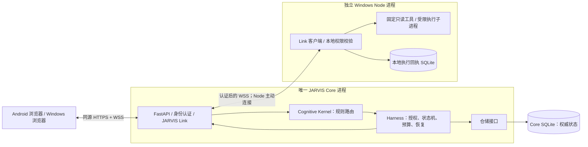
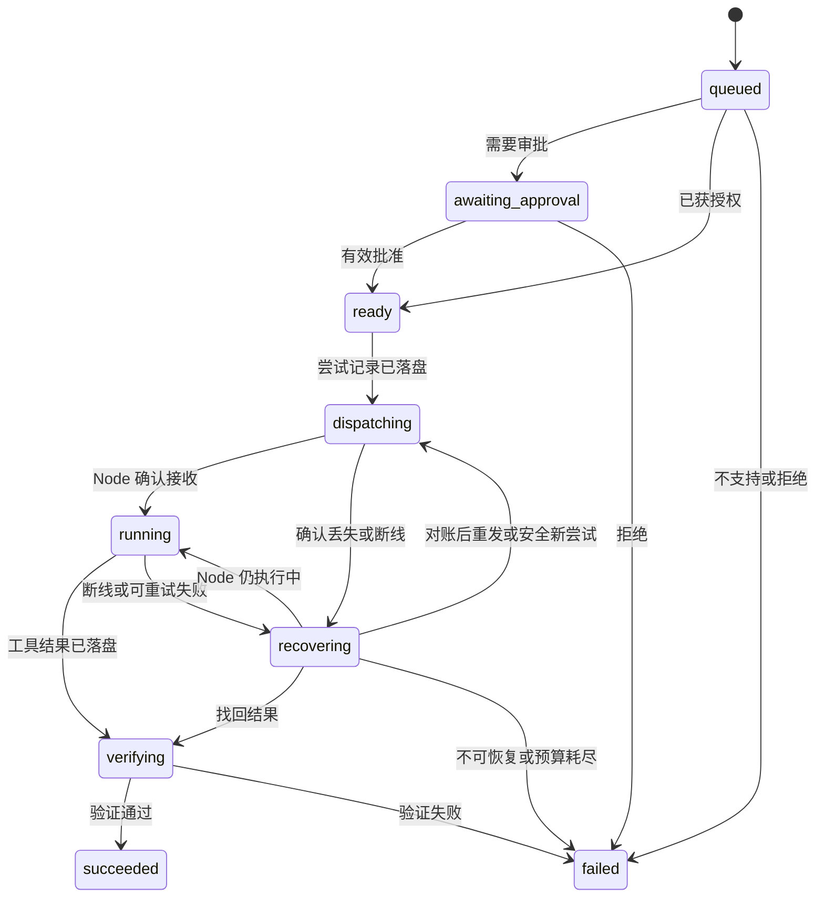
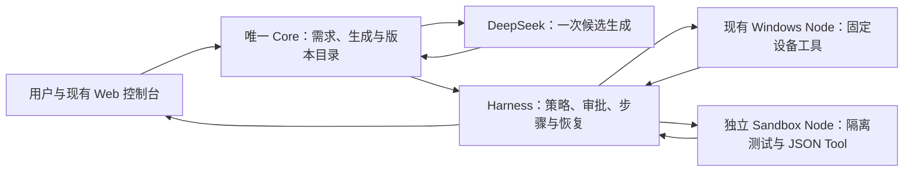

# NEXUS 架构与第一阶段 MVP 技术方案

状态：M1 已由用户整体验收；M2 有云端真实闭环证据；M3 命名与会话工具版本已按用户后续要求部署到云端、迁移 008，真实 DeepSeek 系统工具闭环和重启检查通过，待手机补验和用户验收。已实现范围、验证和批准见 ROADMAP。日期：2026-10-18。

本文件是唯一架构设计入口，供后续每次开发前完整读取。项目规范见 [AGENTS.md](../AGENTS.md)，阶段批准与任务验收见 [ROADMAP.md](ROADMAP.md)，项目入口见 [README.md](../README.md)。

本文件描述目标架构，不代表远期能力均已实现。S1–S6 已交付工程、契约/仓储/权限、独立 Windows Node、只读闭环及恢复、同源浏览器、显式记忆/项目/路由和禁用模型适配器。S7 已有本机 TLS/故障/一致恢复，以及实际 Tailscale 公信证书、Android 登录/任务/审批、Core 重启历史和手机网络恢复后新执行证据，见 [S7 验证](S7-VERIFICATION.md)。M1 技术交付完成，最终用户验收以 [ROADMAP](ROADMAP.md)为准。当前部署入口见 [S7 部署](s7-deployment.md)，功能见 [S6 说明](s6-browser-records.md)及 [S5 恢复](s5-recovery.md)。设计文档不授予后续实施权限。

## 项目愿景

NEXUS 是面向个人、长期运行的统一认知与多身体自主 AI 系统，目标是逐步具备类似 JARVIS 的环境感知、长期记忆、目标管理、任务执行和反馈调整能力。

**One Mind, Many Bodies — 一个大脑，多个身体。** Windows、Android 及未来设备都是同一个 Core 的身体，不各自形成独立人格、目标体系或长期认知存储。设备可进行工具执行、格式处理和回执恢复等必要的本地处理。

长期愿景通过可验证的小里程碑推进。第一阶段产品里程碑记为 M1；ROADMAP 中 S0–S7 是开发子阶段，批准其中某个子阶段不代表批准整个产品里程碑。

## 1. 结论与设计边界

采用一个 Python 单体 Core 服务、一个独立 Windows Node 进程、一个由 Core 托管的静态 Web 客户端。Core 内部分模块，模块间使用函数及类型接口；设备之间使用 JARVIS Link v1。

三个不变量：

1. **一个大脑**：只有 Core 可以创建目标、改变任务权威状态、授予操作权限和写入长期记忆。Node 只接受经过认证和授权的具体命令。
2. **低成本运行**：心跳、任务查询、重连、已知任务路由和恢复全部由确定性代码完成；MVP 不调用任何模型。
3. **可靠自主执行**：先持久化再派发；成功需要匹配当前执行尝试的工具证据及验证；未知执行结果必须显式保留，不能推断成成功或直接重试。

第一阶段只验证可靠执行的基础设施，不宣称已实现通用自主智能。

## 2. 需求中需要澄清或补足的地方

| 问题 | 影响 | 本方案采用的边界 |
| --- | --- | --- |
| 统一认知容易被理解成一个大模型或一个串行循环 | 模型故障会阻塞整个系统，也容易让模型越权 | Core 是状态和权限的唯一权威；模型是可替换计算服务，异步 I/O 不改变权威归属 |
| “断线恢复”没有定义重复与未知结果 | 已执行但回执丢失时，重发可能造成重复操作 | 持久化执行尝试、Node 回执和对账；不承诺分布式 exactly-once |
| “只读”没有限定可读取的数据 | 文件名、环境变量和系统信息也可能泄露隐私 | 按工具、节点、资源别名及字段授权；MVP 不提供任意文件读取 |
| Tailscale 只能解决部分网络问题 | 连上网络的设备仍不应获得执行权限 | 应用级凭证、消息授权、HTTPS/WSS 和撤销能力仍须独立实现 |
| 审批对象与有效期未定义 | 修改参数或目标后可能错误复用旧审批 | 审批绑定任务、工具版本、规范化参数摘要、节点和策略版本，并设置期限 |
| 长期记忆与执行历史没有区分 | 工具输出、推测可能被误当成用户认可的事实 | 执行日志与授权记忆分开存储；记忆需要明确同意，并记录证据与时效 |
| “任务成功”缺少可操作定义 | 容易把模型回答或一个 success 标志当成完成 | 工具特定验证器校验结构、任务归属、约束和证据；声明验证级别 |
| Core 迁移与同时运行两个 Core 未区分 | 两套权威可能重复派发任务 | MVP 只支持停机迁移，禁止活动双主；同一数据目录使用独占进程锁 |
| 全天候运行缺少资源和故障边界 | 队列、日志、重试可能无限增长 | 有界队列、结果大小限制、任务期限、执行次数和模型预算；磁盘写入失败停止派发 |
| 需求同时涉及底座与完整自主系统 | 个人开发容易陷入框架建设 | 先完成一个零模型、单步、只读的真实闭环；规划器和主动工作后续添加 |

这些是建议采用的设计默认值，本轮不需要决定模型厂商、Android 原生技术细节或未来云部署方式。

## 3. 最小部署架构



- Windows 最初同时运行 Core 和 Node，但必须是两个独立进程，可分别重启。
- Harness 和 Cognitive Kernel 是 Core 内的模块，不是额外服务。
- Node 主动连接 Core，不需要对外监听服务端口。浏览器不能直接控制 Node。
- Core 数据库只由 Core 访问。Node 回执只记录命令身份、局部执行阶段及有限结果，不保存长期目标、用户画像或规划。
- 第一版固定单个 Core worker、每个 Node 同时执行一个任务；Core 可同时处理多个网络连接。
- 单例锁绑定规范化数据目录，防止误启动第二实例。它不提供跨主机分布式锁；禁止复制数据库后同时启动两套 Core。
- 将来移动 Core 时，停旧 Core、取得一致备份、迁移数据及身份配置，再让 Node 修改连接地址。移动的是权威数据，不是重新建立一套人格。
- 2026-10-18 用户明确批准自有 Ubuntu 云端单活 Core、无域名 IP 直连 HTTPS/WSS、正式证书和自动续期。实际迁移保留原身份及权威历史，Windows 仍只运行 Node；不引入第二 Core 或新工具。网络不再依赖 Tailscale，CA 只负责签发和续期；决策见 [ADR 0008](decisions/0008-self-hosted-core-ip-tls.md)，结果见 ROADMAP 和部署说明。
- 不引入 Redis、Celery、Kafka、容器编排、向量数据库或独立调度微服务。

FastAPI 支持 WebSocket 依赖认证；其内存连接列表示例也明确仅适用于存活的单进程。NEXUS 因此将任务事实放入数据库，内存只保留可重建的连接与唤醒信号。[FastAPI 官方文档](https://fastapi.tiangolo.com/advanced/websockets/)

## 4. 模块职责与接口

以下是目标接口与职责边界，已实现的 S2 接口和后续接入要求见 [storage-security.md](storage-security.md)。对象都使用明确的类型；跨网络契约使用 Pydantic 模型并拒绝未知字段。

| 模块 | 负责 | 主要接口 | 不负责 |
| --- | --- | --- | --- |
| Core 应用层 | 身份、任务入口、设备登记、历史查询、记忆与控制 API，组装各模块 | `submit(request, principal) -> TaskSnapshot`；`query_tasks(filter, principal)` | 直接执行设备工具 |
| Cognitive Kernel | 对已知意图规则匹配，决定是否需要模型，给出可解释路由建议 | `route(intent, context) -> RoutingDecision` | 审批、授予权限、写任务终态 |
| Harness | 固定计划、策略判定、审批、预算、尝试、派发、验证、取消、恢复 | `advance(task_id)`；`decide_approval(...)`；`request_cancel(...)`；`reconcile(node_id)` | 设备文件操作、让模型修改权限 |
| JARVIS Link | 连接认证、消息解析、会话、心跳、重连、确认和恢复传输 | `dispatch(command)`；`request_attempt_status(...)`；`publish(event)` | 判断任务成功、维护独立业务状态 |
| Node Runtime | 注册能力、检查本地策略、执行固定工具、保存及重传回执 | `execute(AuthorizedCommand) -> ToolResult`；`cancel(attempt_id)`；`status(attempt_id)` | 拆解用户目标、选择 LLM、创建后续任务 |
| Tool Registry | 提供工具名与版本、参数和结果模型、风险级别、重试性质及验证器 | `resolve(tool_name, version) -> ToolSpec` | 自动下载或执行任意插件 |
| Policy Engine | 按身份、工具、参数、资源、节点计算允许、拒绝或待审批 | `evaluate(principal, action, context) -> PolicyVerdict` | 由模型自然语言决定权限 |
| Storage | 事务、任务状态比较更新、事件、身份与记录查询 | `transaction()`；`transition(expected_revision, ...)` | 在数据库事务内等待网络或模型 |

`RoutingDecision` 至少包含：`mode`（rule / decision_model / llm / reject）、`reason_code`、`policy_version`、建议工具及版本、已验证参数；使用模型时才有 `model_id` 和预算估计。路由建议必须经过 Harness 再授权。

预留两个有实际边界的模型接口：

- `DecisionModel.decide(context, budget) -> DecisionAssessment`：可替换的轻量判断器，输出是否需要推理、置信度及候选能力。MVP 不提供真实实现。
- `ModelProvider.estimate(request)` 与 `invoke(request, limits) -> ModelResponse`：屏蔽厂商差异，返回内容、用量、耗时与错误。MVP 使用禁用适配器，任何调用都返回 `MODEL_DISABLED`。

未来模型选择顺序：先检查授权和预算，再匹配能力，再在满足条件的候选中比较估算费用与延迟。没有足够预算、价格上限或合适模型时显式停止，不无限升级模型或重试。模型输出属于未受信建议，不能扩大工具列表、文件范围或预算。

## 5. MVP 的任务与工具

第一版页面提供明确操作按钮，不承诺任意自然语言理解。按钮提交结构化意图，由规则路由成一个固定步骤；未知意图返回 `UNSUPPORTED_TASK`，不自动调用 LLM。

| 意图 | Node 工具 | 参数 | 结果及授权 |
| --- | --- | --- | --- |
| `get_system_info` | `system.info@1` | 空对象 | 仅操作系统名称、版本、架构和 Python 版本；由用户配置的只读授权允许 |
| `list_directory` | `filesystem.list@1` | `root_id`、`limit` | 只列配置资源根的直接条目；首次 MVP 每次任务需要明确审批 |

`root_id` 是 `workspace` 这样的别名，由 Node 本地配置映射为目录。Core 保存允许的别名；Node 不因 Core 发送一个绝对路径就开放访问。默认没有任何文件资源授权，必须在配置中明确指定。

目录工具约束：

- 只访问已配置且启动时校验的本地目录根，不接收任意路径、相对路径、UNC 路径或通配符。
- 不递归、不读取文件正文、不跟随子项的符号链接或 Windows junction/reparse point；配置根或其祖先含重解析跳转时拒绝启用。
- 返回名称与条目类型；链接条目标记为链接并且不读取目标。达到数量或字节上限时返回 `truncated: true`，不声称结果完整。
- 不泄露绝对路径、环境变量、凭证或进程命令行。页面以文本显示条目名，禁止把工具输出直接作为 HTML 渲染。
- Node 以普通用户运行。应用路径检查不构成抵御恶意本机管理员或本地路径竞态的 OS 沙箱；MVP 不执行不受信本地代码，也不开放通用文件读取。未来扩大文件能力前需重新设计句柄级访问边界。

Godot 项目状态检查适合下一项只读工具，本 MVP 先不增加第三种工具。

## 6. 身份、权限与审批

### 6.1 身份和传输

- 首版单用户；分别建立 owner 身份和每个 Node 的独立身份。稳定 `node_id` 与高熵随机令牌分离，令牌可撤销且不能相互替代。
- 通过本地管理命令离线登记节点，不提供开放自助注册。Core 保存随机令牌的摘要；Node 通过环境变量或本地未入库配置获得自己的令牌。
- Node 在 WebSocket 握手使用 Bearer 认证，同时验证 Core TLS 证书；禁止关闭证书校验。身份来自认证连接，不能信任 JSON 自报的 `node_id`。
- 浏览器通过同源 HTTPS 登录换取有时限、可撤销的 HttpOnly / Secure / SameSite 会话 Cookie。浏览器原生 WebSocket 不提供任意 Authorization 请求头接口，因此浏览器与 Python Node 不共用同一种握手方式。[MDN WebSocket 构造器](https://developer.mozilla.org/en-US/docs/Web/API/WebSocket/WebSocket)
- 对浏览器握手和 HTTP 写操作检查允许的 Origin；HTTP 写操作另校验会话关联的 CSRF 令牌。会话过期或凭证撤销时关闭现有连接。所有消息继续执行授权检查。
- 不把长期令牌放在 URL、LocalStorage、示例配置或日志里。不依赖 CORS 自动保护 WebSocket。
- 默认只绑定 localhost；此开发模式允许 HTTP/WS，Cookie Secure 只在该显式本机模式关闭。Android 接入必须显式开启远程模式并提供 Android 信任的 HTTPS/WSS 证书。当前入口由 Uvicorn 直接加载，禁用代理头；部署层终止 TLS 是目标选项，尚未交付该接入模式。配置好 TLS 前不开放远程访问。
- LAN 和 Tailscale 都只是连接路径；应用权限检查相同。不自动修改防火墙、证书信任或系统安全设置。

Origin、逐消息授权、过期会话关闭和消息限额是参考 OWASP 建议采用的边界；具体角色与策略是 NEXUS 的设计选择。[OWASP WebSocket 安全指南](https://cheatsheetseries.owasp.org/cheatsheets/WebSocket_Security_Cheat_Sheet.html)

### 6.2 授权模型

有效能力 = Core 已知工具 ∩ owner 授权 ∩ Node 身份许可 ∩ Node 已注册能力 ∩ Node 本地允许范围。

节点声称支持一个工具，并不代表它自动获准执行。审批只能批准本来允许通过人工授权的操作；不能把未实现或硬性禁止的工具变成可用工具。

MVP 将 `system.info` 设为可配置的预授权只读操作，将 `filesystem.list` 设为需要审批的只读操作。后者用真实只读任务验证审批机制，无需先引入危险工具。

审批记录绑定：`approval_id`、`task_id`、owner、目标 `node_id`、工具名及版本、规范化参数 SHA-256、资源/策略版本和到期时间。单个批准只解锁该任务中完全一致的动作，最多允许预算内的只读重试，不允许复用到新任务。参数、节点或策略变化后必须重新评估，必要时重新审批；已派发任务不原地改写动作。

S2 已实现离线身份/授权管理、随机凭证摘要、8 小时浏览器会话（最多 10 个有效会话）、同源会话路由及 HTTP/WS 认证守卫。P06 的 Node Link 已接入 `SecurityHTTP.receive_text`，每秒检查空闲连接的撤销/过期，并在返回每条消息前再次检查。资源范围摘要绑定 `NodeScope.resource_version`，持久授权或身份变化递增全局策略版本。Link 从认证节点、可信工具/资源配置与持久授权交集构建范围；自报能力不能扩大授权。loopback WS 及 S7 实际公信 HTTPS/WSS、Android 接入均已有证据，范围见 [S7 验证](S7-VERIFICATION.md)。

删除重要文件、发送对外消息、支付和修改安全设置目前都没有工具实现，直接拒绝。以后加入时，必须同时具备精确授权、效果验证、幂等/对账策略，不能只增加一个“同意”按钮。

## 7. 任务状态机与执行语义

### 7.1 状态



图仅展示主流程。完整公共规则：

| 条件 | 转移或处理 |
| --- | --- |
| 尚未派发的 queued / awaiting_approval / ready 收到取消 | 立即进入 cancelled，并原子撤销待派发记录 |
| dispatching / running / recovering 收到取消 | 持久化 `cancel_requested`；要求 Node 停止或上报既有结果，收到确认前不假称 cancelled |
| Node 确认已停止且没有已完成结果 | 进入 cancelled，记录执行尝试实际结束阶段 |
| Node 已完成并提交结果 | 按结果验证；取消请求记录为已来不及取消 |
| 结果已持久化并进入 verifying 后收到取消 | 返回 `ALREADY_FINISHED`，完成本地验证 |
| 任何非终态到达总期限 | 进入 timed_out；仍有活动尝试时发送停止请求，并记录结果是否未知 |
| running 返回明确的不可重试错误 | 进入 failed，保留结构化错误 |
| dispatching 直接收到有效结果而确认包缺失 | 可直接进入 verifying，不等待一个已无必要的确认包 |
| 验证前崩溃、重启时已存在有效结果 | 恢复到 verifying，重新运行确定性验证器 |
| 任意终态收到迟到消息 | 只补充审计或对账证据，不倒改终态，不覆盖新尝试 |

终态为 `succeeded / failed / cancelled / timed_out`。任务另有 `execution_outcome = not_started / known / unknown`，避免把“已经超时”误解成“肯定没有执行”。未知结果不会进入 succeeded。

每次转移使用事务及 `revision` 比较更新，避免取消、结果、超时竞争时互相覆盖。任务计划和结果分开保存；终态不可被 Node 自行更改。

### 7.2 尝试、幂等与恢复

任务包含一个步骤，步骤可有至多两次执行尝试；不为单步 MVP 单独建立复杂工作流引擎。尝试记录包含 `attempt_id`、`task_id`、`step_index`、`attempt_no`、节点、参数摘要、派发次数、阶段、期限与结果。

1. Core 在同一事务中保存任务状态、尝试、审计和事件后，才发送命令。尝试表就是最小持久派发队列，无需消息中间件。
2. Node 在执行前持久化该 `attempt_id` 的接收回执及命令摘要，再确认接收。相同 attempt、相同动作仅重传状态或缓存结果；同 ID 不同动作返回 `IDEMPOTENCY_CONFLICT`。
3. Node 父进程在本地记录 started 后启动固定工具子进程；started 与实际开始之间仍可能发生崩溃，恢复时一律视为未知，不假定未执行。子进程由父进程持有及管理，重启后先确认旧执行已结束，无法确认时不新开尝试。
4. Node 完成后先保存有限结果，再回传。Core 持久化结果后回复 `result.ack`；断线时 Node 保留结果并于重连重传。
5. Core 重启或 Node 重连后，按活跃 `attempt_id` 请求状态。已完成则验证；仍运行则等待；确认从未执行或确认旧执行已经结束且工具可安全重跑时，才允许在预算内新建 attempt。
6. 同一命令的网络重传沿用原 attempt，不计作新的执行尝试，但仍有单独派发次数上限。只有 Core 可以创建新 attempt。
7. MVP 只读工具允许安全重跑，但不能保证两次读取产生相同快照；结果包含观测时间。未来具有副作用且结果未知的工具不得自动重试，必须依赖外部幂等键、查询或人工对账。
8. Core 终态已确定后收到迟到结果，返回已结算确认并留审计；不会继续驱动执行。Node 回执在 MVP 中保留，不自动清理尚需对账的记录。

这里实现的是有确认、有去重和可恢复状态的协议，不是无条件“恰好执行一次”。WebSocket 保证连接内的传输顺序，不提供跨重连的应用事务。

### 7.3 成功验证与暂停

- Node 的 success 字段仅是证据之一。Core 校验认证节点、task/attempt 归属、工具版本、命令摘要、结果模型、大小限制及工具特定断言。
- `system.info` 验证必需字段和类型；目录工具验证 root_id 一致、条目/字节限制、无目标内容、截断标记等。单步任务只有当前有效尝试通过验证才 succeeded。
- 验证级别标记为 `node_report_schema_checked`。这不能证明恶意 Node 诚实，也不能证明操作系统底层事实绝对真实；更强的独立外部验证随未来具体工具添加。
- Node 使用受管理的固定工具子进程实施超时和取消；不能仅取消等待线程却让实际工具继续运行。Windows 目标为 Windows 10/11，工具进程纳入设置了 KILL_ON_JOB_CLOSE 的 Job Object，由 Node 独占不可继承的管理句柄；完成纳管前，子进程不得进入工具执行。纳管失败则拒绝执行。Node 崩溃时由 OS 清理工具进程；重启仍须对账，因为清理进程不能撤销已经完成的读取。该机制封装在 Node 内，不给 Core 引入 Windows 依赖。[Microsoft Job Objects 文档](https://learn.microsoft.com/en-us/windows/win32/procthread/job-objects)
- 禁止 shell=True、任意脚本或任意可执行命令入口。Job Object 用于生命周期管理，不被当作不受信代码的安全沙箱。
- 全局 `pause` 持久化，并立即阻止新的派发、重试和模型调用；已在执行的只读任务可完成。紧急停止使用独立的 `cancel_all`，对所有未完成任务发起可审计的取消。
- 取消、暂停、审批与派发通过同一个状态机事务检查；已经发送的命令无法被数据库事务撤回，需要节点停止协议。界面必须区分“停止派发”和“确认停止执行”。
- 数据库不能可靠写入时，Core 不接新任务或继续派发；Node 不能写回执时拒绝执行。

## 8. JARVIS Link v1 协议

P02 已实现本节 25 种消息的数据契约；字段、严格解析、错误及字节约定见 [protocol-v1.md](protocol-v1.md)。P06 已实现认证连接、心跳、会话替换和重连；P07 已接入持久派发和执行结算；P08 已实现网络对账、取消及全局控制，见 [S5 恢复](s5-recovery.md)。status_result 新增可选 execution_stopped=false；未知结果仅在有停止证据时允许预算内重试，严格 Core/Node 应同步升级。

P09 已接入同源静态页面、会话恢复、浏览器 WS 及消息授权。任务/控制事务通过触发器追加统一 client_events 游标，有效游标有界回放，无效游标先取得 HTTP 快照；慢连接独立排队并超时断开。历史事件附当前已提交状态及对应 revision，不伪造旧快照。详情见 [S6](s6-browser-records.md)及 [ADR 0006](decisions/0006-s6-browser-records.md)。

### 8.1 端点和消息信封

HTTP：`/api/v1/session` 用于登录/退出；`/api/v1/tasks` 和 `/api/v1/tasks/{id}` 用于分页历史与详情；`/api/v1/memories` 用于显式授权记忆管理。HTTP 与 WS 共用应用层授权。

WebSocket：`/ws/v1/client` 服务浏览器；`/ws/v1/node` 服务 Node。连接角色决定允许的消息，不使用可伪造的 sender 字段授权。

通用信封：

```json
{
  "protocol_version": 1,
  "type": "task.submit",
  "message_id": "d641f031-65ec-41f4-9933-297ed3856906",
  "correlation_id": null,
  "sent_at": "2026-10-17T08:00:00Z",
  "payload": {
    "request_id": "5d489189-2958-4fb2-a59d-2cba31974d96",
    "intent": "list_directory",
    "arguments": {"root_id": "workspace", "limit": 100}
  }
}
```

- `message_id` 标识一次消息；响应的 `correlation_id` 指向请求消息。
- `request_id` 是业务幂等键；同一 owner 的重连补发沿用它。Core 对 `(owner_id, request_id)` 建唯一约束；相同内容返回原任务，不同内容返回冲突。
- task_id、attempt_id、审批身份及状态由 Core 生成，客户端不能指定或越权修改。
- 所有时间为 UTC RFC 3339；页面按用户本地时区显示。客户端 sent_at 仅供诊断，不作为身份或核心超时依据。
- 信封和 payload 都严格校验；拒绝未知协议主版本、未知消息类型及多余字段。不发送 Python 对象或绝对文件路径。

### 8.2 消息类型

| 方向 | 类型 | 必要负载 |
| --- | --- | --- |
| 浏览器 → Core | `client.sync` | 上次持久 `event_id` 或 null |
| 浏览器 → Core | `task.submit` | request_id、intent、arguments |
| 浏览器 → Core | `task.cancel` | task_id |
| 浏览器 → Core | `approval.decide` | approval_id、approve/reject；审批人由会话确定 |
| 浏览器 → Core | `control.pause / control.resume / control.cancel_all` | request_id；仅 owner 可用 |
| Core → 浏览器 | `client.synced` | 同步边界游标、是否需要完整查询 |
| Core → 浏览器 | `task.accepted` | task_id、当前状态；只承诺任务已入库 |
| Core → 浏览器 | `task.updated` | event_id、task_id、revision、状态、有限结果或错误 |
| Core → 浏览器 | `approval.required` | event_id、approval_id、动作摘要、节点、到期时间 |
| Core → 浏览器 | `control.updated` | event_id、暂停状态及版本 |
| Node → Core | `node.hello` | node_id、节点版本、支持的工具版本和资源别名、当前 boot_id |
| Core → Node | `node.welcome` | session_id、心跳及限额配置 |
| Node → Core | `node.heartbeat` | session_id、活跃 attempt_id；不传任意屏幕或文件数据 |
| Core → Node | `command.execute` | task_id、attempt_id、工具及版本、参数、命令摘要、grant_id、到期时间、执行超时 |
| Node → Core | `command.accepted / command.started` | task_id、attempt_id、命令摘要、boot_id |
| Core → Node | `command.status` | attempt_id |
| Node → Core | `command.status_result` | attempt_id、阶段或 not_found、命令摘要、可用结果 |
| Core → Node | `command.cancel` | attempt_id、原因 |
| Node → Core | `command.cancelled` | attempt_id、实际停止阶段；已完成则返回原结果 |
| Node → Core | `command.result` | task_id、attempt_id、命令摘要、工具版本、观测时间、outcome、result 或 error |
| Core → Node | `result.ack` | attempt_id、stored/already_settled |
| 双向 | `error` | code、有限 message、retryable、关联消息 ID |

完成 node.hello / node.welcome 后，双方运行期消息还携带当前连接的 session_id；只接收当前已认证连接，替换连接时关闭旧会话。持久去重键仍是 attempt_id，不随连接改变。命令摘要覆盖不可变任务动作；会话字段及重传时间不进入动作摘要。

Core 的 grant_id 引用已持久授权；它通过已验证的 Core 连接传给 Node，不是一个可由客户端提交后直接生效的权限令牌。Node 无论如何仍检查本地工具和资源策略。

`command.result` 的 payload 示例：

```json
{
  "session_id": "1716eb9e-78c4-4baa-9a9c-49b47fcde962",
  "task_id": "93e32968-43ba-43dc-9f07-610d672b4884",
  "attempt_id": "6f74fd13-05d2-48dd-ae79-751a900a7d37",
  "command_digest": "aaaaaaaaaaaaaaaaaaaaaaaaaaaaaaaaaaaaaaaaaaaaaaaaaaaaaaaaaaaaaaaa",
  "tool": "filesystem.list",
  "tool_version": 1,
  "observed_at": "2026-10-17T08:00:02Z",
  "outcome": "succeeded",
  "result": {
    "root_id": "workspace",
    "entries": [{"name": "docs", "kind": "directory"}],
    "truncated": false
  }
}
```

### 8.3 重连、流控与错误

- Node 默认 10 秒心跳，30 秒未收到则判离线；这是可用性观测，不直接改变任务为 failed。重连采用 1–30 秒指数退避及抖动，持续重连不调用模型。
- Core 重启后要求 Node 重新认证、重新注册能力并对账。boot_id 改变意味着 Node 进程已重启，不能据此断定旧执行未发生。
- 客户端以持久 event_id 补取事件；事件游标来自 Core 数据库，表示为十进制字符串。按身份过滤事件；基于同步边界回放并接入实时流，按 event_id/revision 去重，避免回放与订阅之间漏事件。
- 游标无效或事件不可用时明确通知完整查询，客户端通过 HTTP 重新取得任务快照。浏览器断开不取消任务。
- 每个连接的发送队列有界；慢客户端被断开后从持久记录恢复，不阻塞调度。一次读取结果必须完整装入受限大小的消息，MVP 不实现文件传输。
- 主要错误码：`AUTH_REQUIRED`、`FORBIDDEN`、`INVALID_MESSAGE`、`PROTOCOL_UNSUPPORTED`、`UNSUPPORTED_TASK`、`POLICY_DENIED`、`APPROVAL_EXPIRED`、`NODE_OFFLINE`、`IDEMPOTENCY_CONFLICT`、`TOOL_TIMEOUT`、`BUDGET_EXCEEDED`、`RESULT_INVALID`、`EXECUTION_UNKNOWN`、`BUSY`、`MODEL_DISABLED`。
- retryable 仅提供故障分类，是否重试由 Harness 同时检查工具性质、回执、剩余预算和期限；错误消息本身不触发自动执行。

## 9. 默认资源预算

以下为待确认的 MVP 默认值，可由可信配置收紧；客户端和模型只能申请更小的值。

| 限额 | 默认值 |
| --- | --- |
| 每任务计划步数 | 1 |
| 每步骤执行尝试数 | 总计 2 次，含首次；只对白名单只读工具开放重试 |
| 每次尝试的命令派发数 | 总计 3 次，含首次；均使用相同 attempt_id |
| 单次工具执行时间 | 10 秒，Node 用单调时钟限时 |
| 接收确认等待 | 5 秒；丢失后对账，不能直接认定未执行 |
| 每尝试状态/停止请求 | 总计 64 次；每 5 秒至多一个周期请求，取消可立即发起；耗尽仍未知则保留执行槽 |
| Node 未确认结果主动重传 | 每 5 秒扫描最多 4 条，单连接每条最多 3 次；仍可响应 Core 查询 |
| 任务总期限 | 5 分钟，包含等待审批、离线和重试 |
| 审批有效期 | 最多 2 分钟，且不得晚于任务期限 |
| 每 Node 工具并发 | 1 |
| Core 待处理任务数量 | 100，超出返回 BUSY |
| 单身份新任务速率 | 每分钟最多 10 个；连接/消息也设有界速率限制 |
| 单消息 / 工具结果 | 64 KiB / 32 KiB，按编码后字节计算 |
| 目录条目数量 | 最多 200；超限明确截断 |
| 每任务模型调用 / 模型费用 | 0 次 / 0；全局同样禁用模型调用 |

重传、失败和取消不返还已消耗的执行次数。新 attempt 前必须确认旧执行结束或确定未开始；不因计时器到期而并发开第二次。

Core 负责总期限及最终超时判定，Node 执行接收时剩余预算与单次超时中较小的值，并拒绝已过期命令。部署要求基本时钟同步；严重时钟偏差时停止派发并提示校时，不能通过放宽过期校验继续执行。

未来启用模型时，另实现原子预留费用、最大输出 token、调用次数、总费用及全局日额度，失败尝试同样计入。成本记录区分预估、已报告实际值和未知值，不把未知成本记为零。未完成这些验收前不得启用真实 Provider。

## 10. SQLite 与长期记忆

使用 `aiosqlite` 进行异步数据库访问，短事务串行写入，迁移使用有版本的 SQL 文件与 `schema_migrations`。暂不引入 ORM；仓储接口使业务状态机不依赖 SQLite 查询语法，但将来迁移数据库仍需要专门迁移及测试。

Core 概念表：

| 表 | 内容 |
| --- | --- |
| identities / sessions / grants | owner 和 Node 身份、凭证摘要、会话期限及静态授权 |
| projects | 项目标识与元数据，任务可选关联项目 |
| tasks | 意图、固定计划、状态、revision、期限、预算、取消标志及有限结果 |
| task_attempts | 派发、去重、执行阶段、尝试预算、错误与回执 |
| task_events | 持久递增事件和重连游标；任务事实的事件历史 |
| devices | 能力、策略范围、最近心跳、在线观测；重启后在线状态重新确认 |
| approvals | 审批动作绑定、期限、决定及操作者 |
| audit_events | 身份、权限、审批、控制及执行审计；不复制秘密或无限输出 |
| memory_entries | 经明确同意的长期信息及来源、验证和时效 |
| routing_decisions | 路由方式、理由、策略版本、耗时及后续结果关联 |
| model_calls | Provider、模型、预算预留、用量、费用状态、延迟、结果；MVP 无真实调用行 |
| system_state | 全局 pause 状态和配置版本 |
| schema_migrations | 已执行迁移版本 |

Node 的 `receipts.sqlite3` 保存 execution_receipts、schema_migrations / node_identity，以及 S5 迁移 002 的 cancellation_tombstones，不属于长期认知存储。使用专用身份、模式摘要与 FULL 同步；received/started/结果先落盘、重复 attempt 去重、重启 unknown 和结果恢复均有证据。回执和墓碑各默认最多 10000 条，满后拒绝新增并保留旧证据。S5 增加升级前一致备份及前向迁移、持久取消屏障和停止证据。Windows Job 门控、进程清理、数据目录锁及恢复见 [Node Runtime](node-runtime.md)和 [S5](s5-recovery.md)。

模型调用记录与最终工具验证结果关联，以后分别计算调用可用率和任务验证通过率，不能把模型正常返回等同于任务成功。MVP 仅产生规则路由记录，模型成功率显示“不适用”，不填造零成本调用记录。

关键事务：任务幂等创建；状态与事件/审计同时提交；派发前创建尝试；结果落盘后才确认；审批决定与下一状态同时提交。网络和模型调用均在事务外进行。

启用 WAL、busy_timeout，并在每个连接显式启用外键。数据库位于 Core 本地磁盘，不能放入网络共享目录；WAL 不是跨设备共享数据库的方案。[SQLite WAL](https://www.sqlite.org/wal.html)、[SQLite 外键文档](https://www.sqlite.org/foreignkeys.html)

使用 SQLite 一致备份接口或完全停机后的备份，不在运行时只复制一个 .sqlite3 文件。迁移前备份并校验；第一版只提供向前迁移，失败恢复使用备份，不自动执行破坏性降级。

S2 实现身份、会话、静态授权、任务、事件、审计与审批；S4 迁移 003 增加 execution_grants、task_attempts 和任务结果字段；S5 迁移 004 增加取消/停止/对账计数、system_state、control_requests 和 control_events。只创建当前使用的表。迁移验证连续版本及摘要，升级前生成唯一一致备份并 quick_check；拒绝无版本旧库或未知新版本。任务权威由 Harness 负责；离线管理审计的 actor 为空，subject 记录被管理身份。设计见 [ADR 0001](decisions/0001-s2-storage-security.md)及 [ADR 0005](decisions/0005-s5-recovery-controls.md)。

S6 迁移 005 增加 projects、memory_consents、memory_entries、routing_decisions、model_calls 和 client_events；tasks 可选关联项目。保存、替代记忆与明确同意同事务；撤销/过期默认不作为当前信息查询，不物理删除。每个新任务原子记录规则路由；历史路由补记明确 migrated 且不捏造耗时。model_calls 保持零行，应用仅装配无网络的禁用 Provider/DecisionModel；不以虚构的零费用调用填充记录。

记忆至少区分以下独立字段：

- `kind = fact / inference / plan`：这是何种陈述。
- `verification = unverified / verified`：是否有足够依据，记录 evidence_ref 与 verified_at；工具输出本身不会自动变成 verified fact。
- `valid_until`、`superseded_at`、`retracted_at`：信息何时过期、被替代或撤销。
- owner、来源、consent_event_id：谁明确允许保存什么内容。

首版提供简单记忆管理 API，只有明确的保存请求才写入，不从聊天或工具结果自动提取。过期信息默认不作为当前事实返回，历史仍可查询。任务执行记录是审计历史，不等于授权个人记忆。

首版不自动清除任务与回执。结果有大小上限，数据库使用量提供观测；达到存储告警或写入失败时停止新执行。长期运行后的归档、保留期和删除策略另行确认，不悄悄删除用户记录。首版日志可轮转，但不会因此删除数据库审计。

## 11. 项目目录结构

下列是预期最终 MVP 结构，不在本轮批量创建空模块。开发时按验收任务逐步增加文件。

```text
NEXUS/
├── pyproject.toml
├── README.md
├── AGENTS.md                       # 每次开发前必读的项目规范
├── .gitignore
├── .env.example                    # 仅变量名和安全占位符
├── config/
│   ├── core.example.toml
│   └── windows-node.example.toml
├── docs/
│   ├── ARCHITECTURE.md              # 唯一架构设计入口
│   ├── ROADMAP.md                   # 唯一开发阶段及验收记录入口
│   ├── protocol-v1.md              # 协议实现时从本设计提取
│   └── decisions/                 # 重要决策逐项记录 ADR
├── src/nexus/
│   ├── contracts/                 # 协议、任务、工具、结果与错误类型
│   ├── core/
│   │   ├── app.py                 # FastAPI 组装、生命周期
│   │   ├── api/                   # HTTP、浏览器 WS、Node WS
│   │   ├── cognitive/             # 规则路由与决策模型接口
│   │   ├── harness/               # 状态机、调度、恢复、验证
│   │   ├── security/              # 身份、策略、审批
│   │   ├── link/                  # 节点会话、消息与事件订阅
│   │   ├── storage/               # 仓储、事务、版本 SQL 迁移
│   │   ├── models/                # Provider 接口及禁用适配器
│   │   └── memory/                # 显式记忆管理
│   ├── node/
│   │   ├── runtime.py
│   │   ├── link.py
│   │   ├── receipts.py
│   │   └── tools/
│   │       ├── registry.py
│   │       ├── system_info.py
│   │       └── list_directory.py
│   ├── web/                       # HTML / CSS / 原生 JavaScript
│   └── settings.py                # TOML + 环境变量及校验
├── tests/
│   ├── unit/
│   ├── integration/
│   └── e2e/
└── var/                           # 数据库、日志、Node 回执，Git 忽略
```

`contracts` 只共享通信/数据契约，不共享认知逻辑。Node 不导入 Core 的 Harness、记忆或模型模块。协议以 JSON 及工具版本定义，使后续 Kotlin Node 无需重写 Core。

配置优先级：指定环境变量 > 指定 TOML > 安全默认值；凭证不得进入 TOML。服务使用严格 CoreConfig / NodeServiceConfig 和有界 TOML 加载器；Core 可覆盖 NEXUS_DATA_DIR/HOST/PORT，Node 可覆盖 NEXUS_NODE_DATA_DIR/CORE_URL，Node 凭证仅由 NEXUS_NODE_TOKEN 环境变量提供。显式 loopback 模式允许 HTTP/WS，远程 Core 必须配置证书和私钥，Node WSS 保留默认 CA 与主机名验证。配置加载不创建目录或数据库；单活 Core 在生命周期中持锁后才初始化存储。P01 的 load_settings 保留给离线身份命令及原有接口，只读取环境变量且只允许 localhost；不自动读取 .env。当前直接 TLS 配置、恢复与设备验证边界见 [S7 部署](s7-deployment.md)和 [S7 验证](S7-VERIFICATION.md)。

当前开发依赖为 pytest 与 httpx2；S2 使用标准 `asyncio.run`，未引入 pytest-asyncio。S2 增加架构指定的 aiosqlite 0.22.1；由于现有 Starlette 1.8.0 TestClient 已弃用 httpx，使用 httpx2 2.13.1 替换无代码调用方的旧 httpx 开发依赖，并锁定 httpcore2/truststore；没有升级现有 FastAPI、Starlette、Pydantic。`requirements.lock` 和实际 wheel 已在 Windows / Python 3.13.9 独立环境离线安装验证；构建依赖 `setuptools>=75,<81` 仍为范围约束，Python 3.12 和其他平台尚未实测。

S3 唯一新增安装包为锁定的 websockets 17.1，用作 Node 客户端与 Uvicorn Sans-I/O 后端；其他 24 个包版本不变。Core/Node 共用可移植数据目录锁和有界消息辅助函数，互不导入对方业务模块。连接观测仅保存在可重建内存中，接入/断开写入现有审计；没有为 P06 创建 devices 或 attempt 新表。S3 交付时拒绝网络执行派发，见 [ADR 0003](decisions/0003-s3-authenticated-link.md)。S4 已通过专用 Harness 路径启用持久派发与结果验证；普通 send 控制接口仍禁止执行命令，见 [ADR 0004](decisions/0004-s4-durable-execution.md)。本轮无新依赖。

云部署补验：Ubuntu 24.04 / Python 3.12.3 上已安装相同锁定版本，409 项 Core/协议/权限检查及实际跨主机只读闭环通过。上文 Python 3.12 未测描述是云迁移前的依赖验证记录；本轮不代表 Linux Node、其他版本或全平台均已验证。

## 12. 第一版明确不做

- Kotlin Android Node、Android 无障碍控制、手机传感器常驻采集。
- 语音唤醒、全天候录音、屏幕常驻观察。
- Jev 或其他轻量判断模型、真实 LLM Provider 接入、任意自然语言规划。
- 多步骤通用规划、自动创建长期目标、模型自行发起后台工作。
- 任意 shell、Python 代码执行、读写任意文件、修改系统设置。
- 对外消息发送、删除、支付、自动升级自身权限或工具代码。
- Godot 编辑器控制与项目扫描工具。
- 多用户、公开注册、云多租户、活动双主、自动热迁移。用户明确批准的自有服务器单用户 IP HTTPS/WSS 部署沿用既有认证和权限边界。
- 向量检索、自动个人画像、未经许可的记忆提取。
- 完整插件市场、分布式队列、通用 DAG 工作流、炫技式多 Agent 框架。

## 13. 重要架构决策与以后演进

确认后在 docs/decisions 中按实现进度拆出 ADR：

1. 唯一 Core + 独立执行 Node，单活部署。
2. SQL 持久任务与事件，Node 本地回执，显式未知结果。
3. 规则先行、模型默认禁用，路由与权限分离。
4. 应用身份认证、资源授权和审批绑定。
5. 单步只读 MVP 与明确的成功验证级别。

后续顺序建议：先添加 Godot 只读检查工具，验证工具扩展成本；再实现真实模型预算和单个 Provider；然后引入受约束多步骤计划与用户目标；最后再开发 Android Node 与主动事件策略。每一步都沿用同一 Core 权威、协议和审计链，而不是再创建一个独立大脑。

MVP 全部验收条件及逐项计划见 [ROADMAP.md](ROADMAP.md)。开始任何开发前，完整读取根目录 AGENTS.md、本文件及 ROADMAP.md，并仅执行用户当前批准的阶段。

## 14. M2：真实模型与自然语言任务

2026-10-18 用户完成 M1 验收并选择 M2 优先接入 DeepSeek，预算每天 USD 1、每请求 USD 0.05。此明确选择优先于第 13 节的历史演进建议。M1 的零模型要求保留为 M1 基线；M2 在完成预算和审计后可通过显式配置启用首个真实 Provider。

- Core 仍是唯一认知与权限权威，Node 协议/工具不扩大。自然语言仅解释为现有两个动作，单步、显式确认后提交 Harness；目录审批仍独立检查。模型不创建长期目标或后台循环。
- 新 language_requests 保存有限输入、逐次外发同意、状态、建议和对应任务。固定短语先走规则；其他输入仅在模型配置启用且本次 allow_model=true 时调用。确认和任务关联在同一事务内落盘，重试确认使用 Core 生成的稳定 request_id。
- Provider 固定访问 https://api.deepseek.com/chat/completions，使用 deepseek-flash、非思考模式和 JSON 输出。不启用联网搜索、服务端工具、流式输出、重定向、代理环境配置或自动重试。复用已锁定的 httpx2 作为运行依赖，无新增版本。
- 仅发送当前文本与静态允许动作说明；不上传身份凭证、绝对资源路径、历史、个人记忆或工具结果。API Key 只从 Core 的 DEEPSEEK_API_KEY 环境变量读取；浏览器/Node/数据库/TOML 均不保存 Key。
- 迁移 006 在升级前沿用一致备份；无损扩展 model_calls，原七列及所有旧行保留，使解释阶段可在尚无执行 task_id 时记录调用。model_calls 记录请求、费用预留、用量、价格快照、完成/未知状态和后续任务。
- 每请求最多 1 次模型调用；全局每日最多 100 次，单并发；输出最多 512 token，HTTP 请求体最多 8 KiB、响应最多 32 KiB，30 秒总时限。请求先持久化，再在同一预算事务中预留整项 USD 0.05 上限并登记调用，网络位于事务外。
- UTC 每日额度 USD 1。报告用量按已核对的公开峰值缓存未命中单价计算上界；不冒充精确账单。失联/超时/取消/崩溃后费用不明时保留完整预留，跨日仍占额度且不重试。价格快照过期时停止新调用。
- 暂停与调用启动按同一 Harness 操作锁排序；已开始的调用可完成。cancel_all 同事务取消待解释/待确认请求，并关闭已开始 HTTP 交换；这不能撤销已经发送的数据或供应商计费。重启不重发 interpreting 请求，转为失败和费用未知。
- 模型结果严格解析为有限联合类型；拒绝未知字段、路径、额外动作和越权声明。模型解释通过不等于任务成功；任务仍需 Node 工具证据与原验证级别。

默认保持模型禁用；实际云端启用和真实 API/Android 验证以 ROADMAP 的实际记录为准。具体接口与启动见 [M2 说明](m2-language.md)，决定见 [ADR 0009](decisions/0009-m2-deepseek-language.md)。官方依据：[模型与定价](https://api-docs.deepseek.com/quick_start/pricing/)、[JSON 输出](https://api-docs.deepseek.com/guides/json_mode/)、[Chat API](https://api-docs.deepseek.com/zh-cn/api/create-chat-completion/)。单价核对日 2026-10-18；后续必须人工复核快照，不自动抓取价格改变预算。

## 15. 自扩展：Tool 与 Skill 方案

2026-10-18 用户提出“自进化，比如自己写 tool，自己写 Skill”，随后选定“自动生成和隔离测试，由我批准具体版本后启用”，并明确“先不用实现，生成方案”。本节给出待审阅方案；批准和开发状态统一见 ROADMAP 第 9 节。这里的改进对象是可版本化的工具与流程，不包含模型权重训练。

用户随后要求先能像与 Codex 对话一样和 NEXUS 自由聊天，再实现自扩展。因此优先建设第 16 节的会话能力；本节作为其后的自扩展设计保留，不随优先级调整取得实施授权。

### 15.1 目标与首版范围

用户提出一个目标，NEXUS 先检查已启用能力；缺失时形成扩展需求，生成候选产物及测试，经独立检查和隔离测试后展示给用户。用户批准具体版本后，该能力进入可用目录，后续任务可重复使用。执行失败可以提出修订建议；每次修订仍受模型次数、费用和新版本批准约束。

| 产物 | 职责 | 首版范围 |
| --- | --- | --- |
| Tool | 实现一种可验证的原子操作 | Python 标准库代码，只处理显式传入的有界 JSON；例如统计目录条目中的文件类型，不直接访问设备文件或网络 |
| Skill | 将工具组织成可复用的任务方法 | Markdown 使用说明加严格声明式执行计划，最多 3 个顺序步骤，引用已启用的固定工具版本 |

首版允许生成、测试、逐版批准、启用、复用、停用和回退。自动改写 Core/Node 源码、策略、验证规则或部署脚本，自动安装依赖、递归生成能力、常驻自我改写和无界修复均不在首版。新增设备读写、Godot 控制等能力以后通过独立审阅的可信接口接入；JSON Tool 本身不产生这些设备权限。

### 15.2 沿用唯一 Core 的职责划分



Core 内扩展现有认知入口、Harness、仓储和 Provider；版本目录是 Core 内模块，不新建决策服务。Sandbox Node 是另一种执行身体，只接收有界、可对账的命令，不保存目标、长期记忆或模型密钥。沙箱内部不暴露任何 Node 令牌或 Core 数据库。

Skill 的 Markdown 供解释和审阅，不能直接作为授权指令。执行器仅解释严格的步骤结构：固定工具版本、字面量/经过校验的用户输入/此前已验证结果中的白名单字段。禁止表达式求值、模板代码、循环、分支递归和嵌套 Skill；每步重新校验参数、权限、资源与结果。第一步失败或结果未知时停止后续步骤，保留已发生的执行事实。

### 15.3 产物契约与版本

候选以不可执行数据保存。Tool 产物包含 manifest、单个代码文件及有限用例；Skill 产物包含 manifest、说明和声明式步骤。首版不接收可执行安装包、任意压缩包、依赖安装脚本或模型指定的宿主路径。

| 内容 | 必需字段或规则 |
| --- | --- |
| 身份 | kind、稳定 capability_id、schema_version、不可变 revision、内容 SHA-256；模型不能覆盖内置工具命名空间 |
| 行为 | 说明、适用条件、严格输入/结果契约、完成条件、所需能力/资源别名、执行及输出限制 |
| 版本依赖 | 固定工具 revision/摘要、可信运行镜像摘要、验证器及沙箱策略版本；禁止 latest 和未固定依赖 |
| 来源与证据 | 原扩展请求、生成调用、父版本、有限测试输入及预期结果、实际测试记录、批准及停用记录 |

输入/结果契约采用预定义的有限 JSON Schema 子集，限制层数、数组、字符串和总字节，拒绝远程引用。Core 不运行生成的 Python 验证器；使用系统维护的结构检查与有限断言。若未来确需新验证代码，也按不受信代码隔离执行，不能自行进入 Core。

发布摘要覆盖 manifest、源码/说明、步骤、测试、依赖与验证配置；测试记录另绑定该摘要和运行环境配置摘要。任一绑定内容改变产生新 revision，旧批准不继承。产物保存在专用候选存储，路径由系统生成；总数量/空间有上限，满时拒绝新候选并提示清理，不自动删历史证据。

### 15.4 从生成到复用的生命周期

| 环节 | 系统自动完成 | 用户控制点 |
| --- | --- | --- |
| 明确需求 | 检查现有能力，形成目标、输入/输出、能力缺口和验收条件 | 可修改范围；外发前确认实际发送内容 |
| 生成候选 | 先落盘和预留费用，再一次生成产物及用例 | 可取消；不以生成文件视为完成任务 |
| 检查与测试 | 严格解析、权限检查、独立用例；代码只在合格沙箱中测试 | 查看代码/步骤差异、实际测试报告和费用；失败时无启用入口 |
| 批准与启用 | 核对摘要、测试和策略仍有效，同事务记录批准与启用状态 | 用户批准具体版本；Tool 和 Skill 均不自动启用 |
| 运行与验证 | 版本固定，逐步持久化、授权、派发、验证和对账 | 业务任务仍需有效授权；原目录动作审批继续有效 |
| 修订或回退 | 统计失败原因，提出修订；阻止已停用版本的新派发 | 修订需要新请求和新版本批准；可停用或切回合格旧版本 |

测试流程中的生成测试属于辅助证据。独立测试由可信测试控制器维护，不能被候选修改；控制器在沙箱外比较输入、实际有界输出与预期结果，不信任候选输出的“passed”或自制报告。对 Skill 使用受控工具替身进行参数、顺序、授权及失败演练，不能在获准启用前直接试跑真实设备动作。生成测试代码与 Tool 代码均进入沙箱，可信控制器不导入它们。

版本启用批准与业务任务执行批准是两个概念。启用只让该版本有资格参与任务；业务仍受身份、节点、本地资源和具体动作授权约束。原业务任务可在授权及期限仍有效时继续，否则重新确认；不因批准能力而恢复已取消或过期的任务。测试通过仅说明指定用例及验证边界成立，不证明任意未来输入都正确。

### 15.5 推荐沙箱方案

建议使用**独立 Linux 执行环境中的 Sandbox Node + gVisor runsc**：每次测试/运行创建短生命周期沙箱，使用预构建并固定摘要的 Python 标准库镜像，输入输出仅限有界 JSON。优先与权威 Core 部署在不同的虚拟机/执行主机；可复用已获准的专用环境，新增云资源与费用需另行决定。本轮没有调查实际主机对 runsc 的兼容性，也没有购买或部署资源。

选择依据：runsc 提供 OCI 运行时和用户态应用内核隔离，但仍需结合文件映射、网络和宿主资源策略；兼容性必须实测，不能据文档宣称已经可用。[gVisor 概览](https://gvisor.dev/docs/)、[安全模型](https://gvisor.dev/docs/architecture_guide/security/)、[兼容性](https://gvisor.dev/docs/user_guide/compatibility/)

建议执行配置如下，均属待实施、待实测的上限：

- 无外部网络、无宿主目录/设备/控制 socket 映射、无云元数据访问；只提供固定只读运行文件、产物和单次输入。Python 正常读取镜像内标准库不等于允许读取宿主文件。
- 非特权用户、无宿主身份和密钥、不使用 privileged 或 host network；固定入口，不接受模型构造的命令行、OCI 配置或挂载配置。
- 单个 Tool 最多 10 秒；整个测试流程最多 60 秒、最多 20 个用例；每环境并发 1。建议宿主 cgroup 预算为 1 vCPU、512 MiB 内存、64 个进程、16 MiB 临时空间，验证时计入运行时开销并据证据收紧或调整。
- stdout 只允许最多 32 KiB 的结果 JSON，诊断输出另限额且按文本显示；超过时间、进程、存储或输出限制时停止整个沙箱，而非仅取消等待。
- Node 先保存执行回执，再启动沙箱；取消、崩溃及重启后查询实际沙箱状态。不能确认已停止时保留 unknown、占用执行槽，不创建新尝试。每次运行使用全新临时状态，测试环境和正式运行使用相同配置摘要。

gVisor 的网络策略及资源限额需要宿主层配合，尤其不能把沙箱内 cgroup 记账当作已强制执行资源上限；具体实现必须验证宿主限制和进程清理。[官方安全模型](https://gvisor.dev/docs/architecture_guide/security/)、[兼容性限制](https://gvisor.dev/docs/user_guide/compatibility/)

现有 Windows Job Object 只负责生命周期管理；Python 审计钩子、受限 import 和静态扫描也不代替安全沙箱。[Python 官方说明](https://docs.python.org/3/library/sys.html#sys.addaudithook) 若推荐环境不具备条件，保留候选并显示“测试不可用”；不得回退到普通子进程或在现有云端 Core/Windows Node 中直接运行生成代码。沙箱降低风险，不能保证抵御所有漏洞或硬件侧信道；独立环境仍需更新与运维。

### 15.6 持久化、协议与恢复

概念数据分为扩展请求、不可变产物版本、测试运行、版本启用批准和 Skill 步骤记录；优先复用现有 task/attempt/event/audit/model_calls，不复制整个状态机。具体表及迁移在实施时按用途新增，升级前一致备份，旧行不重解释。生成状态、测试状态和启用状态分开，生成成功不能直接转成业务 succeeded。

Skill 固定最多 3 步：本步任务、attempt 和事件先提交，才派发；本步结果持久验证后，才能创建下一步。恢复时只对账未确定步骤，不重新运行已完成步骤，也不因恢复调用模型。总期限沿用 5 分钟；每步使用已有授权/取消语义，生成 Tool 首版不自动新尝试。停用阻止后续步骤的新派发，在途执行仍须明确停止或对账。

当前 ToolCall 是两个固定联合类型，Node 注册表是静态表。方案采用新增、显式协商的扩展协议主版本承载“能力 ID、revision、内容摘要、环境摘要和参数”的执行信封；旧节点保留 v1，只执行原两个工具。Skill 对旧工具仍派发原 v1 命令；生成 Tool 仅派发至支持新协议且已登记的 Sandbox Node。扩展产物通过认证、有界的专用传输按摘要获取，不让 Node 下载模型给出的 URL，也不把源码塞入原命令字段。具体字段、授权和同步升级策略在实现前形成协议规格；未知版本/字段/摘要拒绝，不悄悄放宽 v1 校验。

版本批准绑定产物、依赖、验证器、环境策略、可用节点/资源范围及有效期；每次派发重查。Node 注册能力不授予权限，Core/用户/身份/节点能力/本地策略仍取交集。回退只改变后续可用版本；历史、费用和已发生的外部效果不被撤销，旧产物保留至在途执行完成或对账。

### 15.7 模型、预算与隐私

复用 DeepSeek HTTPS 传输与现有全局费用账本，新增明确的“生成能力”请求类型和提示/结果契约；不直接放宽 M2 动作解释接口。以下均为拟议生成模式限制，尚未修改线上配置：

| 项目 | 拟议限制 |
| --- | --- |
| 模型费用及次数 | 按 UTC 日计算，全局每天 USD 1、每根请求 USD 0.05、全局每天最多 100 次；生成、解释和修订共用额度 |
| 单次请求 | 最多 1 次模型调用，单并发，30 秒时限；不自动重试或拼接续写 |
| 模型输入/输出 | 最多 16384 输入 token 的费用预留边界；生成输出最多 4096 token；M2 解释仍为 512 token |
| 传输/产物 | 生成 HTTP 请求最多 32 KiB、响应最多 64 KiB、候选包最多 64 KiB；截断或非法结构均失败，不运行残缺代码 |
| 修订 | 用户明确新建修订请求；此前调用和费用保留，不自动拆子任务绕过单请求调用上限 |

若原任务已用过一次模型调用，只能登记能力缺口并提示新建扩展请求，不能再自动调用生成器。模型输出上限不是“必定有足够代码”的承诺；超过上限时缩小需求或停止。预留、价格过期阻断、费用未知不释放和取消已外发不能撤销计费的规则沿用 M2。沙箱主机费用独立于模型额度，选环境时单独明确。

默认外发仅当前需求、公共产物契约和获准工具的最小描述；不自动发送记忆、历史、设备路径、凭证或工具结果。修订如需发送旧源码、失败报告或样本，页面先展示具体字段并逐次取得同意。工具结果作为后续 Tool 的输入在受控节点间传递，不因此发送给模型；同样要检查数据范围和最大字节。候选文件和结果均按不受信文本显示，禁止渲染成可执行 HTML。

### 15.8 首个演示与产品界面

首个 Skill 建议为“工作区概览”：读取系统信息，再列出 workspace 直接条目，汇总为结构化结果。以下仅是拟议声明式格式示意，不是现有可执行接口：

```json
{
  "schema_version": 1,
  "kind": "skill",
  "capability_id": "user.workspace_overview",
  "revision": 1,
  "steps": [
    {"id": "system", "tool": "system.info", "tool_version": 1, "arguments": {}},
    {"id": "directory", "tool": "filesystem.list", "tool_version": 1, "arguments": {"root_id": "workspace", "limit": 100}}
  ],
  "completion": {"kind": "all_steps_verified"}
}
```

首次用受控工具替身验证，用户批准版本后才用于实际任务；列目录时保留原动作审批。返回结构化结果无需模型总结，截断条目必须显示不完整。

首个 Tool 建议为“目录条目类型统计”：输入显式给定的条目数组，输出文件、目录、链接等数量；测试包含空数组、未知类型、超限和非法字段。启用后，可生成该 Skill 的新版本，在第三步调用此 Tool 对目录结果统计；新 Skill 仍单独批准。只能统计返回的条目，不能把截断列表称为整个目录总数。

现有 Web 控制台新增“能力”入口，提供创建 Tool/Skill、需求与外发预览、候选版本、代码/步骤差异、测试与费用、批准/拒绝、启用/停用和版本历史。批准页显示版本、摘要、节点/资源、权限、环境与测试日期；发现新 revision 时不能复用旧确认。首先通过显式选择能力使用，模糊自然语言匹配可提出建议但不自动启用新产物。

长期改进以同一组独立用例及真实任务完成率、失败率、延迟、调用和运行成本比较版本；区分实际观测与未验证。首版仅记录并提出改进建议，不根据失败启动无界后台修复。下一阶段可在用户另行批准的固定任务窗口、次数和费用内加入自动修订，但仍不自动启用新版本。

## 16. 自由聊天与会话任务衔接方案

2026-10-18 用户要求“在实现自扩增之前实现可以像 codex 一样和他自由聊天”，随后批准现在实现 DeepSeek 多轮聊天、会话历史与停止回复，以及每轮当前会话近期消息外发。首版落实文字对话、上下文追问、会话列表与历史、逐步显示回复和停止生成；首版当时不含模型工具建议，后续用户已另行批准并实现并部署第 16.4 节的衔接版本；实际部署以 ROADMAP 为准。开发顺序为先自由聊天、后第 15 节自扩展；状态以 ROADMAP 为准。

### 16.1 用户体验与首版范围

- 现有 Web 控制台增加“聊天”主视图，可新建、切换、重命名、归档会话；自动标题在首轮同一次模型回复中根据用户输入提炼，无合格标题时保留输入短名称，不为标题增加模型调用。归档只影响列表，不等于删除历史或撤回已发送的数据。
- 可讨论任意文字主题、解释概念、分析用户粘贴的内容、连续追问或澄清需求。一个会话的近期消息作为上下文，新会话不自动带入其他会话。
- 回复按实际接收到的内容逐步呈现；支持段落、列表和代码块的安全显示，长内容在手机宽度内可阅读。原始 HTML 不执行，不自动请求模型提供的图片或其他远程资源。
- 显示等待、生成中、已完成、已停止、未完整结束及失败状态；停止按钮关闭实际 Provider 交换，保留已生成部分及费用状态。刷新或换设备后可查已持久内容，不重新调用模型。
- 聊天动作建议在用户另行批准的补充中接入第 16.4 节，只有确认后才提交原 Harness，目录审批继续工作；生产版本及本地验证状态见 ROADMAP，模型文字不作设备成功证据。

首版只接入已有 DeepSeek 文本模型，不新增语音、文件上传、视觉、联网搜索、任意 shell 或跨会话个人记忆提取。其目的在于先形成日常沟通入口，再为以后讨论和审阅 Tool/Skill 提供会话基础；不承诺复制其他产品的全部功能或回答能力。

### 16.2 会话、上下文与外发同意

Core 保存 conversations、chat_turns 及必要审计事件，所有读写按 owner 隔离；浏览器不能指定 system 角色、伪造 assistant 历史或读取其他身份的会话。消息内容及未完成状态是对话记录，不自动转为长期个人记忆。首版不关联项目；后续如增加关联，也不应自动加载项目文件、记忆或任务结果。

首版每轮最多附带本会话最近 10 个已完整结束的问答轮次，并同时受上下文字节及 token 预算限制；优先保留当前输入，按整轮从最旧处裁剪，页面明确显示截断范围。首版不额外调用模型做摘要，也不声称能记住整个无限历史。停止或失败的部分回复不作为完整回答自动带入下轮。

当前 M2 只外发单条输入，多轮聊天将新增历史消息外发，需要明确同意该范围。首轮解释“本次输入和本会话近期消息将发给 DeepSeek”，提供仅发送当前消息的选择；每次点击明确标注外发含义的发送按钮，记录该轮具体上下文快照的同意。上下文变更、附件变更或发送失败后的新请求不复用旧快照同意，新会话重新选择范围。

默认不附加其他会话、长期记忆、凭证、设备绝对路径或工具结果。后续若支持附带工具结果，须由用户选择具体任务的白名单字段并预览，本轮同意后才附带；首版未提供该入口。取消后续外发不撤回此前已发的数据。系统构建并保存固定角色与上下文摘要，历史中的提示或模型自述不能改变 Core 权限。

### 16.3 Provider 与成本边界

复用固定 DeepSeek HTTPS 端点、现有凭证、价格快照、费用预留与调用审计，新增独立的 chat 请求/回复契约；原 M2 的单动作解释接口继续保持严格 JSON 和既有限额。普通聊天不强制返回任务意图，避免闲聊和追问被当成 unsupported。

聊天模式每轮最多 1 次模型调用、最多 2048 输出 token、30 秒总时限；上下文序列化后最多 24 KiB，完整 HTTP 请求最多 32 KiB，启动配置按最多 32768 输入 token 的保守边界检查价格是否符合单轮预算。每个会话最多一个活动轮次，全局模型单并发；全局最多 100 个会话、10000 轮，每会话最多 200 轮，每分钟最多 10 个新聊天请求，聊天内容达到 268000000 字节时拒绝新增，不静默删历史。单轮文本最多 2000 字符/6000 UTF-8 字节，回复最多 32 KiB；配置可收紧输出上限，模型无权提高。

费用沿用 UTC 日全局 USD 1、每轮 USD 0.05、全局每日最多 100 次，与 M2 动作解释及未来生成能力共用账本。每轮用户发送是一次独立请求；不为分类、标题、摘要、自动续写或工具结果总结追加调用。价格快照过期、余额不足、暂停或账本不能提交时禁止新调用，未知费用保留完整预留；不以停止或流断开推断零费用。聊天 2048 token 上限由独立配置控制，M2 的 512 token 不被放宽。

推荐使用 Provider 实际 SSE 数据流并接入 Core 控制的增量事件。官方 Chat Completions API 以 messages 数组接收会话、支持 stream 与流式用量，并要求应用自行校验函数参数；具体事件和最终 usage 应按实现时核对的接口解析，不能假设普通文本块就是完整响应。[DeepSeek Chat API](https://api-docs.deepseek.com/api/create-chat-completion/)

### 16.4 聊天与执行衔接

2026-10-18 用户另行要求首轮按输入命名、支持工具并上传 GitHub，现已实现本节，并按用户后续部署要求上线。首轮同一次回复返回一行 title JSON 元数据（最多 40 字），剥离后显示正文，无合格标题时保留首条输入短名称，手动名称优先。不追加命名调用。

API 默认 allow_tools=false；浏览器可明确允许建议并选择 node_id，节点身份不外发。同一次模型交换允许提出至多一个已有工具的原生函数建议；不先调用分类模型。工具名和严格参数仅限原两个动作，未知工具、多个动作、非法参数或截断建议一律不创建可执行任务。聊天文本可逐步显示，工具建议必须等完整解析和校验后才展示确认入口。

确认摘要绑定轮次、建议参数、工具版本、节点、当前权限版本、资源范围摘要及期限。任务、轮次和调用账本关联同事务提交，重复确认返回同一任务；过期、归档、取消所有或策略变化阻止新确认。改动参数需新请求。目录仍需原审批。普通聊天、引用代码、讨论一个操作以及模型在回答中写“已经执行”，均不构成执行授权；模型的工具建议也不能自行派发。

执行后在会话内复用原任务卡显示确定性状态、结果、审批及执行记录，不追加模型总结或自动外发结果。下一轮只有明确同意的普通对话，结果附带入口尚未实现；未确认/被拒绝的建议只作元数据，不能将悬空的供应商 tool_call 塞入后续 messages。迁移 008 保留旧标题、轮次和账本，增加标题标记和动作/任务关联，见 [ADR 0011](decisions/0011-chat-titles-actions.md)。

### 16.5 持久化、取消与恢复

用户消息、轮次幂等键、上下文快照、同意范围和费用预留先提交，再启动 Provider。并发标签页通过会话 revision 和活动轮次约束避免上下文交叉；相同 request_id 和相同快照返回原轮次，内容不同则冲突，不重复扣费。

Provider SSE 在 Core 解析，原始交换最多 1 MiB、4096 个事件，单行最多 16 KiB，拒绝推理内容；仅在逐轮允许时接收至多一个原生函数建议，函数参数串最多 2 KiB，严格白名单验证，不执行流中的内容。增量文本按至多每 0.1 秒一次的批次持久化，带轮次和 revision；浏览器通过有界历史快照轮询读取真实增量，活动时约 0.5 秒、空闲时约 3 秒，不伪造打字效果，不增加 WS 协议。断线后读取持久快照，按 revision 替换文本，避免重复拼接。浏览器慢或关闭不阻塞 Provider，也不自动重发或取消；用户停止才发明确取消请求。

正常结束须校验终止原因、总大小和最终用量，再原子保存回答状态与调用账本。达到输出上限时标记未完整结束，不能自动继续调用。停止/超时/断流保留有限文本并标记实际状态；缺最终用量时费用未知。Core 重启不重发正在生成的轮次，转为中断并保留未知费用；已完成历史和动作关联保持可查询。pause、cancel_all 与新轮次启动沿用已有控制锁和持久审计。

### 16.6 验收演示

先在手机新建会话，询问“我想做一个 Godot 小游戏，先讨论方向”，再说“把第二个方案展开”，确认能基于本会话回答；新开会话后确认不自动包含上次内容。测试真实逐步输出、停止生成、刷新/重新登录及 Core 重启后的历史，并核对每轮调用和费用。

随后在同一会话要求查看系统信息，应出现可确认动作卡，确认后有真实 Windows 工具结果；请求目录仍需原审批。聊天中的恶意 HTML、越权要求、伪造角色、其他会话 ID、重复提交、断流无 usage、慢客户端、并发发送、预算耗尽和价格过期分别有对应负向证据。以上是待执行的验收标准，不代表本轮已经通过。

首版历史范围不含动作卡；用户后续明确批准后，已实现第 16.4 节的确认及工具结果衔接，随后按用户明确部署要求完成迁移 008 和云端切换。实际本机检查、独立进程、真实浏览器及已获另行批准的云端两轮真实 DeepSeek/重启证据见 ROADMAP；Android 真机聊天仍待用户补验。操作与接口见 [M3 聊天说明](m3-chat.md)。
