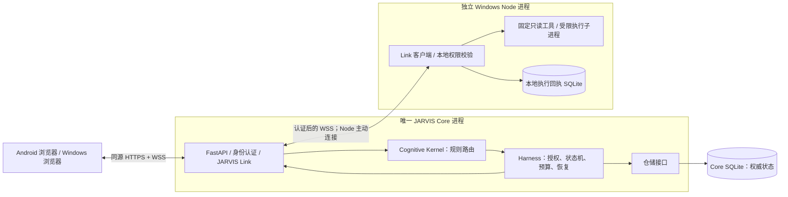
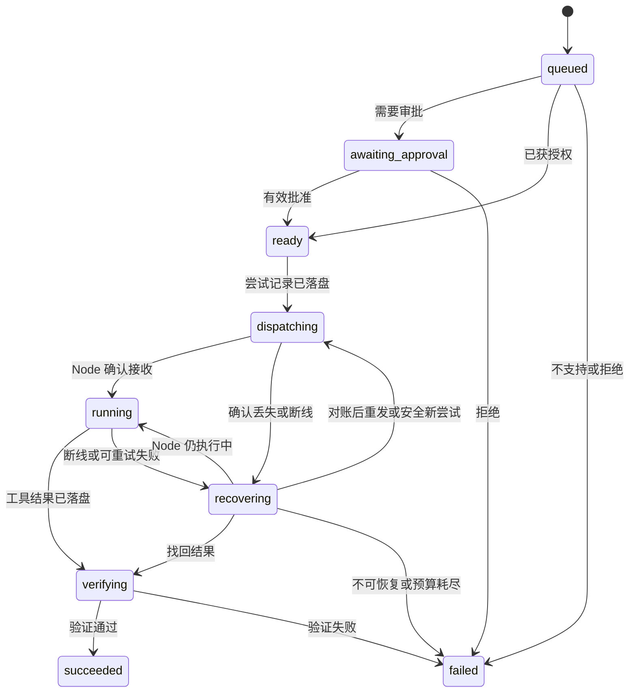

# NEXUS 架构与第一阶段 MVP 技术方案

状态：M1 技术设计，整体方案仍待用户确认；已实现范围与阶段批准见 ROADMAP。日期：2026-10-17。

本文件是唯一架构设计入口，供后续每次开发前完整读取。项目规范见 [AGENTS.md](../AGENTS.md)，阶段批准与任务验收见 [ROADMAP.md](ROADMAP.md)，项目入口见 [README.md](../README.md)。

本文件描述目标架构，不代表所有功能已经实现。当前已交付 S1 工程基础、S2 契约/仓储/权限、S3 独立 Windows Node 与认证 Link，以及 S4/P07 的持久派发、结果验证和历史查询。Core/Node 可独立运行两个固定只读任务；P08–P12 尚未实施，交付和用户验收状态以 [ROADMAP](ROADMAP.md) 为准。当前接口与证据见 [S4 Harness](s4-harness.md)、[S4 验证](S4-VERIFICATION.md)；历史接口见 [存储与安全](storage-security.md)、[Node Runtime](node-runtime.md) 和 [S3 Link](s3-link.md)。设计文档完成不代表后续实施授权。

## 项目愿景

NEXUS 是面向个人、长期运行的统一认知与多身体自主 AI 系统，目标是逐步具备类似 JARVIS 的环境感知、长期记忆、目标管理、任务执行和反馈调整能力。

**One Mind, Many Bodies — 一个大脑，多个身体。** Windows、Android 及未来设备都是同一个 Core 的身体，不各自形成独立人格、目标体系或长期认知存储。设备可进行工具执行、格式处理和回执恢复等必要的本地处理。

长期愿景通过可验证的小里程碑推进。第一阶段产品里程碑记为 M1；ROADMAP 中 S0–S7 是开发子阶段，批准其中某个子阶段不代表批准整个产品里程碑。

## 1. 结论与设计边界

采用一个 Python 单体 Core 服务、一个独立 Windows Node 进程、一个由 Core 托管的静态 Web 客户端。Core 内部分模块，模块间使用函数及类型接口；设备之间使用 JARVIS Link v1。

三个不变量：

1. **一个大脑**：只有 Core 可以创建目标、改变任务权威状态、授予操作权限和写入长期记忆。Node 只接受经过认证和授权的具体命令。
2. **低成本运行**：心跳、任务查询、重连、已知任务路由和恢复全部由确定性代码完成；MVP 不调用任何模型。
3. **可靠自主执行**：先持久化再派发；成功需要匹配当前执行尝试的工具证据及验证；未知执行结果必须显式保留，不能推断成成功或直接重试。

第一阶段只验证可靠执行的基础设施，不宣称已实现通用自主智能。

## 2. 需求中需要澄清或补足的地方

| 问题 | 影响 | 本方案采用的边界 |
| --- | --- | --- |
| 统一认知容易被理解成一个大模型或一个串行循环 | 模型故障会阻塞整个系统，也容易让模型越权 | Core 是状态和权限的唯一权威；模型是可替换计算服务，异步 I/O 不改变权威归属 |
| “断线恢复”没有定义重复与未知结果 | 已执行但回执丢失时，重发可能造成重复操作 | 持久化执行尝试、Node 回执和对账；不承诺分布式 exactly-once |
| “只读”没有限定可读取的数据 | 文件名、环境变量和系统信息也可能泄露隐私 | 按工具、节点、资源别名及字段授权；MVP 不提供任意文件读取 |
| Tailscale 只能解决部分网络问题 | 连上网络的设备仍不应获得执行权限 | 应用级凭证、消息授权、HTTPS/WSS 和撤销能力仍须独立实现 |
| 审批对象与有效期未定义 | 修改参数或目标后可能错误复用旧审批 | 审批绑定任务、工具版本、规范化参数摘要、节点和策略版本，并设置期限 |
| 长期记忆与执行历史没有区分 | 工具输出、推测可能被误当成用户认可的事实 | 执行日志与授权记忆分开存储；记忆需要明确同意，并记录证据与时效 |
| “任务成功”缺少可操作定义 | 容易把模型回答或一个 success 标志当成完成 | 工具特定验证器校验结构、任务归属、约束和证据；声明验证级别 |
| Core 迁移与同时运行两个 Core 未区分 | 两套权威可能重复派发任务 | MVP 只支持停机迁移，禁止活动双主；同一数据目录使用独占进程锁 |
| 全天候运行缺少资源和故障边界 | 队列、日志、重试可能无限增长 | 有界队列、结果大小限制、任务期限、执行次数和模型预算；磁盘写入失败停止派发 |
| 需求同时涉及底座与完整自主系统 | 个人开发容易陷入框架建设 | 先完成一个零模型、单步、只读的真实闭环；规划器和主动工作后续添加 |

这些是建议采用的设计默认值，本轮不需要决定模型厂商、Android 原生技术细节或未来云部署方式。

## 3. 最小部署架构



- Windows 最初同时运行 Core 和 Node，但必须是两个独立进程，可分别重启。
- Harness 和 Cognitive Kernel 是 Core 内的模块，不是额外服务。
- Node 主动连接 Core，不需要对外监听服务端口。浏览器不能直接控制 Node。
- Core 数据库只由 Core 访问。Node 回执只记录命令身份、局部执行阶段及有限结果，不保存长期目标、用户画像或规划。
- 第一版固定单个 Core worker、每个 Node 同时执行一个任务；Core 可同时处理多个网络连接。
- 单例锁绑定规范化数据目录，防止误启动第二实例。它不提供跨主机分布式锁；禁止复制数据库后同时启动两套 Core。
- 将来移动 Core 时，停旧 Core、取得一致备份、迁移数据及身份配置，再让 Node 修改连接地址。移动的是权威数据，不是重新建立一套人格。
- 不引入 Redis、Celery、Kafka、容器编排、向量数据库或独立调度微服务。

FastAPI 支持 WebSocket 依赖认证；其内存连接列表示例也明确仅适用于存活的单进程。NEXUS 因此将任务事实放入数据库，内存只保留可重建的连接与唤醒信号。[FastAPI 官方文档](https://fastapi.tiangolo.com/advanced/websockets/)

## 4. 模块职责与接口

以下是目标接口与职责边界，已实现的 S2 接口和后续接入要求见 [storage-security.md](storage-security.md)。对象都使用明确的类型；跨网络契约使用 Pydantic 模型并拒绝未知字段。

| 模块 | 负责 | 主要接口 | 不负责 |
| --- | --- | --- | --- |
| Core 应用层 | 身份、任务入口、设备登记、历史查询、记忆与控制 API，组装各模块 | `submit(request, principal) -> TaskSnapshot`；`query_tasks(filter, principal)` | 直接执行设备工具 |
| Cognitive Kernel | 对已知意图规则匹配，决定是否需要模型，给出可解释路由建议 | `route(intent, context) -> RoutingDecision` | 审批、授予权限、写任务终态 |
| Harness | 固定计划、策略判定、审批、预算、尝试、派发、验证、取消、恢复 | `advance(task_id)`；`decide_approval(...)`；`request_cancel(...)`；`reconcile(node_id)` | 设备文件操作、让模型修改权限 |
| JARVIS Link | 连接认证、消息解析、会话、心跳、重连、确认和恢复传输 | `dispatch(command)`；`request_attempt_status(...)`；`publish(event)` | 判断任务成功、维护独立业务状态 |
| Node Runtime | 注册能力、检查本地策略、执行固定工具、保存及重传回执 | `execute(AuthorizedCommand) -> ToolResult`；`cancel(attempt_id)`；`status(attempt_id)` | 拆解用户目标、选择 LLM、创建后续任务 |
| Tool Registry | 提供工具名与版本、参数和结果模型、风险级别、重试性质及验证器 | `resolve(tool_name, version) -> ToolSpec` | 自动下载或执行任意插件 |
| Policy Engine | 按身份、工具、参数、资源、节点计算允许、拒绝或待审批 | `evaluate(principal, action, context) -> PolicyVerdict` | 由模型自然语言决定权限 |
| Storage | 事务、任务状态比较更新、事件、身份与记录查询 | `transaction()`；`transition(expected_revision, ...)` | 在数据库事务内等待网络或模型 |

`RoutingDecision` 至少包含：`mode`（rule / decision_model / llm / reject）、`reason_code`、`policy_version`、建议工具及版本、已验证参数；使用模型时才有 `model_id` 和预算估计。路由建议必须经过 Harness 再授权。

预留两个有实际边界的模型接口：

- `DecisionModel.decide(context, budget) -> DecisionAssessment`：可替换的轻量判断器，输出是否需要推理、置信度及候选能力。MVP 不提供真实实现。
- `ModelProvider.estimate(request)` 与 `invoke(request, limits) -> ModelResponse`：屏蔽厂商差异，返回内容、用量、耗时与错误。MVP 使用禁用适配器，任何调用都返回 `MODEL_DISABLED`。

未来模型选择顺序：先检查授权和预算，再匹配能力，再在满足条件的候选中比较估算费用与延迟。没有足够预算、价格上限或合适模型时显式停止，不无限升级模型或重试。模型输出属于未受信建议，不能扩大工具列表、文件范围或预算。

## 5. MVP 的任务与工具

第一版页面提供明确操作按钮，不承诺任意自然语言理解。按钮提交结构化意图，由规则路由成一个固定步骤；未知意图返回 `UNSUPPORTED_TASK`，不自动调用 LLM。

| 意图 | Node 工具 | 参数 | 结果及授权 |
| --- | --- | --- | --- |
| `get_system_info` | `system.info@1` | 空对象 | 仅操作系统名称、版本、架构和 Python 版本；由用户配置的只读授权允许 |
| `list_directory` | `filesystem.list@1` | `root_id`、`limit` | 只列配置资源根的直接条目；首次 MVP 每次任务需要明确审批 |

`root_id` 是 `workspace` 这样的别名，由 Node 本地配置映射为目录。Core 保存允许的别名；Node 不因 Core 发送一个绝对路径就开放访问。默认没有任何文件资源授权，必须在配置中明确指定。

目录工具约束：

- 只访问已配置且启动时校验的本地目录根，不接收任意路径、相对路径、UNC 路径或通配符。
- 不递归、不读取文件正文、不跟随子项的符号链接或 Windows junction/reparse point；配置根或其祖先含重解析跳转时拒绝启用。
- 返回名称与条目类型；链接条目标记为链接并且不读取目标。达到数量或字节上限时返回 `truncated: true`，不声称结果完整。
- 不泄露绝对路径、环境变量、凭证或进程命令行。页面以文本显示条目名，禁止把工具输出直接作为 HTML 渲染。
- Node 以普通用户运行。应用路径检查不构成抵御恶意本机管理员或本地路径竞态的 OS 沙箱；MVP 不执行不受信本地代码，也不开放通用文件读取。未来扩大文件能力前需重新设计句柄级访问边界。

Godot 项目状态检查适合下一项只读工具，本 MVP 先不增加第三种工具。

## 6. 身份、权限与审批

### 6.1 身份和传输

- 首版单用户；分别建立 owner 身份和每个 Node 的独立身份。稳定 `node_id` 与高熵随机令牌分离，令牌可撤销且不能相互替代。
- 通过本地管理命令离线登记节点，不提供开放自助注册。Core 保存随机令牌的摘要；Node 通过环境变量或本地未入库配置获得自己的令牌。
- Node 在 WebSocket 握手使用 Bearer 认证，同时验证 Core TLS 证书；禁止关闭证书校验。身份来自认证连接，不能信任 JSON 自报的 `node_id`。
- 浏览器通过同源 HTTPS 登录换取有时限、可撤销的 HttpOnly / Secure / SameSite 会话 Cookie。浏览器原生 WebSocket 不提供任意 Authorization 请求头接口，因此浏览器与 Python Node 不共用同一种握手方式。[MDN WebSocket 构造器](https://developer.mozilla.org/en-US/docs/Web/API/WebSocket/WebSocket)
- 对浏览器握手和 HTTP 写操作检查允许的 Origin；HTTP 写操作另校验会话关联的 CSRF 令牌。会话过期或凭证撤销时关闭现有连接。所有消息继续执行授权检查。
- 不把长期令牌放在 URL、LocalStorage、示例配置或日志里。不依赖 CORS 自动保护 WebSocket。
- 默认只绑定 localhost；此开发模式允许 HTTP/WS，Cookie Secure 只在该显式本机模式关闭。Android 接入必须显式开启远程模式并提供 Android 信任的 HTTPS/WSS 证书，可由 Uvicorn 直接加载，或由部署层终止 TLS。配置好 TLS 前不开放远程访问。
- LAN 和 Tailscale 都只是连接路径；应用权限检查相同。不自动修改防火墙、证书信任或系统安全设置。

Origin、逐消息授权、过期会话关闭和消息限额是参考 OWASP 建议采用的边界；具体角色与策略是 NEXUS 的设计选择。[OWASP WebSocket 安全指南](https://cheatsheetseries.owasp.org/cheatsheets/WebSocket_Security_Cheat_Sheet.html)

### 6.2 授权模型

有效能力 = Core 已知工具 ∩ owner 授权 ∩ Node 身份许可 ∩ Node 已注册能力 ∩ Node 本地允许范围。

节点声称支持一个工具，并不代表它自动获准执行。审批只能批准本来允许通过人工授权的操作；不能把未实现或硬性禁止的工具变成可用工具。

MVP 将 `system.info` 设为可配置的预授权只读操作，将 `filesystem.list` 设为需要审批的只读操作。后者用真实只读任务验证审批机制，无需先引入危险工具。

审批记录绑定：`approval_id`、`task_id`、owner、目标 `node_id`、工具名及版本、规范化参数 SHA-256、资源/策略版本和到期时间。单个批准只解锁该任务中完全一致的动作，最多允许预算内的只读重试，不允许复用到新任务。参数、节点或策略变化后必须重新评估，必要时重新审批；已派发任务不原地改写动作。

S2 已实现离线身份/授权管理、随机凭证摘要、8 小时浏览器会话（最多 10 个有效会话）、同源会话路由及 HTTP/WS 认证守卫。P06 的 Node Link 已接入 `SecurityHTTP.receive_text`，每秒检查空闲连接的撤销/过期，并在返回每条消息前再次检查。资源范围摘要绑定 `NodeScope.resource_version`，持久授权或身份变化递增全局策略版本。Link 从认证节点、可信工具/资源配置与持久授权交集构建范围；自报能力不能扩大授权。实际 loopback WS 已验证，远程 TLS 尚未实测。

删除重要文件、发送对外消息、支付和修改安全设置目前都没有工具实现，直接拒绝。以后加入时，必须同时具备精确授权、效果验证、幂等/对账策略，不能只增加一个“同意”按钮。

## 7. 任务状态机与执行语义

### 7.1 状态



图仅展示主流程。完整公共规则：

| 条件 | 转移或处理 |
| --- | --- |
| 尚未派发的 queued / awaiting_approval / ready 收到取消 | 立即进入 cancelled，并原子撤销待派发记录 |
| dispatching / running / recovering 收到取消 | 持久化 `cancel_requested`；要求 Node 停止或上报既有结果，收到确认前不假称 cancelled |
| Node 确认已停止且没有已完成结果 | 进入 cancelled，记录执行尝试实际结束阶段 |
| Node 已完成并提交结果 | 按结果验证；取消请求记录为已来不及取消 |
| 结果已持久化并进入 verifying 后收到取消 | 返回 `ALREADY_FINISHED`，完成本地验证 |
| 任何非终态到达总期限 | 进入 timed_out；仍有活动尝试时发送停止请求，并记录结果是否未知 |
| running 返回明确的不可重试错误 | 进入 failed，保留结构化错误 |
| dispatching 直接收到有效结果而确认包缺失 | 可直接进入 verifying，不等待一个已无必要的确认包 |
| 验证前崩溃、重启时已存在有效结果 | 恢复到 verifying，重新运行确定性验证器 |
| 任意终态收到迟到消息 | 只补充审计或对账证据，不倒改终态，不覆盖新尝试 |

终态为 `succeeded / failed / cancelled / timed_out`。任务另有 `execution_outcome = not_started / known / unknown`，避免把“已经超时”误解成“肯定没有执行”。未知结果不会进入 succeeded。

每次转移使用事务及 `revision` 比较更新，避免取消、结果、超时竞争时互相覆盖。任务计划和结果分开保存；终态不可被 Node 自行更改。

### 7.2 尝试、幂等与恢复

任务包含一个步骤，步骤可有至多两次执行尝试；不为单步 MVP 单独建立复杂工作流引擎。尝试记录包含 `attempt_id`、`task_id`、`step_index`、`attempt_no`、节点、参数摘要、派发次数、阶段、期限与结果。

1. Core 在同一事务中保存任务状态、尝试、审计和事件后，才发送命令。尝试表就是最小持久派发队列，无需消息中间件。
2. Node 在执行前持久化该 `attempt_id` 的接收回执及命令摘要，再确认接收。相同 attempt、相同动作仅重传状态或缓存结果；同 ID 不同动作返回 `IDEMPOTENCY_CONFLICT`。
3. Node 父进程在本地记录 started 后启动固定工具子进程；started 与实际开始之间仍可能发生崩溃，恢复时一律视为未知，不假定未执行。子进程由父进程持有及管理，重启后先确认旧执行已结束，无法确认时不新开尝试。
4. Node 完成后先保存有限结果，再回传。Core 持久化结果后回复 `result.ack`；断线时 Node 保留结果并于重连重传。
5. Core 重启或 Node 重连后，按活跃 `attempt_id` 请求状态。已完成则验证；仍运行则等待；确认从未执行或确认旧执行已经结束且工具可安全重跑时，才允许在预算内新建 attempt。
6. 同一命令的网络重传沿用原 attempt，不计作新的执行尝试，但仍有单独派发次数上限。只有 Core 可以创建新 attempt。
7. MVP 只读工具允许安全重跑，但不能保证两次读取产生相同快照；结果包含观测时间。未来具有副作用且结果未知的工具不得自动重试，必须依赖外部幂等键、查询或人工对账。
8. Core 终态已确定后收到迟到结果，返回已结算确认并留审计；不会继续驱动执行。Node 回执在 MVP 中保留，不自动清理尚需对账的记录。

这里实现的是有确认、有去重和可恢复状态的协议，不是无条件“恰好执行一次”。WebSocket 保证连接内的传输顺序，不提供跨重连的应用事务。

### 7.3 成功验证与暂停

- Node 的 success 字段仅是证据之一。Core 校验认证节点、task/attempt 归属、工具版本、命令摘要、结果模型、大小限制及工具特定断言。
- `system.info` 验证必需字段和类型；目录工具验证 root_id 一致、条目/字节限制、无目标内容、截断标记等。单步任务只有当前有效尝试通过验证才 succeeded。
- 验证级别标记为 `node_report_schema_checked`。这不能证明恶意 Node 诚实，也不能证明操作系统底层事实绝对真实；更强的独立外部验证随未来具体工具添加。
- Node 使用受管理的固定工具子进程实施超时和取消；不能仅取消等待线程却让实际工具继续运行。Windows 目标为 Windows 10/11，工具进程纳入设置了 KILL_ON_JOB_CLOSE 的 Job Object，由 Node 独占不可继承的管理句柄；完成纳管前，子进程不得进入工具执行。纳管失败则拒绝执行。Node 崩溃时由 OS 清理工具进程；重启仍须对账，因为清理进程不能撤销已经完成的读取。该机制封装在 Node 内，不给 Core 引入 Windows 依赖。[Microsoft Job Objects 文档](https://learn.microsoft.com/en-us/windows/win32/procthread/job-objects)
- 禁止 shell=True、任意脚本或任意可执行命令入口。Job Object 用于生命周期管理，不被当作不受信代码的安全沙箱。
- 全局 `pause` 持久化，并立即阻止新的派发、重试和模型调用；已在执行的只读任务可完成。紧急停止使用独立的 `cancel_all`，对所有未完成任务发起可审计的取消。
- 取消、暂停、审批与派发通过同一个状态机事务检查；已经发送的命令无法被数据库事务撤回，需要节点停止协议。界面必须区分“停止派发”和“确认停止执行”。
- 数据库不能可靠写入时，Core 不接新任务或继续派发；Node 不能写回执时拒绝执行。

## 8. JARVIS Link v1 协议

P02 已实现本节 25 种消息的数据契约；字段名、严格解析入口、错误映射和字节计算约定见 [protocol-v1.md](protocol-v1.md)。P06 已实现认证连接、心跳、会话替换和重连，详见 [S3 Link](s3-link.md)；P07 已接入持久派发和执行结算，见 [S4 Harness](s4-harness.md)；P08 的网络对账与全局控制尚未实施。

### 8.1 端点和消息信封

HTTP：`/api/v1/session` 用于登录/退出；`/api/v1/tasks` 和 `/api/v1/tasks/{id}` 用于分页历史与详情；`/api/v1/memories` 用于显式授权记忆管理。HTTP 与 WS 共用应用层授权。

WebSocket：`/ws/v1/client` 服务浏览器；`/ws/v1/node` 服务 Node。连接角色决定允许的消息，不使用可伪造的 sender 字段授权。

通用信封：

```json
{
  "protocol_version": 1,
  "type": "task.submit",
  "message_id": "d641f031-65ec-41f4-9933-297ed3856906",
  "correlation_id": null,
  "sent_at": "2026-10-17T08:00:00Z",
  "payload": {
    "request_id": "5d489189-2958-4fb2-a59d-2cba31974d96",
    "intent": "list_directory",
    "arguments": {"root_id": "workspace", "limit": 100}
  }
}
```

- `message_id` 标识一次消息；响应的 `correlation_id` 指向请求消息。
- `request_id` 是业务幂等键；同一 owner 的重连补发沿用它。Core 对 `(owner_id, request_id)` 建唯一约束；相同内容返回原任务，不同内容返回冲突。
- task_id、attempt_id、审批身份及状态由 Core 生成，客户端不能指定或越权修改。
- 所有时间为 UTC RFC 3339；页面按用户本地时区显示。客户端 sent_at 仅供诊断，不作为身份或核心超时依据。
- 信封和 payload 都严格校验；拒绝未知协议主版本、未知消息类型及多余字段。不发送 Python 对象或绝对文件路径。

### 8.2 消息类型

| 方向 | 类型 | 必要负载 |
| --- | --- | --- |
| 浏览器 → Core | `client.sync` | 上次持久 `event_id` 或 null |
| 浏览器 → Core | `task.submit` | request_id、intent、arguments |
| 浏览器 → Core | `task.cancel` | task_id |
| 浏览器 → Core | `approval.decide` | approval_id、approve/reject；审批人由会话确定 |
| 浏览器 → Core | `control.pause / control.resume / control.cancel_all` | request_id；仅 owner 可用 |
| Core → 浏览器 | `client.synced` | 同步边界游标、是否需要完整查询 |
| Core → 浏览器 | `task.accepted` | task_id、当前状态；只承诺任务已入库 |
| Core → 浏览器 | `task.updated` | event_id、task_id、revision、状态、有限结果或错误 |
| Core → 浏览器 | `approval.required` | event_id、approval_id、动作摘要、节点、到期时间 |
| Core → 浏览器 | `control.updated` | event_id、暂停状态及版本 |
| Node → Core | `node.hello` | node_id、节点版本、支持的工具版本和资源别名、当前 boot_id |
| Core → Node | `node.welcome` | session_id、心跳及限额配置 |
| Node → Core | `node.heartbeat` | session_id、活跃 attempt_id；不传任意屏幕或文件数据 |
| Core → Node | `command.execute` | task_id、attempt_id、工具及版本、参数、命令摘要、grant_id、到期时间、执行超时 |
| Node → Core | `command.accepted / command.started` | task_id、attempt_id、命令摘要、boot_id |
| Core → Node | `command.status` | attempt_id |
| Node → Core | `command.status_result` | attempt_id、阶段或 not_found、命令摘要、可用结果 |
| Core → Node | `command.cancel` | attempt_id、原因 |
| Node → Core | `command.cancelled` | attempt_id、实际停止阶段；已完成则返回原结果 |
| Node → Core | `command.result` | task_id、attempt_id、命令摘要、工具版本、观测时间、outcome、result 或 error |
| Core → Node | `result.ack` | attempt_id、stored/already_settled |
| 双向 | `error` | code、有限 message、retryable、关联消息 ID |

完成 node.hello / node.welcome 后，双方运行期消息还携带当前连接的 session_id；只接收当前已认证连接，替换连接时关闭旧会话。持久去重键仍是 attempt_id，不随连接改变。命令摘要覆盖不可变任务动作；会话字段及重传时间不进入动作摘要。

Core 的 grant_id 引用已持久授权；它通过已验证的 Core 连接传给 Node，不是一个可由客户端提交后直接生效的权限令牌。Node 无论如何仍检查本地工具和资源策略。

`command.result` 的 payload 示例：

```json
{
  "session_id": "1716eb9e-78c4-4baa-9a9c-49b47fcde962",
  "task_id": "93e32968-43ba-43dc-9f07-610d672b4884",
  "attempt_id": "6f74fd13-05d2-48dd-ae79-751a900a7d37",
  "command_digest": "aaaaaaaaaaaaaaaaaaaaaaaaaaaaaaaaaaaaaaaaaaaaaaaaaaaaaaaaaaaaaaaa",
  "tool": "filesystem.list",
  "tool_version": 1,
  "observed_at": "2026-10-17T08:00:02Z",
  "outcome": "succeeded",
  "result": {
    "root_id": "workspace",
    "entries": [{"name": "docs", "kind": "directory"}],
    "truncated": false
  }
}
```

### 8.3 重连、流控与错误

- Node 默认 10 秒心跳，30 秒未收到则判离线；这是可用性观测，不直接改变任务为 failed。重连采用 1–30 秒指数退避及抖动，持续重连不调用模型。
- Core 重启后要求 Node 重新认证、重新注册能力并对账。boot_id 改变意味着 Node 进程已重启，不能据此断定旧执行未发生。
- 客户端以持久 event_id 补取事件；事件游标来自 Core 数据库，表示为十进制字符串。按身份过滤事件；基于同步边界回放并接入实时流，按 event_id/revision 去重，避免回放与订阅之间漏事件。
- 游标无效或事件不可用时明确通知完整查询，客户端通过 HTTP 重新取得任务快照。浏览器断开不取消任务。
- 每个连接的发送队列有界；慢客户端被断开后从持久记录恢复，不阻塞调度。一次读取结果必须完整装入受限大小的消息，MVP 不实现文件传输。
- 主要错误码：`AUTH_REQUIRED`、`FORBIDDEN`、`INVALID_MESSAGE`、`PROTOCOL_UNSUPPORTED`、`UNSUPPORTED_TASK`、`POLICY_DENIED`、`APPROVAL_EXPIRED`、`NODE_OFFLINE`、`IDEMPOTENCY_CONFLICT`、`TOOL_TIMEOUT`、`BUDGET_EXCEEDED`、`RESULT_INVALID`、`EXECUTION_UNKNOWN`、`BUSY`、`MODEL_DISABLED`。
- retryable 仅提供故障分类，是否重试由 Harness 同时检查工具性质、回执、剩余预算和期限；错误消息本身不触发自动执行。

## 9. 默认资源预算

以下为待确认的 MVP 默认值，可由可信配置收紧；客户端和模型只能申请更小的值。

| 限额 | 默认值 |
| --- | --- |
| 每任务计划步数 | 1 |
| 每步骤执行尝试数 | 总计 2 次，含首次；只对白名单只读工具开放重试 |
| 每次尝试的命令派发数 | 总计 3 次，含首次；均使用相同 attempt_id |
| 单次工具执行时间 | 10 秒，Node 用单调时钟限时 |
| 接收确认等待 | 5 秒；丢失后对账，不能直接认定未执行 |
| 任务总期限 | 5 分钟，包含等待审批、离线和重试 |
| 审批有效期 | 最多 2 分钟，且不得晚于任务期限 |
| 每 Node 工具并发 | 1 |
| Core 待处理任务数量 | 100，超出返回 BUSY |
| 单身份新任务速率 | 每分钟最多 10 个；连接/消息也设有界速率限制 |
| 单消息 / 工具结果 | 64 KiB / 32 KiB，按编码后字节计算 |
| 目录条目数量 | 最多 200；超限明确截断 |
| 每任务模型调用 / 模型费用 | 0 次 / 0；全局同样禁用模型调用 |

重传、失败和取消不返还已消耗的执行次数。新 attempt 前必须确认旧执行结束或确定未开始；不因计时器到期而并发开第二次。

Core 负责总期限及最终超时判定，Node 执行接收时剩余预算与单次超时中较小的值，并拒绝已过期命令。部署要求基本时钟同步；严重时钟偏差时停止派发并提示校时，不能通过放宽过期校验继续执行。

未来启用模型时，另实现原子预留费用、最大输出 token、调用次数、总费用及全局日额度，失败尝试同样计入。成本记录区分预估、已报告实际值和未知值，不把未知成本记为零。未完成这些验收前不得启用真实 Provider。

## 10. SQLite 与长期记忆

使用 `aiosqlite` 进行异步数据库访问，短事务串行写入，迁移使用有版本的 SQL 文件与 `schema_migrations`。暂不引入 ORM；仓储接口使业务状态机不依赖 SQLite 查询语法，但将来迁移数据库仍需要专门迁移及测试。

Core 概念表：

| 表 | 内容 |
| --- | --- |
| identities / sessions / grants | owner 和 Node 身份、凭证摘要、会话期限及静态授权 |
| projects | 项目标识与元数据，任务可选关联项目 |
| tasks | 意图、固定计划、状态、revision、期限、预算、取消标志及有限结果 |
| task_attempts | 派发、去重、执行阶段、尝试预算、错误与回执 |
| task_events | 持久递增事件和重连游标；任务事实的事件历史 |
| devices | 能力、策略范围、最近心跳、在线观测；重启后在线状态重新确认 |
| approvals | 审批动作绑定、期限、决定及操作者 |
| audit_events | 身份、权限、审批、控制及执行审计；不复制秘密或无限输出 |
| memory_entries | 经明确同意的长期信息及来源、验证和时效 |
| routing_decisions | 路由方式、理由、策略版本、耗时及后续结果关联 |
| model_calls | Provider、模型、预算预留、用量、费用状态、延迟、结果；MVP 无真实调用行 |
| system_state | 全局 pause 状态和配置版本 |
| schema_migrations | 已执行迁移版本 |

Node 单独的 `receipts.sqlite3` 保存 execution_receipts，以及必要的 schema_migrations / node_identity 元数据，不属于长期认知存储。P05 使用专用 Node 身份、模式摘要与 FULL 同步，提供 received/started/结果先落盘、重复 attempt 去重、重启 unknown 和结果恢复；默认容量 10000 条，满后拒绝新执行并保留旧证据。当前只支持初建和同版本重开；后续模式升级须先实现一致备份和前向迁移。Windows Job 的输入门和进程归属双重检查、真实停止确认、独占 Node 数据目录锁及本地限额已在 Windows 11 上验证，详见 [Node Runtime](node-runtime.md) 和 [ADR 0002](decisions/0002-p05-node-execution.md)。

模型调用记录与最终工具验证结果关联，以后分别计算调用可用率和任务验证通过率，不能把模型正常返回等同于任务成功。MVP 仅产生规则路由记录，模型成功率显示“不适用”，不填造零成本调用记录。

关键事务：任务幂等创建；状态与事件/审计同时提交；派发前创建尝试；结果落盘后才确认；审批决定与下一状态同时提交。网络和模型调用均在事务外进行。

启用 WAL、busy_timeout，并在每个连接显式启用外键。数据库位于 Core 本地磁盘，不能放入网络共享目录；WAL 不是跨设备共享数据库的方案。[SQLite WAL](https://www.sqlite.org/wal.html)、[SQLite 外键文档](https://www.sqlite.org/foreignkeys.html)

使用 SQLite 一致备份接口或完全停机后的备份，不在运行时只复制一个 .sqlite3 文件。迁移前备份并校验；第一版只提供向前迁移，失败恢复使用备份，不自动执行破坏性降级。

S2 已实现的表为 `schema_migrations`、`identities`、`tasks`、`task_events`、`audit_events`、`sessions`、`policy_state`、`grants`、`approvals`，仅创建当前任务使用的表。迁移验证版本连续性和脚本摘要；已有数据库升级前通过 SQLite backup 生成唯一备份并执行 quick_check，拒绝无版本旧库或未知新版本。任务仓储只开放派发前状态，不开放写入成功结果的捷径；S4 已通过迁移 003 增加 execution_grants、task_attempts 和任务结果字段，由 Harness 负责执行状态及验证；全局控制留待 P08。离线管理审计以空 actor 表示本地管理入口，subject 单独记录被管理身份，不冒充 Node 发起授权。实现选择见 [ADR 0001](decisions/0001-s2-storage-security.md)。

记忆至少区分以下独立字段：

- `kind = fact / inference / plan`：这是何种陈述。
- `verification = unverified / verified`：是否有足够依据，记录 evidence_ref 与 verified_at；工具输出本身不会自动变成 verified fact。
- `valid_until`、`superseded_at`、`retracted_at`：信息何时过期、被替代或撤销。
- owner、来源、consent_event_id：谁明确允许保存什么内容。

首版提供简单记忆管理 API，只有明确的保存请求才写入，不从聊天或工具结果自动提取。过期信息默认不作为当前事实返回，历史仍可查询。任务执行记录是审计历史，不等于授权个人记忆。

首版不自动清除任务与回执。结果有大小上限，数据库使用量提供观测；达到存储告警或写入失败时停止新执行。长期运行后的归档、保留期和删除策略另行确认，不悄悄删除用户记录。首版日志可轮转，但不会因此删除数据库审计。

## 11. 项目目录结构

下列是预期最终 MVP 结构，不在本轮批量创建空模块。开发时按验收任务逐步增加文件。

```text
NEXUS/
├── pyproject.toml
├── README.md
├── AGENTS.md                       # 每次开发前必读的项目规范
├── .gitignore
├── .env.example                    # 仅变量名和安全占位符
├── config/
│   ├── core.example.toml
│   └── windows-node.example.toml
├── docs/
│   ├── ARCHITECTURE.md              # 唯一架构设计入口
│   ├── ROADMAP.md                   # 唯一开发阶段及验收记录入口
│   ├── protocol-v1.md              # 协议实现时从本设计提取
│   └── decisions/                 # 重要决策逐项记录 ADR
├── src/nexus/
│   ├── contracts/                 # 协议、任务、工具、结果与错误类型
│   ├── core/
│   │   ├── app.py                 # FastAPI 组装、生命周期
│   │   ├── api/                   # HTTP、浏览器 WS、Node WS
│   │   ├── cognitive/             # 规则路由与决策模型接口
│   │   ├── harness/               # 状态机、调度、恢复、验证
│   │   ├── security/              # 身份、策略、审批
│   │   ├── link/                  # 节点会话、消息与事件订阅
│   │   ├── storage/               # 仓储、事务、版本 SQL 迁移
│   │   ├── models/                # Provider 接口及禁用适配器
│   │   └── memory/                # 显式记忆管理
│   ├── node/
│   │   ├── runtime.py
│   │   ├── link.py
│   │   ├── receipts.py
│   │   └── tools/
│   │       ├── registry.py
│   │       ├── system_info.py
│   │       └── list_directory.py
│   ├── web/                       # HTML / CSS / 原生 JavaScript
│   └── settings.py                # TOML + 环境变量及校验
├── tests/
│   ├── unit/
│   ├── integration/
│   └── e2e/
└── var/                           # 数据库、日志、Node 回执，Git 忽略
```

`contracts` 只共享通信/数据契约，不共享认知逻辑。Node 不导入 Core 的 Harness、记忆或模型模块。协议以 JSON 及工具版本定义，使后续 Kotlin Node 无需重写 Core。

配置优先级：指定环境变量 > 指定 TOML > 安全默认值；凭证不得进入 TOML。S3 服务使用严格 CoreConfig / NodeServiceConfig 和有界 TOML 加载器；Core 可覆盖 NEXUS_DATA_DIR/HOST/PORT，Node 可覆盖 NEXUS_NODE_DATA_DIR/CORE_URL，Node 凭证仅由 NEXUS_NODE_TOKEN 环境变量提供。显式 loopback 模式允许 HTTP/WS，远程 Core 必须配置证书和私钥，Node WSS 保留默认 CA 与主机名验证。配置加载不创建目录或数据库；单活 Core 在生命周期中持锁后才初始化存储。P01 的 load_settings 保留给离线身份命令及原有接口，只读取环境变量且只允许 localhost；不自动读取 .env。实际启动及未验证 TLS 边界见 [S3 Link](s3-link.md)。

当前开发依赖为 pytest 与 httpx2；S2 使用标准 `asyncio.run`，未引入 pytest-asyncio。S2 增加架构指定的 aiosqlite 0.22.1；由于现有 Starlette 1.8.0 TestClient 已弃用 httpx，使用 httpx2 2.13.1 替换无代码调用方的旧 httpx 开发依赖，并锁定 httpcore2/truststore；没有升级现有 FastAPI、Starlette、Pydantic。`requirements.lock` 和实际 wheel 已在 Windows / Python 3.13.9 独立环境离线安装验证；构建依赖 `setuptools>=75,<81` 仍为范围约束，Python 3.12 和其他平台尚未实测。

S3 唯一新增安装包为锁定的 websockets 17.1，用作 Node 客户端与 Uvicorn Sans-I/O 后端；其他 24 个包版本不变。Core/Node 共用可移植数据目录锁和有界消息辅助函数，互不导入对方业务模块。连接观测仅保存在可重建内存中，接入/断开写入现有审计；没有为 P06 创建 devices 或 attempt 新表。S3 交付时拒绝网络执行派发，见 [ADR 0003](decisions/0003-s3-authenticated-link.md)。S4 已通过专用 Harness 路径启用持久派发与结果验证；普通 send 控制接口仍禁止执行命令，见 [ADR 0004](decisions/0004-s4-durable-execution.md)。本轮无新依赖。

## 12. 第一版明确不做

- Kotlin Android Node、Android 无障碍控制、手机传感器常驻采集。
- 语音唤醒、全天候录音、屏幕常驻观察。
- Jev 或其他轻量判断模型、真实 LLM Provider 接入、任意自然语言规划。
- 多步骤通用规划、自动创建长期目标、模型自行发起后台工作。
- 任意 shell、Python 代码执行、读写任意文件、修改系统设置。
- 对外消息发送、删除、支付、自动升级自身权限或工具代码。
- Godot 编辑器控制与项目扫描工具。
- 多用户、公开互联网服务、云多租户、活动双主、自动热迁移。
- 向量检索、自动个人画像、未经许可的记忆提取。
- 完整插件市场、分布式队列、通用 DAG 工作流、炫技式多 Agent 框架。

## 13. 重要架构决策与以后演进

确认后在 docs/decisions 中按实现进度拆出 ADR：

1. 唯一 Core + 独立执行 Node，单活部署。
2. SQL 持久任务与事件，Node 本地回执，显式未知结果。
3. 规则先行、模型默认禁用，路由与权限分离。
4. 应用身份认证、资源授权和审批绑定。
5. 单步只读 MVP 与明确的成功验证级别。

后续顺序建议：先添加 Godot 只读检查工具，验证工具扩展成本；再实现真实模型预算和单个 Provider；然后引入受约束多步骤计划与用户目标；最后再开发 Android Node 与主动事件策略。每一步都沿用同一 Core 权威、协议和审计链，而不是再创建一个独立大脑。

MVP 全部验收条件及逐项计划见 [ROADMAP.md](ROADMAP.md)。开始任何开发前，完整读取根目录 AGENTS.md、本文件及 ROADMAP.md，并仅执行用户当前批准的阶段。
