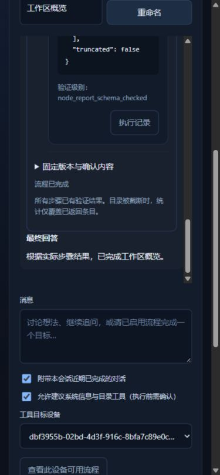

# M5 技术交付与上线验证

日期：2026-10-20。范围为 P25–P28 的实现、受控检查、固定安装包及用户另行明确批准的生产部署；真实模型外发、GitHub 推送和 Android 真机验收不包含在部署批准内。当前批准与剩余工作只更新 [ROADMAP](ROADMAP.md#m5从聊天完成多步任务)。操作见 [M5 说明](m5-chat-skills.md)，脱敏摘要见 [JSON](assets/m5-evidence.json)。

## 交付内容

- 聊天逐次允许发送已启用流程的有限目录；模型只建议一个固定版本，不生成或启用新能力。
- 缺参数时展示表单，重新核对后才能确认。计划绑定版本、参数、依赖批准、设备、策略、范围与期限；旧摘要不能确认新计划。
- 确认、Skill 运行、会话与调用账本关联同事务提交；重复确认返回同一运行，写入失败回滚。执行复用 M4 SkillService 与原 Harness，目录审批继续保留。
- 会话内展示步骤、原任务卡、审批、取消、失败及未知结果；运行期间保持本轮活动，刷新不重新执行。停止回复、取消流程和暂停派发分别操作。
- 仅成功且证据匹配时允许选择步骤、预览白名单结果、逐次同意解读。第二次调用沿用同轮 USD 0.05，失败/未知不能由模型回答掩盖。
- 迁移 013 保留旧请求、会话、工具证据与费用。没有增加依赖、设备工具或长期记忆入口。

## 实际验证

| 层级 | 结果与边界 |
| --- | --- |
| Windows 源码完整回归 | **723 passed，231.69 秒**；Python 3.13.9，警告视为错误，无跳过 |
| M5 定向行为与迁移 | Windows **27 passed，17.28 秒**；未同意/未知版本拒绝、参数先验、旧摘要失效、重复确认、事务回滚、权限变化、暂停/取消、未知结果、原预算与三步组合 |
| Linux Core 定向 | 既有 WSL Ubuntu / Python 3.12.15，**27 passed，48.17 秒**；只在项目临时目录运行，不修改现有服务或权限。此处第三步使用受控沙箱替身，不重复宣称真实隔离已验收 |
| Windows 独立进程 | Core 与 Windows Node 分离；真实系统信息与合成目录，目录审批前 attempt=0；Core 在待审批处重启后沿用运行与两个任务；最终各 1 次 attempt；真实 SSE 解析器连接本地合成传输后完成解读，真实模型调用为 0 |
| 迁移与历史 | 非空 schema 012→013 的所有原表、旧字段与旧行逐项一致；升级前备份仍为 012，quick_check/外键检查通过，旧 unknown 费用继续保留 USD 0.05 预留；原 006/010 升级回归也通过 |
| 安装包隔离加载 | 固定 wheel 的 108 个运行文件与源码逐字节一致；以 `python -I`、关闭源码 pythonpath、固定解包路径运行相关 **149 passed，64.37 秒**；68 个已加载 NEXUS 模块全部来自包，子进程同样指定包路径。复用原锁定依赖环境，未新建全新依赖安装环境 |
| 浏览器与键盘 | Codex 内置浏览器，1280×900 和 390×844；scrollWidth 分别 1265/375，无横向溢出；目录预览、缺参数、键盘填写/Tab、重新核对、确认、目录审批、结果选择及最终回答通过；另一次取消在目录未批准时结算，刷新显示已取消且完成步骤保留；错误/警告日志 0 |

浏览器测试的两次流程分别成功和取消，合计 4 项任务、3 次实际工具尝试、3 次合成模型交换；刷新没有增加运行或尝试。真实模型费用为零，界面中的调用费用是合成 usage 按现行价格计算的测试账本值。



## 固定包与改动范围

安装包为工作区 `var/m5-dist/nexus-0.1.0-py3-none-any.whl`，SHA-256：

```text
42f51704fd8fe1d8acb19a98f18608b6f9598526351974fefb94aa483663592a
```

与已发布 M4 包 `6f4a88b8…3270b34` 比对：原 105 个运行文件中只有本次 M5 涉及的 11 个文件变化，另外新增流程衔接模块、迁移 013、流程前端共 3 个文件。其余 M4 运行文件完全相同；原有未提交改动保留，未提交 Git 或推送。生产升级另按下节记录。

复现源码检查：显式选择已有 Git OpenSSL 后运行 `python -B -m pytest -q -W error -p no:cacheprovider`。M5 定向模块为 `test_chat_skills.py`、`test_chat_skill_migration.py`，独立进程为 `test_chat_skill_processes.py`。原始受控测试目录位于 Git 忽略的 `var/m5-*`，不将数据库、凭证或私有日志上传到文档。

## 中间失败与限制

首次受限环境不能创建 Windows asyncio socket pair；改在允许本机通信的受控环境执行。系统默认 Anaconda OpenSSL 不能生成测试证书，显式改用既有 Git OpenSSL，没有修改系统信任。新 UUID 建议曾被严格 Python 模式拒绝，已改为严格 JSON 解析后重跑通过。旧迁移断言按新增可空字段更新，旧字段的完整保留断言未削弱。

一次完整回归中，原有强制停止后的 SQLite 备份出现 disk I/O error；原库检查和独立备份均正常，原测试单独重跑通过，最终完整 723 项通过。保留该环境现象，没有增加重试去吞掉错误。wheel 构建首次受沙箱临时目录权限限制，改用项目内临时目录完成离线构建。

## 获批生产部署

用户明确批准上述固定包后，云端 Ubuntu / Python 3.12.3 在独立发布目录离线安装，复用原锁定依赖；`pip check`、25 个依赖版本和 108 个运行时文件逐字节核对通过。适用 Linux 的两份 M5 Core/迁移测试 **27 passed，10.60 秒**，模型环境变量从测试进程中移除，调用均为合成响应。首次验证脚本额外选入仅适用 Windows 的进程测试，因 `CREATE_NO_WINDOW` 在 Linux 不存在而失败；修正验证选择后重跑通过，固定包未改动。

暂停新派发并确认任务、模型、聊天、扩展测试、Skill 与沙箱无活动/未知执行后，停止唯一 Core，取得 SQLite API 一致备份。迁移 012→013 后，所有旧表的原字段和全部行逐一比对一致，`quick_check` 与外键检查通过。第一次 systemd 覆盖文件 `100-…` 被字典序在后的原 `90-…` 覆盖，启动路径核对失败，脚本立即恢复 schema 012 和原 M4 服务；核对完整性及历史数量后改为 `99-m5-release.conf`，重新备份、迁移、切换成功，未丢失数据或增加调用。

最终记录时点为北京时间 2026-10-20 12:50 后：

| 项目 | 实际结果 |
| --- | --- |
| 固定版本 | `/opt/nexus/releases/m5-20261020/venv`，SHA-256 与上述批准包相同，schema 013 |
| 唯一 Core | systemd active，PID 3333967；`/proc` 检查只有一个 `nexus.core` |
| 升级前一致备份 | `/var/backups/nexus/before-m5-20261020T045054Z`；数据库 SHA-256 `d3f26a5de3ff8e9f3c5d597db263c85da3b8eba665d4a432e618b6c627b64c4e`，仅保存在云端 |
| 历史 | 19 任务、12 会话、22 轮、3 个身份和 4 个授权保留；全部旧表原字段及 API 历史摘要一致 |
| 账本 | 29 次历史模型调用，费用上界 9643 microunits，未知费用 0；升级前后完全一致，本轮真实调用 0 |
| 原配置 | Core 配置与模型密钥文件摘要不变，身份、预算、权限及目录范围不扩大 |
| 连接与页面 | 正常 TLS 校验通过；线上 `chat-skills.js` 与批准源码摘要相同；目录查询成功；原 Windows Node 在线、两工具/单 workspace 范围一致，原 WSL Sandbox 可用 |
| 原暂停状态 | 升级前未暂停，验证后恢复为未暂停；再次核对历史和账本一致 |
| 可用流程 | 当前符合条件的已批准且启用 Skill 为 0，目录为空；未自动生成、批准或启用版本 |

无秘密操作证据保存在 Git 忽略的 `var/m5-deployment/`。不下载云端数据库、生产配置或模型密钥；本次上线检查没有真实模型或沙箱任务调用。后续发生新费用后，不能直接恢复上述备份而丢失新账本。

尚未完成：具体 Skill 的用户批准与启用、M5 对真实 DeepSeek 的逐次外发验收、M5 与真实 runsc 第三步的新端到端组合、Android 真机操作、GitHub 发布及最终用户验收。M4 的既有真实隔离与三步证据继续有效，但不将其冒充 M5 新版端到端证据。真实模型验收需明确实际外发内容与调用上限。没有因本次交付自动进入 M6。
