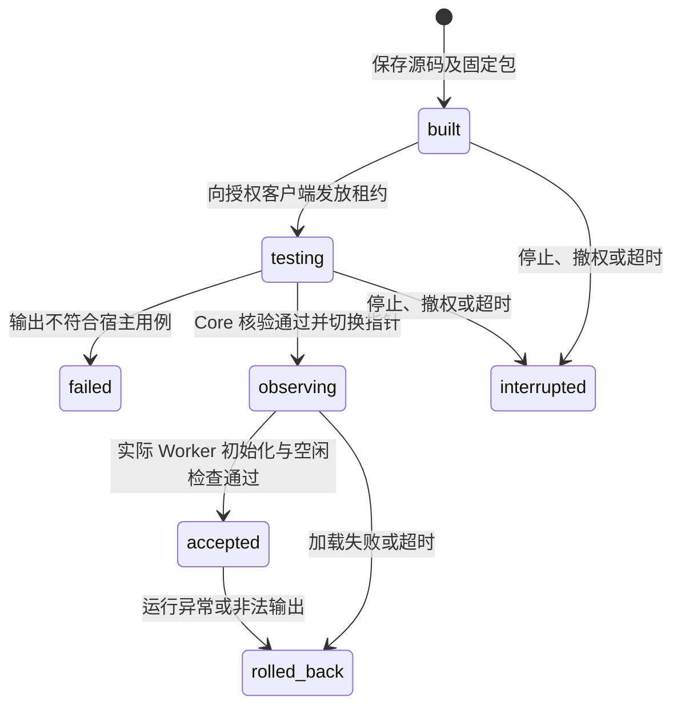

# 可视化插件自主开发与手势控制

本功能让 NEXUS 在聊天中编写和更新可视化插件，复用现有 Three.js 场景。Core 保存候选、测试结果和当前版本；网页或 Windows 客户端负责隔离执行、场景控制和本地手部识别。批准范围、交付版本和验收状态以 [P90 路线图](ROADMAP.md#p90-extension-evolution) 为准。

## 使用

1. 打开或创建会话，在顶部工具菜单（⋯）中选择“手势”，点击“允许 NEXUS 为本会话开发和升级”。授权绑定本会话、当前客户端和 `user.gesture_control`，可以随时停用。
2. 在聊天中要求 NEXUS 开发或修改手势插件。NEXUS 先检查契约和旧版源码，提交固定新版本，等待客户端验证及加载回执；失败结果回到同一工具循环，模型可修正后再提交新版本。保持已授权客户端在线。
3. 版本就绪后，在动态视图的“手势”面板选择摄像头，再点击“开启摄像头手势”。存在手机投屏、OBS 等虚拟摄像头时，选择实际需要的设备。客户端记住选择，所选设备不可用时提示重新选择，不自动切到其他摄像头。单手捏合移动旋转；双手捏合拉开缩放；短暂静止捏合后松开选择；双手张开复位。点击顶部“停止手势”关闭摄像头。

摄像头不随授权、升级或重启自动开启。切换会话、退出动态视图、页面隐藏、暂停或连接失效时停止采集。浏览器需要可信 HTTPS 或本机地址；Windows 通过 WebView2 使用系统摄像头许可。识别使用随包 MediaPipe 模型，原始画面和关键点不上传 Core，也不发给模型。Core 接收插件源码和合成测试输出。

## 统一插件管理

网页 App 和 Windows 的“插件”列表同时展示工具插件与自写可视化插件。可视化条目按所属会话分开，显示当前和最新版本；点击“版本、启停与历史”查看固定摘要、独立测试、客户端加载、升级基线及回退原因。停用后记录仍可查看。

“停用插件”撤销原会话开发升级策略并卸载当前版本，保留源码与历史；重新启用时必须明确选择已通过测试、状态仍为 accepted 的版本。管理页保留原授权客户端和插件名，不会将插件迁移到当前浏览器；需要原客户端在线。归档、计划模式、全局暂停和插件总开关仍限制启用。已失败或已回退的版本不能直接启用。

启停绑定策略修订、部署修订、版本及摘要；状态变化后旧操作被拒绝并重新读取。选定版本后仍等待原客户端加载回执，界面区分“已启用，等待加载”和“客户端已加载”。策略改变会停止摄像头，重新启用不会自动采集。

迁移038新增独立历史事件，构建、测试发布、加载、启停和自动回退与权威状态在同一事务落盘。旧版本不改写，只生成标为“历史版本记录（升级前快照）”的记录，使用旧记录更新时间，不推定过去每次操作的准确时刻。版本与事件分页读取，每页50条。

## 开发契约

聊天工具 `inspect_ui_extension({})` 返回本会话授权、当前源码、版本和可信宿主定义的行为用例。`submit_ui_extension` 参数为：

```json
{
  "plugin_id": "user.gesture_control",
  "version": "1.0.1",
  "name": "手势控制",
  "base_version_id": null,
  "source": "function update(frame, state) { return { commands: [], state: {} }; }"
}
```

上面的空实现只说明首次提交的函数形状，不能通过手势验收用例。源码至多 20,000 UTF-8 字节，不包含构建脚本、路径、远程依赖或宿主入口。版本不可覆盖；升级时 `base_version_id` 必须填写检查到的当前版本 UUID，避免并发覆盖。

`visualization-worker-v1` 的 `update(frame, state)` 同步返回指令数组和对象状态，状态至多 4 KiB，每帧至多 4 条指令。`frame.time_ms` 为单调毫秒时间；`hands` 最多两项，包含镜像归一化的 `x/y`、`pinch`、`open` 和 21 个 `{x,y,z}` 关键点。合成用例的 `landmarks` 为空数组。失去追踪后应清空手势状态。

| 指令 | 参数 | 宿主处理 |
| --- | --- | --- |
| `rotate` | `dx,dy`，有限数值 −200 至 200 | 调用既有旋转接口 |
| `zoom` | `delta`，有限数值 −200 至 200 | 负数拉近，正数拉远 |
| `select` | `x,y`，0 至 1 | 转换成可视化画布坐标后射线选择 |
| `reset` | 无 | 恢复场景视点 |

## 构建、验证与回退

Core 将源码、版本、运行时与宿主用例摘要封装为规范 JSON，并计算 SHA-256；构建不执行候选。迁移 037 保存策略、不可变版本、执行租约与客户端记录。客户端加载时重新核对摘要。



可信客户端在隔离环境中运行空闲、旋转、缩放、选择和复位五组序列，提交实际输出。Core 使用自己的用例判断，通过前保留旧版本。插件自己返回 `success` 或模型自述不能激活版本。测试后还必须收到真实客户端的运行准备回执，工具步骤才成功；这些证据不等于真人摄像头体验验收。

租约绑定 owner、会话、客户端、候选版本和包摘要；授权在提交、测试、切换与首次加载确认时重新检查。重复相同测试回执不会重新测试或二次升级；不一致回执拒绝。测试或加载超时为 30 秒，Worker 单帧超时 500 毫秒，宿主另有等待保护。重启只核对持久记录，不把未知测试重跑为成功。

运行失败按当前版本和部署修订号比较后回退。仅恢复同会话仍为 accepted 的基线；首次安装失败或基线已失效时停用。迟到回执不能撤销后续升级。撤销策略或改变目标会中断候选；停用后不恢复旧插件。回退只切换插件指针，不恢复旧数据库、权限、调用账本或已发生的视点操作。

## 权限和隔离

普通模式也可在 owner 主动设置的上述会话策略内自动发布合格新版本；仍需有效 standard 工作授权，保留计划模式、全局暂停、用户停止、身份和作用域检查。模型不能设置此策略、打开摄像头或扩大能力。现有 Python 插件的 runsc 测试、normal/full 审批规则独立保留。

生成代码只运行于 opaque origin 的沙箱 iframe 内部 Worker。iframe 只有 `allow-scripts`；其 CSP 仅放行固定引导脚本摘要和 Blob Worker，禁止网络、脚本导入和 eval。候选无法接触父页面 DOM、凭据、原生桥或持久存储。可信父页面校验每条指令和数值范围，负责超时终止与回执；识别 Worker 与候选 Worker 分开。浏览器 Worker 提供终止和权限隔离，不宣称操作系统级内存配额或任意恶意代码的资源安全证明。

这里提供的是可视化插件闭环。需要新的宿主接口、任意页面功能、Core/Node 源码修改或主程序发布时，仍属于 [ADR 0035](decisions/0035-scoped-self-iteration.md) 的独立源码发布范围；本功能不把 M9 全部任务标为完成。

## 客户端接口

前缀为 `/api/v1/ui-extensions/conversations/{conversation_id}`，全部要求 owner 会话认证，写请求要求允许的 Origin 和 CSRF。

| 方法与路径 | 内容 |
| --- | --- |
| `GET` 前缀 | 策略、当前源码、最近版本、开发契约与宿主用例 |
| `PUT /policy` | `expected_revision,enabled,client_id,plugin_id,profile`；仅支持 `gesture_navigation_v1` |
| `POST /poll` | `client_id,runtime,platform`；心跳、一个待测租约、当前部署和最近版本状态 |
| `POST /versions/{version_id}/test-report` | `lease_id,client_id,bundle_digest,outputs,error`；独立测试实际输出 |
| `POST /runtime-report` | `client_id,version_id,deployment_revision,bundle_digest,status,error`；`ready` 或 `failed` |
| `GET /management` | 原会话/客户端策略、当前版本、版本与事件；`before_version`、`before_event` 为返回的分页游标 |
| `POST /decision` | owner 的 `action=enable/disable`、`expected_revision`、`expected_deployment_revision`、`version_id`、`bundle_digest` |

`GET /api/v1/plugins` 保留原 `plugins` 工具插件数组，另返回 `ui_plugins` 摘要供同一管理列表展示；原工具执行器和旧客户端不把可视化代码当作 Python 工具加载。管理写接口不向模型工具目录开放。

同一轮开发仅按原有工作操作机制审计一次构建操作。心跳、核验、恢复和回退不调用 LLM。累计调用/金额额度开关保持原配置，不新增累计轮次上限；保留单请求、状态、存储容量和超时边界。

## 构建资源与验证

固定依赖为 `@mediapipe/tasks-vision@1.1.1` 和 Hand Landmarker float16 模型版本 1。[锁定记录](../config/ui-extension/mediapipe.lock.json)包含 npm SHA-512、各文件 SHA-256 和下载来源；Apache 许可证随包保存。[Google 官方指南](https://developers.google.com/edge/mediapipe/solutions/vision/hand_landmarker/web_js)说明接口及视频检测线程使用方式。

修改可信隔离引导脚本或共享前端后运行：

```powershell
.venv/Scripts/python.exe config/ui-extension/build_assets.py
```

该命令校验已下载资源，生成带精确 CSP 摘要的隔离 HTML，并同步网页/Windows 共享模块。没有运行时 CDN 请求；Python wheel 和 Windows 安装包均包含运行库、WASM 与模型。依赖更新需更新锁定记录并重新做浏览器及原生 WebView2 验证。

测试入口为 `tests/test_ui_extensions.py`、`tests/test_ui_extension_browser.py` 和 `tests/ui_extensions_native.cjs`。模型采用脚本替身；浏览器采用虚拟摄像头，另用 Google 官方示例图验证真实模型输出 2×21 个关键点。测试图来源为 [MediaPipe 示例](https://github.com/google-ai-edge/mediapipe-samples/blob/main/examples/hand_landmarker/python/hand_landmarker.ipynb)，下载文件仅放本地验证目录。最终测试数、固定包摘要、实际发布与未验收内容只记录在 ROADMAP。
